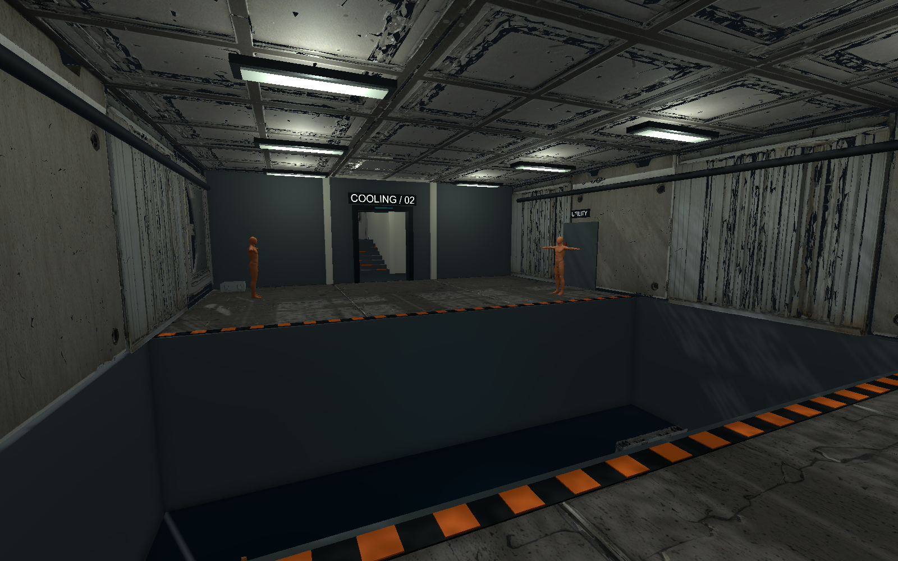

오늘은 오전에 NCAI 수업에서 블렌더 머티리얼을 배웠고([수업 메모]({{ '/posts/261102_ncai/' | relative_url }})), 오후에는 작업 환경과 팀 프로젝트 「다녀왔어: 층계참 식당」의 기획 할 일을 정리했다. 저녁에는 개인 프로젝트 「After Seconds」의 첫 층을 구성했다. 폴더 경로를 확인하는 일과 **끝났다고 판단할 기준을 정하는 일**이 하루 동안 여러 번 이어졌다.

## 폴더 이름만 바꿨는데

프로젝트 폴더가 늘어나서 앞에 `01.`, `02.`처럼 번호를 붙여 정리했다. 탐색기에서는 순서대로 보여서 깔끔했는데, 확인해 보니 생각보다 많은 곳이 예전 이름을 가리키고 있었다.

- **Unity Hub 프로젝트 목록:** Hub는 프로젝트의 전체 경로를 기억한다. 폴더 이름이 바뀌니 목록에서 프로젝트를 찾지 못했다.
- **도구 설정 파일:** 작업용 도구의 "신뢰하는 폴더" 목록도 전체 경로로 적혀 있었다.
- **패키지 연결 폴더:** 블로그 도구 폴더 안에는 실제 파일 대신 다른 위치를 가리키는 연결(정션)이 여러 개 있었다. 이것도 예전 경로를 가리켜서 다시 연결해야 했다.

반대로 Unity 프로젝트 **안쪽**의 참조는 문제가 없었다. 에셋끼리는 상대 경로와 GUID로 서로를 찾기 때문이다. 그래서 끊기는 것은 프로젝트 **바깥에서 전체 경로로 가리키는 것들**이라고 정리할 수 있었다.

번호를 다시 빼는 것도 생각했다. 그런데 번호를 빼도 다시 한 번 이름을 바꾸는 것이라 같은 수정을 또 해야 한다. 그래서 번호는 유지하고 바꾼 경로와 수정 전 설정을 기록으로 남겼다. Windows 경로 길이 제한(260자)도 확인했는데, 넘는 경로는 모두 Unity가 다시 만드는 `Library` 폴더 안에만 있었다.

블렌더 파일도 옮기면서 열어 확인했다. 메시와 재질은 괜찮았고, 블렌더 설치 폴더의 기본 노드를 연결해 쓰던 자동 스무딩만 끊겨 있었다. 이건 다시 적용하면 되는 문제라 직접 고치기로 했다.

## 처음 받는 사람은 폴더부터 막힌다

팀원에게 Git으로 프로젝트를 받는 방법을 알려 줘야 하나 고민했다. 안내 문서에는 `git clone` 명령어만 한 줄 있었다. 그런데 처음 받는 사람은 그 전 단계에서 막힐 수 있다. **폴더를 먼저 만들어야 하는지**부터 모르기 때문이다.

`git clone`은 저장소 이름으로 폴더를 직접 만든다. 이걸 모르면 폴더를 먼저 만들고 그 안에서 받아서 폴더가 두 겹이 되거나, ZIP으로 내려받아서 Git과 연결되지 않은 복사본을 쓰게 된다. 나한테는 당연한 단계가 처음 하는 사람에게는 가장 막히는 단계라는 걸 다시 느꼈다.

## 팀 브랜치 맞추기

팀원의 PR이 main에 병합되어서 로컬 main을 최신으로 받고, 역할 브랜치(백엔드·프론트엔드·아트)도 main과 같은 커밋으로 맞췄다. 각 브랜치에 아직 올리지 않은 작업이 없는지 먼저 확인했고, 덮어쓰지 않고 앞으로만 당기는 방식으로 옮겼다. 로컬에 남아 있던 설정 파일 변경은 바로 지우지 않고 잠시 보관했다가, 받아 온 내용과 같은 것을 확인한 뒤에 정리했다.

## 순서와 완료 기준으로 일을 나누기

오후에는 팀 노션의 작업 보드에서 내 기획 할 일을 정리했다. 우리 팀 보드는 마감일 대신 **순위와 선행 조건**으로 일을 나눈다. 정리해 보니 기획 1번이 다른 팀원 작업의 출발점이었다. 첫 플레이를 어디까지로 볼지, 언제 됐다고 할지를 내가 먼저 정해야 개발자들이 그 기준에 맞춰 만들 수 있다.

그래서 1번 카드에 첫 플레이의 범위를 적었다. 포함할 것과 뒤로 미룰 것을 나누고, 단계마다 "다음 단계로 넘어가는 조건"을 적었다. 확인표도 두 개로 나눴다.

- **성공 확인표:** 정상적으로 플레이했을 때 보여야 하는 결과
- **예외 확인표:** 같은 버튼을 여러 번 누르거나, 다른 대상에게 주거나, 중간에 게임을 끄는 경우

예외 표를 쓰면서 기획서의 규칙을 다시 읽게 됐다. 예를 들어 "재료가 부족하면 어떻게 되는가"는 정상 흐름만 보면 떠오르지 않는다. 그런데 테스트하는 사람은 가장 먼저 확인하는 부분이다. **예외를 적어 보면 아직 정하지 않은 결정이 드러난다.** 정하지 못한 것들은 따로 모아 팀 검토 목록으로 남겼다.

## 결과는 일이 있는 곳에 적는다

처음에는 이 내용을 Git 저장소에 문서 파일로 만들었다. 그런데 작업 카드마다 결과를 적으라고 페이지를 만들어 둔 상태였다. 결과가 다른 곳에 있으면 카드를 연 사람은 내용을 찾을 수 없다. 그래서 카드 본문으로 옮겼다. 할 일과 그 결과가 한곳에 있어야 다음 사람이 바로 이어서 쓸 수 있다.

카드에 옮긴 뒤 다시 읽어 보니 빠진 단계도 보였다. 게임을 처음 시작하면 튜토리얼이 실행되는데, 이 단계가 흐름표에 따로 없었다. 튜토리얼 씬을 쓰는 첫 손님 단계에 묻혀 있었다. 첫 시작에서 튜토리얼이 실행되는 단계를 따로 한 줄로 넣었다. 단계가 표에 한 줄로 있어야 그 단계가 끝났는지도 확인할 수 있다.

## 건물 전체보다 B5층부터

저녁에는 After Seconds의 레벨 제작을 시작했다. 이미 만들어 둔 VARCO 에셋을 쓰되, 건물 전체를 한꺼번에 만드는 대신 **층마다 별도 씬을 두고 B5층 하나부터 확인**하기로 했다. 첫 층에는 격리실과 냉각조를 넣고, 두 공간을 잇는 통로와 다음 층으로 올라가는 계단 입구까지만 구성했다.

방의 모양을 예쁘게 만드는 것보다 먼저 지켜야 할 배치도 있었다. 감방에서 냉각조 건너편 경비가 바로 보이면 앞의 두 방을 건너뛰게 된다. 그래서 연결 통로를 두 번 꺾어 시야를 막았다. 냉각조 양옆에도 걸어서 건널 수 있는 길을 만들지 않았다. 벽과 바닥의 **보이는 모델과 실제 충돌체를 분리**하니, 생성 모델의 돌출된 부분이 의도하지 않은 발판이 되는 것을 막으며 외형을 바꿀 수 있었다.

기존 이동·걷기를 확인하던 SampleScene은 보존하고, 기존 플레이어·카메라 구성을 새 씬에 복제했다. 공간을 늘리는 동안 이전에 확인한 것까지 같이 바뀌면, 문제가 생겼을 때 무엇이 원인인지 찾기 어려울 것 같았다.

## 검수한 범위를 정확히 적기

준비된 환경 모델을 확인하니 각 모델이 50만 삼각형이었다. 벽과 바닥은 여러 번 반복해서 쓰기 때문에 원본을 그대로 배치하기에는 부담이 컸다. 원본은 보존하고, 쓸 모델 8종을 블렌더에서 정리했다. 8종을 합친 메시 수치는 400만에서 8만 4천 삼각형으로 줄었고, 텍스처는 최대 2K로 맞췄다. 이 수치는 이번 배치를 위한 준비 결과이지 최종 성능 기준을 정한 것은 아니다.

편집 상태의 참조·배치 검수 25개와 Play 상태의 이동·충돌 검수 9개는 통과했다. 시작 지점의 접지, 철창 통과 차단, 통로 이동, 냉각조 가장자리 낙하, 계단 이동을 확인했다. 다만 사격과 교환 기능이 아직 없어서 감방을 빠져나오거나 냉각조를 건너는 과정은 정상 플레이로 검증할 수 없다. 그 뒤 구역의 이동 검수는 위치를 옮겨 따로 진행한 것으로 기록했다.

렌더를 보니 천장에는 검은 삼각형과 갈라져 보이는 면도 남아 있었다. 메시를 줄이는 과정, 노멀맵, 크기 변환을 비교해 봐야 하고 아직 원인은 정하지 못했다. **기능 검수 통과와 외형 품질 확인은 각각 적어야 한다**는 걸 배웠다. 숫자가 채워졌다고 모든 항목이 끝난 것으로 쓰면 다음 작업에서 다시 헷갈린다.

_B5 냉각조 초안. 기존 모델을 배치하고 이동·충돌을 확인한 상태이며, 천장 면의 외형 보정은 남아 있다._

## 비어 보이는 프로젝트와 실제 파일

레벨을 만든 뒤에는 프로젝트가 이상해 보이는 일도 있었다. 확인해 보니 Unity Hub가 예전 폴더 경로를 기억하고 있었다. 그 경로에는 빈 Assets 폴더와 과거 캐시가 남아 있었고, 실제 코드와 두 씬은 다른 정식 경로에 그대로 있었다. 올바른 프로젝트를 다시 등록해 열자 B5 씬을 확인할 수 있었고 Console 오류와 경고도 없었다.

앞서 폴더 이름을 바꾸며 확인한 일이 저녁에도 반복됐다. 화면에 파일이 안 보이면 파일을 다시 만들거나 복사하기 전에 **지금 어느 프로젝트 경로를 열었는지**부터 확인해야겠다. 기존 추적 파일도 비교해 보니 갱신한 문서 3개를 제외한 282개는 그대로였다.

내일은 팀 프로젝트에서 남은 첫날 진행 결정을 정리하고, After Seconds에서는 천장 외형 문제를 원본과 비교할 생각이다. 그다음 사격·교환·경비·문 규칙을 의사코드부터 구현해 B5를 실제로 통과하는 흐름을 확인해야 한다. 다음 층은 그 뒤에 만들기로 했다.
