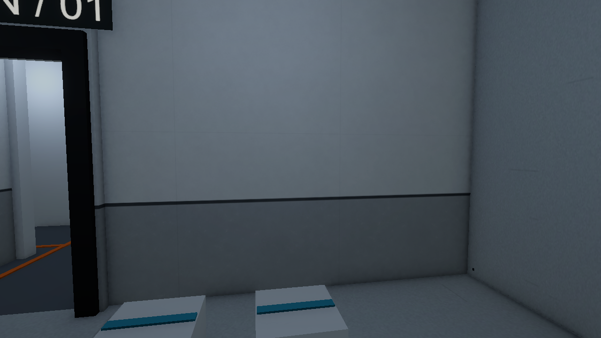
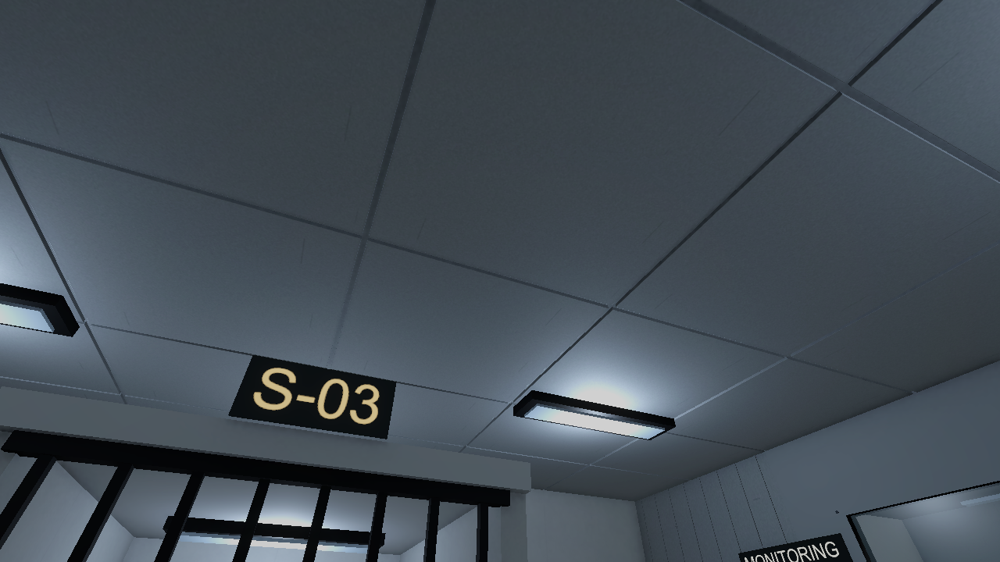

오늘은 층별 공간과 환경 에셋을 정리하는 쪽으로 진행함\
모델을 가져오는 것까지는 됐는데, 실제 레벨에 놓고 보니 깨진 면과 겹치는 벽이 눈에 들어왔음

예쁜 모델 하나를 만드는 것과\
게임 공간에 문제없이 반복해서 쓰는 건 조금 다른 작업인 듯

## 층별 에셋 반입

B5부터 1F까지 6개 층의 초안 씬을 정리함\
추가 설비 6종은 10개, 환경·프랍 20종은 60개 시각 인스턴스로 배치한 상태

배관, 환기구, 수납장, 시료 용기, 냉동고, 실험 카트, 화물 검색기 같은 시설용 물건을 넣어 봄\
현재는 외형 배치 단계이고 각 물건의 상호작용까지 연결한 건 아님

## 구멍이 난 모델 다시 확인

기존 에셋 일부는 면이 찢어지거나 구멍이 많이 난 것처럼 보였음\
원본과 감량본을 비교해 보니 고해상도 원본보다 기존 감량본에 열린 경계가 크게 늘어나 있었음

UV나 노멀 때문에 같은 위치에 나뉜 버텍스를 먼저 용접하고\
그 상태에서 다시 감량한 뒤 관통하는 부위를 정리함

폴리곤 수를 처음부터 무조건 작게 잡는 것보다\
원형을 남길 수 있는 고해상도 모델에서 시작해 줄이는 편이 확인하기 좋았음

천장 패널은 8천 삼각형으로 줄였을 때 관통이 많이 생겨 목표를 올렸음\
낮은 숫자 자체가 최적화 완료를 뜻하지는 않는다는 걸 다시 확인함

벽·바닥처럼 정확히 맞물려야 하는 6종은 건축 모듈로 재제작함\
볼트 구멍이 밖까지 뚫리는 문제와 불규칙한 외곽을 줄이고, 관찰창 유리는 창틀과 분리함

## 폴더 구조도 단순하게

반입 경로마다 폴더를 만들다 보니 모델을 찾는 단계부터 복잡해졌음\
지금은 아래 구조로 정리함

```text
05.Model/
  Player/
  Enemy/
  Props/
    Common/
    B5/ ... 1F/
  Environment/
    Common/
    B5/ ... 1F/
```

모델·프리팹·메시는 해당 폴더에 바로 두고\
머티리얼과 텍스처만 하위 폴더로 나눔

공용 상자나 여러 층에서 쓰는 설비는 Common에서 같이 참조하도록 함\
414개 파일을 옮기는 동안 GUID와 씬·프리팹 참조를 확인했고, 머티리얼은 추가 복제하지 않음

## 일반 벽의 텍스처 매핑

일반 벽은 색만 들어가 있어 프랍의 표면에 비해 너무 밋밋했음\
콘크리트와 보호 도장의 BaseColor·Normal·Mask를 만들고 미터 기준 UV를 적용함

벽 길이가 달라도 질감 크기와 도장 높이가 같게 보이도록 맞춤\
공용 머티리얼은 1개를 사용하고, 금속도·AO·매끄러움은 한 장의 Mask에 묶음

처음 하단을 회녹색으로 넣었을 때는 생각보다 감옥 느낌이 강했음\
지금은 흰색과 회색을 넓게 쓰고 검은 프레임과 경계선이 대비되도록 바꿈



천장은 직접 180도 뒤집어 패널 패턴이 보이도록 조정함\
그 방향은 유지하고 천장 조명 18개를 옅은 청백색으로 바꿈\
노란 기운을 줄이니 연구시설 쪽에 조금 더 가까워 보임



## 겹치는 벽과 남은 검사

벽끼리 같은 평면에 겹쳐 그려지는 부분이 있어 깜빡임이 발생함\
일반 벽 24개의 시각 메시를 정리하고, 그중 21개 벽에서 접합면을 잘라냄\
이 과정에서는 기존 충돌체와 천장 Transform을 유지함

일반 벽끼리의 공면 겹침 검사는 통과했지만\
전체 건축 표면을 추가 검사하니 천장·데크 등에서 후보 26쌍이 더 나옴

외부 상면의 접촉도 포함돼 있어 실제로 보이는 부분부터 다시 확인할 예정\
아직 전체 레벨의 모든 깜빡임을 해결했다고 볼 단계는 아님

오래된 미사용 정적 더미에 Humanoid 설정이 남아 Hips 오류가 뜬 것도 확인함\
사용 중인 리그와 분리해 정적 모델 설정을 수정하고 재반입함\
마무리 확인에서 Console 오류·경고는 0건이었음

## 시작 공간은 유리 돔 구상까지

처음 갇힌 공간도 네모난 철창 감방보다는\
실험체를 여러 방향에서 관찰하는 유리 돔이면 시설 분위기에 더 맞을 것 같음

배식구를 탈출의 계기로 쓰는 구상도 나옴\
다만 오늘은 참고 이미지 한 장을 준비한 것까지임\
실제 돔 모델과 배식구의 탈출 기능은 아직 만들지 않음

집에서는 남은 천장·데크 접합부부터 확인하고\
유리 돔 형태와 유리 재질은 그다음에 생각해 볼 예정
