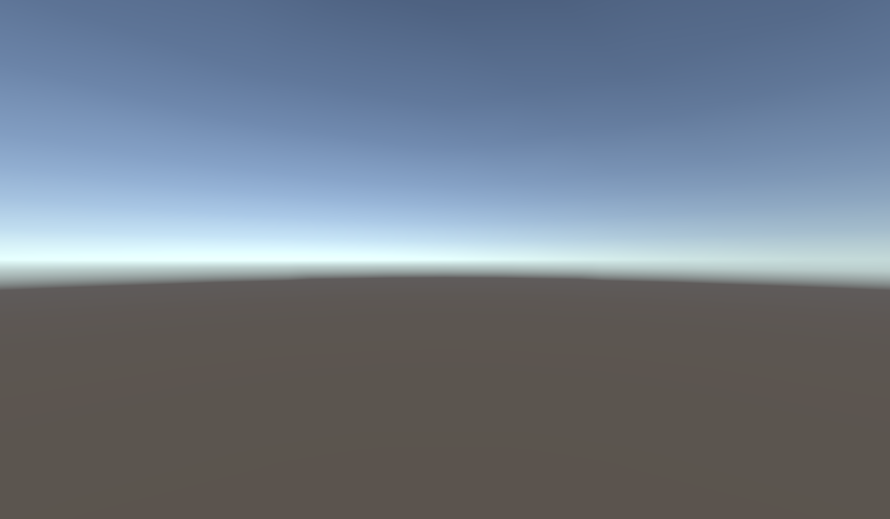
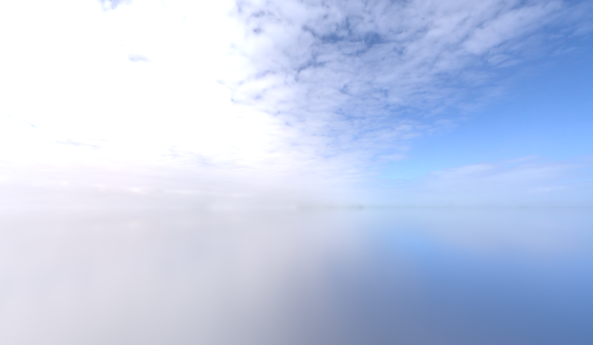
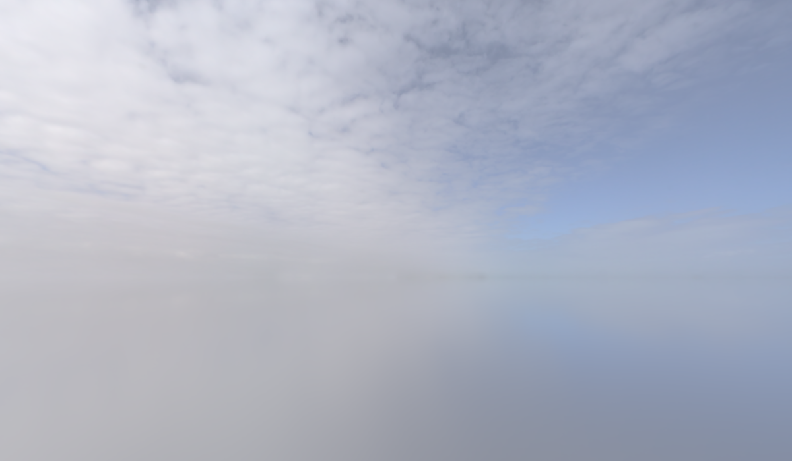

오늘은 Invector 캐릭터 컨트롤러를 보면서 로코모션 쪽을 확인해 봄\
캐릭터를 움직여 보니까 점프한 상태에서도 공중에서 방향을 바꿀 수 있었음\
근데 이건 어떤 식으로 움직이길래 가능한 거지?

내가 만드는 After Seconds는 CharacterController로 이동 중인데 이쪽은 Rigidbody를 쓰고 있었음\
그래서 입력이 어디로 들어가고, 실제 이동과 애니메이션이 어떻게 이어지는지 같이 정리해 봄

이번에 확인한 건 실습 프로젝트의 `Invector_Basic` 씬과 `Rigged_Dummy` 설정 기준

## 로코모션 스크립트 구성

로코모션은 걷기, 달리기, 방향 전환 같은 캐릭터 이동을 다루는 부분\
위치를 움직이는 코드와 움직이는 모습을 보여 주는 애니메이션을 같이 봐야 함

| 스크립트 | 역할 |
| --- | --- |
| `vThirdPersonInput` | 이동, 카메라, 점프, 스트레이프, 전력질주 입력 |
| `vThirdPersonController` | 이동 모드, 카메라 기준 이동 방향, 몸 회전, 점프 시작 |
| `vThirdPersonMotor` | 실제 Rigidbody 속도 제어, 접지, 경사, 중력, 공중 이동 |
| `vThirdPersonAnimator` | 이동과 접지 상태를 Animator에 전달 |

```text
MonoBehaviour
└─ vThirdPersonMotor
   └─ vThirdPersonAnimator
      └─ vThirdPersonController

vThirdPersonInput → Controller를 찾아 호출
```

이렇게 상속으로 연결된 구조임\
Input은 따로 붙어 있는 컴포넌트고, 같은 캐릭터의 Controller를 가져와서 사용 중

## 입력이 들어가서 움직이기까지

```text
Update
  입력 읽기
  카메라 기준 이동 방향 갱신
  Animator 파라미터 갱신

FixedUpdate
  UpdateMotor → 접지, 경사, 점프, 공중 조작
  ControlLocomotionType → 이동 모드, 속도, 지상 이동
  ControlRotationType → 몸 회전
```

입력은 `input`에 들어가고, 이걸 부드럽게 보간한 값이 `inputSmooth`\
그 값과 카메라의 앞쪽, 오른쪽 방향을 조합해서 `moveDirection`을 구함

현재 `rotateByWorld=false`라서 카메라 기준으로 움직이는 상태\
W를 눌렀을 때 월드의 고정된 방향으로 가는 게 아니라 카메라 기준 앞으로 가게 됨

## 지상 이동은 어떻게 하는지

현재 컨트롤러의 `useRootMotion`은 false\
`MoveCharacter()`에서 목표 속도를 계산해서 Rigidbody에 넣어 주는 방식

아래는 흐름만 보기 쉽게 줄인 코드

```csharp
Vector3 targetPosition = rigidbody.position
    + moveDirection * moveSpeed * deltaTime;

Vector3 targetVelocity = (targetPosition - transform.position) / deltaTime;
targetVelocity.y = rigidbody.linearVelocity.y;

rigidbody.linearVelocity = targetVelocity;
```

이동 방향과 속도로 목표 위치를 구함\
거기까지 가기 위한 속도를 계산해서 `linearVelocity`에 넣는 구조\
Y는 기존 값을 유지해서 상승, 낙하 속도를 수평 이동으로 덮어쓰지 않게 해 둠

공중이거나 점프 중이면 이 지상 이동 처리를 빠져나감\
그때는 따로 있는 `AirControl()`에서 처리

현재 자유 이동과 스트레이프의 속도 설정은 같음

| 항목 | 값 |
| --- | ---: |
| 걷기 `walkSpeed` | 2 |
| 달리기 `runningSpeed` | 4 |
| 전력질주 `sprintSpeed` | 6 |
| 입력과 속도 보간 `movementSmooth` | 6 |
| 회전 속도 `rotationSpeed` | 16 |
| 애니메이션 보간 `animationSmooth` | 0.2 |

`walkByDefault=false`라서 기본 이동의 목표 속도는 달리기 값인 4\
전력질주 상태가 되면 6을 사용함\
입력과 속도에 보간이 들어가서 처음 누르는 순간부터 바로 최댓값이 되는 건 아님

이건 설정값을 확인한 거고 실제 이동 거리를 재서 측정한 속도는 아님

## 자유 이동과 스트레이프

현재 모드는 `FreeWithStrafe`\
Tab으로 `isStrafing`을 바꿔서 두 이동 방식을 전환할 수 있음

자유 이동은 가려는 방향으로 몸도 돌아가는 방식\
왼쪽으로 움직이면 캐릭터도 왼쪽을 바라보게 됨\
현재 자유 이동의 `rotateWithCamera`는 꺼져 있음

스트레이프는 카메라 쪽을 바라보면서 옆이나 뒤로 움직이는 방식\
몸이 보는 방향과 실제 이동 방향을 따로 다룰 수 있음\
현재 스트레이프의 `rotateWithCamera`는 켜져 있음

다만 전력질주 중에는 `sprintOnlyFree` 같은 조건에 따라 회전 기준이 달라짐\
단순히 스트레이프를 켜면 모든 상황에서 카메라만 보는 구조는 아님

## Animator에서 걷기와 달리기를 섞는 방법

실제 연결된 `Invector@BasicLocomotion`을 확인해 보니\
자유 이동은 `InputMagnitude`로 1D Blend Tree를 제어 중

| 기준값 | 동작 |
| --- | --- |
| 0 | Idle |
| 0.5 | Walk |
| 1 | Run |
| 1.5 | Sprint |

중간값이면 옆에 있는 동작끼리 섞어서 표현함\
여기서 0.5, 1 같은 숫자는 실제 이동 속도가 아니라 애니메이션을 선택하기 위한 값

스트레이프는 속도 단계 안에 2D Blend Tree가 들어 있음\
`InputHorizontal`과 `InputVertical`로 앞, 뒤, 옆, 대각선 동작을 섞는 방식

`SetAnimatorMoveSpeed()`에서 이동 방향을 `transform.InverseTransformDirection()`으로 바꿔 주는데\
이건 월드 기준 방향을 캐릭터 기준 방향으로 바꾸는 부분\
여기서 나온 X와 Z로 옆으로 움직이는지, 앞으로 움직이는지를 Animator에 알려 줌

카메라 기준으로 이동 방향을 만들고 → 캐릭터 기준으로 다시 해석해서 애니메이션을 고르는 흐름

접지 쪽은 `IsGrounded`, `GroundDistance` 등을 전달하고 있음\
점프 시작은 코드에서 `Jump` 또는 `JumpMove`로 전환\
그 후 낙하와 착지 상태도 Animator에 연결돼 있음

그리고 Animator의 `Apply Root Motion`은 켜져 있었는데 컨트롤러의 `useRootMotion`은 꺼져 있었음\
`OnAnimatorMove()`에서 별도로 처리하는 구조라 체크박스 하나만 보고 판단하면 안 됨\
입력이 0일 때 Animator의 루트 위치와 회전을 적용하는 코드도 남아 있음

## 공중에서 방향을 바꿀 수 있는 이유

점프했다고 입력을 끊는 게 아니라 공중에서도 계속 새 입력을 읽고 있음\
그 입력으로 목표 수평 속도를 바꾸고, 현재 속도를 그쪽으로 보간하기 때문에 가능한 것

현재 사용하는 분기를 원리만 남겨 줄인 코드

```csharp
// 현재 이동 방향으로 공중 목표 속도를 계산
Vector3 targetVelocity = moveDirection * airSpeed;

// 상승, 낙하 속도는 유지
targetVelocity.y = rigidbody.linearVelocity.y;

// 현재 속도를 목표 속도 쪽으로 보간
rigidbody.linearVelocity = Vector3.Lerp(
    rigidbody.linearVelocity,
    targetVelocity,
    airSmooth * deltaTime
);
```

앞으로 점프하다가 오른쪽을 누름 → 목표 수평 속도가 오른쪽으로 바뀜\
현재 속도가 그쪽으로 바뀌면서 공중 궤적도 휘어지는 구조임

| 설정 | 현재 값 | 의미 |
| --- | --- | --- |
| `airSpeed` | 5 | 공중 목표 수평 속도에 사용 |
| `airSmooth` | 6 | 공중 입력과 속도를 보간하는 정도 |
| `jumpAndRotate` | true | 공중에서 몸 회전 허용 |
| `jumpWithRigidbodyForce` | false | 현재는 목표 속도를 보간하는 분기 사용 |

여기서 몸이 돌아가는 것과 실제 이동 방향이 바뀌는 건 별개\
`jumpAndRotate`를 꺼도 `AirControl()`이 없어지는 건 아니라서\
공중 이동까지 막으려면 수평 입력을 반영하는 부분도 따로 봐야 함

`jumpWithRigidbodyForce`를 켜면 `AddForce(..., ForceMode.VelocityChange)`로 속도 변화를 누적하는 다른 분기를 사용함\
지금 캐릭터는 이쪽을 사용하는 상태는 아님

## jumpHeight가 실제 높이는 아님

이름만 보면 점프 높이 같은데 실제로는 Y 속도에 넣고 있었음\
현재 `jumpHeight=4`, `jumpTimer=0.3`

점프 상태인 약 0.3초 동안 위쪽 속도를 반복해서 4로 설정하는 방식\
그 이후에는 Rigidbody 중력과 추가 중력이 낙하에 영향을 줌

그래서 4라고 해서 4m를 뛰는 뜻은 아님\
변수 이름만 보지 말고 이 값이 위치에 쓰이는지, 속도에 쓰이는지도 확인해야 함

## 내가 쓰는 CharacterController와는 어떤 차이가 있는지

After Seconds의 `PlayerMotor`는 Rigidbody 속도를 바꾸는 방식이 아님\
내가 계산한 속도에 시간을 곱해서 이번에 이동할 거리를 구한 다음\
`CharacterController.Move()`로 전달하고 있음

```csharp
// 현재 PlayerMotor의 흐름을 줄인 예시
Vector3 horizontalVelocity = moveDirection * settings.MoveSpeed;
verticalVelocity += settings.GravityAcceleration * deltaTime;

Vector3 velocity = horizontalVelocity + Vector3.up * verticalVelocity;
characterController.Move(velocity * deltaTime);
```

| 비교 | After Seconds | Invector 실습 코드 |
| --- | --- | --- |
| 전달하는 값 | 이번에 이동할 거리 | Rigidbody 속도 |
| 이동 호출 | `CharacterController.Move(속도 × 시간)` | `Rigidbody.linearVelocity = 목표 속도` |
| 중력 | 코드에서 수직 속도에 누적 | Rigidbody 중력과 추가 중력, 점프 속도 제어 |
| 관성, 밀림 | 필요한 동작을 별도로 설계 | 물리 영향을 받지만 속도 대입으로 덮어쓸 수도 있음 |
| 공중 방향 전환 | 공중에 입력을 얼마나 적용할지 코드로 결정 | `AirControl()`에서 목표 속도로 보간 |

CharacterController도 벽과 바닥의 충돌 처리는 해 줌\
대신 Rigidbody처럼 힘에 반응해서 움직이는 방식은 아니라서\
넉백이나 가속, 감속이 필요하면 별도 속도를 계산해서 합쳐 주는 식으로 만들 수 있음

반대로 Rigidbody라고 무조건 관성이 그대로 유지되는 것도 아님\
지금 Invector처럼 매번 속도를 넣어 주면 외부에서 밀린 속도를 이동 코드가 다시 바꿀 수도 있음

내 `PlayerMotor.Move()`는 공중이라고 수평 입력을 막는 조건이 없음\
이 흐름으로 점프를 추가하면 공중에서도 새 입력 방향으로 수평 속도를 구하게 됨\
아직 점프 기능은 없으니 실제 점프 테스트를 했다는 의미는 아님

Invector처럼 부드럽게 방향을 바꾸고 싶으면\
수평 속도를 따로 기억해 두고 목표 속도로 보간하는 부분을 참고할 수 있을 듯

## 어떤 게임에서 쓰기 좋을지

Unity 공식 문서의 이동 방식 설명을 바탕으로 생각해 본 사례\
아래는 어떤 게임을 만들 때 검토할지 정리한 거고, 특정 출시작의 내부 코드를 확인한 목록은 아님

| 만들려는 게임과 상황 | 먼저 검토할 방식 | 이유 |
| --- | --- | --- |
| 1인칭 퍼즐, 잠입 게임 | CharacterController | 좁은 발판이나 엄폐물 앞에서 정확히 멈추고 조준하기 좋음 |
| 정밀한 점프가 중요한 플랫폼 액션 | CharacterController 또는 별도 이동 코드 | 점프 궤적과 공중 입력을 직접 설계하기 좋음. Rigidbody로도 구현 가능 |
| 서로 밀고 넘어뜨리는 물리 난투 | Rigidbody와 필요한 Joint | 충돌, 외력, 회전 자체가 게임의 재미가 되는 경우 |
| 공 굴리기, 차량 조작 | Rigidbody | 경사, 마찰, 힘, 토크, 관성을 이동에 활용하기 좋음 |
| 달리기, 회피, 스트레이프가 있는 3인칭 액션 | 두 방식 모두 검토 | 조작 반응과 물리 반응 중 어디에 비중을 둘지에 따라 달라짐 |

예를 들면 좁은 발판에서 입력을 놓는 순간 멈추게 하고 싶으면 CharacterController 쪽부터 볼 수 있음\
반대로 큰 물체에 부딪혀 튕겨 나가는 것 자체가 재미라면 Rigidbody 쪽을 먼저 검토하는 식

그리고 플레이어와 물체가 꼭 같은 방식을 쓸 필요는 없음\
플레이어는 CharacterController, 던지는 상자는 Rigidbody로 구성하는 것도 가능함\
대신 서로 미는 동작이나 무게 판정 같은 연결은 따로 구현해야 함

## 내 게임에서는 왜 CharacterController로 시작했는지

기획서에는 플레이어 이동은 CharacterController로 시작하고\
교환과 끼임 처리는 규칙 코드로 다룬다는 가안이 적혀 있음

미리보기는 경비 상태를 계산하고 플레이어 이동까지 예측하지 않는 범위를 전제로 한 선택\
처음부터 모든 이동을 자체 물리로 만들기보다 기본 이동과 충돌은 준비된 기능으로 시작하는 방향임

여기에 현재 게임 구성을 같이 보면 이런 장점이 있을 것 같음

- 좁은 공간이나 냉각조 가장자리에서 멈추고 조준하는 걸 입력 중심으로 조절하기 좋음
- 평소 걷기, 벽 충돌과 예약된 시각의 위치 교환을 나누어서 생각할 수 있음
- 지금의 입력 → 이동 방향 → 속도 → 중력 → Move 구조에서 점프나 달리기를 하나씩 붙여 보기 좋음

이 세 가지는 현재 설계를 보고 정리한 해석\
처음 선택할 때 전부 이유로 적혀 있던 건 아니고, CharacterController도 아직 시작 가안으로 기록돼 있음

그리고 CharacterController를 쓴다고 미래 예측이나 교환이 자동으로 정확해지는 건 아님\
교환할 자리에 공간이 있는지, 벽에 끼지 않는지\
교환 후 낙하 속도를 유지할지 초기화할지 같은 건 별도로 정해야 함

Rigidbody로 위치 교환을 만드는 것도 가능함\
나중에 폭발, 줄, 움직이는 구조물의 힘을 플레이어에게 그대로 전달하는 게 중요해지면\
그때는 이동 방식과 외력 처리도 다시 비교해 볼 필요가 있어 보임

지금은 현재 이동 구조에서 지상 이동, 공중 입력, 수직 속도, 몸 회전, 애니메이션을 나눠서 이해하는 게 먼저일 듯\
이번에는 기존 코드를 읽고 설정을 확인한 상태고, 내 프로젝트의 이동 코드를 교체하거나 점프를 구현한 건 아님

## 스카이박스 유형

스카이박스는 씬 바깥에 보이는 하늘이나 먼 배경을 표현하는 머티리얼\
같은 하늘을 보여 주더라도 이미지를 어떤 형태로 넣는지, 이미지 없이 계산해서 만드는지에 따라 유형이 나뉨

이번에 정리할 건 `6 Sided`, `Cubemap`, `Panoramic`, `Procedural` 네 가지\
앞의 세 가지는 텍스처를 사용하는 방식이고, Procedural은 머티리얼 설정값으로 하늘을 만드는 방식임\
[Unity 스카이박스 유형 설명](https://docs.unity3d.com/6000.4/Documentation/Manual/skybox-shaders.html) 기준으로 정리

아래 이미지는 Unity 6.4 URP에서 비교용 머티리얼을 임시 카메라로 렌더한 화면\
6 Sided, Cubemap, Panoramic은 프로젝트에 있는 같은 하늘 자료를 사용함\
표현 방식 자체의 품질 순위를 비교하는 이미지는 아니고, 입력 형태와 적용 결과를 같이 보기 위한 예시\
변환 과정과 배경 방향에 따라 보이는 구름 위치나 선명도는 조금 다를 수 있음

### 6 Sided · 6사이디드

앞, 뒤, 왼쪽, 오른쪽, 위, 아래에 사용할 이미지 6장을 각각 넣는 방식\
큰 상자 안쪽 여섯 면에 배경 그림을 붙인다고 생각하면 이해하기 쉬움


_하늘 자료를 여섯 방향 이미지로 나눠 연결한 예시_

각 방향 이미지를 따로 넣을 수 있어서 6면으로 나눠진 배경 자료를 사용할 때 맞는 방식\
대신 방향이나 회전이 맞지 않으면 하늘이 뒤집히거나 경계가 어색하게 이어질 수 있음\
면끼리 맞닿는 부분의 구름이나 색이 연결되는지도 확인해야 함

머티리얼 Shader에서 `Skybox/6 Sided`를 선택하고 각 면의 텍스처 슬롯에 연결\
색감, 노출, 회전도 조절할 수 있음\
[6 Sided 설정 설명](https://docs.unity3d.com/6000.4/Documentation/Manual/shader-skybox-6sided.html)

### Cubemap · 큐브맵

여섯 방향을 담은 **Cubemap 에셋 하나**를 연결하는 방식\
이것도 여섯 면으로 주변을 표현하지만, 머티리얼에서 이미지 6장을 따로 받는 6 Sided와 입력 형태가 다름


_같은 하늘을 Cubemap 에셋 하나로 연결한 예시. 6 Sided와 외형이 비슷해도 입력 구성이 다름_

`Skybox/Cubemap`을 선택하고 `Cubemap (HDR)` 슬롯에 연결\
일반 Texture2D 이미지를 그대로 넣는 슬롯과는 구분해야 함

이미 준비된 Cubemap 에셋을 배경으로 쓸 때 검토할 수 있음\
노출과 색감, Y축 회전을 조절해서 배경 방향을 맞출 수 있음\
[Cubemap 설정 설명](https://docs.unity3d.com/6000.4/Documentation/Manual/shader-skybox-cubemap.html)

### Panoramic · 파노라믹

주변 풍경을 한 장에 펼친 2D 이미지를 씬 주위로 감싸는 방식\
가로와 세로에 경도, 위도 방향을 펼쳐 놓은 Lat-Long 이미지가 기준\
일반 사진 한 장을 넣는다고 자동으로 자연스러운 전 방향 배경이 되는 건 아님


_펼쳐진 2D 하늘 이미지를 Panoramic으로 감싼 예시_

`Skybox/Panoramic`을 사용하고 텍스처는 `Texture Shape=2D`로 준비\
전 방향으로 펼쳐진 HDRI 같은 자료를 배경으로 활용할 때 검토하기 좋은 방식

Cubemap도 하나, Panoramic도 하나를 연결하니까 비슷해 보일 수 있는데\
Cubemap은 여섯 면을 담은 큐브 텍스처 에셋이고, Panoramic은 펼쳐진 2D 텍스처라는 차이가 있음\
[Panoramic 입력 형태 설명](https://docs.unity3d.com/6000.4/Documentation/Manual/skybox-shaders.html#panoramic-skybox-shader)

### Procedural · 프로시저럴

하늘 이미지를 넣는 대신 설정값을 계산해서 하늘을 만드는 방식\
`Skybox/Procedural`에서 하늘 색, 대기 두께, 지평선 아래 색, 노출, 태양 크기 등을 조절할 수 있음


_텍스처 없이 설정값으로 계산한 하늘. 위쪽의 구름은 자동으로 생기는 기능이 아님_

태양 원반을 표시하는 경우에는 사용하는 Directional Light의 회전으로 태양 방향을 정함\
빛의 방향과 머티리얼 설정값을 바꾸는 식으로 낮이나 노을 분위기를 만들 때 검토할 수 있을 듯

다만 Procedural을 고르는 것만으로 시간이 흐르거나 날씨가 자동으로 바뀌는 건 아님\
기본 제공 항목에 구름, 비, 밤낮 주기 전체가 들어 있는 것도 아니라서 필요한 기능은 따로 구성해야 함\
[Procedural 설정 설명](https://docs.unity3d.com/6000.4/Documentation/Manual/shader-skybox-procedural.html)

### 네 가지 비교

| 유형 | 넣는 자료 | 구분할 부분 |
| --- | --- | --- |
| 6 Sided | 방향별 텍스처 6장 | 각 면에 직접 연결, 방향과 경계 확인 |
| Cubemap | Cubemap 에셋 1개 | 여섯 방향을 담은 큐브 텍스처 |
| Panoramic | 펼쳐진 2D 텍스처 1장 | Lat-Long 형태로 준비 |
| Procedural | 별도 하늘 텍스처 없이 설정값 사용 | 하늘과 태양 표현을 계산해서 생성 |

준비한 이미지가 여섯 장인지, Cubemap인지, 펼쳐진 한 장인지부터 보면 선택하기 쉬울 듯\
이미지를 준비하지 않고 하늘 색과 태양부터 조절해 보고 싶으면 Procedural을 검토

위 설명은 Built-in과 URP의 Skybox Shader 기준\
HDRP는 별도의 Sky 시스템을 사용하므로 같은 Shader 메뉴를 그대로 적용하는 방식과는 다름\
비교용 이미지 촬영 후 임시 에셋은 정리했고, 실제 프로젝트의 기존 스카이박스는 그대로 유지함

## UVC Shader의 스카이박스

프로젝트에 `UVC Shader/UVC_Skybox`라는 셰이더도 있어서 코드를 확인해 봄\
파일은 `Shaders/URPC#/UVC_Skybox.shader`에 있고, 소스 머리말에는 GBX Studio 저작권 표기가 있음\
이번 설명은 프로젝트에 들어 있는 이 파일 기준

입력 텍스처가 `samplerCUBE`이고 실제 색도 큐브맵에서 가져오는 구조\
앞에서 본 네 가지와 별개의 다섯 번째 입력 유형이라기보다는\
**큐브맵 방식에 시간에 따른 회전과 Fog 색 혼합을 추가한 커스텀 셰이더**로 보면 이해하기 쉬움

### Inspector에 보이는 항목

| 표시 이름 | 코드 속성 | 실제 처리 |
| --- | --- | --- |
| Color | `_Color` | 항목과 변수는 있지만 현재 최종 색 계산에는 사용하지 않음 |
| Match Fog Color | `_FogColorMix` | 큐브맵 색과 씬의 Fog 색을 섞는 비율, 0~1 |
| Exposure | `_Exposure` | 혼합한 색 전체에 곱하는 밝기 값, 0~8 |
| Speed | `_Speed` | 시간에 따라 하늘을 Y축으로 회전시키는 계산에 사용, 0~360 |
| Cubemap (HDR) | `_Tex` | 배경으로 사용할 Cubemap 입력 |

### 하늘 색이 만들어지는 순서

```text
보는 방향으로 Cubemap 색을 읽음
→ Fog 색과 설정 비율만큼 섞음
→ Exposure를 곱함
→ 배경 색으로 출력
```

최종 색 계산만 줄여 적으면 이런 흐름

```hlsl
skyColor = sampleCubemap(viewDirection);
finalColor = lerp(skyColor, fogColor, fogMix) * exposure;
```

`Match Fog Color=0`이면 큐브맵 색을 그대로 사용하고\
0.5면 두 색을 절반씩 섞음\
1이면 큐브맵 무늬 대신 Fog 색만 남고, 거기에 Exposure가 곱해짐

여기서 Match Fog Color는 거리가 멀어질수록 안개가 짙어지는 일반적인 거리 Fog 계산과는 다름\
현재 코드는 하늘 전체에 같은 비율로 Fog 색을 섞는 방식\
지평선 쪽에만 안개가 생기는 기능도 아님

씬의 Fog 체크 여부를 검사하는 분기도 없어서\
이 셰이더의 색 혼합과 일반 Fog의 켜짐, 꺼짐은 구분해서 봐야 함

### 실제로 적용된 머티리얼

현재 `Invector_Basic` 씬에 지정된 스카이박스는 `Pure_Skybox`\
이 머티리얼이 실제로 UVC 스카이박스 셰이더를 사용하고 있었음

| 머티리얼 | Cubemap | Exposure | Match Fog Color | Speed |
| --- | --- | ---: | ---: | ---: |
| Pure_Skybox · 현재 씬에 적용 | Pure_Sky.exr | 1.2 | 0 | 0 |
| Day_Skybox · 프로젝트에 보관 | Day_Skybox.hdr | 0.8 | 0.04 | 0 |

두 머티리얼 모두 현재 Speed가 0이라 자동 회전이 없는 설정\
확인 시점에 씬의 일반 Fog는 꺼져 있었음

아래는 `Pure_Skybox`를 복제한 임시 머티리얼로 촬영한 Unity 카메라 렌더\
두 이미지 모두 같은 시점, Exposure 1.2, Speed 0으로 두고 Fog 혼합값만 바꿔 봄


_Match Fog Color 0. 큐브맵의 하늘 색과 구름을 유지하는 설정_


_Match Fog Color 0.6. 회색 Fog 색이 섞이면서 하늘 전체의 대비와 색감이 줄어든 모습_

이미지는 색 혼합 차이를 보여 주기 위한 예시이고\
실제 씬의 머티리얼 값이나 스카이박스 연결은 바꾸지 않음

### Speed는 구름을 새로 만드는 기능이 아님

버텍스 처리에서 시간값과 Speed를 조합한 각도로 하늘을 Y축 회전시키는 구조\
큐브맵에 그려져 있는 구름과 풍경 전체가 돌아가 보이는 방식임\
구름 모양이 변하거나 새 구름이 생성되는 시뮬레이션은 아님

현재 식에는 Speed 자체를 각도에 더하는 부분과 `_Time`을 사용하는 부분이 함께 있음\
그래서 Inspector의 숫자를 그대로 초당 몇 도라고 읽으면 안 됨\
실제 연출 속도를 정하려면 이 계산과 화면상의 회전을 같이 확인하는 게 좋을 듯

### 실습하면서 적어 둔 기준값

| 상황과 항목 | 기준값 |
| --- | ---: |
| 어두울 때 Exposure | 0.4 |
| 밝을 때 Exposure | 0.4 |
| UVC 스카이박스 Speed | 20 |

Exposure는 어두울 때와 밝을 때 모두 0.4로 메모\
UVC 스카이박스 회전은 Speed 20을 실습 기준값으로 기록\
Speed 20은 머티리얼에 넣는 값이고, 초당 20도라는 의미로 적은 건 아님\
이번 실습에서 사용할 기준이라 다른 하늘 텍스처나 씬에도 무조건 같은 값이 맞는 건 아님

### 기본 Cubemap 셰이더와 비교하면서 볼 부분

**Color가 실제로 쓰이는지 확인하기**\
현재 파일은 `_Color`를 선언만 하고 마지막 색 계산에 넣지 않음\
이 코드 그대로라면 Inspector에서 Color를 바꿔도 기대한 색상 보정은 적용되지 않음\
항목이 보인다고 무조건 기능이 연결돼 있는 건 아니라는 예시

**HDR 슬롯 이름과 실제 디코딩 구분하기**\
`_Tex_HDR` 변수가 있지만 `DecodeHDR`를 호출하는 줄은 주석 처리돼 있음\
현재는 샘플링한 텍스처의 RGB를 직접 사용 중\
슬롯에 HDR이라고 적혀 있다고 기본 `Skybox/Cubemap`과 모든 HDR 처리 결과가 같은 것으로 보면 안 됨\
입력 텍스처의 저장, 임포트 형식과 실행 환경에 따라 명암 결과를 따로 확인할 필요가 있음

내가 사용할 때는 먼저 원하는 Cubemap을 넣고 Exposure로 밝기를 맞춘 다음\
배경과 안개 색을 맞추고 싶을 때 Match Fog Color를 조금씩 올려 보는 순서가 좋을 듯\
자동으로 도는 배경이 필요하면 Speed를 조절하되, 하늘 전체가 회전한다는 걸 생각하고 사용해야 함

## Shader Graph를 참고해서 직접 만드는 방법

Environment Training도 살펴보면서 셰이더를 어떻게 가져갈지 생각해 봄\
원본을 통째로 옮기는 방법도 있지만\
그래프에서 필요한 원리를 이해하고 우리 게임용으로 직접 만들어 보는 방법도 있음

예를 들어 물이라면 처음부터 모든 효과를 붙이기보다 아래 순서가 좋을 듯

| 순서 | 직접 만들어 볼 기능 | 참고할 원리 |
| --- | --- | --- |
| 1 | 기본 물 색과 투명도 | 색·알파가 최종 출력에 연결되는 흐름 |
| 2 | 움직이는 물결 | Time으로 UV를 이동하고 노멀을 샘플링 |
| 3 | 얕은 물과 깊은 물 색 | Scene Depth와 수면 깊이를 같은 기준으로 비교 |
| 4 | 벽·바닥 접촉부 거품 | 깊이 차이를 마스크로 바꾸고 폭·강도 조절 |
| 5 | 반사와 굴절 | Fresnel, Reflection Probe, Scene Color의 역할 구분 |

Scene Depth는 원시 깊이 값을 그대로 빼는 것으로 끝내면 안 됨\
사용한 노드 모드와 좌표 기준을 맞추고, 카메라에서 깊이 입력이 실제로 제공되는지도 확인\
Scene Color를 읽는 표현은 Opaque Texture와 렌더 순서도 같이 봐야 함

Garden에는 수면·폭포·잔물결 그래프가 따로 있었고\
SharedAssets에는 물 그래프와 물빛 무늬용 Decal, Water HLSL이 있었음\
그래프나 함수가 들어 있다는 것과 현재 머티리얼에서 해당 기능을 사용한다는 것은 구분해서 볼 필요가 있음

새 그래프에서 한 기능씩 연결하고 값을 바꿔 보면\
어떤 노드가 물 색, 움직임, 경계에 영향을 주는지 이해하기 쉬울 듯\
우리 쪽에서 쓰는 이름과 프로퍼티로 정리하고 텍스처도 직접 준비하는 방향을 생각 중\
이번에는 구조를 분석한 상태고 새 물 셰이더를 제작하거나 적용한 건 아님

### 직접 만들면 라이선스와 관계없어지는지

일반적인 표현 원리를 배우고 자체 코드·그래프로 구현하는 것과\
원본 노드 구성을 그대로 다시 배치하는 것은 구분해야 함\
파일을 새로 만들거나 색·이름을 바꿨다고 원본의 권리가 사라지는 건 아님

Unity 공식 샘플은 해당 샘플의 이용 조건을 기준으로 사용하면 됨\
Unity Companion License가 적용되는 부분은 그 조건 아래에서 사용·수정하고 고지를 유지하는 식\
별도 에셋이나 코드 안에 다른 저작권 고지가 있으면 해당 조건도 함께 확인\
[Unity Companion License](https://unity.com/legal/licenses/unity-companion-license)

게임에 포함하는 것과 블로그에서 원본 파일을 내려받게 제공하는 것도 구분해서 보기\
분석한 설정값과 직접 적은 설명을 기록하되, 원본 파일 공개는 재배포 조건까지 확인하는 방향

## Environment Training 전체에서 가져갈 만한 요소

이번에는 조명뿐 아니라 Assets 전체의 파일 구성과 주요 스크립트도 다시 확인함\
Terminal·Garden·Cockpit·Oasis 외에 ShipSetup 보조 씬과 TPSControl 실습 씬도 들어 있음\
전체 Assets 기준 씬 6개, 프리팹 311개, C# 89개, Shader Graph 88개, Timeline 12개를 확인\
이 숫자는 기본·외부·실습 에셋까지 포함한 수라 앞서 정리한 렌더링 자료의 추출 범위와는 다름

| 우선순위 | 참고할 요소 | 활용해 볼 방향 |
| --- | --- | --- |
| 먼저 | Terminal 홀로그램·로딩바·발광 표면 | 장치 상태와 대상 표시용 시각 효과. 게임 판정과는 분리 |
| 먼저 | Terminal 모니터·제어 패널·Room·Grime Decal | 시설 공간의 형태·재질 구성과 모니터 연출 참고 |
| 먼저 | Garden 먼지·주전자 증기·빛줄기 표현 | 먼지·증기 등 작은 환경 효과로 분위기 추가 |
| 먼저 | Light·Volume·Reflection Probe 조합 | 작은 테스트 공간에서 조명과 노출을 나눠 조절 |
| 다음 | 물·폭포·잔물결·Caustics | 필요한 기능부터 직접 그래프를 만들어 보기 |
| 다음 | ScreenCamera·ScreenController | 카메라 화면을 시설 모니터 재질에 표시하는 구조 |
| 다음 | Dissolve·Fullscreen 전환 | 교환 같은 순간의 시각 연출 후보. 위치 변경 판정은 별도 |
| 다음 | Cinemachine·Timeline | 공간 소개와 짧은 장치·카메라 연출 참고 |
| 나중 | Oasis 높이 Fog·LayeredLit·VFX Graph | 넓은 공간의 원근감·표면 혼합·부유 입자 학습 |
| 필요할 때 | Cockpit Outline·Toon·3D Skybox | 특수한 화풍·외곽선·원경 연출 비교 |

모든 걸 한 번에 넣기보다는\
발광 표면 하나 → 먼지 효과 하나 → 모니터 하나 → 작은 물 표면 순서로 비교하면 좋을 듯\
효과를 끈 화면과 켠 화면을 같은 카메라에서 보고, 퍼즐 대상이 잘 보이는지도 함께 확인

### 그대로 가져오기 전에 걸러볼 부분

`QualityLevelToggle`은 Start에서 품질 이름을 확인해 오브젝트를 켜고 끄는 방식\
실행 중 품질 변경을 계속 따라가는 완성된 옵션 시스템은 아님

`SceneTransitionManager`는 PlayerCapsule 이름, 태그, 레이어와 여러 씬에 연결돼 있음\
화면 전환 원리는 참고하되 우리 게임의 씬 관리나 교환 로직을 통째로 교체할 이유는 없어 보임

`LodLightmapCopy`, `DirectionalLightmapperCorrector`는 편집기 이벤트·임포트 과정에 개입하는 코드\
`PrefabReplacer`에는 임시 작업 도구라는 주석과 기존 오브젝트를 삭제하는 처리도 있음\
이런 도구는 참고 자료로 보고 필요한 기능만 별도 테스트하는 게 좋을 듯

TPSControl의 Invector·UVC·VARCO 연동은 Unity 환경 샘플과 출처를 나눠서 보기\
실제로 UVC 셰이더에는 GBX Studio 고지가 있고, SplineFollower의 보간 함수에도 별도 저작권·허가문이 있었음\
프로젝트 전체에 하나의 라이선스를 일괄 적용하면 안 되는 이유도 여기서 확인됨

자세한 파일 위치·연결 조건·도입 우선순위는 [전체 재사용 후보 목록](/assets/data/environment-training-20261103/reuse-catalog.md)에 보관\
조명·셰이더 설정값과 가져오기 도구는 [데이터 카테고리의 정리 글](/posts/environment-training-lighting-shader-data/)에서 다시 확인 가능\
이번 작업은 조사와 기록까지이며 실제 게임에 에셋을 반입하거나 씬을 변경한 건 아님

## 참고 자료

- [Unity 6.4 — Character Controller 설명](https://docs.unity3d.com/6000.4/Documentation/Manual/CharacterControllers.html)
- [Unity 6.4 — Rigidbody 설명](https://docs.unity3d.com/6000.4/Documentation/Manual/class-Rigidbody.html)
