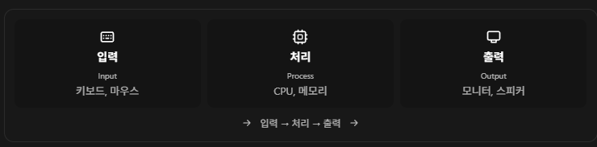

오늘은 C# 문법에 들어가기 전에 컴퓨터가 어떻게 정보를 다루는지부터 정리함\
입력과 출력, 0과 1, 메모리를 거쳐서 변수와 자료형으로 이어지는 내용임

수업 중 적어 둔 메모와 `Variable.cs`의 예제를 같이 정리해 봄\
자료형마다 크기가 다른 이유와 같은 비트를 다르게 읽는 방식을 연결해서 보기

## Chapter 01. 컴퓨터의 동작 원리와 프로그래밍의 본질

### 컴퓨터는 입력을 받아 처리하고 출력함

컴퓨터는 데이터를 입력받아 정해진 명령에 따라 처리하는 정보 처리 시스템임\
기본 흐름은 `입력(Input) → 처리(Process) → 출력(Output)`


_입력 장치 → 처리 → 출력 장치의 관계를 정리한 화면_

계산기로 생각하면 `3 + 5`를 입력하고 → 덧셈을 처리하고 → `8`을 출력하는 식\
게임도 키보드 입력을 읽고, 이동량을 계산하고, 바뀐 위치를 화면에 보여 주는 흐름으로 볼 수 있음

### 컴퓨터가 다루는 0과 1

컴퓨터는 0과 1로 표현된 정보를 처리함\
트랜지스터 같은 전자 소자로 전기 신호를 제어하고 두 논리 상태를 구분

기초 개념으로는 `0 = OFF`, `1 = ON`으로 생각하면 됨\
실제 회로에서는 전압 범위 등을 기준으로 논리적인 0과 1을 구분함

그런데 0과 1만 가지고 어떻게 큰 숫자를 표현할 수 있을까?

### 2진수는 2가 되면 다음 자리로 올라감

10진수는 한 자리에 0~9를 사용하고, 2진수는 0과 1만 사용함\
각 자릿값은 오른쪽부터 `1, 2, 4, 8, 16…` 순서로 커짐


_10진수 2는 2진수 10, 10진수 10은 2진수 1010으로 표현됨_

```text
1010₂ = 1×8 + 0×4 + 1×2 + 0×1 = 10
1101₂ = 1×8 + 1×4 + 0×2 + 1×1 = 13
```


_1이 있는 자리의 값을 더하면 8 + 4 + 1 = 13_

숫자뿐 아니라 문자, 이미지, 소리도 비트의 조합으로 표현할 수 있음\
같은 0과 1이어도 어떤 규칙으로 해석하느냐에 따라 의미가 달라짐

### 하드웨어와 소프트웨어

하드웨어는 CPU, 메모리, 키보드, 마우스 같은 물리적인 장치\
소프트웨어는 그 장치가 수행할 작업을 정의하는 프로그램과 관련 데이터임

마우스 동작을 회로에만 고정해 두면 기능을 바꿀 때 하드웨어 수정이 필요할 수 있음\
소프트웨어로 동작을 제어하면 같은 마우스에서도 일반 클릭이나 자동 더블클릭처럼 기능을 바꿀 수 있음


_하드웨어가 지원하는 범위 안에서 소프트웨어로 동작을 바꿀 수 있음_

프로그램을 바꾼다고 없는 센서가 생기거나 성능 한계가 사라지는 건 아님\
하드웨어가 지원하는 기능과 성능 안에서 동작을 정의하는 것

### 문법보다 먼저 원하는 동작을 정의하기

컴퓨터가 실행할 명령을 사람이 전부 0과 1로 적기에는 복잡함\
사람이 읽고 작성하기 쉬운 형태로 명령을 표현하려고 프로그래밍 언어를 사용함


_사람에게 뜻을 전달하는 것처럼 컴퓨터에도 수행할 작업과 규칙을 전달해야 함_

`if` 문법을 알아도 HP가 0 이하일 때 무엇을 할지는 따로 정해야 함\
사망 상태로 바꾸기 → 조작 막기 → 애니메이션 실행처럼 조건과 순서를 구체적으로 나누는 과정이 필요

예를 들어 “W키를 누르면 앞으로 이동”도 컴퓨터가 처리할 순서로 나눌 수 있음


_입력 확인 → 조건 판단 → 이동 처리 → 다음 프레임 반복_


_실제 문법을 적기 전에 필요한 작업을 의사코드로 나눠 본 예시_

컴퓨터는 생략한 의도를 알아서 채워 주지 않음\
무엇을 구현할지 정하고 → 절차와 조건을 설계하고 → 코드로 표현하는 순서로 생각하기\
이런 절차적 사고와 특정 프로그래밍 방식인 절차지향은 구분해서 기억

## Chapter 02. 개발 환경과 C#의 기본 개념

### Unity와 IDE의 역할

Unity Editor에서는 씬과 게임 오브젝트를 구성하고 게임을 실행함\
Project 창은 프로젝트 안의 파일을 확인하고 만들거나 관리할 때 사용

C# 코드는 Visual Studio 같은 IDE에서 작성하고 디버깅함\
IDE는 Integrated Development Environment, 통합 개발 환경이라는 뜻

문법 오류 확인, 코드 관리, 디버깅, 컴파일·실행 도구 연결 등을 도와주는 프로그램임\
대표적으로 Visual Studio와 JetBrains Rider가 있음

### 주석은 실행할 명령과 설명을 구분하는 방법

```csharp
// 한 줄 주석

/*
여러 줄에 걸친 설명
*/
```

주석은 실행할 명령으로 처리되지 않는 설명임\
코드의 역할이나 왜 이렇게 작성했는지 적고, 다른 사람에게 의도를 전달할 때 사용\
임시로 코드를 주석 처리해서 실행 대상에서 제외할 수도 있음

### C#은 컴파일을 거쳐 실행됨

컴파일은 소스 코드를 다른 실행용 형태로 바꾸면서 문법 등을 검사하는 과정\
C#을 적자마자 바로 최종 기계어가 되는 것으로만 이해하면 중간 과정이 빠짐

```text
C# 소스 코드 → 컴파일 → IL(중간 언어)
                         ├─ JIT: 실행 시 기계어로 변환
                         └─ AOT: 실행 전에 기계어로 변환
```

Unity도 실행 환경과 빌드 방식에 따라 과정이 달라짐\
Mono와 IL2CPP가 있고, IL2CPP는 IL을 C++로 바꾼 다음 대상 플랫폼용 기계어로 컴파일하는 방식임. [Unity 스크립팅 백엔드 설명](https://docs.unity3d.com/6000.4/Documentation/Manual/scripting-backends.html)

### Unity 기본 스크립트 구조

```csharp
using UnityEngine;

public class Variable : MonoBehaviour
{
    void Start()
    {
        Debug.Log("Hello Unity!");
    }

    void Update()
    {

    }
}
```

| 코드 | 역할 |
| --- | --- |
| `using UnityEngine;` | UnityEngine 네임스페이스의 형식을 짧은 이름으로 사용 |
| `class Variable` | Variable이라는 클래스 정의 |
| `: MonoBehaviour` | Unity 컴포넌트 스크립트의 기본 클래스를 상속 |
| `Start()` | 활성 상태에서 첫 Update 전에 한 번 실행 |
| `Update()` | 활성 상태에서 매 프레임 실행 |
| `Debug.Log()` | Unity Console에 메시지 출력 |

Start는 컴포넌트를 껐다 켤 때마다 반복 실행되는 함수는 아님\
해당 스크립트 인스턴스가 활성화되어 처음 업데이트되기 전에 한 번 호출됨. [Unity Start 설명](https://docs.unity3d.com/6000.4/Documentation/ScriptReference/MonoBehaviour.Start.html)

## Chapter 03. 변수는 값을 저장하고 다시 쓰기 위한 이름

### 저장한 값을 어떻게 다시 찾을까?

`1 + 1`을 계산하려면 계산할 값과 결과를 다뤄야 함\
프로그램이 실행되는 동안 데이터와 명령 등을 보관하는 공간이 메모리(Memory)

변수는 값을 저장하고 참조할 수 있도록 이름을 붙여 다루는 개념임\
학습할 때는 “이름이 붙은 저장 공간”으로 생각하면 이해하기 쉬움

### 선언과 대입

```csharp
int a = 1;
Debug.Log(a); // 1
```

| 부분 | 의미 |
| --- | --- |
| `int` | 정수를 저장하는 자료형 |
| `a` | 변수명 |
| `=` | 오른쪽 값을 왼쪽 변수에 넣는 대입 연산자 |
| `1` | 저장할 값 |

정수형 변수 a를 선언하고 1로 초기화한 것\
`Debug.Log(a)`는 a라는 글자가 아니라 a에 저장된 값을 출력함

### 선언한 뒤에 값 바꾸기

```csharp
int c = 10;
c = 20;

Debug.Log(c); // 20
```

처음에는 10을 넣고, 다음 줄에서 20으로 바꾼 것\
같은 범위에서 같은 이름의 지역변수를 또 선언하는 것과 기존 변수에 대입하는 건 다름

```csharp
// int c = 30; // 같은 범위에서 다시 선언하면 오류
c = 30;       // 기존 변수의 값 변경은 가능
```

### 이름을 붙이는 규칙과 관례

변수명 중간에 공백을 넣을 수 없어서 `player move speed`처럼 적으면 안 됨\
여러 단어를 연결할 때는 표기법을 정해 두면 읽기 편함

| 표기법 | 예시 | 주로 쓰는 곳 |
| --- | --- | --- |
| camelCase | `playerMoveSpeed` | 지역변수, 매개변수 |
| PascalCase | `PlayerController` | 클래스, 메서드, 프로퍼티 |
| I + PascalCase | `IMovable` | 인터페이스 |
| _camelCase | `_moveSpeed` | 비공개 필드에 쓰는 관례 중 하나 |
| snake_case | `player_move_speed` | 문서·파일을 정리할 때 활용 가능 |

문법상 반드시 지켜야 하는 이름 규칙과 팀에서 정하는 표기 관례는 구분\
나는 스크립트 변수는 camelCase, 클래스와 메서드는 PascalCase로 쓰고\
프로젝트 문서나 파일을 정리할 때 snake_case를 활용하는 편

## Chapter 04. 비트와 바이트, sizeof

### 비트는 두 가지 상태를 표현함

비트(Bit)는 0 또는 1을 나타내는 정보의 최소 단위\
비트가 하나 늘어날 때마다 표현 가능한 조합 수는 두 배가 됨

| 비트 수 | 표현 가능한 상태 수 |
| --- | ---: |
| 1비트 | 2 |
| 2비트 | 4 |
| 3비트 | 8 |
| 8비트 | 256 |
| 32비트 | 4,294,967,296 |

**n비트의 상태 수는 2ⁿ개**\
부호 없는 정수로 해석하면 0부터 시작하므로 최댓값은 `2ⁿ - 1`

### 1바이트는 8비트

바이트(Byte)는 비트 8개를 묶은 단위임\
일반적인 컴퓨터 메모리는 바이트 단위로 주소를 지정함

정보의 최소 단위인 비트와 메모리의 일반적인 주소 지정 단위인 바이트를 구분하기\
“비트로는 정보를 저장할 수 없어서 바이트를 쓴다”는 의미는 아님

### sizeof로 자료형 크기 보기

```csharp
Debug.Log(sizeof(int));   // 4
Debug.Log(sizeof(float)); // 4
Debug.Log(sizeof(char));  // 2
Debug.Log(sizeof(bool));  // 1
```

결과의 단위는 바이트\
`sizeof(int) = 4`이므로 int는 `4Byte = 32bit`

sizeof는 자료형이 차지하는 크기를 확인하는 연산자임\
이번 Unity/C# 환경에서 `sizeof(string)`으로 문자열 객체의 전체 메모리 사용량을 구할 수는 없음\
위 기본 자료형의 크기와 사용 조건은 [Microsoft sizeof 설명](https://learn.microsoft.com/en-us/dotnet/csharp/language-reference/operators/sizeof)에서 확인 가능

## Chapter 05. 자료형과 정수 표현

### 같은 비트라도 어떤 값인지 정해야 함

자료형(Data Type)은 저장할 값의 종류와 표현 범위, 사용할 수 있는 연산 등을 정함\
정수인지, 소수인지, 문자인지 구분하는 기준이라고 보면 됨

| 분류 | 자료형 | 용도 |
| --- | --- | --- |
| 정수형 | `int`, `long` | 소수점 없는 정수 |
| 실수형 | `float`, `double` | 2진 부동소수점 숫자 |
| 10진 소수형 | `decimal` | 10진 소수 계산 |
| 문자형 | `char` | UTF-16 코드 단위 하나 |
| 문자열형 | `string` | 여러 UTF-16 코드 단위로 된 텍스트 |
| 논리형 | `bool` | 참 또는 거짓 |

### 정수형의 크기와 범위

| 자료형 | 크기 | 표현 범위 |
| --- | --- | --- |
| `sbyte` | 1Byte | -128 ~ 127 |
| `byte` | 1Byte | 0 ~ 255 |
| `short` | 2Byte | -32,768 ~ 32,767 |
| `ushort` | 2Byte | 0 ~ 65,535 |
| `int` | 4Byte | -2,147,483,648 ~ 2,147,483,647 |
| `uint` | 4Byte | 0 ~ 4,294,967,295 |
| `long` | 8Byte | -9,223,372,036,854,775,808 ~ 9,223,372,036,854,775,807 |
| `ulong` | 8Byte | 0 ~ 18,446,744,073,709,551,615 |

Signed는 음수·0·양수를 표현하는 부호 있는 정수\
Unsigned는 0과 양수만 표현하는 부호 없는 정수임. [Microsoft 정수형 범위 표](https://learn.microsoft.com/en-us/dotnet/csharp/language-reference/builtin-types/integral-numeric-types)

```csharp
int signedNumber = -10;
uint unsignedNumber = 10;
```

int와 uint는 크기가 같아도 같은 비트 패턴을 해석하는 방식과 표현 범위가 다름

### 음수는 맨 앞에 1만 붙이면 되는 걸까?

C#의 부호 있는 정수는 **2의 보수** 방식으로 음수를 표현함\
단순히 양수의 맨 앞 비트만 1로 바꾸는 방식으로 이해하면 틀림

8비트 부호 있는 정수로 읽는 예시

```text
00000001 =  1
11111111 = -1
11111110 = -2
```

이 방식에서는 최상위 비트가 0이면 0 또는 양수, 1이면 음수\
비트 전체를 2의 보수 규칙으로 읽어야 함

int의 32비트는 총 2³²개의 상태를 가짐\
음수와 0·양수에 나누어 쓰므로 범위는 `-2³¹ ~ 2³¹ - 1`\
그래서 약 -21억부터 +21억까지이고 음수 쪽이 하나 더 많음

## Chapter 06. 정수 범위를 넘으면 오버플로우

### 큰 값을 곱하면 왜 예상과 다른 값이 나올까?

```csharp
int b = 2100000000;
Debug.Log(unchecked(b * 10)); // -474836480
```

수학적으로는 `2,100,000,000 × 10 = 21,000,000,000`\
그런데 계산에 쓰인 int는 이 값을 담을 수 없음

unchecked에서는 범위를 넘어선 상위 비트를 버리고 남은 32비트를 int로 읽음\
이 예제의 결과는 `-474836480`이고, `-4294967296`이 아님\
음수로 바뀌는 것만이 오버플로우의 전부는 아니고, 표현 범위를 벗어난 것이 핵심

checked를 사용하면 범위를 벗어날 때 예외로 알 수 있음

```csharp
int b = 2100000000;
int result = checked(b * 10); // 실행 중 OverflowException 발생
```

정수 연산의 검사 문맥에 따라 결과가 달라지고, 상수 식의 오버플로우는 컴파일 오류가 될 수도 있음\
예제에서는 결과가 분명하도록 checked와 unchecked를 직접 적음. [Microsoft 오버플로우 검사 설명](https://learn.microsoft.com/en-us/dotnet/csharp/language-reference/statements/checked-and-unchecked)

### 계산하기 전에 더 큰 자료형으로 바꾸기

```csharp
int b = 2100000000;

long result = (long)b * 10;
Debug.Log(result); // 21000000000
```

먼저 b를 long으로 바꾸면 곱셈도 long으로 진행됨\
반대로 `long result = b * 10;`은 int 곱셈이 먼저 끝나므로 결과를 담는 변수만 키워서는 해결되지 않음

큰 값을 다룰 때는 저장할 변수의 자료형과 **계산이 수행되는 자료형**을 같이 봐야 함

## Chapter 07. char와 string, ASCII와 Unicode

### char는 UTF-16 코드 단위 하나

```csharp
char charA = 'a';

Debug.Log(charA);        // a
Debug.Log(sizeof(char)); // 2
Debug.Log((int)charA);   // 97
```

char는 작은따옴표로 적고 크기는 `2Byte = 16bit`\
값 형식이며, UTF-16 코드 단위 하나를 저장함

일상적인 표현으로 “문자 하나”라고 부를 수 있지만 모든 글자가 char 하나에 들어가는 건 아님\
일부 이모지처럼 UTF-16 코드 단위 두 개가 필요한 문자도 있음. [Microsoft char 설명](https://learn.microsoft.com/en-us/dotnet/csharp/language-reference/builtin-types/char)

### 'a'를 int로 바꾸면 97이 되는 이유

ASCII는 영문자, 숫자, 일부 기호 등에 숫자를 대응시킨 문자 코드 규칙\
기본 ASCII는 7비트를 사용하고 일반적으로 1바이트에 담을 수 있음

| 문자 | 코드값 |
| --- | ---: |
| `'A'` | 65 |
| `'B'` | 66 |
| `'a'` | 97 |
| `'0'` | 48 |

C# char가 ASCII 전용 자료형인 건 아님\
ASCII 범위의 문자는 Unicode에서도 같은 코드값을 사용해서 `'a'`를 변환하면 97이 나오는 것

Unicode는 다양한 언어의 문자 등에 코드 포인트를 부여하는 표준\
UTF-16은 그 코드 포인트를 16비트 코드 단위 한 개 또는 두 개로 표현하는 인코딩 방식임\
화면에 한 글자로 보이는 것이 여러 코드 포인트의 조합일 수도 있어 글자 수와 코드 단위 수는 구분

### string의 길이와 메모리 크기

```csharp
string str = "hello!";

Debug.Log(str);        // hello!
Debug.Log(str.Length); // 6
```

string은 큰따옴표로 적고 참조 형식임\
여러 UTF-16 코드 단위를 연속해서 보관하고, Length는 코드 단위 수를 알려 줌

`hello!`는 코드 단위 6개이므로 **문자 데이터 부분은 6 × 2 = 12바이트**\
문자열 객체의 관리 정보와 정렬 등을 포함한 전체 메모리 사용량이 12바이트라는 뜻은 아님

문자열 길이를 “끝의 널 문자까지 읽어서 알아낸다”는 방식으로 외우지 않기\
C# 문자열은 길이를 관리하고 중간에 `\0`도 포함할 수 있음\
런타임 내부의 종료용 공간이 있을 수 있다는 것과 Length에 포함되는 문자 데이터는 구분해야 함

그래서 `hello!`에 `\0`을 더해 7글자·14바이트라고 적으면 부정확함\
여기서는 Length 6, 문자 데이터 12바이트, 전체 객체 크기는 별도라는 기준으로 정리. [Microsoft 문자열 설명](https://learn.microsoft.com/en-us/dotnet/csharp/language-reference/builtin-types/reference-types#the-string-type)

| 구분 | char | string |
| --- | --- | --- |
| 형식 | 값 형식 | 참조 형식 |
| 담는 내용 | UTF-16 코드 단위 1개 | UTF-16 코드 단위 여러 개 |
| 문자 데이터 크기 | 2Byte | 코드 단위 수 × 2Byte |
| 표기 | `'A'` | `"ABC"` |

char와 string의 차이를 단순히 1바이트와 2바이트의 차이로 보면 안 됨

## Chapter 08. 실수형과 소수점 표현

### 2진수에도 소수 자리가 있음

2진수의 소수점 오른쪽 자릿값은 절반씩 작아짐

| 자릿값 | 10진수 값 |
| --- | ---: |
| 2⁰ | 1 |
| 2⁻¹ | 0.5 |
| 2⁻² | 0.25 |
| 2⁻³ | 0.125 |
| 2⁻⁴ | 0.0625 |

```text
101.11₂ = 4 + 0 + 1 + 0.5 + 0.25 = 5.75
```

### 고정소수점과 부동소수점

고정소수점(Fixed-Point)은 소수점 위치나 배율을 미리 정해 두는 방식\
예를 들어 정수 4비트, 소수 4비트로 약속한 `0101.1100`은 5.75로 읽을 수 있음

표현 가능한 값의 간격이 일정하고, 정해 둔 배율로 계산할 때 활용 가능\
범위와 정밀도 사이에 제약이 있지만 무조건 메모리를 낭비하는 방식인 건 아님

부동소수점(Floating-Point)은 지수로 숫자의 크기를 조절함\
소수점 위치가 움직이는 것과 같은 효과가 있고, 부호·지수·가수로 나눠 표현함

C#의 float와 double은 IEEE 754의 2진 부동소수점 형식\
Unity의 Vector3나 Transform.position도 float를 사용함

### float와 double의 크기와 비트 구성

| 항목 | float | double |
| --- | --- | --- |
| 크기 | 4Byte = 32bit | 8Byte = 64bit |
| 부호 | 1bit | 1bit |
| 지수 | 8bit | 11bit |
| 저장되는 가수 부분 | 23bit | 52bit |
| 십진 유효숫자 정밀도 | 약 6~9자리 | 약 15~17자리 |

float는 **1 + 8 + 23 = 32비트**\
처음 메모에 적은 1 + 13 + 18이 아니라 위 구성으로 기억하기

지수 8비트는 지수를 담는 공간의 크기이고 지수 값 자체가 8이라는 의미는 아님\
가수 23비트도 소수점 아래 23자리라는 뜻은 아님\
유효숫자는 소수점 아래 자릿수와 달리 숫자 전체의 정밀도를 말함

```csharp
float someFloat = 3.14f;
double someDouble = 3.14;
decimal someDecimal = 3.14m;

Debug.Log(sizeof(float));  // 4
Debug.Log(sizeof(double)); // 8
Debug.Log(sizeof(decimal)); // 16
```

f를 붙이면 float 리터럴, 접미사 없는 소수 리터럴은 기본적으로 double\
m을 붙이면 decimal 리터럴임\
`float someFloat = 3.14;`는 double 값이 float 변수에 자동으로 들어가는 코드가 아니라 변환 오류가 나는 코드

decimal은 10진 소수 계산에 쓰이며 0.1 같은 값을 정확하게 표현할 수 있음\
다만 범위와 정밀도가 유한하므로 모든 실수를 정확하게 담는 건 아님. [Microsoft 실수형과 리터럴 설명](https://learn.microsoft.com/en-us/dotnet/csharp/language-reference/builtin-types/floating-point-numeric-types)

### 부동소수점에는 왜 오차가 생길까?

10진수 0.1은 2진수로 바꾸면 끝없이 반복되는 소수가 됨\
float와 double은 비트 수가 제한되어 있어 이런 값은 근삿값으로 저장함

```csharp
double sum = 0.1 + 0.2;
Debug.Log(sum == 0.3); // False
```

계산 과정의 반올림 때문에 수학적으로 같아 보이는 식도 완전히 같은 값이 아닐 수 있음\
반대로 0.5나 5.75처럼 정확하게 표현 가능한 값도 있음

double은 float보다 범위와 정밀도가 크지만 오차가 전부 없어지는 건 아님\
실수를 비교할 때는 계산의 목적과 값의 크기에 맞는 허용 오차를 생각해야 함

## Chapter 09. bool과 비트 플래그

### bool은 true 또는 false

Boolean에서 온 이름으로 참과 거짓을 표현하는 자료형임

```csharp
bool q = false;
bool w = true;

Debug.Log(q); // False
Debug.Log(w); // True
Debug.Log(sizeof(bool)); // 1
```

두 가지 상태를 구분하는 정보는 1비트면 충분함\
하지만 C#의 bool 크기는 1바이트이고 일반적인 메모리는 바이트 단위로 주소를 지정함

1바이트라고 bool 하나에 논리값 8개를 넣을 수 있는 건 아님\
bool 값 하나는 true 또는 false 하나만 나타냄\
실제 객체와 배열의 전체 메모리는 배치와 관리 정보도 함께 고려해야 함

### 여러 상태를 비트별로 나누기

```csharp
byte playerState = 0b00000101;
```

오른쪽부터 0번 비트를 “이동 중”, 1번을 “점프 중”, 2번을 “공격 중”으로 약속할 수 있음\
이 예제에서는 0번과 2번 비트가 1이라 이동·공격 상태가 켜진 것으로 읽을 수 있음

이런 식으로 정수의 각 비트를 별도 상태로 사용하는 것이 비트 플래그\
byte 하나의 8비트로 최대 8개의 참·거짓 상태를 표현할 수 있음\
각 상태에 어떤 비트를 사용할지 정하고 비트 연산으로 읽고 바꾸는 방식

## Chapter 10. 자료형을 바꾸는 형변환

### 명시적 형변환

```csharp
char charA = 'a';
Debug.Log((int)charA); // 97
```

`(int)`처럼 변환할 자료형을 직접 적는 방식\
여기서는 char의 코드 단위 값을 정수로 변환해 읽는 것

### 암시적 형변환

```csharp
int a = 10;
long b = a;
```

int 값을 long에 넣을 때는 변환을 직접 적지 않아도 됨\
long이 int의 모든 값을 표현할 수 있어서 이 변환에는 값 손실이 없음

다만 암시적 변환이면 무조건 정밀도가 보존된다는 의미는 아님\
int에서 float처럼 허용되지만 값에 따라 정밀도가 줄어드는 변환도 있음

### int와 char를 더하면?

```csharp
int x = 1;
char y = 'a';

Debug.Log(x + y); // 98
```

char y가 int로 승격되고 `'a'`의 코드값인 97을 사용함\
그래서 `1 + 97 = 98`이 되는 것\
문자열을 붙이는 연산과는 다름

서로 다른 자료형을 계산할 때는 어떤 자료형으로 바뀌어 연산되는지 확인하기\
명시적으로 바꾼다고 값 손실이나 범위 문제가 자동으로 해결되는 것도 아님

## Chapter 11. GetType으로 런타임 자료형 확인

```csharp
int x = 1;
char y = 'a';
float ff = 3.14f;

Debug.Log(x.GetType());  // System.Int32
Debug.Log(y.GetType());  // System.Char
Debug.Log(ff.GetType()); // System.Single
```

GetType은 값이나 객체의 런타임 자료형을 확인하는 메서드\
기본 자료형의 C# 키워드와 .NET 이름이 달라서 출력 이름이 낯설 수 있음

| C# 키워드 | .NET 자료형 |
| --- | --- |
| `int` | `System.Int32` |
| `long` | `System.Int64` |
| `float` | `System.Single` |
| `double` | `System.Double` |
| `decimal` | `System.Decimal` |
| `char` | `System.Char` |
| `string` | `System.String` |
| `bool` | `System.Boolean` |

int와 System.Int32는 같은 자료형을 가리킴\
float를 확인했을 때 Single이 나오는 것도 다른 자료형으로 변한 게 아님

## Chapter 12. 오늘 학습에서 가져갈 내용

| 주제 | 기억할 내용 |
| --- | --- |
| 컴퓨터 | 입력 → 처리 → 출력 |
| 변수 | 값을 저장하고 다시 참조할 수 있게 이름을 붙임 |
| 메모리 | 정보의 최소 단위는 비트, 1바이트는 8비트 |
| 자료형 | 비트를 어떻게 해석할지와 값의 범위·연산을 정함 |
| 정수 | 부호 있는 정수는 2의 보수, 범위를 넘는 계산은 오버플로우 주의 |
| 문자 | char는 UTF-16 코드 단위 하나, string은 코드 단위의 연속 |
| 실수 | float·double은 부동소수점, 범위와 정밀도에 한계가 있음 |
| 논리값 | bool 하나는 참·거짓 하나, 여러 비트 상태는 정수형으로 구성 |
| 형변환 | 저장할 자료형뿐 아니라 연산 중 변환되는 자료형도 확인 |

자료형마다 크기가 다른 이유는 표현할 데이터의 종류와 범위, 정밀도가 다르기 때문\
같은 비트여도 자료형과 인코딩 규칙에 따라 숫자나 문자처럼 다른 의미로 읽을 수 있음

내가 코드를 적을 때도 값만 볼 게 아니라\
어떤 자료형에 담는지 → 어디에서 바꾸는지 → 어떤 자료형으로 계산되는지 같이 봐야겠음

문법은 원하는 작업을 표현하는 도구\
먼저 동작과 조건을 나누고, 그다음 코드로 옮기는 습관을 들이기
