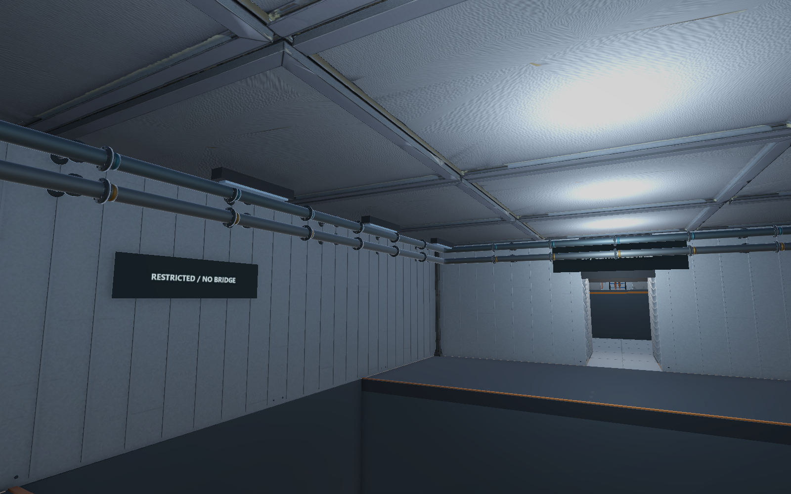
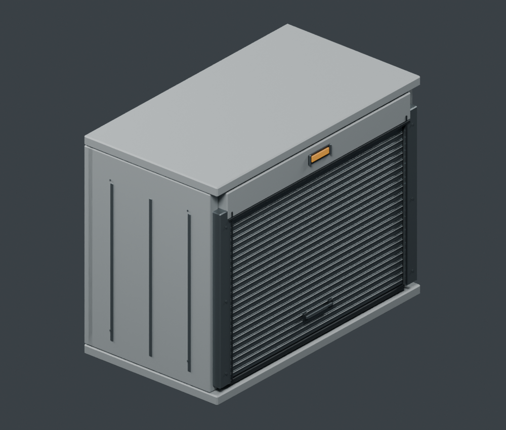
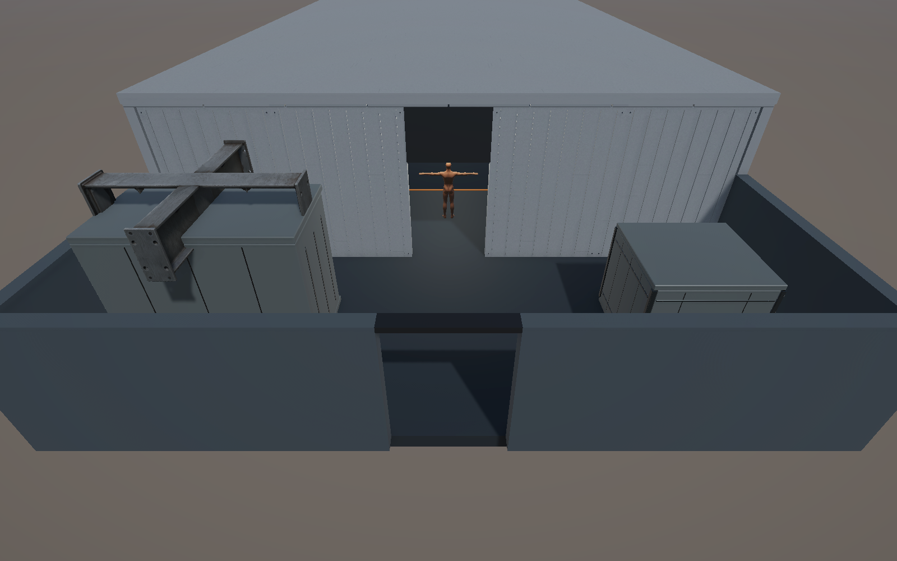

오늘은 앞서 배치한 층별 환경을 다시 확인함\
B2는 배관 연결이 빠진 부분이 있었고\
끊긴 구간을 보완해 설비까지 이어 줌\
1층은 셔터와 외장 코너가 깨져 보여 두 모델을 다시 제작해 교체함

## 11월 3일 작업에서 이어진 상태

B5의 생활·실험형 유리 돔, 양면 배식구, 돔 안쪽 링 조명은 어제까지 작업한 내용\
돔 안에는 침상, 식사·위생 설비, 검사 장비가 있고 경비는 밖에 있음\
큰 돔 안에서도 가구는 사람 크기를 유지한 상태

배식구는 앞뒤가 같은 두 문짝과 빈 전달함으로 구성돼 있음\
문을 임시로 열고 닫아 정적 충돌까지 검사했지만\
입력 개폐, 잠금, 배식, 탈출 기능은 아직 연결하지 않음

오늘은 이 상태를 유지하면서 다른 층의 빠진 연결부와 외형을 확인함

## 48종 적용과 배치 완료는 따로 확인

B5부터 1F까지는 계속 층별 씬으로 나눠서 관리 중\
앞선 배치 기록에서는 환경·소품 48종의 종류별 사용을 확인해 둔 상태

그런데 모델을 한 번 이상 썼다고 그 층의 배치가 끝난 건 아니었음\
B2는 배관이 군데군데 끊겨 보여 연결 경로를 다시 확인하게 됨

종류별 사용 누락이 없는지와\
배관·벽·설비가 자연스럽게 이어지는지는 서로 다른 검사임

## B2는 주배관에서 설비까지 연결

두 방의 공급·회수 주배관 4개, 설비로 가는 가지관 4개\
환기 계통 2개를 합쳐 10개 경로로 구성함\
관망은 프리팹 하나와 메시 12개로 정리함

처음에는 기계의 전체 크기를 감싸는 상자 범위에 맞춰 끝단을 잡았음\
그런데 이 범위에는 실제 기계 표면이 없는 빈 부분도 포함돼 있음\
숫자로는 닿아 있어도 화면에서는 배관 끝이 떠 보이는 문제가 생김

기계 메시의 실제 삼각형 표면을 찾아 연결 위치를 다시 잡음\
그 표면 안쪽으로 끝단을 12cm 넣어 연결부가 떨어져 보이지 않게 보정함\
새 렌더에서 반응기와 원심분리기 쪽 접속부를 다시 확인함

_벽 상부의 배관 연결 상태. 기존 통로와 퍼즐 보호구역을 유지한 시각 배치임._

이번 작업 전후 6개 층의 기존 Transform과 Collider를 비교해 유지된 것을 확인함\
배관이 보호구역을 침범한 곳은 없었고\
새 Collider나 게임 동작 스크립트도 추가하지 않음

## 1층 셔터와 익스테리어 코너 재제작

1층에서는 셔터와 외장 코너의 불규칙한 면이 깨져 보였음\
기존 형상을 계속 감량하기보다 정확한 평면과 모서리를 가진 모델로 다시 제작함

셔터는 닫힌 서비스 베이로 만들고\
롤러 슬랫, 가이드 기둥, 상부 하우징, 경고등을 나눠 구성함\
코너는 외장 패널과 금속 코너 캡, 점검판, 환기구가 있는 닫힌 설비 구조로 정리함

| 모델 | 재제작 삼각형 수 |
| --- | ---: |
| 하역장 셔터 | 3,736 |
| 익스테리어 코너 | 2,676 |
| 합계 | 6,412 |

_Blender 검토 렌더. 기존 모델의 바닥 중앙 피벗과 외곽 크기에 맞춘 교체용 외형임._

기존 배치를 유지할 수 있도록 바닥 중앙 피벗과 원래 모델 크기를 맞춤\
FBX로 내보낸 뒤 새 파일로 다시 가져와서 검사함

두 모델 모두 열린 경계, 비다양체, 퇴화 면은 0개\
법선은 유한한 값이며 재반입 크기 오차는 최대 약 0.00000006m였음\
앞뒤 렌더에서도 면이 찢어지거나 뒤집혀 보이는 부분은 없었음

두 프리팹의 기존 참조와 외곽 크기를 유지한 채 새 외형으로 교체함\
원본 FBX와 이전 외형은 보존하고 비활성화해 둠\
씬에서 셔터, 코너, 외부 출구 주변을 다시 확인함

_중앙 출구와 기존 바닥을 유지한 상태. 두 설비의 외형을 교체한 편집 화면임._

## 다음 작업

내일은 전체 층의 크기, 방향, 연결부와 시야부터 다시 볼 예정\
추가 프랍, Player·Enemy 구성, 실제 플레이 테스트도 그다음 작업으로 남겨 둠

난이도 곡선도 씬 외형만 보고 확정하지 않으려고 함\
사격과 교환 등 필요한 기능을 연결한 뒤 실제로 풀어 보며 조정해야 함

현재 결과는 외형 배치와 기하·참조 검수 범위임\
퍼즐 완주, 적 행동, 상호작용, 목표 기기 성능까지 완료한 상태는 아님
