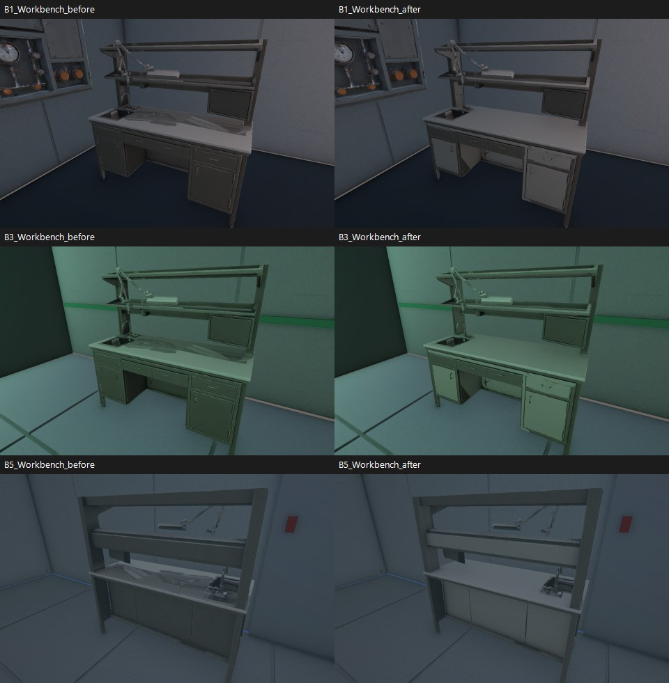
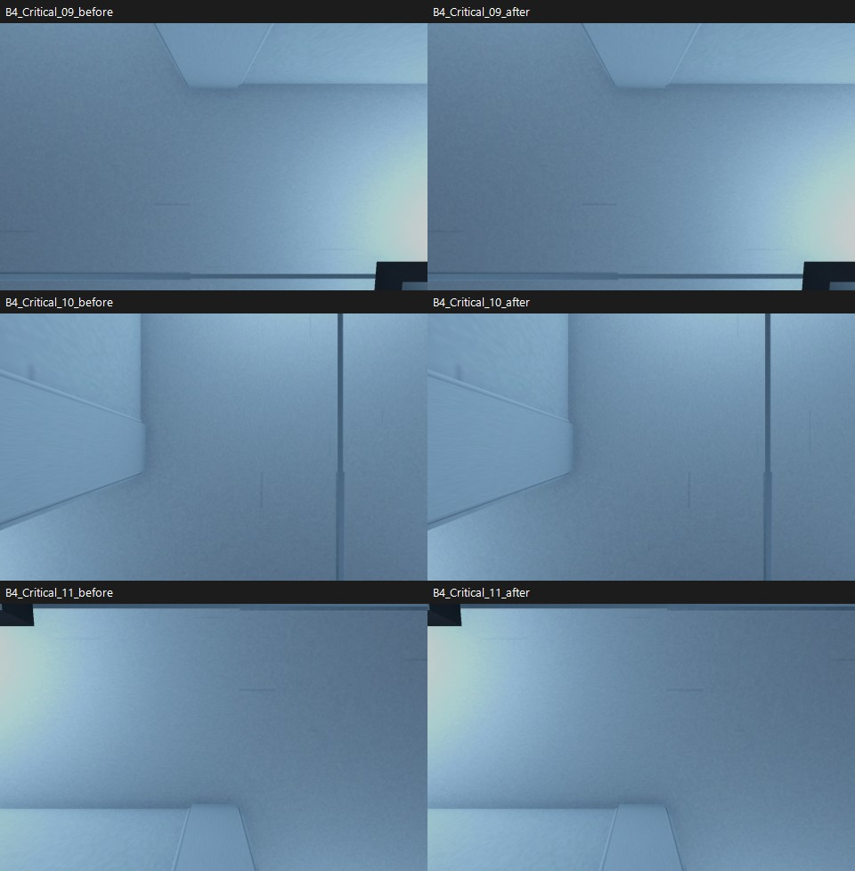
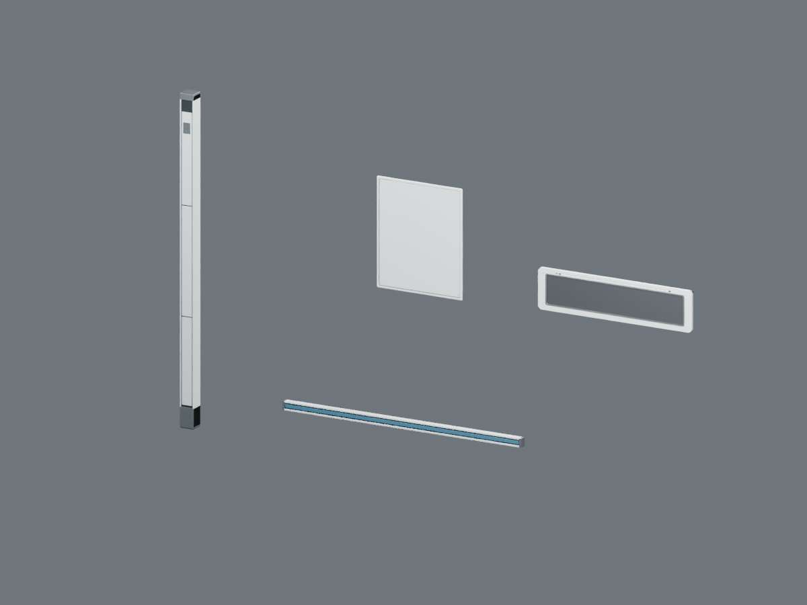
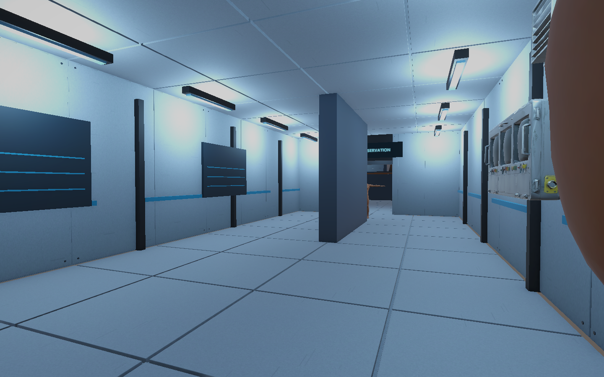
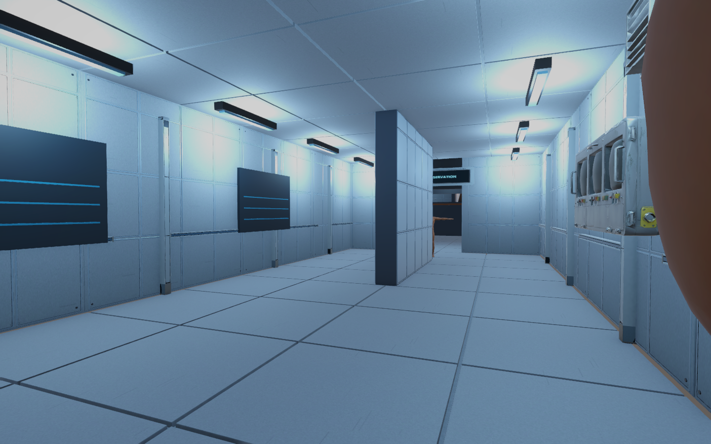
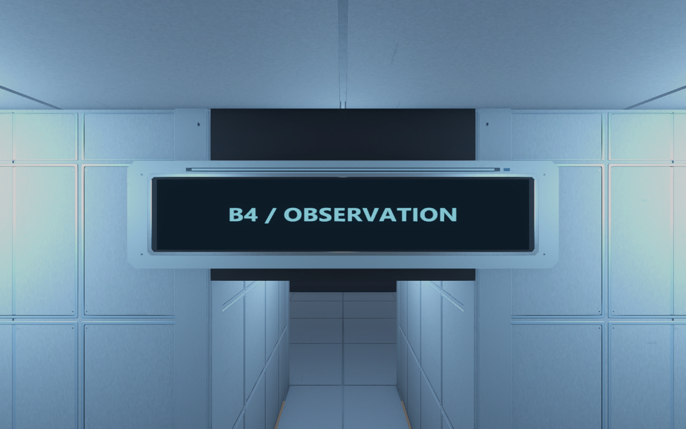
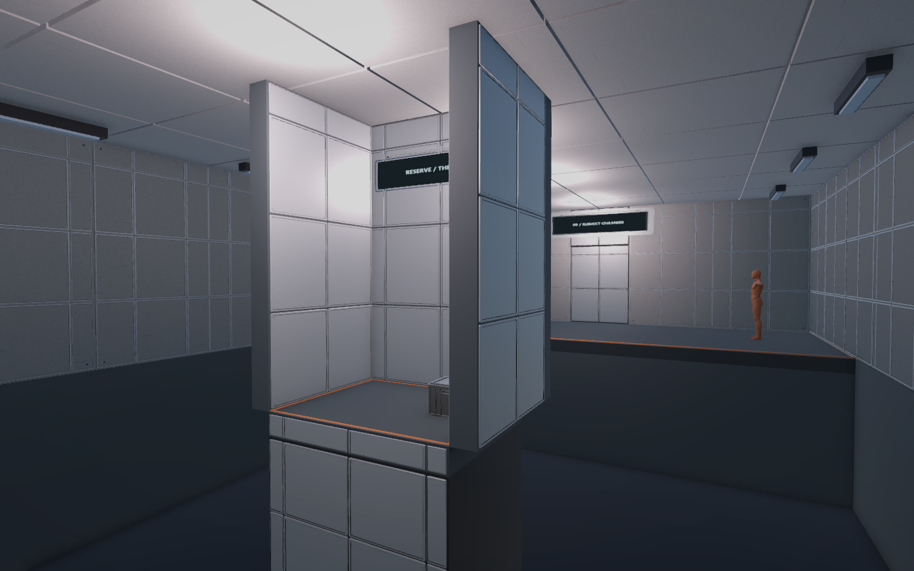
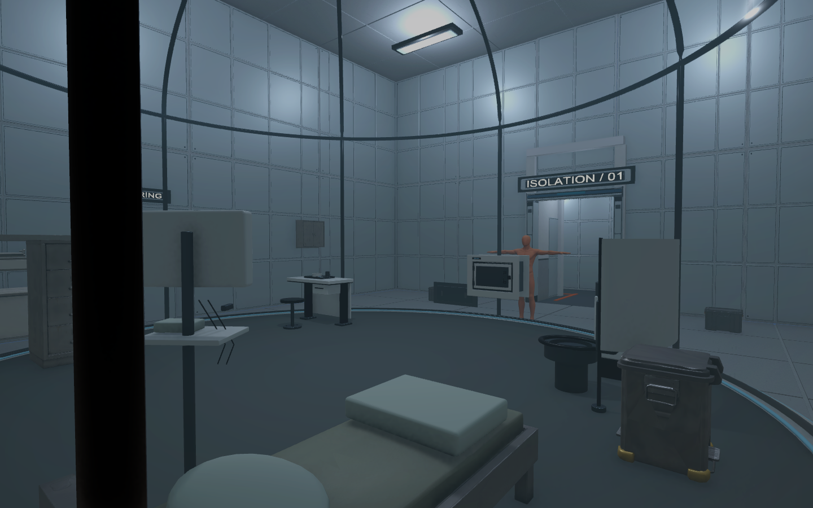

[B2 배관과 1층 외장 작업]({{ '/posts/after-seconds-b2-pipes-and-1f-facades/' | relative_url }})에서 이어지는 오후 작업 기록임\
오늘은 가구·소품 모서리, 작업대 색 얼룩, 벽과 문틀의 겹침을 먼저 정리함\
그다음 B5부터 1F까지 건축 마감의 외형을 바꿈

텍스처가 들어가 있어도 벽과 기둥, 표지판이 너무 단순해서\
아직 기본 도형으로 만든 프로토타입 같은 느낌이 남아 있었음\
표면 색뿐 아니라 판재 두께와 고정부가 보이도록 손보는 쪽으로 진행함

## 소품은 모서리와 노멀부터 정리

가구·소품·설비의 고유 메시 파트 41개를 처리함\
35개에는 베벨을 새로 넣고, 생활 소품 6개는 이미 제작한 베벨을 유지함\
전체에 60도 기준 각도 스무스와 가중 노멀을 적용함

좁은 모서리는 베벨 폭을 줄이고\
판재 전체가 둥글게 부풀지 않도록 모서리 위주로 처리함\
원래 UV를 유지하고 새 모서리 면에 필요한 UV만 보간함

원본 FBX를 덮어쓰지 않고 파생 메시를 만들어 연결함\
모델 프리팹 41개를 갱신했고, 6개 층의 배치 110곳에서 새 메시를 참조함\
기존 배치와 Collider는 유지함

이 과정에서 고유 소품 메시의 삼각형 합은 815,808개에서 1,447,800개로 늘어남\
모서리를 추가한 비용이 있으므로 화면이 나아진 것과 성능 확인은 따로 봐야 함

## 작업대 삼각형 얼룩은 색 텍스처 문제도 있었음

작업대 상판의 큰 삼각형 무늬는 스무스만 바꿔서 없어지는 문제가 아니었음\
색 텍스처 자체에 판재를 가로지르는 색 패치가 들어가 있었음

처음 만든 아틀라스 시안은 실제 UV에 맞지 않아 채택하지 않음\
최종본은 원래 메시와 UV를 그대로 사용해 Blender에서 색을 다시 베이크함\
넓은 판재 29곳을 정리하고 나머지 작은 디테일은 원래 색을 유지함

_왼쪽이 전, 오른쪽이 후. 상판의 큰 삼각형 색 무늬를 비교한 화면임._

2048×2048 색 텍스처를 공용 작업대 재질에 연결함\
기존 노멀맵과 원본 색 파일은 보존함\
B5·B3·B1의 같은 시점에서 큰 색 얼룩이 사라진 것을 확인함

작은 손잡이 주변의 생성 흔적이나 찌그러진 형상까지 전부 다시 만든 건 아님\
이번 보정 범위는 넓은 판재의 색과 소품 모서리 마감임

## 벽과 문틀은 겹치는 시각 면을 잘라 맞춤

6개 층의 활성·불투명 건축 시각 메시 614개를 검사함\
같은 방향으로 거의 같은 평면에 놓인 면의 겹침이 72쌍 있었음\
문틀, 복도 연결부, 천장, 냉각조와 포획 구역 주변이 포함돼 있었음

| 층 | 보수 전 겹침 쌍 | 수정한 시각 메시 | 보수 후 잔여 쌍 |
| --- | ---: | ---: | ---: |
| B5 | 60 | 47 | 0 |
| B4 | 9 | 30 | 0 |
| B3 | 3 | 4 | 0 |
| B2·B1·1F | 0 | 0 | 0 |
| 합계 | 72 | 81 | 0 |

문틀과 기존 통로를 유지한 상태에서 중복되는 시각 면을 잘라 맞춤\
원본 대신 보수한 파생 메시 81개를 씬에 연결함\
원래 위치, 충돌체, 재질과 앞서 보정한 소품은 유지함

_B4 연결부 비교. 겹치는 면을 조금 밀어 숨기기보다 잘라 맞추는 방식으로 보수함._

저장한 씬을 다시 읽어 같은 조건으로 계산한 잔여 공면 겹침은 0쌍\
다만 이 수치는 정해 둔 방향·간격·면적 조건 안에서의 결과임\
모든 방향의 자기 교차나 유리, 실제 이동 중 깜박임까지 통과했다는 뜻은 아님

## 단순한 벽·기둥·표지판을 제조 부품 형태로

기존 `Wall_Reveal`, `Wall_Pillar`, `Sign_Observation`은\
색이 들어가 있어도 얇은 막대나 상자처럼 보이는 부분이 있었음

VARCO 이미지 3장과 3D 3종도 확인함\
생성 파일은 열렸지만 모서리가 변형되거나 표지판이 두꺼워져 그대로 쓰기 어려웠음\
이미지의 디자인을 참고하고 실제 교체용 부품은 Blender에서 치수를 맞춰 제작함

벽 패널, 기둥, 수평 레일, 표지판 하우징 4종으로 정리함\
판재의 단차, 모서리, 고정 나사와 베젤처럼 실제 두께가 필요한 부분을 형상으로 만듦\
원래 표지판 문구와 앞면 텍스처는 유지함

_기둥, 벽 패널, 표지판 하우징, 수평 레일. Blender 제작 검토 화면임._

| 대상 | 최종 적용 수 |
| --- | ---: |
| 벽·부스·독립 칸막이 마감 메시 | 237곳 |
| 표지판 하우징 | 30곳 |
| 수평 마감 레일 | 16곳 |
| 기둥 마감 | 16곳 |
| 문틀 마감 | 12곳 |
| 합계 | 311곳 |

벽 마감은 패널 3,747장을 237개 메시로 묶어 배치함\
기존 벽의 실제 면이 덮고 있는 영역을 확인해 문과 창의 개구부를 피함\
B1의 실험 부스와 독립 칸막이도 포함함

_건축 마감 반영 전 B4 복도._

_같은 시점의 최종 B4. 외형 교체와 아래의 AA 설정 보정이 함께 반영된 결과임._

_기존 글자는 유지하고 주변 하우징과 고정부를 추가함._

## 겹침을 없애도 가는 이음은 다시 확인해야 했음

초기 패널은 가운데 판과 별도 프레임을 조립한 구조였음\
안쪽에서 반대 방향으로 포개진 공면 삼각형 16쌍을 확인함

간격을 줘서 내부 겹침을 0쌍으로 줄였는데도\
고정 화면에서 가는 이음이 점선처럼 보이는 현상은 남아 있었음\
이 현상의 원인을 공면 겹침 하나로 단정할 수는 없었음

최종 패널은 별도 프레임을 포개지 않는 닫힌 단면으로 다시 만듦\
나사를 포함해 패널 한 장은 208삼각형\
최종 패널 내부 공면 겹침은 0쌍이며, B4 배치끼리의 평면 중복 검사도 0쌍임

PC 렌더 파이프라인의 MSAA는 기존에 꺼져 있었음\
MSAA 4배와 카메라 SMAA High를 비교해 가는 이음의 연속성이 나아진 것을 확인함\
이 설정을 PC 렌더 파이프라인과 6개 씬의 기존 카메라에 반영함

조명 배치, SSAO, 렌더 스케일은 유지함\
AA의 GPU 비용과 패널 추가 비용은 실제 기기에서 다시 측정해야 함\
패널만 합쳐 779,376삼각형이며, 이 수는 6개 씬에 나뉜 전체 합계임

## 6개 층 저장 후 다시 확인

_B1의 부스와 독립 칸막이에도 같은 마감 체계를 적용함._

_B5 시작 구역. 기존 포드와 생활·실험 구역의 배치는 유지함._

방 20곳, 표지판 6곳, B4 기둥·레일 2곳의 고정 시점 28개를 남김\
B5~1F 씬을 저장한 뒤 다시 열어 참조와 기존 구성을 비교함

- 누락 메시·재질·스크립트 0개
- 기존 Transform·Collider·런타임 Behaviour 타입 구성·문구 일치
- 새 시각 오브젝트에 추가한 Collider·게임 동작 스크립트 0개
- 임시 검수 도구를 컴파일 대상에서 정리한 뒤 컴파일 실패 없음

## 남은 작업

이번에 확인한 범위는 저장 상태, 참조, 기존 구성 보존과 고정 화면임\
실제 키보드 이동 중 이음이나 깜박임이 어떻게 보이는지는 아직 검사하지 않음\
목표 기기의 FPS와 전체 퍼즐 완주 검사도 남아 있음

환경 외형이 바뀐 것과 게임 기능이 완성된 것은 따로 기록함\
문 상호작용, 예약·교환·경비 핵심 로직을 이번에 구현한 건 아님

다음에는 이동 시점에서 수정 구역을 확인하고\
실제 화면의 비용을 측정한 뒤 기능 구현과 플레이 테스트를 이어갈 예정

오늘 작업을 보면서 이해한 점은 [별도 데일리 로그]({{ '/posts/daily-log-visual-quality-and-verification/' | relative_url }})에 정리함
