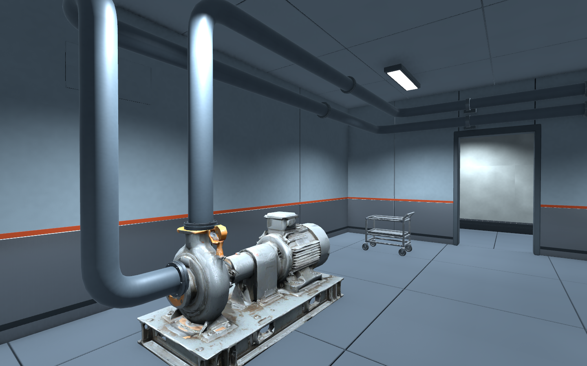
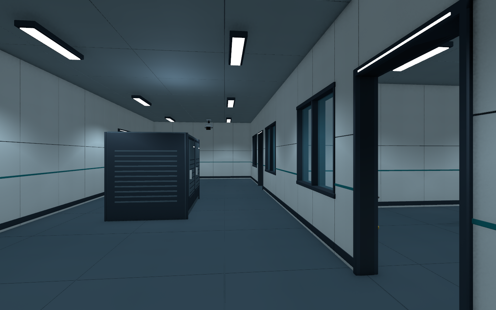
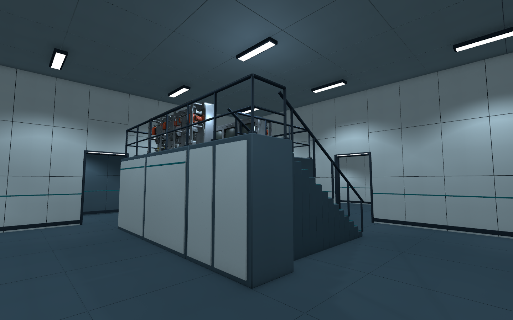
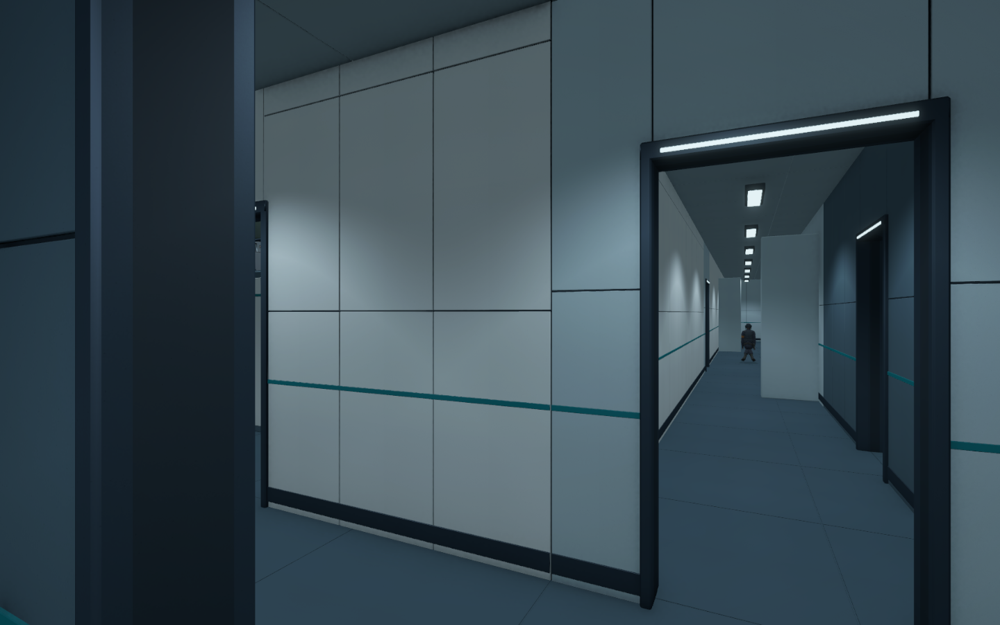

11월 5일 밤부터 6일 새벽까지 이어진 작업\
B5의 에셋 보수 상태를 다시 확인하고\
최신 잠입 도면을 기준으로 B4 관찰층을 제작함

기존 B4 씬은 보존하고 `Level_B4_Stealth`를 별도로 만듦\
Unity 6000.4.0f1과 URP 17.4.0은 그대로 유지함

## B5는 현재 상태를 다시 확인

앞서 보수한 경비 얼굴과 바이저, 펌프의 접지와 연결 포트\
공급·회수 배관, 계단 난간, 벽 접합부를 새 렌더로 확인함

이번 확인 범위에서는 B5 메시를 추가로 수정하지 않음\
B5 씬 파일도 유지함

_기존 보수 상태를 다시 확인한 화면. 이번 B4 제작과 구분해 기록함._

예상 경로를 지름 0.6m, 높이 1.8m의 캡슐로 검사함\
0.25m 간격의 표본 648개에서 통행을 막는 겹침은 없었음\
정적 검사 결과이며 사람이 잠입해서 완주한 결과는 아님

## B4 관찰층 구성

48×32m 안에 실내·복도·코어 19구역을 구성함\
문은 28곳이고 열린 문 27곳, 잠긴 설비문 1곳으로 나눔

| 구역 | 이번 구성 |
| --- | --- |
| 관찰 구역 | 북·남 관찰실, 관찰 복도, 양면 유리창 4곳, 장비 랙 |
| 분석·관제 구역 | 분석 콘솔, 높이 2.5m 데크, 14단 계단과 난간 |
| 지원 구역 | 관찰 지원·장비 준비·기록·유틸리티실, 리프트 전실 |
| 계단A | B5에서 올라오는 도착 전실. 층간 연결은 미완료 |
| 계단B | 2개 계단 구간과 중간참·상부참. 상승 6.4m, 36단은 가안 |

_관찰실 안팎을 볼 수 있는 창과 복도. 유리 충돌은 확인했고 적의 시야 판정은 아직 없음._

기존 소품 30개와 경비 3명, 연구원 1명, CCTV 2개를 재사용함\
인물과 CCTV는 외형 배치까지만 진행함\
AI, 감지, 자동 회전, 교환 기능은 추가하지 않음

건축과 마감에는 베벨, Weighted Normal, 명시 삼각화를 적용함\
Blender 편집 원본과 외부 제작·검수 도구도 함께 보관함

_데크는 바닥보다 2.5m 높게 구성함. 계단 상승·하강과 난간 충돌을 검사한 상태._

## 제작 중 수정한 문제

### 복사된 조명 데이터

새 씬의 초기 복사에 B5 조명 데이터 참조가 남아 있었음\
이 상태에서 ReflectionProbeManager 오류와 검은 렌더가 발생함

복사된 조명 데이터 참조를 비우고 B4 씬을 다시 연 뒤\
B4 구역에 맞는 정적 반사 8개를 새로 생성함\
최종 렌더와 플레이 검사에서는 재발하지 않음

### 바닥 재질과 정적 인물

기존 B4 바닥 재질과 섞이지 않도록 새 씬 전용 재질을 분리함\
반입·저장 중 바뀐 기존 재질은 원래 내용으로 복원함

인물은 편집 화면의 자세가 플레이 진입 때 T자로 돌아가는 문제가 있었음\
B5의 정적 포즈를 가져오고 새 B4 인스턴스의 미연결 Animator만 끔

포즈 적용 뒤에는 스킨 메시의 실제 최저 정점으로 발 높이를 다시 맞춤\
공유 프리팹과 Animator 리소스는 변경하지 않음\
나중에 동작을 연결할 때 자세와 접지를 다시 확인해야 함

## 통행과 실제 입력 확인

| 검사 | 확인한 결과 |
| --- | --- |
| B4 정적 경로 | A/B/C 합계 1,077표본, 막힘 0건 |
| CharacterController 이동 | A/B/C와 데크·계단B 왕복, 7개 검사 통과 |
| 문 | 열린 27곳 통행, 잠긴 1곳 차단 |
| 유리 | 창 4곳의 양쪽 충돌 확인 |
| 실제 플레이 입력 | W 입력 0.8초에 약 1.2m 이동, 접지 유지 |
| 마지막 플레이 Console | 검사 중 새 경고·오류 0건 |
| 에셋 참조 | 누락 메시·재질·스크립트 0건 |

Controller 검사는 현재 플레이어의 치수와 이동 설정에 맞춘 임시 Controller로 진행함\
실제 플레이 검사에서는 Input System 키보드 상태 이벤트를 기존 이동 코드에 전달함

_계단A 도착 전실에서 출입문 방향으로 이동한 실제 Game View. 전 구간 잠입 완주 화면은 아님._

기존 게임 코드·씬·Animator·패키지·프로젝트 설정 등\
보호 대상으로 기록한 95개 파일의 작업 전후 해시도 확인함\
이번 작업에서 게임 내부 C#은 추가하지 않음

## 성능과 남은 작업

B4의 전체 최고 LOD 배치는 867,081삼각형\
LODGroup은 30개, Collider는 259개임\
광원 93개 중 그림자를 쓰는 것은 7개임

이 수치는 현재 씬의 구성 기록임\
플레이 프레임이 진행됐다는 것만으로 성능이 충분하다고 판단하지 않음\
목표 PC의 FPS와 CPU·GPU 프레임타임 측정은 남아 있음

B5 계단A 상부참과 B4 출입문 위치도 아직 맞춰야 함\
계단B의 높이와 B3 도착층 역시 가안이고 실제 씬 전환은 없음

다음 회사 작업은 B5·B4 직접 이동 확인부터 시작할 예정\
층간 단면, 공간 구분, 조명과 성능을 확인한 뒤 B3 제작으로 이어감

현재는 도면 기반 공간과 통행 검사를 완료한 단계\
최종 아트, 적 행동, 사람의 잠입 완주까지 완료한 상태는 아님

작성자 송예찬
