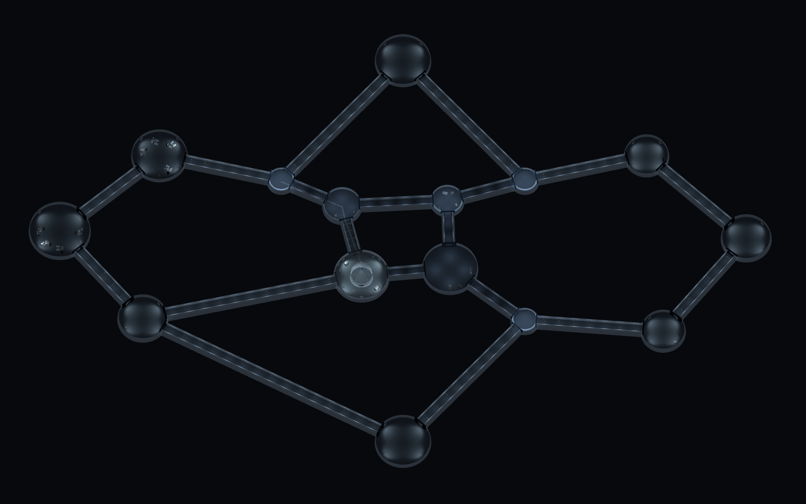
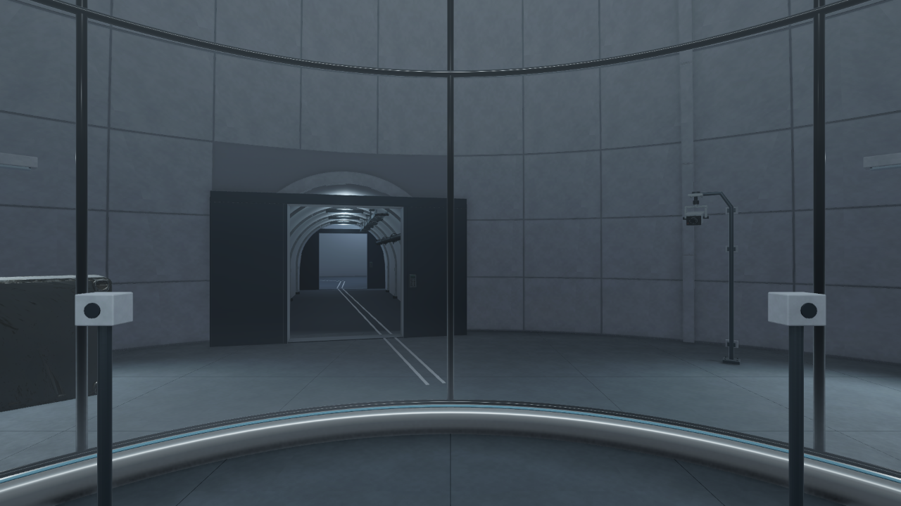
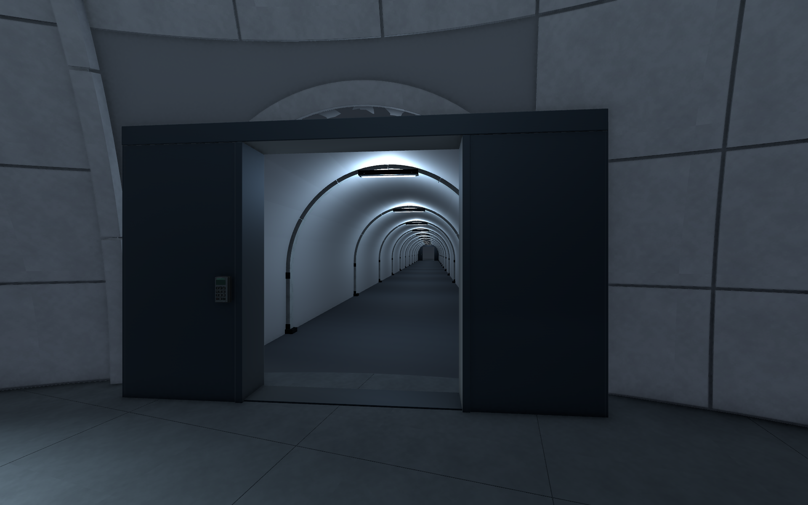

오늘은 기존 B5·B4의 문과 재질 보완부터 시작해서\
B3 프랍 작업, 터널·돔 구조 정리, 새 원형 공동 설계 반영까지 진행함

마지막 기준 씬은 `Level_B5_Circular`임\
Unity 6000.4.0f1을 유지했고 구버전 씬은 `Old`에 보관함

현재 완료한 것은 **B5 전체 평면 구조 구현과 통행 검수**임\
구역별 최종 아트와 층간 연결, 게임 동작은 남아 있음

## 기존 레벨에서 정리한 부분

B5·B4의 좌우 슬라이딩문과 문틀, 키패드 외형을 손봄\
열린 상태에서 문짝이 통로 쪽으로 남지 않도록 수납 공간도 확인함\
벽과 배관 재질, 과하게 밝던 조명도 함께 조정함

B3 시료층을 제작하고 만든 세 층에 프랍을 보강함\
VARCO에서 장비 6종을 생성·리메시한 뒤 Blender에서 치수와 베벨\
노멀, 삼각화, LOD, PBR 재질을 정리해 추가 프랍 101개를 배치함

시료 선반의 단순한 상자 288개도 테두리와 손잡이\
잠금쇠, 뚜껑 가스켓이 구분되는 모델로 교체함

처음 적용한 규칙적인 문양은 원하는 분위기와 달랐음\
후속 작업에서 벽과 상자 마감을 불규칙한 먼지·긁힘·닦임 쪽으로 다시 정리함

이 수량은 오늘 중간에 작업한 기존 레벨 기준임\
최종 원형 B5의 프랍 수량이나 완성도로 합산하지 않음

## 터널과 원형 공동을 기준으로 설계 정리

기존 복도에 아치와 돔을 덧붙이면서\
조명과 리브가 겹치고 벽 설비가 통로를 막는 구간이 생김

큰 차폐벽은 벽 쪽 설비 엄폐로 바꾸고\
복도 폭, 천장 단면, 문 접합부를 함께 조정함

이후 새 조감도와 공간 역할을 기준으로 원형 공동 설계를 대조함\
층별 색감, 안내선과 기록을 연결하는 길 찾기 방향도 정리함

| 층 | 현재 연출 방향 |
| --- | --- |
| B5 격리층 | 창백한 청백색, 실험 공간과 생활 공간 구분 |
| B4 측정·관찰층 | 어두운 무채색 연구 환경 |
| B3 시료층 | 저인원 창고, 보관부 기본 소등과 구역 점등 |
| B2 기계층 | 철색과 붉은 보조등, 그레이팅 메자닌 |

B2는 한 공동의 메자닌 검토 씬을 따로 만듦\
그레이팅 데크, 두 계단, 난간과 지지 구조, 펌프·배관을 배치함\
전체 기계층이 완성된 상태는 아님

B3 구역 점등도 현재는 설계 데이터까지임\
스위치 상호작용이나 새 원형 시료층 전체를 구현한 것은 아님

## 최종 B5는 12공동과 별도 이동 구역

초기 원형 씬에는 일반 공동 4개, 이동 코어 3개, 복도 7개가 있었음\
조감도 전체를 기준으로 외곽 공동 8개와 복도 12개를 추가함

| 구분 | 최종 기본 구조 |
| --- | ---: |
| 일반 공동 | 12개 |
| 계단·승강기 코어 외피 | 3개 |
| 연결 터널 | 19개 |
| 문 | 38세트 |

작업 단위는 공동·코어·복도를 합쳐 34개로 관리함\
기존 공동에도 추가 복도가 이어질 수 있도록 개구부를 만들고\
전체 바닥과 터널, 출입부 연결을 실제 씬에 반영함

_구조 확인을 위해 촬영할 때만 지붕 상부를 숨긴 화면. 저장된 씬에는 지붕이 남아 있음. 외곽 공동의 세부 배치는 아직 비어 있는 곳이 많음._

## C01은 실험 공간으로 정리

중앙 C01은 실험·일시 격리 공간으로 사용함\
생활 가구 배치는 비활성 상태로 보관하고 실험 포드를 유지함

관찰 콘솔 2개, 기록장, 밀폐 폐기함을 배치하고\
곡면 벽 패널, 세 출입구에 맞춘 보강 리브와 계측 장치를 추가함

생활 시설은 W01·W02로 나눔\
각 공동에 침상과 책상 등 생활 가구 4모듈을 배치함\
생활 구획 전체의 마감까지 끝난 것은 아님

새 건축·패널·리브·계측 장치는 Blender에서 제작함\
편집 원본에는 베벨을 남기고 Unity 반입 메시에는 명시 삼각화를 적용함

_현재 C01의 실제 Game View. 장비 배선·단자·작은 소품과 조명 마감은 후속 작업임._

## T11 출입부의 막힘 수정

새 서쪽 출입구 주변에 기존 벽면 설비가 남아 있었음\
복도를 연결했어도 이 설비 때문에 통행 검사에서 걸리는 구간이 나옴

환기구와 점검함, 캐비닛 등 기존 설비 6개의 위치를 옮김\
새 기록장도 다른 가구와 겹치지 않도록 다시 배치함

_설비 이동 후 통행을 확인한 출입부. 문틀과 곡면 벽의 시각적인 접합 마감은 더 다듬어야 함._

## 최종 검수 결과

| 검사 | 확인한 결과 |
| --- | --- |
| 복도 중앙·좌우 캡슐 검사 | 4,854표본, 막힘 0·바닥 누락 0 |
| CharacterController 복도 왕복 | 38/38 통과 |
| 문 열린·닫힌 정적 충돌 | 38/38 통과 |
| 새 임상 설비 4개와 외곽 BoxCollider 27개 | 검사 기준 35mm 초과 관통 0 |
| 메시·재질 누락 | 0 |
| 새 모델 반입 경고·오류 | 0 |
| C01·T11 Play 검사 | 실제 입력 이동·프레임 진행 확인, 새 경고·오류 0 |

문 검사는 열린 위치와 닫힌 위치의 형상·충돌을 확인한 것임\
실제 문 개폐나 키패드 동작을 구현한 결과는 아님

Play 측정은 Editor 1920×1080에서 구간별 5초씩 진행함\
C01 중앙 프레임 시간은 9.13ms, T11은 9.56ms였음\
p95는 각각 13.92ms와 12.80ms임

처음 비활성 창에서 프레임이 제대로 진행되지 않은 측정은 제외함\
백그라운드 실행을 켜고 이동과 프레임 증가를 확인한 뒤 다시 측정함

두 구간의 짧은 Editor 측정이므로 전체 게임 성능으로 일반화하지 않음\
적 AI를 포함한 잠입 완주와 층간 이동 검사도 아직 남아 있음

## 저장한 것과 다음 작업

씬, 에셋, Blender 원본, 도면, 검수 화면을 함께 Git에 저장함\
게임 내부 C#과 Animator는 이번 레벨 작업에서 추가하거나 변경하지 않음\
구버전 씬과 에셋의 GUID도 보존함

전체 평면이 생겼지만 구역별 아트 완료는 아직 0/34임\
외곽 프랍 목록에는 연결된 에셋이 없는 배치가 24개 남아 있음\
24종의 서로 다른 프랍이 필요하다는 뜻은 아님

집에서 이어갈 순서는 아래처럼 남김

1. C01 문틀·곡면 벽 접합부와 재질·조명 마감
2. 실험 장비 배선·단자·작은 소품 보강
3. T01·T03·T11 연결부 확인 후 T01 → C02 진행
4. 공동 역할에 맞는 부족 프랍 제작·배치
5. B5 마감 후 실제 층간 계단·승강로 연결

문·키패드·적 AI·스위치·미니맵 동작은 이후 직접 작성할 범위로 남김

공간을 다시 정리하면서 생각한 내용은 [오늘의 데일리 로그]({{ '/posts/daily-log-spaces-need-a-purpose/' | relative_url }})에 따로 적음

작성자 송예찬
