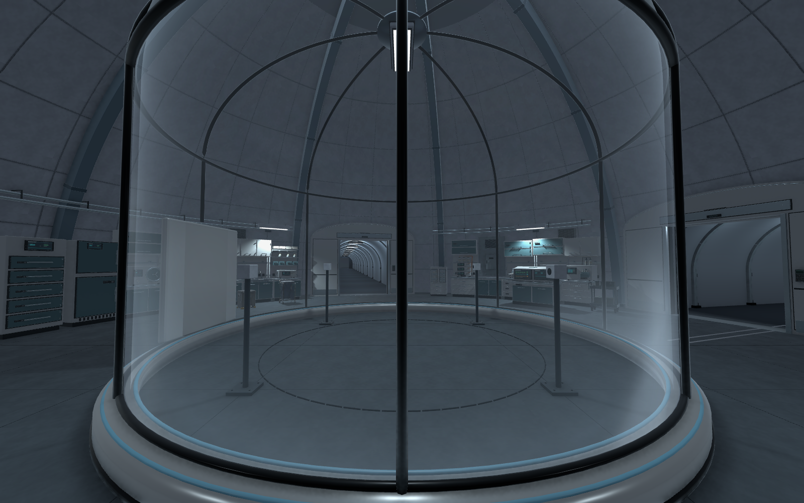
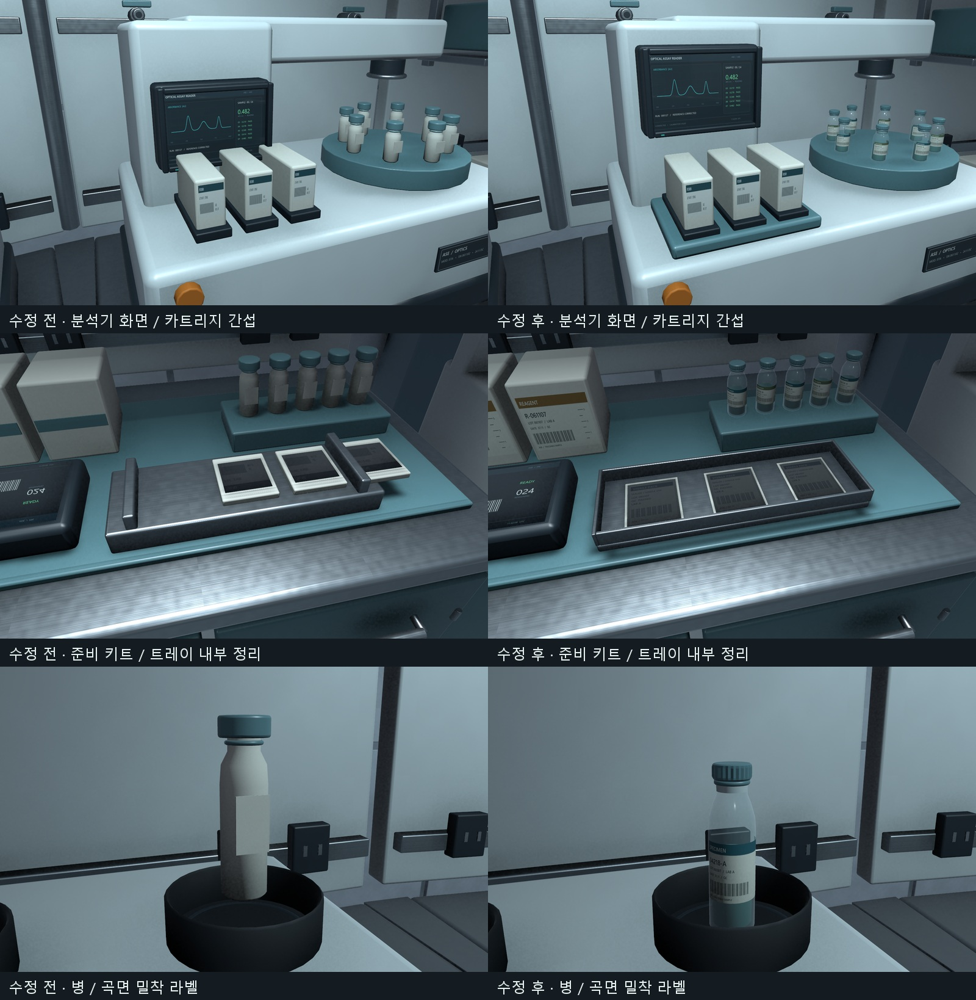
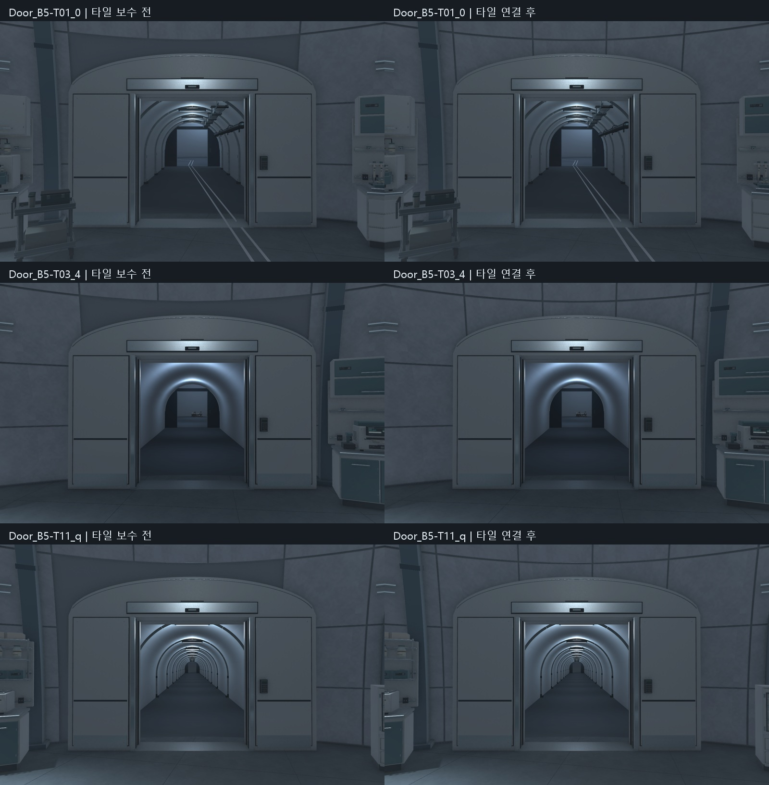
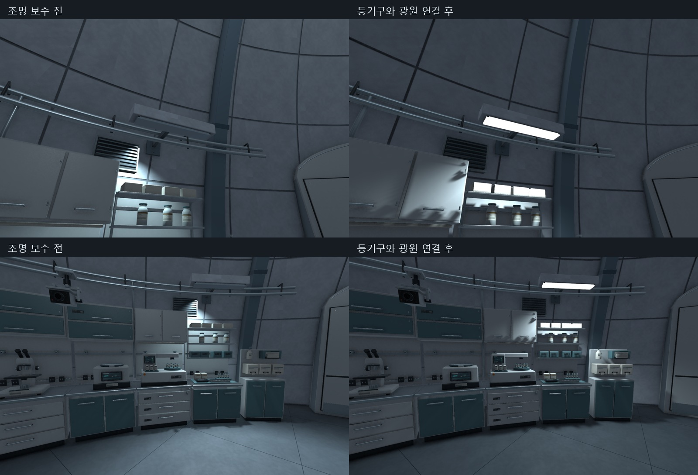

회사에서 만든 B5 원형 공동을 집에서 이어서 작업함\
이번 범위는 `Level_B5_Circular`의 C01 실험동 세부 마감임\
날짜가 넘어가서 11월 7일자로 기록함

외곽 작업대와 장비 구성을 채우고\
프랍의 가까운 디테일, 문과 터널의 접합부, 조명까지 순서대로 보수함

_최종 조명 보수 후 Unity에서 촬영한 실험동. 중앙 포드 주변으로 작업대와 분석·수납 장비가 배치된 상태임._

## 보강 리브와 외곽 배치

`AF_C01_ThreePortalRibs`는 중간 마디가 비고 간격이 어긋나 보였음\
45도 간격으로 이어지는 리브 8개로 정리하고\
벽 타일과 구분되는 무광 금속 재질, 약 30cm 돌출 형태를 적용함

돔 외곽에는 30개 작업대 배치를 구성함\
실험, 계측, 세척, 준비, 보관 장비가 이어지도록 채움\
검수 후 이 배치를 유지하면서 프랍 디테일을 보강함

반복을 줄이기 위해 장비 16종과 수납 변형 5종을 추가함\
최종 프랍 검수 대상은 공통 장비와 보수한 바이탈 모니터를 포함한 37종임

## 장비의 역할과 재질 보강

| 대상 | 바꾼 부분 |
| --- | --- |
| 분석·계측 장비 | 시료 슬롯, 도크, 로터, 호스, 조작부를 구체화 |
| 모니터 | LCD 표현 13종과 베젤·유리·발광 표면 구성 |
| 응급 캐비닛 | 유리 뒤 실제 내부와 수납물 구성 |
| 점검·서비스 설비 | 점검함은 한 곳으로 정리하고 환기구·배선 역할 구분 |
| PPE 스테이션·바이탈 모니터 | 깨지거나 어색한 메시와 연결부 보수 |
| 장비 표면 | 베벨, 곡면 노멀, 코팅·금속·유리 등 재질 구분 |

공용 PBR 맵 18장과 기능 라벨 12장을 반영함\
원심분리기 로터, PCR 96웰, 세척기 수조, 현미경\
압력계와 열접착부처럼 용도를 알 수 있는 부분도 보강함

화면 그래프와 수치는 현재 정적 텍스처임\
실시간 표시나 장비 동작은 아직 연결하지 않음

## 겹침과 얇은 소품 재보수

`CP_OpticalAnalyzer`는 모니터와 네모난 카트리지가 겹쳐 있었음\
화면을 올려 두 부분 사이에 약 36.9mm 간격을 확보하고\
카트리지 도크가 본체 상판에 닿도록 정리함

`CP_PreparationKit`은 포장물 3개를 트레이 내부로 옮김\
포장 두께도 12mm에서 1.8mm로 줄여 두꺼운 카드처럼 보이던 부분을 보수함

병 라벨은 큐브 형태에서 곡면을 따라 붙는 얇은 인쇄면으로 변경함\
원본 모델 9종에 들어 있는 병 46개가 수정 대상임\
씬 전체의 반복 배치 수량을 뜻하는 것은 아님

뚜껑의 파지 홈, 병목, 밀봉 링, 바코드와 눈금\
유리병 내부 시료와 불투명 시약병의 재질 차이도 반영함

프린터 출력지와 멸균 포장은 얇게 정리하고\
선반·받침 위에서 떠 있던 병과 상자의 접점도 맞춤

_왼쪽이 수정 전, 오른쪽이 수정 후. 승인한 작업대 배치와 기존 모델 GUID는 유지함._

## 실험동 출입문 3세트 교체

기존 문 높이는 약 3.08m였고 터널 상부는 3.4m까지 올라가 있었음\
그래서 문 위로 터널 단면이 남아 보였음

T01·T03·T11의 실험동 쪽 문 3세트를 교체함\
곡선 상부와 터널 안쪽 접합부, 양쪽 문짝 수납 포켓을 구성함

통행 폭은 2.4m를 유지함\
문짝에는 실제로 뚫린 관찰창과 유리, 패킹, 하부 보호판\
손잡이 홈과 키패드 외형을 반영함

기존 문은 비활성 상태로 보관함\
새 문도 지금은 열린 상태의 정적 아트이며 개폐 로직은 추가하지 않음

## 문 위의 회색 벽과 타일 연결

문을 바꾼 뒤에도 아치 위쪽에 회색 벽이 비대칭으로 남아 있었음\
출입구 주변에서 벽 타일을 통째로 생략하던 부분이 원인이었음

실제 아치에 맞춘 곡면 타일 20조각을 추가함\
기존 돔의 곡률과 타일 두께, 베벨, 줄눈에 맞춰 연결함\
추가 메시의 삼각형 수는 14,337개임

_새 문을 적용한 뒤의 타일 보수 비교. 왼쪽은 타일이 빠져 있던 상태, 오른쪽은 기존 벽 줄눈에 맞춰 연결한 상태임._

## 등기구와 실제 광원 맞추기

등이 없는 위치에서 빛이 나오고 실제 작업등은 어두워 보였음\
확인한 원인은 꺼진 재질 발광 키워드와 등기구 없이 남아 있던 보조 광원임

벽 작업등 4개의 확산판을 전용 발광 재질로 연결함\
실제 Spot Light도 확산판 아래에 맞추고 작업대를 향하도록 조절함

등기구 없는 보조 광원 6개는 비활성 상태로 보관함\
직접 조정했던 광원의 위치와 수치는 남겨 둠

중앙 포드에는 천장 등기구를 추가하고 아래를 비추도록 정리함\
T01·T11의 실제 등기구 15개도 발광 표면을 연결함\
새 라이트맵이나 GI 베이크를 진행한 것은 아님

_왼쪽은 보수 전, 오른쪽은 보수 후. 등기구의 밝은 표면과 주변을 비추는 광원의 위치를 맞춤._

## 확인한 결과

검수 수치는 각 보수 단계에서 확인한 범위를 구분해서 기록함

| 검수 단계 | 확인한 결과 |
| --- | --- |
| 프랍 보수 | 모델 37종의 퇴화 삼각형·누락 재질/셰이더 0건, 기존 30작업대 배치 유지 |
| 프랍 주변 통행 | 실험동 순환 경로 540표본에서 막힘 0건 |
| 문 교체 | 닫힌 단면 11,019표본에서 빈틈 0건, 문짝 126자세에서 기준 초과 간섭 0건 |
| 문 교체 후 동선 | 복도 4,854표본 통과, 실험동 연결 3경로 왕복 6회 통과 |
| 타일 보수 | 출입부 369표본에서 막힘 0건, 새 메시 퇴화면 0건 |
| 최종 조명 보수 후 Play | 345프레임 진행, 기존 입력으로 1.218m 이동, 새 경고·오류 0건 |

마지막 Play는 1920×1080 Editor에서 확인함\
프레임 시간 중앙값은 13.64ms, p95는 17.92ms였음\
짧은 확인 구간의 결과이며 전체 레벨이나 최종 빌드 성능 판정은 아님

편집 모드와 플레이어 시작 위치를 복원하고 씬을 저장함\
게임 C#과 Animator 동작은 이번 작업에 추가하지 않음

## 다음 작업

1. 실제 플레이어 시점에서 문 위 타일과 실험동 밝기 최종 확인.
2. 바닥 안내선과 출입구 표식을 정리하고 통행·시야 재확인.
3. T01 연결 복도를 마감한 뒤 C02 경비·모니터링 공동으로 진행.
4. 이후 다른 공동의 프랍, 층간 계단·승강로와 전체 성능을 별도로 검수.

오늘은 실험동 한 구역의 완성도를 높인 작업임\
B5 전체 34작업 단위의 아트 완료 판정은 아직 0/34로 유지함\
최종 시야 검수와 남은 마감까지 확인한 뒤 완료 처리할 예정임

작업하면서 확인한 점은 [오늘의 데일리로그]({{ '/posts/daily-log-details-that-make-a-lab/' | relative_url }})에 따로 정리함

작성자 송예찬
