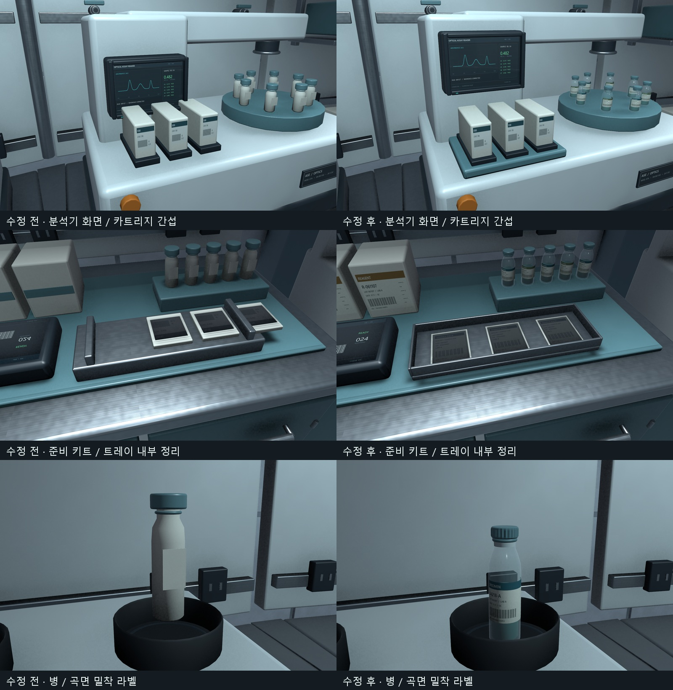

회사에서 만든 원형 B5를 집에서 이어서 작업함\
날짜가 넘어가서 11월 7일 기록으로 남김

이번에는 C01을 편하게 실험동이라고 부르기로 함\
방의 구성은 좋아졌는데 가까이서 보면 어색한 부분이 계속 눈에 들어왔음

## 물건이 많아도 역할이 안 보이면 어색함

처음에는 돔 외곽이 듬성듬성해서 실험 공간처럼 보이지 않았음\
작업대와 장비를 채우고 나니 이번에는 같은 프랍이 반복되는 게 보임

모니터도 판 위에 그래프를 그린 것처럼 보였고\
분석기는 전자레인지처럼 보여서 어떤 물건인지 바로 알기 어려웠음

장비 종류를 늘리면서 시료가 들어가는 곳, 조작하는 곳\
호스와 전원선, 뚜껑과 잠금장치처럼 역할이 드러나는 부분을 구체화함

화면에는 베젤과 유리, 표시 영역을 구분해서 넣음\
같은 그래프라도 어디에 붙어 있는지에 따라 모니터처럼 읽히는 정도가 달라 보임

지금 화면은 움직이지 않는 정적 표현임\
움직이는 그래프나 장비 동작은 나중에 따로 진행하려고 함

## 라벨은 작게 만든 큐브로 끝나지 않았음

병 앞에 붙은 네모난 부분은 종이 라벨을 표현한 것 같았음\
그런데 두께와 모양 때문에 병에 큐브를 붙여 놓은 느낌이 더 강했음

병 표면을 따라 휘는 얇은 인쇄면으로 바꾸고\
바코드와 눈금, 병목과 뚜껑 홈, 밀봉 링을 같이 정리함

준비 키트의 포장물도 두꺼운 카드처럼 옆으로 삐져나와 있었음\
트레이 안으로 넣고 두께를 줄이니 용도가 훨씬 자연스럽게 보임

_왼쪽이 수정 전, 오른쪽이 수정 후. 라벨의 두께와 곡률, 물건이 받침에 닿는 부분을 함께 정리함._

모서리에 베벨을 넣는 것도 필요하지만\
얇아야 하는 물건의 두께와 물건끼리 닿는 위치도 계속 봐야겠음

## 문 하나를 바꾸면 주변 벽까지 봐야 함

실험동 문 위로 터널 상부가 남아 보이는 부분이 있었음\
문을 바꾸고 나서는 아치 위 회색 벽이 비대칭으로 남아 있는 게 눈에 들어옴

확인해 보니 문 주변에서 벽 타일을 통째로 생략한 부분이었음\
아치 모양에 맞춰 타일을 잘라 기존 줄눈과 이어 붙임

문 자체의 모양만 보는 것으로 끝낼 수는 없었음\
터널, 문틀, 벽 타일이 만나는 부분까지 한 구조로 봐야 자연스러워 보임

## 밝은 표면과 실제 빛의 위치

마지막에는 조명이 이상해서 직접 조금 건드려 봄\
등이 없는 곳에서 빛이 나오는데 정작 등기구는 어두워 보였음

재질에 발광색은 들어 있었지만 발광이 활성화되지 않은 부분이 있었고\
별도의 보조 광원은 등기구와 떨어져 있었음

등의 표면을 밝게 보이게 하는 재질과\
주변 작업대를 비추는 Light의 위치·방향을 각각 맞춤

장면 전체 밝기만 바꿔서는 왜 어색한지 해결하기 어려웠음\
빛이 어디에서 나와서 어디를 비추는지 같이 봐야 하는 듯

## 다음에 이어서 볼 것

실험동의 구성과 프랍은 지금 꽤 마음에 드는 상태임\
다음에는 실제 플레이어 시점에서 조명 밝기와 문 위 타일을 다시 확인할 예정

그다음은 바닥 안내선과 연결 복도, 다음 공동 순서로 진행하려고 함\
한 구역을 다듬으면서 발견한 기준을 다음 공간에도 적용하면 좋을 것 같음

구체적인 변경 내용과 확인한 결과는 [오늘의 After Seconds 일일개발일지]({{ '/posts/after-seconds-lab-props-doors-and-lighting/' | relative_url }})에 정리함

작성자 송예찬
