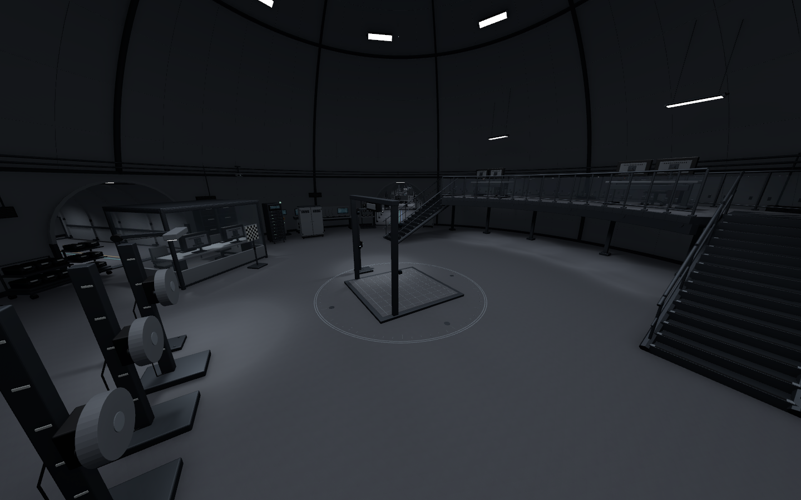
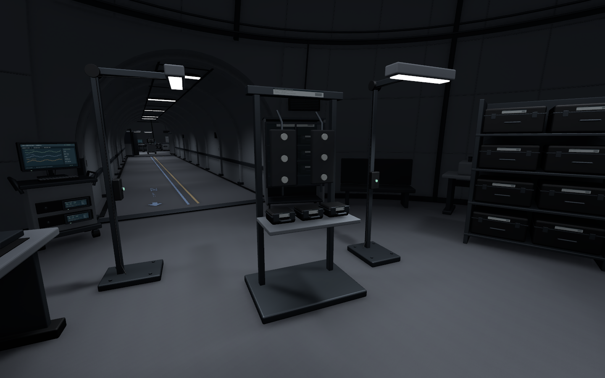
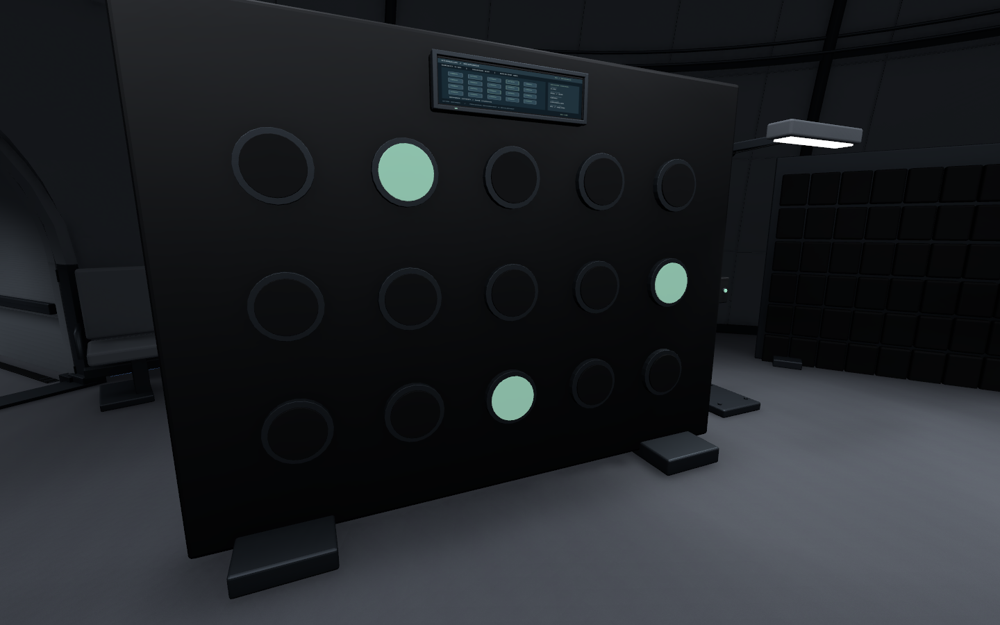
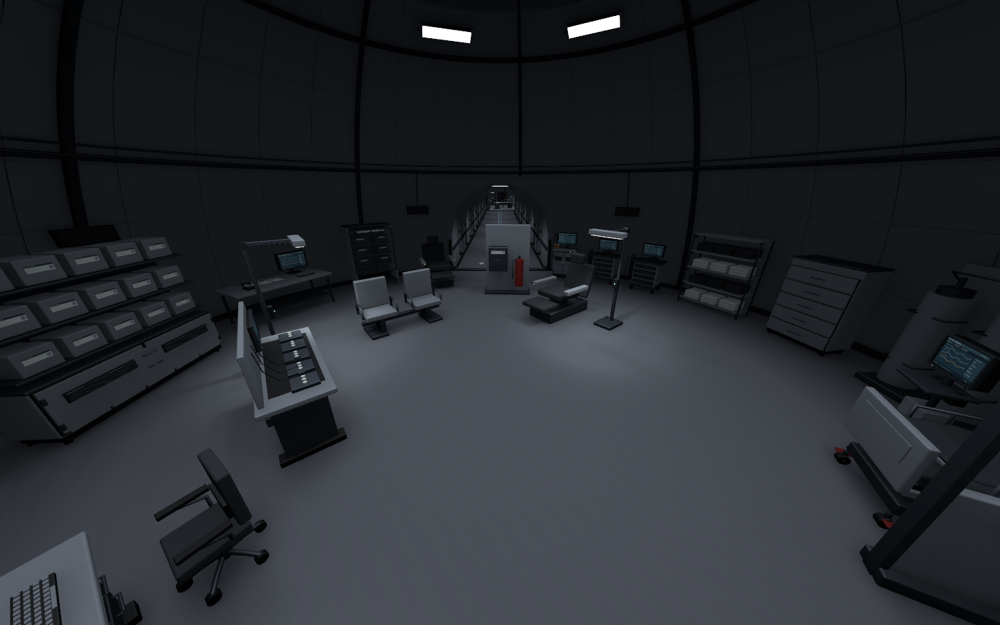
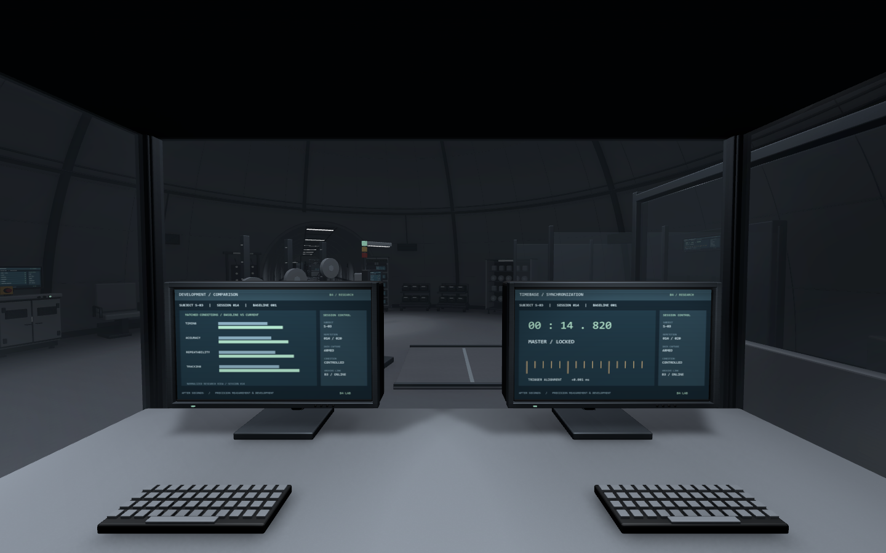

[새벽 B5 작업]({{ '/posts/after-seconds-b5-domes-and-corridor-guidance/' | relative_url }}) 이후 조명을 보강하고 B4 제작을 이어감\
오늘 저녁에는 B4 전체 공간에 각 돔의 기능을 구분해 실험 설비를 채움

현재 B4 구성은 **13개 돔, 이동 코어 3개, 연결 복도 22개**임\
작업 씬은 `Level_B4_Circular`

## B5 조명 보강 후 B4로 이동

B5 일반 돔 12곳에 천장등 80개와 실제 광원을 추가함\
복도 등기구는 기둥 역할을 하는 리브 사이에 오도록 정렬함

기존 등기구 98개를 리브 사이로 옮기고 끝 구간에 13개를 보강함\
외형이 없던 기존 광원 16개에도 등기구를 연결함

B5에 추가한 광원은 돔과 복도를 합쳐 93개\
기존 광원의 밝기·색·그림자 설정과 바닥 충돌은 유지함

실제 이동과 천장 시야를 확인하고 이 상태를 1차 기준으로 삼음\
전체 색감과 최종 성능 조정은 후속으로 남김

## B4 전체 공간과 층의 역할 정리

중앙 관찰 공간과 접근 복도를 먼저 만든 뒤\
나머지 돔과 계단·화물승강기 코어, 연결 복도까지 확장함

중앙에는 계측 영역과 높이 2.5m의 관찰 데크를 두고\
다른 돔은 시험·준비·분석·기록·회복 기능으로 나눔

B5는 생활·격리와 기본 관리가 중심\
B4는 정밀한 능력 측정과 발달·강화 진행 기록이 중심인 실험층으로 정리함

B4의 회차 기록 공간은 현재 시험의 대조·인계를 맡고\
B3의 주 데이터 보관 역할과는 구분함

## 각 돔에 배치한 설비

| 구역 | 역할 | 주요 구성 |
| --- | --- | --- |
| C01 | 종합 계측·반복 시험 | 정밀 플랫폼, 가변 표적, 보호 관측 부스 |
| C02 | 시험 전 접수·센서 준비 | 인계 확인대, 호송 대기석, 센서 부착·착용대 |
| C03 | 계측기 교정·정비 | 분해 정비대, 교정 랙, 케이스 보관·세척 설비 |
| C04 | 정밀 신호 분석 | 분석 작업섬, 기준값·현재값 비교석, 수집 장비 |
| C05 | 회차 기록 대조·인계 | 검토 테이블, 기록 확인대, 봉인 기록 보관·인계 해치 |
| W01 | 투척 조건·지연 측정 | 투척 레인, 규격 시험물, 가변 표적, 시간 동기화 |
| W02 | 궤적·추적 시험 | 광학 게이트, 가변 추적 궤도, 교정·영상 수집 |
| W03 | 자극 반응·반응시간 측정 | 전신 자극벽, 압력·위치 계측, 차음 구획 |
| E01 | 영상·결과 판독 | 대형 비교 화면, 영상 비교석, 공동 판독 테이블 |
| E02 | 발달 계획·다음 시험 준비 | 연구 작업열, 검토 테이블, 장비 준비·소모품 보관 |
| E03 | 시험 후 관찰·회복 | 리클라이너, 센서 제거·상태 검사, 응급 카트 |
| N01 | 통합 진행 관찰·통제 | 개체별 비교, 합동 검토, 이송 상태 감시 |
| S01 | 차폐·고부하 반복 시험 | 부하 리그, 차폐 전원 제어, 보호 관측 부스 |

계단 A/B에는 경비 통제석과 비상 설비를 추가함\
화물승강기에는 장비 인수 확인대, 케이스 보관과 회수 카트를 둠

실험체는 인계·대기 → 센서 준비 → 시험 → 상태 검사·회복으로 이동하는 구성\
경비는 출입과 인계를 확인하고 연구원은 준비·조작·판독·회수를 맡는 배치임

## 프랍과 화면 디테일

이번 설비 보강 단계에서 새 모델 **35종을 제작하고 34종을 사용함**\
새 설비 210개와 기존 작업의자 27개를 배치함

별도 출입 게이트 모델은 제작해 두었지만 이번 씬에는 배치하지 않음\
위 수량은 오늘의 설비 보강 단계이며 앞선 건축·프랍 수량과 구분함

모니터는 베젤·스탠드·키보드와 후면 통풍·접속부를 표현함\
장비에는 베벨, 손잡이·잠금장치·캐스터·케이블과 단자를 넣음

보관장은 내부 선반과 물품을 실제로 구성함\
유리 뒤로 바로 벽이 보이는 형태가 되지 않도록 내부 공간을 둠

정적 계측·운용 화면 18장과 밀착 라벨 2장을 제작함\
기존 B4 금속·코팅·고무·유리의 공용 Base·Normal 맵은 재사용함

관측 부스의 주 화면은 방에 맞춰 압력·위치, 시간 기준\
추적 오차, 부하 신호로 나눔\
보조 화면에는 반복 결과 비교를, 회차 이력에는 표를 사용함

작업등 36개와 부스등 8개, 총 44개 광원을 추가함\
물리 등기구 아래에 실제 광원이 오도록 맞춤

화면과 표시 수치는 현재 정적 아트 예시임\
실시간 계측이나 게임의 강화 수치가 구현된 것은 아님

## 장비 접근이 막힌 부분 보수

초기 배치에서는 출입문을 통과해도\
일부 장비의 사용면까지 접근할 수 없는 문제가 있었음

- C05 기록실: 중앙 비상설비 1개를 추가 배치에서 제외하고 카트를 이동.
- W01 투척실: 시험 통제대를 레인 뒤쪽에서 접근 가능한 위치로 이동.
- E02 연구원 작업실: 소모품 보관장을 작업열 뒤쪽에서 열린 공간으로 이동.
- E03 회복 구역: 대기석을 옮겨 청결 보관장 앞 통로 확보.
- 관측 부스 4곳: 두 의자 사이 중앙 통로를 1.38m로 확장.

기존 건축과 프랍을 옮기지 않고 새로 추가한 설비를 조정함\
장비를 채우는 것과 사람이 사용할 공간을 남기는 것을 같이 확인함

## 하이라키 이름은 간결한 영어로 통일

프로젝트 내부 이름은 영어로 맞추기로 함\
전체 13개 씬을 조사했고 한글 이름은 현재 B4와 B5에 남아 있었음

B4 1,577개, B5 222개로 총 **1,799개 이름**을 변경함\
한글 이름 1,778개와 연결 기호가 들어간 복도 이름 21개를 정리함\
에셋·폴더 경로에는 한글이 없어 파일 이동은 필요하지 않았음

| 용도 | 이름 예시 |
| --- | --- |
| B4 전체 루트 | `B4_ResearchFloor_V0.03` |
| 새 실험 설비 그룹 | `B4_ExperimentEquipment` |
| W01 관측 부스 | `B4_W01_ObservationBooth_01` |
| C01 천장등 | `C01_CeilingLight_01` |

네이티브 씬 편집으로 이름만 변경함\
이름을 제외한 오브젝트·컴포넌트 속성 22,473개를 비교해 차이가 없는 것을 확인함\
위치·재질·충돌·광원 설정과 참조를 유지했고 에셋 GUID도 바꾸지 않음

## 검수 결과와 남은 범위

| 항목 | 확인 결과 |
| --- | --- |
| 복도·출입·계단·설비 접근 | CharacterController 320/320경로 통과 |
| 실제 플레이 | 13돔·3이동 코어에서 실제 입력 이동과 프레임 진행 확인 |
| 플레이 중 새 게임 로그 | 검사한 16구역에서 경고·오류 0건 |
| 기존 배치 | 설비 보강 전 Transform 1,317개 위치·회전·크기·활성 상태 유지 |
| 재질·안내선 | 재질 누락 0, 돔·코어 내부 이동 안내선 0 |
| 이름 변경 | B4·B5 잔여 한글 이름 0, 이름 이외 속성 변경 0 |
| 이름 변경 후 재확인 | B4·B5 대표 구역 실제 입력 이동, 새 게임 경고·오류 0건 |

이동 안내선은 계속 복도에만 유지함\
Editor에서 확인한 결과이며 출시 빌드 성능이나 전체 게임 기능 완료 판정은 아님

다음 작업은 각 돔의 용도·밀도·시야와 프랍 디테일 검수\
지적된 부분을 보수한 뒤 전체 조명·색감과 성능을 마감할 예정

모니터 애니메이션, 실험 장비 동작, 문·승강기와 실제 층간 연결은 별도 작업임\
구체적인 능력 강화 방식이나 약물·게임 수치도 아직 확정하지 않음

설계를 정리한 과정은 [오늘 저녁의 데일리로그]({{ '/posts/daily-log-living-floor-and-experiment-floor/' | relative_url }})에 따로 남김

작성자 송예찬
