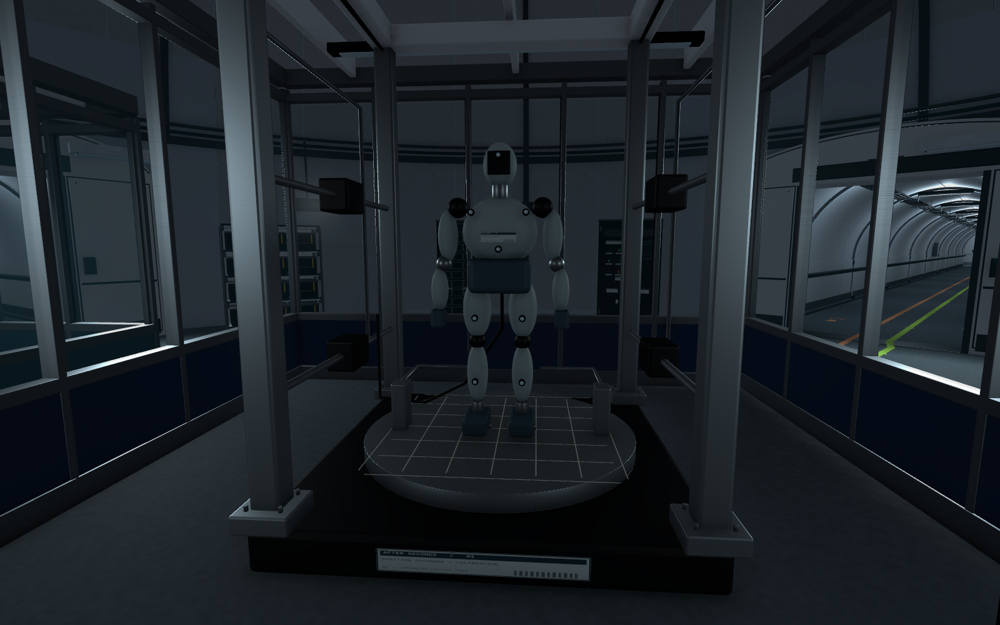
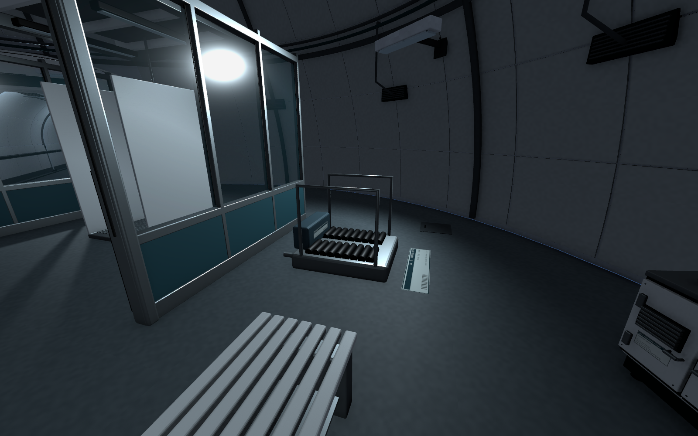
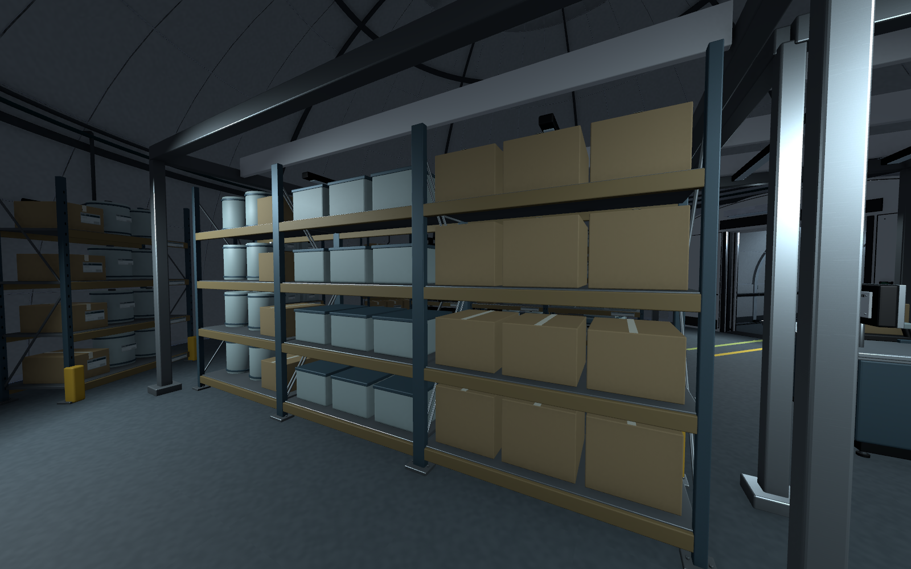
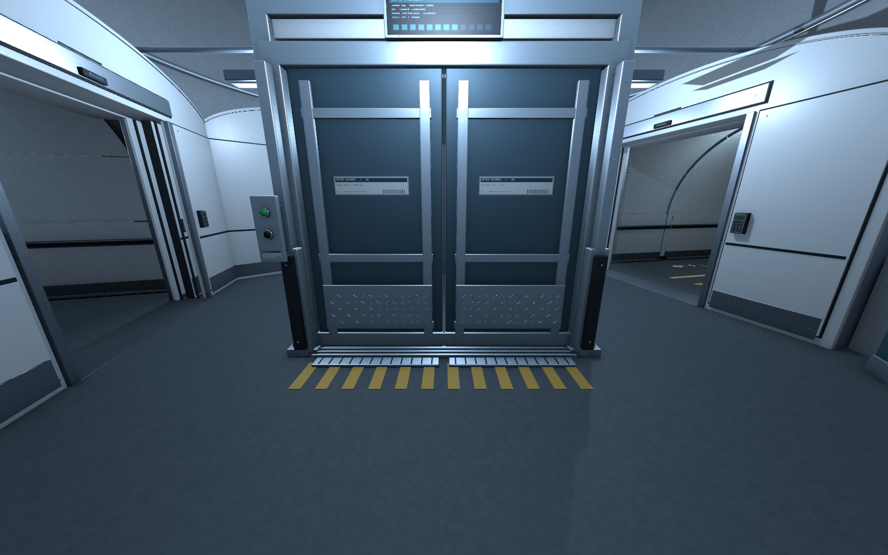
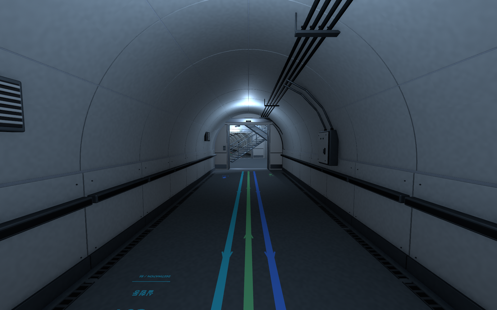
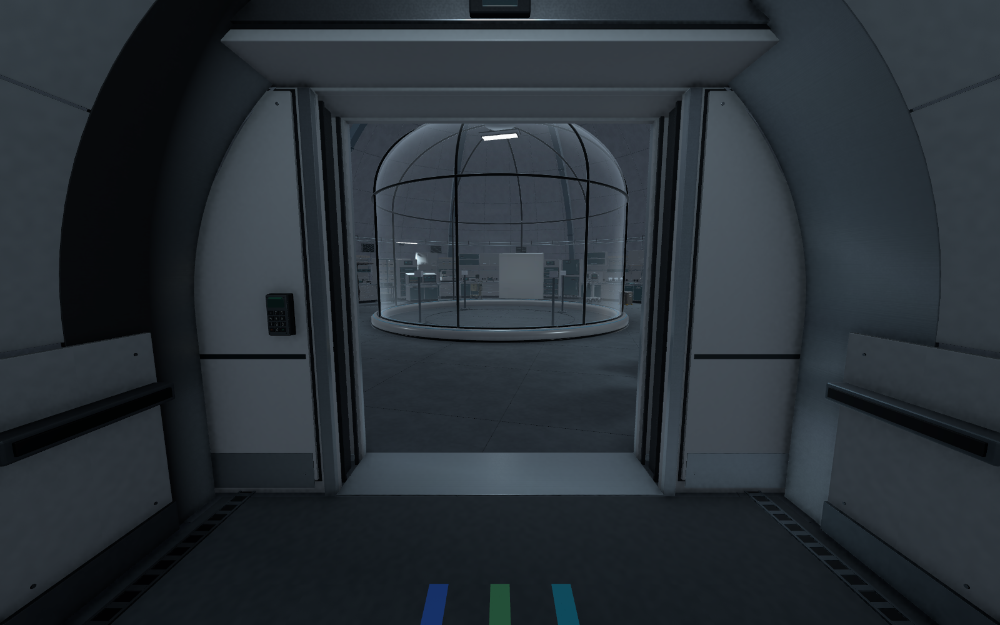

실험동 다음 작업으로 바닥 안내와 T01 복도 마감부터 이어감\
보안관제동, 계단 A를 거쳐 B5의 나머지 돔과 연결 복도까지 외형을 확장함

일괄 배치 후에는 실험동을 제외한 방의 구조와 프랍을 다시 검수함\
마지막에는 이동 안내선을 복도에만 남기는 것으로 정리하고 씬을 저장함

작업 대상은 `Level_B5_Circular`\
전체 구성은 일반 돔 12개, 이동 코어 3개, 복도 19개임

## 연결 복도와 보안관제동 제작

T01에는 곡면·하부 패널, 보호 레일, 배수, 케이블 트레이와 설비를 추가함\
보안관제동 쪽 출입문도 실험동과 이어지는 형식으로 맞춤

C02 보안관제동은 관제석, 6분할 감시 화면\
서버·녹화·무전 장비와 사건 검토 자리를 구성함

이전 구조를 보여 주던 감시 화면은 현재 B5 기준으로 교체함\
모니터 베젤·통풍구·단자·지지대와 배선도 보강함

T02와 계단 A에는 계단·중간참·난간·지지 구조와 설비를 제작함\
높이 차를 잇는 계단 외형과 통행은 확인했지만 B4 실제 씬 연결은 아직 남아 있음

## 방마다 내부 구조를 다르게 구성

처음 일괄 제작한 방들이 단순해 보여서\
실험동 C01의 구성을 기준으로 나머지 11개 돔과 3개 코어를 다시 정리함

| 구역 | 내부 구성 |
| --- | --- |
| 보안관제동 | 관제실·사건 검토 자리와 서버·무전 공간 분리 |
| 냉각설비동 | 중앙 냉각 설비, 배관 헤더와 별도 제어실 |
| 유틸리티동 | 전기·공조 설비, 차폐벽과 점검 통로 |
| 격리생활동 2곳 | 각각 생활실 4개, 관찰·간호 자리와 공용 통로 |
| 의료검사동 | 진료실 2개와 검사·대기 공간 |
| 물자보급동 | 중앙·벽면 적재, 입고 검사와 운반 공간 |
| 급식지원동 | 직원용 공급 식품 보관·재가열·검수·분배 |
| 제염동 | 오염측·세정 구역·청결측 분리 |
| 중앙관제동 | 6석 관제실, 서버 통로와 협의 자리 |
| 폐쇄시험동 | 중앙 시험 셀과 별도 관찰실·장비 보관 |

구조 재검수 단계에서 새 모델 76종과 상세 프랍 171개 배치를 반영함\
이 수치는 해당 단계의 제작·배치 수량이며 후속 교체 모델을 모두 더한 최종 활성 수량은 아님

## 운용 목적이 보이도록 장비 보강

구조를 나눈 뒤에도 무엇을 하는 곳인지 모호한 부분이 남아 있었음\
후속으로 모델 25종, 장비 40개와 국소 작업 표기 1개를 반영함

### 폐쇄시험동과 제염동

폐쇄시험동의 흰 임시 표적은 계측 더미와 고정대로 교체함\
추적 마커, 데이터 하네스와 기준 격자를 넣어 위치·자세 변화를 관찰하는 시험 장비로 구체화함

제염동은 오염 보호구 회수·밀봉 → 장화 세척·샤워\
→ 건조·청결 보호구 착용과 출구 확인 순서로 보강함

회수함과 밀봉기, 발 세척기, 보호구 디스펜서와 확인대를 추가함\
샤워의 급수·배수 접점도 함께 정리함

### 급식지원동과 물자보급동

급식지원동은 직원용 외부 공급 밀봉 식품을 보관·재가열해서 나눠 주는 곳으로 정리함\
직접 요리하는 주방이나 직원 식당으로 잡지는 않음

피험체용 영양팩·투약 소모품은 별도 잠금 서랍과 인계 카트에 배치함

물자보급동에는 중앙 6개와 벽면 8개, 총 14개 적재 선반을 구성함\
상자·재사용 용기·밀봉 드럼·장비 케이스로 적재물을 나누고\
팔레트, 수동 팔레트 트럭, 입고용 저울·스캐너·라벨 프린터를 배치함

_운용 목적 보강 단계의 화면. 이후 이동 안내선은 복도에만 남기도록 정리함._

### 화물승강기와 제어 설비

VL에는 강재 보강 문짝, 문틈, 보호 철판, 문턱 레일과 고무 완충대를 추가함\
층·적재 정보 화면과 호출 조작부도 구분해 배치함

_바닥의 노란 문턱 안전 표시는 이동 안내선과 용도가 달라 유지함._

배전반과 공정 제어반의 초록 표시부는\
곡면 렌즈, 패킹, 금속 베젤과 켜짐·꺼짐 재질을 나눠 표현함\
같은 계열 장비가 있는 C03·C04·S01에 함께 반영함

베벨·판금 이음·체결부·케이블·얇은 인쇄 라벨과 PBR 맵도 보강함\
모니터와 계기 화면은 현재 정적 표현임

## 최종 안내선 기준: 복도에만 배치

목적지별 색으로 안내선을 연결했지만 돔 내부에서는 바닥이 복잡해 보이는 경우가 있었음\
최종적으로 19개 복도에만 이동 안내를 남김

돔과 계단·승강기 코어 안의 선, 화살표, 바닥 목적지 문자와 범례를 제거함\
실험동의 이전 R1/S1/M1 이동 표기도 함께 정리함

복도에는 목적지별 색·방향·문자를 유지하고\
선 끝을 돔 외곽에서 복도 쪽 20cm 지점에 맞춤

기존 메시 원본은 보존하고 안내 렌더러 152개를 비활성화함\
복도 부분만 남긴 메시 120개를 별도로 적용함\
장비의 작업 표식과 적재·문턱 안전 표시는 유지함

## 확인한 결과와 범위

| 단계 | 확인 결과 |
| --- | --- |
| 공간 구조 재검수 | CharacterController 90/90경로 통과, 14구역과 복도 Play 확인 |
| 장비 운용 목적 보강 | 기존 경로와 장비 접근을 포함해 Controller 128/128경로 통과 |
| 장비 보강 후 Play | 7구역에서 실제 입력 이동, 새 게임 경고·오류 0건 |
| 복도 안내선 정리 | 저장 씬 재로드 후 89,463정점 검사, 돔 내부·복도 밖 잔여 안내 정점 0개 |
| 안내선 변경 시 보존 | 기존 조명 247개, 충돌체와 기존 오브젝트 위치·회전·크기 유지 |

이동 검사는 장비 보강 단계에서 진행했고\
마지막 안내선 변경은 충돌체를 유지한 상태에서 형상·저장·화면을 확인함\
안내선 변경 후 Play 이동을 다시 검사한 것은 아님

Editor에서 확인한 범위이며 최종 빌드 성능 판정은 별도로 남겨 둠

## 다음 작업

1. 각 돔의 용도와 프랍 디테일을 플레이어 시점에서 일괄 검수.
2. 지적된 배치·형상·재질을 보수하고 통행 재확인.
3. B5 전체 조명과 색감을 함께 조정.
4. 이후 문·승강기·화면 갱신과 B4 연결 등 기능 작업을 별도로 진행.

정적 외형을 제작한 상태이며 게임 C#과 Animator 기능은 추가하지 않음\
전체 34작업 단위의 아트 최종 판정도 사용자 검수 전까지 보류함

작업 중 생각이 바뀐 부분은 [오늘의 데일리로그]({{ '/posts/daily-log-spaces-that-explain-their-purpose/' | relative_url }})에 따로 정리함

작성자 송예찬
