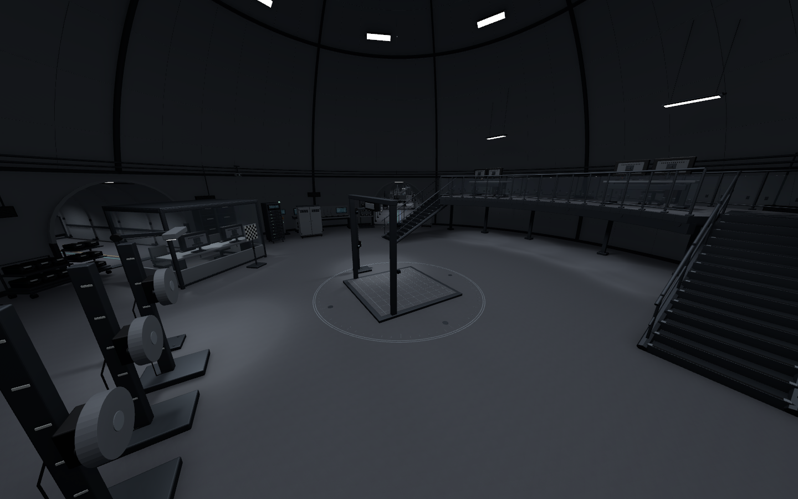
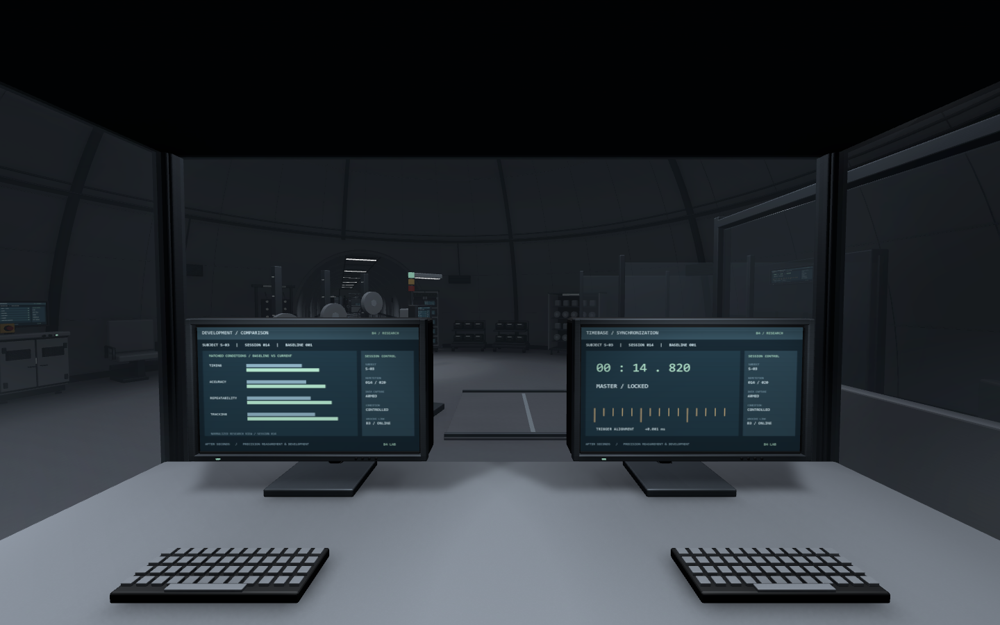

새벽에 마무리한 B5 작업에 이어 조명을 보강하고 B4로 넘어감\
B4 전체를 만들다 보니 먼저 정리해야 할 부분이 있었음

B5에도 실험실과 격리 공간이 있는데\
B4까지 그냥 측정하고 관찰하는 층이라고 하면 역할이 겹쳐 보임

## 기본 관리와 심화 실험을 나누기

B5는 실험체가 생활하고 격리되는 공간이 중심\
기본적인 측정과 실험도 실험체를 관리하기 위한 쪽으로 정리함

B4는 능력을 더 정밀하게 측정하고\
발달·강화 진행도를 기록하기 위한 심화 실험층으로 잡음

같은 실험체라도 현재 상태를 확인하는 것과\
조건을 맞춰 반복 시험하고 이전 결과와 비교하는 것은 다른 일임

이렇게 나누니 B4에 필요한 장비도 조금 더 분명해짐\
시험 장비뿐 아니라 센서 준비, 장비 교정, 결과 비교와 회차 기록이 필요해짐

_중앙 시험 영역과 연구원이 관찰하는 자리를 구분한 상태._

## 같은 방을 세 사람의 입장에서 보기

이번에는 내가 여기서 실험을 당하는 실험체라면\
경비라면, 연구원이라면 어떻게 움직일지를 기준으로 배치를 잡음

실험체는 어디서 인계되고 기다리는지\
센서는 어디서 붙이고, 시험이 끝난 뒤에는 어디로 가는지가 필요함

경비는 출입구와 인계 위치를 확인할 수 있어야 하고\
연구원은 장비를 준비한 뒤 시험 구획을 보면서 조작할 수 있어야 함

그래서 대기 좌석, 접수·확인대, 센서 착용대\
보호 관측 부스, 장비 회수 카트와 시험 후 관찰 자리를 같이 넣음

시험 장비 하나가 멋있게 서 있는 것보다\
그 장비를 쓰기 전과 쓴 뒤의 과정이 연결되어야 실험 공간으로 읽히는 것 같음

_연구원 자리에서 시험장과 계측 화면을 함께 볼 수 있도록 구성함. 화면은 정적 아트임._

## 많이 채워도 장비 앞에 못 가면 의미가 없음

배치 검수에서 기록실의 카트 통로와 일부 보관장 접근이 막힌 부분이 나옴\
문으로 들어갈 수 있는 것과 실제로 장비 앞에 설 수 있는 것은 다른 문제였음

중앙에 있던 설비를 덜어 내고 카트를 옮김\
관측 부스 안에서는 의자 사이 통로도 넓힘

빈 공간이 보인다고 전부 채울 필요는 없겠음\
사람이 서서 작업하고 물건을 꺼내는 여유도 설비 배치에 포함해서 봐야 함

## 프로젝트 이름은 짧은 영어로 통일

하이라키를 알아보기 쉽게 정리하는 과정에서 한글 이름이 들어갔는데\
프로젝트 내부 이름은 간결한 영어로 통일하기로 함

`B4_W01_ObservationBooth_01`처럼\
구역 코드와 용도, 번호만으로 찾을 수 있게 맞춤

이름을 바꿀 때는 보기 좋게 바뀌었는지만 확인하면 안 됨\
이름으로 찾는 코드가 있는지, 기존 연결과 설정이 유지되는지도 같이 확인함

문서에서 설명하는 말과 프로젝트 안에서 사용하는 이름의 기준을 나눠 두려고 함

## 오늘은 여기까지

B4 각 돔의 설비 배치까지 진행한 상태\
다음에는 플레이어 시야에서 방의 용도와 디테일을 검수할 예정

발달·강화층이라는 방향은 정했지만\
구체적인 강화 방식이나 게임 수치를 확정한 것은 아님

움직이는 모니터, 실제 실험 장비 동작과 층간 연결도 별도 작업으로 남겨 둠\
외형을 채운 것과 게임 기능을 완성한 것은 구분해서 기록함

제작 내용과 검수 수치는 [오늘 저녁의 일일개발일지]({{ '/posts/after-seconds-b4-experiment-operations/' | relative_url }})에 정리함

작성자 송예찬
