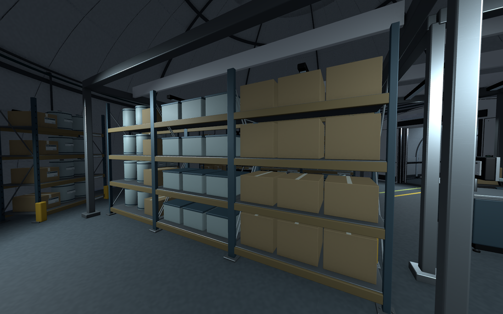
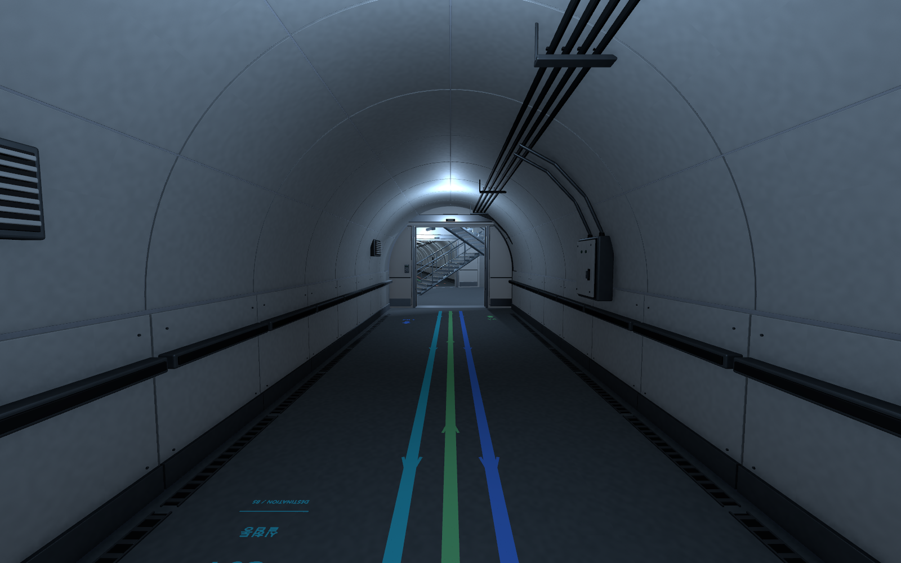

실험동 다음 구역부터 B5의 나머지 돔까지 작업을 이어감\
새벽까지 진행해서 11월 8일 기록으로 남김

구성은 많이 좋아졌는데 방마다 비슷하게 프랍을 놓으니\
이 공간에서 정확히 무엇을 하는지가 잘 안 보이는 부분이 있었음

이번에는 내가 여기서 일하는 사람이라면 어떻게 쓸지를 기준으로 다시 봄

## 방 이름만 붙인다고 용도가 보이는 것은 아님

폐쇄시험동 가운데 하얀 물체가 있었는데\
무엇을 시험하는지, 무엇을 측정하는지 바로 알기 어려웠음

계측 더미와 고정대, 추적 마커, 연결 하네스를 넣고\
시험하는 자리와 관찰하는 자리를 나누는 쪽으로 구체화함

제염동도 샤워 부스만으로는 설명이 부족했음\
오염된 보호구를 어디서 벗고 회수하는지\
씻은 다음 깨끗한 보호구는 어디서 꺼내는지까지 있어야 할 것 같았음

그래서 회수·밀봉 → 세척·샤워 → 청결 보호구 착용 순서가 보이도록 보강함\
장비 하나의 모양뿐 아니라 앞뒤 과정까지 연결해서 봐야 하는 듯

## 누구를 위한 공간인지 먼저 정하기

급식지원동을 보면서 직원용인지 피험체용인지부터 애매하다고 느낌\
여기서 직접 요리하는 공간인지도 정리가 필요했음

직원용은 외부에서 들어오는 밀봉 식품을 보관하고\
재가열·검수해서 나눠 주는 공간으로 정리함

피험체용 영양팩과 투약 소모품은 별도 잠금 보관과 인계 장비로 구분함\
게임 속 시설의 분위기와 대우 방식도 공간 구성에 들어가야겠음

누가 사용하는지 정해 놓으니 필요한 프랍과 배치 기준도 더 분명해짐

## 창고는 물건을 꺼내는 과정까지 보여야 함

물자보급동은 가운데 선반에만 물건이 모여 있어서\
벽면이 비어 있고 공간을 비효율적으로 쓰는 느낌이 있었음

벽면 적재 선반과 팔레트를 추가하고\
입고 물품을 확인하는 저울·스캐너·라벨 프린터, 수동 운반 장비도 배치함

_운용 목적 보강 단계의 창고. 중앙과 벽면에 물자를 나누고 입고·운반 장비를 함께 둠._

많이 채우는 것만으로 끝나지는 않았음\
선반 앞에서 물건을 확인하고 꺼낼 공간도 필요해서 통행과 접근을 같이 확인함

## 안내선도 필요한 곳을 정해야 함

처음에는 각 돔에서 갈 수 있는 목적지를 기준으로 선을 이어 놓음\
목적지마다 색을 다르게 하니 구분은 훨씬 쉬워졌음

그런데 돔 안까지 들어온 선은 장비 배치와 겹쳐 보이거나\
방의 바닥을 너무 복잡하게 만드는 경우가 있었음

최종적으로 이동 안내선은 복도에만 두기로 함\
복도에서 목적지 색과 방향을 보여 주고 입구 앞에서 끝나게 정리함

_돔 안의 이동선은 제거하고 복도 안내만 남긴 최종 상태._

장비 작업 구역이나 화물 문턱의 안전 표시는 그대로 유지함\
바닥에 그려져 있어도 이동 안내와 작업 표시는 역할이 다르기 때문임

안내가 많으면 무조건 알아보기 쉬워지는 것은 아닌 것 같음\
어디에서 어떤 정보가 필요한지 먼저 정하는 게 중요해 보임

## 다음에 볼 것

전체 구성은 만들어졌고 방의 용도도 전보다 분명해진 상태임\
다음에는 실제 시야에서 어색한 프랍과 배치를 다시 검수할 예정

조명과 색감은 B5 전체를 한 번에 보면서 마무리하려고 함\
문 개폐, 승강기 운행, 움직이는 화면 같은 기능은 이후 별도 작업으로 남겨 둠

구체적인 제작 내용과 확인 범위는 [오늘의 After Seconds 일일개발일지]({{ '/posts/after-seconds-b5-domes-and-corridor-guidance/' | relative_url }})에 정리함

작성자 송예찬
