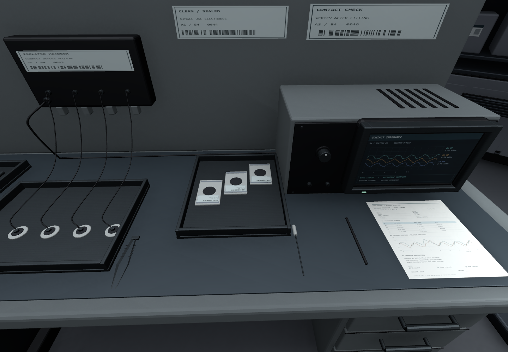
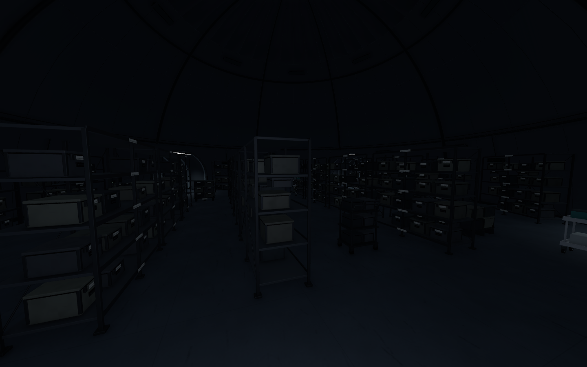
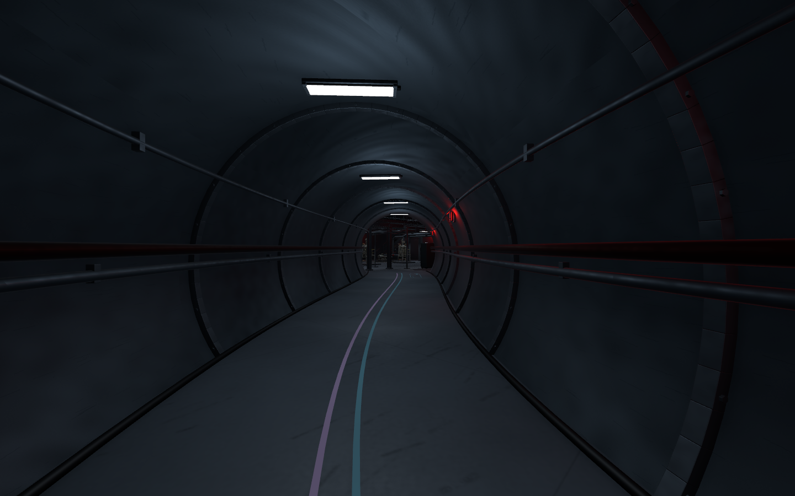
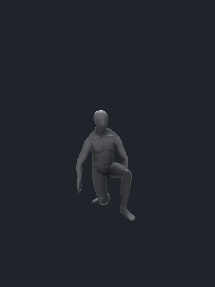

오늘은 기존 레벨의 근접 디테일과 통행을 보수하고\
B3 시료층, B2 기계층 작업을 진행함

플레이어 쪽은 앉기 토글과 천장 검사를 구현한 뒤\
앉기·걷기·달리기 애니메이션과 시점 보간을 연결함

## B5와 B4 표면 및 통행 보수

회색으로만 보이던 바닥에 표면 패턴과 마찰 흔적을 보강함\
벽은 하단 먼지와 닦임, 화물 승강기는 반복 사용한 흔적을 더 강하게 표현함

벽에서 떨어져 있던 소화기·소화전은 벽 곡률에 맞춰 고정함\
카트와 수납장을 정렬하고 장비 앞에 설 자리를 확보함

작업등과 설비의 과도한 충돌 영역도 보수함\
특히 B4 E02와 C02 작업등 주변에서 걸리는 구간을 확인하고 실제 형상에 맞춤

## B4를 실험 공간으로 읽히게 만들기

사무실처럼 보이던 자리에 계측과 시험 설비를 구분해서 배치함\
전용 모델16종으로50배치를 교체함

- E02: 전자 계측대, 보호 커버가 있는 시험 챔버, 광학 계측 섬과 센서 준비대
- C03/C04: 교정대, 미세 이송부, 신호 분석기와 데이터 수집 랙
- E03: 전극 패드·젤·스냅, 개별 단자와 회수 리드선, 밀봉·개봉 포장
- 기록석: 제목·회차·측정표·그래프·관찰 메모를 갖춘 기록지

컴퓨터 주변은 본체와 후면 단자까지 이어지는 곡선 배선을 추가함\
키 배열과 문자 방향, 오른쪽 마우스, 모니터와 겹친 서류도 같이 정리함


_1인칭에서 가까이 보는 패드·포장·선·기록지를 구체화함. 화면과 수치는 환경 아트 예시임._

B4 통로와 장비 접근은 CharacterController331경로를 통과함\
발판·게이트 진입/이탈과 실제 Play 구역도 확인함

## B3 시료층 통로 중첩과 밀도 개선

B3는13공동·3이동 코어·22복도로 구성함\
T02/T08과 T07/T08의 외피 중첩을 T08의 남쪽 곡선 우회로 해소함

통로만 옮기지 않고 공동 출입구·문틀·리브·바닥·안내선도 함께 맞춤\
각 공동의 연결 관계는 유지함

프랍 배치는150개에서302개로 늘림\
중앙 랙과 팔레트, 저온 용기, 포장 작업대, 멸균 트레이를 공간의 역할에 맞춰 구분함


_밀도를 보강한 중앙 시료 공동. 이 구역은 기본 소등 상태이며 조명 스위치 동작은 후속 작업임._

복도10,730표본과 CharacterController394경로를 확인함\
T08과 주요 공동6곳에서 Play 이동도 검수함

## B2 기계층을 배관형 통로로 연결

B2는 **12공동·3이동 코어·21통로**를 연결함\
복도를 지나가는 느낌과 함께 큰 배관 안으로 들어간 느낌을 주도록 구성함

원형 금속 벽체에 체결 플랜지와 볼트, 측면 배관을 넣음\
내경5m, 보행면4.2m를 기준으로 잡고 붉은 보조등을 곁들임



C02에는 높이3.6m의 U형 스틸 그레이팅 메자닌과 양쪽 계단을 구성함\
위아래가 보이는 구조와 냉각 설비를 함께 배치함

전체 연결 단계에서 신규 설비144배치를 추가함\
비상 발전기는 VARCO 생성 후18,000삼각형으로 리메시하고, 변압기·필터·송풍기 등은 Blender에서 제작함

통로21개, 장비 앞 접근186곳, 계단 왕복4개 검사를 통과함\
원형 통로의 인상과 조명, 설비 밀도는 직접 플레이하면서 추가 검수할 예정

## 크라우칭 입력과 실제 몸 상태 연결

C를 누를 때마다 앉기와 일어서기를 전환함\
CharacterController 높이를 바꾸면서 중심도 내려 발밑 위치를 유지함

일어설 때는 머리 위 공간을 검사함\
막혀 있으면 몸을 낮춘 상태로 유지하고 애니메이션도 그대로 앉아 있게 함

현재 구조는 다음과 같음

```text
입력 → Presenter → Motor의 실제 자세와 이동
                 → Look의 눈 높이 보간
                 → AnimationSystem의 파라미터 전달
```

달리기 조건은 `sprintInput && moveInput.y > 0`임\
서 있는 상태와 앉은 상태에서 같은 조건을 사용함\
전방 대각선은 허용하고, 옆·뒤 이동은 Shift를 눌러도 걷기로 처리함

## 두 Blend Tree와 자연스러운 자세 전환

`Player_Animator_Blend`를 실제 플레이어 프리팹에 연결함\
Player 전용 씬과 현재 B2에서 같은 컨트롤러를 참조하는 것도 확인함

| 상태 | Speed 0 | Speed 1 | Speed 2 |
| --- | --- | --- | --- |
| Standing | 대기 | 걷기 | 달리기 |
| Crouching | 앉아 대기 | 방향별 앉아 걷기 | 앉아 달리기 |

`Speed`는 실제 m/s가 아니라 블렌딩 기준값임\
1과2 사이에서는 걷기와 달리기를 섞고, `IsCrouch`는 Motor가 확정한 자세를 전달함

앉은 걷기 안에는 `MoveX`, `MoveY`로 방향을 고르는2D 트리를 둠\
Root Motion은 사용하지 않고 실제 이동은 기존 Motor가 담당함

자세 전환은0.28초, 이동값 감쇠는0.12초로 설정함\
카메라도 목표 눈 높이까지 SmoothDamp로 내려가게 해서 순간적으로 낮아지는 느낌을 줄임


_현재 대기 클립은 한쪽 무릎을 낮춘 자세임. 새 실험체 모델로 교체하면 접지와 손·발 자세를 다시 확인해야 함._

VARCO의 앉기 클립은 기존 V0.3 Avatar에 맞춰 리타깃하고 바닥 접지를 보정함\
앉아 달리기는 무기를 든 원본에서 팔·손 곡선을 비무장 걷기 곡선으로 조정한 파생본임

빠른 토글 검수 중 전환이 반복되던 설정도 수정함\
전환 목적지의 역방향 전환을 허용해 도중에 다시 앉거나 일어설 수 있도록 함

## 검수 결과와 집에서 할 일

크라우칭은 Play 모드의 별도 프리팹에 임시 입력 장치를 연결해 확인함\
실제 InputAction 콜백 경로로28가지 경우를 검사했고, 794프레임 동안 새 게임 오류는 없었음

앉기/일어서기, 좌우·후진 이동, 전진 달리기, 천장 아래 일어서기 거부\
빠른 C 반복 입력과 전환 중간의 블렌딩을 확인함

OnLook이 멈췄던 문제는 Mouse 장치 비활성화 상태를 복구함\
검수 종료 후 실제 키보드와 마우스가 활성인지도 확인함

집에서는 Player 씬에서 조작감을 먼저 확인할 예정\
다음은 B2 통로와 메자닌, 설비 밀도·밝기 검수 순서임

실험체 콘셉트 이미지 두 장은 확인했지만 아직3D 모델로 생성하지 않음\
사용할 인물을 정한 뒤 메시·재질·리깅과 애니메이션을 맞춰야 함

문·승강기·조명 스위치와 실제 층간 연결, 적 AI와 UI는 별도 구현임\
현재 결과는 레벨 외형과 플레이어 이동·크라우칭 작업 범위로 기록함

작업하면서 정리한 생각은 [오늘의 데일리로그]({{ '/posts/daily-log-space-detail-and-crouch-state/' | relative_url }})에 남김

작성자 송예찬
