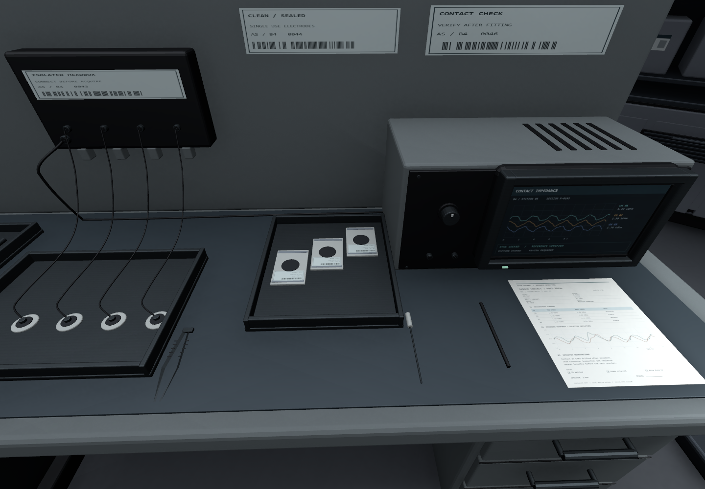
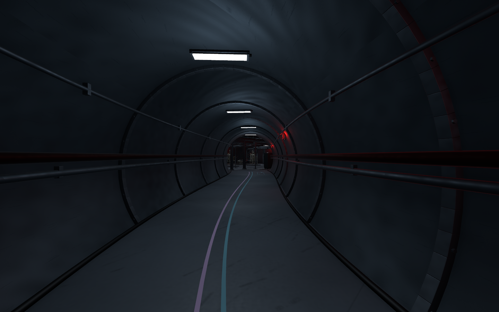

오늘은 B4의 어색한 부분을 고치는 것부터 시작함\
시료층과 기계층을 이어 만들고, 마지막에는 플레이어 앉기까지 연결함

공간과 캐릭터를 따로 작업하고 있었는데\
결국 플레이어 눈높이에서 어떻게 보이고 지나갈 수 있는지를 같이 봐야 했음

## 1인칭에서는 작은 생략도 바로 보임

모니터만 있는 책상은 멀리서는 그럴듯해 보임\
가까이 가면 본체가 없고, 서류가 모니터와 겹쳐 있고, 선도 어색한 게 보임

키보드 모양과 왼쪽에 놓인 마우스도 다시 확인함\
보고서를 그냥 직선 여러 개로 채운 것도 가까이에서는 문서처럼 안 보였음

실험실이라면 장비만 놓는 것으로 끝내기보다\
전극을 꺼내서 연결하고, 측정하고, 사용한 물건을 회수하는 흔적까지 있어야 할 것 같음

_준비된 패드와 회수할 물건, 연결선과 기록지를 구분한 상태. 장비 화면은 정적 표현임._

## 꽉 찬 공간과 막힌 공간은 다름

시료층이 너무 비어 보여서 랙과 적재물 밀도를 늘림\
그렇다고 빈자리를 전부 채우면 장비 앞에 못 가거나 통로가 막힘

작업등 주변에서 플레이어가 걸리는 부분도 있었음\
보이는 기둥은 가늘어도 콜라이더가 크게 잡혀 있으면 이동할 수 없었음

프랍을 더 만드는 일과 동선을 확인하는 일이 따로 끝나는 게 아니었음\
배치가 바뀌면 통행도 다시 확인해야 함

기계층은 복도 자체가 큰 배관 안을 지나는 느낌이면 좋겠다고 생각함\
원형 벽체와 체결부, 측면 배관을 연결하니 다른 층과 구분되는 기준이 생김

_철색 통로에 붉은 보조등을 곁들임. 안내선은 복도에만 유지함._

## 앉기 버튼과 실제 앉은 상태를 구분하기

앉기 기능을 만들고 나서 애니메이션을 연결하려고 보니\
키를 눌렀는지와 실제로 앉아 있는지는 같은 정보가 아니었음

낮은 천장 아래에서 일어서기 키를 눌러도\
몸은 일어서면 안 됨

버튼만 보고 선 자세 애니메이션을 틀면\
충돌체는 앉아 있는데 몸은 일어나는 문제가 생길 수 있음

그래서 Motor가 일어설 수 있는지 판단한 뒤\
그 결과인 `IsCrouching`을 애니메이션에도 전달하도록 연결함

입력은 요청이고, 몸 상태는 처리한 결과라는 구분이 필요했음

## 걷기와 달리기는 두 자세에서 같은 구조로

처음에는 상태와 연결선이 많아서 흐름을 보기 어려웠음\
그냥 서 있을 때 걷기와 달리기를 섞고, 앉았을 때도 똑같이 하면 되지 않을까 싶었음

현재는 두 개의 Blend Tree로 정리함

- 서 있을 때: 대기 → 걷기 → 달리기
- 앉아 있을 때: 대기 → 방향별 걷기 → 앉아 달리기

`IsCrouch`로 자세를 바꾸고, `Speed`로 이동 동작을 섞음\
여기서 Speed의 0·1·2는 실제 이동속도가 아니라 애니메이션 기준값임

앞으로 이동할 때만 달리는 조건도 한 곳에서 판단함\
몸 이동과 애니메이션이 같은 결과를 받아야 서로 다르게 움직이지 않음

## 몸만 부드러워져서는 부족했음

애니메이션이 섞여도 카메라가 바로 아래로 내려가면\
1인칭에서는 여전히 갑자기 앉는 느낌이 남음

눈 높이도 목표 높이까지 부드럽게 따라가도록 보간함\
충돌체의 앉기 판정과 화면에 보이는 전환은 역할을 나눠서 처리함

빠르게 C를 반복해서 눌렀을 때도 확인함\
최종 자세만 맞는지 보는 것보다 전환 도중에 반대로 바뀌는 경우까지 보는 게 필요했음

집에서는 이 상태로 직접 움직이면서 조작감을 먼저 확인할 예정\
현재 더미에 연결한 앉기 자세가 숨는 느낌에 맞는지도 같이 봐야 함

실제 변경과 검수 결과는 [오늘의 일일개발일지]({{ '/posts/after-seconds-b2-b3-and-crouch-blending/' | relative_url }})에 정리함

작성자 송예찬
