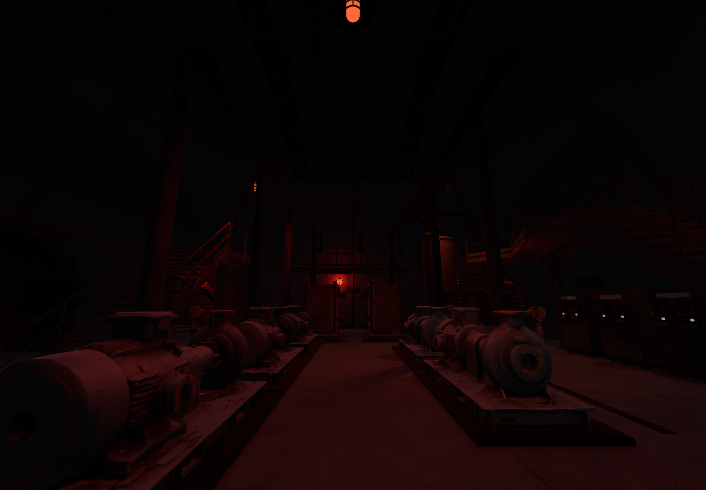
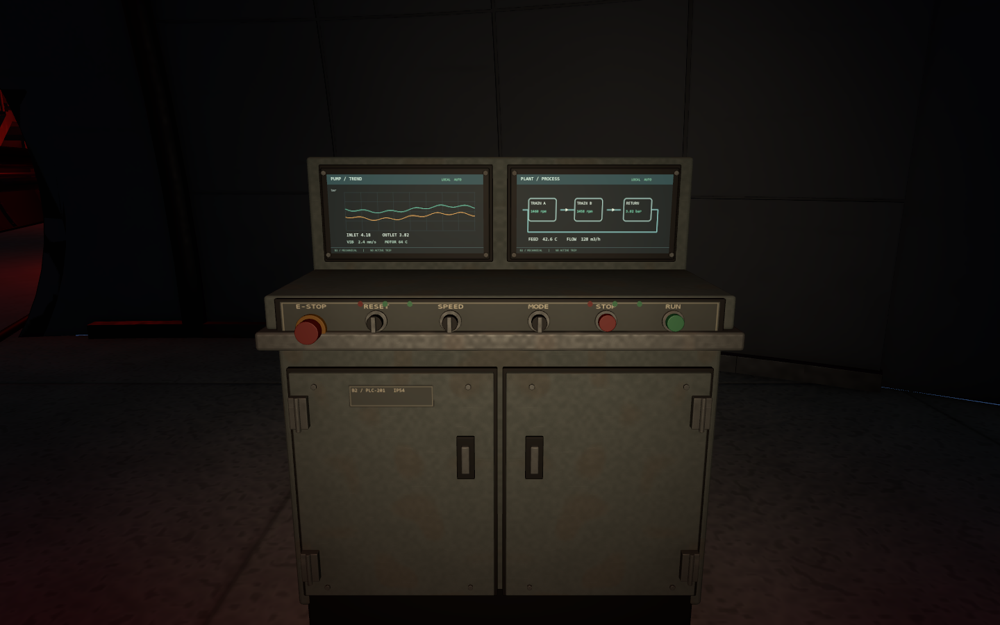
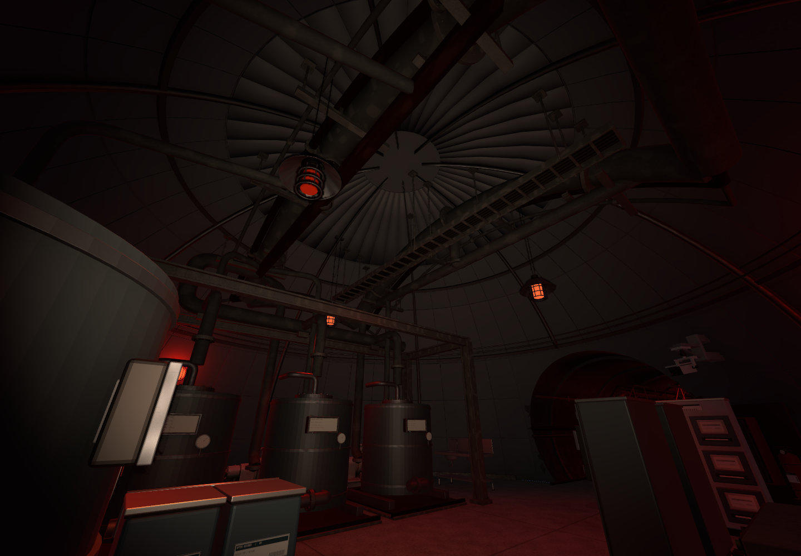
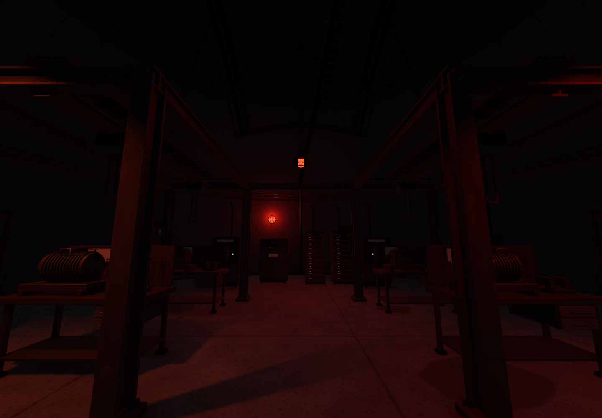

오늘은 B2 기계층을 중심으로 보수함\
12개 공동과 3개 이동 코어, 21개 통로의 연결을 유지하면서 내부 구조를 다듬음

플레이어 조작감은 확인했고 괜찮았음\
이번 작업에서는 게임 로직과 플레이어 씬, Animator를 추가 수정하지 않음

## 복층 통로에 정비 공간의 이유 만들기

21개 통로 중 19개에 상부 정비 그레이팅을 구성함\
짧은 접속부 두 곳은 단층으로 유지함

상부는 높이 2.42m, 폭 1.5m를 기준으로 잡고\
앉아서 이동하는 정비 길 위로 공급·회수 배관과 밸브, 계기, 지지대를 배치함

공동 네 곳에는 높이 3.6m의 부분 메자닌을 구성함\
통로 상부의 일곱 끝을 공동 내부 데크에 연결하고 높이 차이는 계단으로 이어 줌

상부 길이 공중에 따로 떠 있는 느낌을 줄이고\
설비를 점검하기 위해 올라가는 구조로 정리함

## 설비가 사용되는 순서에 맞춰 재배치

점검자가 장비 앞에 서는 자리와 부품을 옮기는 길을 기준으로 내부를 다시 구성함

- 냉각 구역: 펌프 열과 점검 통로, 열교환기 작업면
- 필터 구역: 필터 교체와 모터 정비 자리
- 부품 구역: 입고 → 보관 → 수리 → 출고 흐름
- 전기·관제 구역: 건식 설비와 조작 공간
- 정비 구역: 진단 작업대와 부품, 인양 장치

따로 떨어져 보이던 모터와 카트는 정비 작업대 주변으로 묶음\
한쪽이 비어 보이던 구역에는 윤활·씰 정비 설비를 보강함

_양쪽 펌프 열과 중앙 점검 통로. 실제 씬의 어두운 붉은 조명임._

## 콘솔과 바닥의 근접 마감

기존 생성 모델 중 화면과 마감이 부족한 콘솔 8곳을 교체함\
Blender에서 화면 프레임과 버튼, 비상 정지 스위치, 도어·힌지·손잡이, 후면 배선부를 제작함

모서리에 베벨을 적용하고 화면에는 추세 그래프와 공정 표시를 넣음\
현재 화면과 버튼은 정적 환경 표현이며 실제 설비 조작 기능은 없음

_형상을 확인하려고 임시 점검등을 켜서 촬영함. 촬영 후 점검등은 제거했고, 화면 수치는 환경 아트 예시임._

하부 바닥과 통로는 산업용 콘크리트의 불규칙한 사용감으로 정리함\
상부 그레이팅과 계단은 닳은 철 표면으로 구분함

바닥 줄눈과 도색 경계가 겹치던 부분도 정리함\
**B2에서는 바닥 안내선을 표시하지 않도록 변경함.** 다른 층의 안내선 기준은 유지함

## 대형 설비와 천장 배관 보강

산업 시설 레퍼런스 9장을 확인하고\
바닥부터 천장까지 설비가 이어지는 밀도를 기준으로 잡음

펌프·열교환기·발전기·공조 설비 등 27개를 1.2~2배로 조정함\
대표 냉각 펌프는 높이가 약 0.8m에서 1.6m가 되도록 키움

사람이 사용하는 작업대와 콘솔, 이미 충분히 큰 탱크는 유지함\
설비 루트의 크기를 바꿔 LOD와 충돌체를 함께 맞추고 받침·연결 배관·작업면을 보수함

12개 공동 천장에는 주 배관, 계장 배관, 케이블 트레이를 연결함\
관경과 역할을 나누고 플랜지·가스켓·볼트·행거·앵커까지 추가함

_천장 연결과 철골을 보기 위한 임시 점검등 화면. 최종 조명 밝기를 보여 주는 사진은 아님._

정비 공동에는 두 작업열을 감싸는 인양 프레임과 호이스트를 넣음\
탱크 공동에는 처리 프레임과 통기 집합관을 추가함

마지막 단계에서 교정 전원·부품·탱크 등의 6배치를 더해\
최신 운영 배치목록은 194개가 됨. 천장 배관 조립체와 프레임은 별도임

_실제 붉은 조명으로 본 정비 공동. 장비 앞 작업 공간과 중앙 통로를 남김._

이번 콘솔과 연결 구조는 Blender에서 제작함\
마지막 설비·천장 단계에는 원본과 Far LOD를 합쳐 FBX 52개를 반입하고 편집용 원본도 보관함

## 조명과 검수 결과

오늘 앞 단계에서 광원을 341개에서 158개로 줄임\
흰 직접광을 정리하고 원형 보호망등과 금속 갓 펜던트로 기계층 분위기를 맞춤

마지막 설비 확대·천장 보강 단계에서는 158개를 유지함\
영구 조명을 더 늘리지는 않았고 반사와 가림 데이터를 갱신함

최종 배치에서 확인한 범위는 다음과 같음

- 하부 출입·작업면 접근: 226/226 통과
- 상부 연결 왕복: 34/34 통과
- 실제 플레이어 입력 이동: 유효 8경로, 통과 구간 1,397프레임
- 신규 FBX 52개: 퇴화 삼각형 0, 메시·재질 누락 0
- 플레이어 씬·게임 코드·Animator·다른 층 등 보호 파일 26개: 변경 없음

최초 발전기 구역 검사는 경로가 기존 계단을 따라 올라가서 실패함\
실패 기록을 남기고 발전기 서쪽 연료 점검 통로를 별도로 재검사해 통과함

이 결과는 확인한 경로의 이동·외형 검사임\
에너미 AI 동작이나 최종 프레임 성능까지 검증한 것은 아님

## 남은 작업

현재는 B2 정적 레벨과 아트를 보강하고 저장한 상태임\
확대된 펌프 → 정비 프레임 → 탱크 설비 → 발전기 점검로 → 공조 설비 순서로 직접 근접 검수할 예정

어두운 곳에서 이동 방향이 읽히는지와\
큰 설비 주변에서 시야·숨을 자리가 자연스러운지도 확인해야 함

기획 문서와 에너미 AI 단계별 구현 범위도 오늘 정리함\
기능 개발은 플레이어 핵심 기능을 먼저 마무리한 뒤 에너미로 넘어감

문·승강기·설비 조작과 층간 전환, 에너미 동작은 후속 구현 범위임\
정적 레벨 보강을 본편 플레이 전체 완성으로 보지는 않음

[오늘의 데일리로그]({{ '/posts/daily-log-machinery-scale-and-maintenance-routes/' | relative_url }})에는 배치 기준을 다시 잡으면서 생각한 점을 적어 둠

작성자 송예찬
