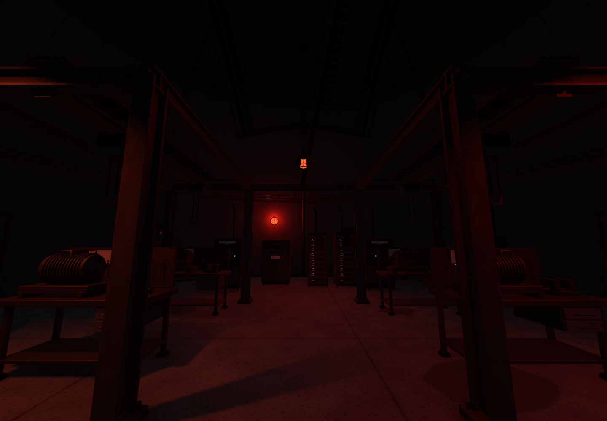

어제 연결한 플레이어 조작감은 직접 확인했고 괜찮았음\
오늘은 B2 기계층의 구조와 디테일을 다시 보는 데 시간을 씀

돔과 통로는 이어져 있는데 내부는 아직 비어 보였음\
기계를 더 놓으면 될 것 같았는데, 개수만으로 해결되는 문제는 아니었음

## 내가 설비를 점검하러 온다면

기계 옆에 모터와 카트가 따로 떨어져 있으니\
왜 거기에 있는 물건인지 바로 읽히지 않았음

여기에 정비하러 온 사람이라면 어디로 들어오고\
어느 면에서 장비를 열고, 부품은 어디에 내려놓을까부터 생각함

펌프 앞에는 점검할 자리를 남기고\
교체 부품과 카트는 작업대 주변으로 묶는 식으로 다시 구성함

경비원이 돌아다닐 때도 장비 사이를 이유 없이 지그재그로 다니기보다\
주 통로와 점검 통로를 따라 구역을 확인하는 편이 자연스러울 것 같음

실제로 경비를 움직인 단계는 아님\
일단 사람이 사용하는 시설로 보이는 구조부터 잡는 중

_정비대 위에 인양 프레임과 설비 연결을 더한 상태. 실제 붉은 조명으로 촬영함._

## 빈 공간에는 크기도 영향을 줌

레퍼런스를 보니 큰 장비가 먼저 공간을 차지하고\
그 주변을 작은 배관과 부품이 채우고 있었음

내 씬은 돔에 비해 설비가 작아서\
장비가 많아도 바닥에 작은 물건들을 늘어놓은 느낌이 남았음

펌프와 열교환기, 발전기 등의 크기를 다시 맞춤\
사람이 사용하는 콘솔과 작업대까지 똑같이 키우지는 않음

크기를 키우고 끝낼 수도 없었음\
받침이 작아지고 배관이 어긋나고, 옆 장비나 계단과 겹치는 부분을 같이 고쳐야 했음

보이는 메시만 키우면 충돌체와 거리별 모델이 따로 남을 수 있어서\
설비 묶음 전체를 기준으로 확인함

## 천장도 기계실의 일부였음

바닥을 채워도 위를 보면 돔 천장이 비어 있었음\
기계실인데 배관이 어디로 이어지는지 보이지 않는 것도 어색했음

굵은 공급·회수 배관과 가는 계장 배관을 나누고\
케이블 트레이, 플랜지, 행거와 철골을 연결함

그냥 천장에 선을 많이 넣는 것보다\
아래 설비에서 올라온 관이 어디로 가는지 보이는 게 중요했음

통로의 위층도 같은 이유로 정비 공간으로 구성함\
배관에 접근하려고 올라가는 길이면 복층 구조의 용도가 보임

## 사용감과 어두운 분위기는 따로 확인하기

기계층 전체가 너무 깨끗하면 다른 연구 공간과 구분이 약했음\
바닥에는 불규칙한 오염과 마찰 흔적, 계단과 그레이팅에는 닳은 철 표면을 더함

기계를 관리한다고 주변 모든 표면까지 새것처럼 유지되지는 않을 것 같음\
조작부는 알아볼 수 있게 두고, 주변 작업면의 사용 흔적을 나눠 표현하는 쪽으로 잡음

붉고 어두운 조명에서는 만든 디테일이 잘 안 보이는 경우도 있음\
형상을 확인할 때만 점검등을 켠 화면과 실제 조명 화면을 구분해서 봄

점검용 화면이 밝다고 최종 씬도 그렇게 밝아진 것은 아님\
최종 분위기와 길이 읽히는지는 실제 플레이 화면에서 다시 봐야 함

## 다음에는 가까이서 다시 보기

설비를 키우고 배관을 추가한 뒤 통행 검사도 다시 진행함\
한 경로는 계단을 따라 위층으로 올라가 버려서, 실제 점검 통로로 경로를 수정해 재검사함

검사가 실패했다고 바로 장비를 옮기는 게 아니라\
검사하려던 길 자체가 맞는지도 확인해야 했음

다음에는 확대된 펌프, 정비 프레임, 탱크 주변을 직접 걸어 보면서\
가까이 보는 마감과 어두운 곳의 가독성을 확인할 예정

게임 기능은 플레이어부터 마무리하고 에너미로 넘어갈 생각임\
기획에 정리해 둔 것과 실제로 작동하는 것을 구분해서 이어가야 함

변경 내역과 검사 범위는 [오늘의 일일개발일지]({{ '/posts/after-seconds-b2-industrial-density-and-ceiling-pipes/' | relative_url }})에 따로 정리함

작성자 송예찬
