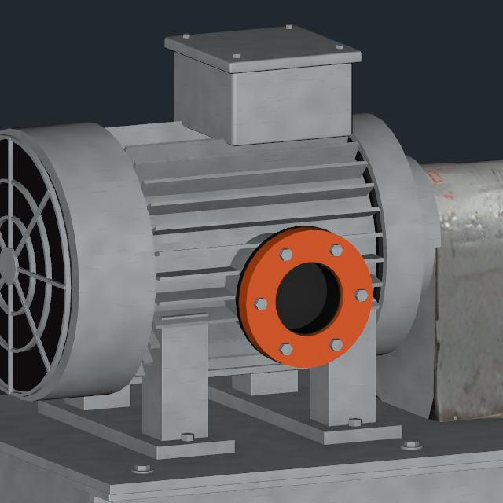
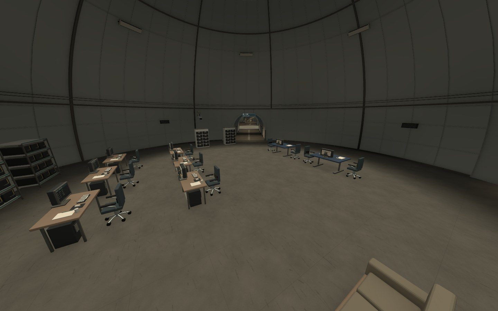
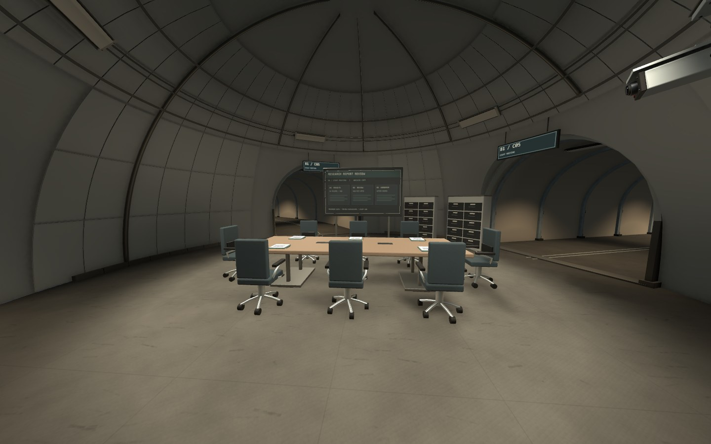

오늘은 전층의 겹치는 면과 B2 프랍을 보수하고\
B1 연구 데이터·직원 생활 구역의 첫 외형을 제작함

회의장까지 배치하고 이동 검사도 진행했지만\
층 전체를 다시 보니 실내 구획과 생활 동선은 더 손봐야 하는 상태임

## 전층 깊이 충돌 보수

이전 씬과 플레이어 씬을 포함해 15개 씬을 조사함\
그중 14개 씬의 렌더러 1,470개에 보수한 시각 메시를 연결함

계단과 데크, 벽 패널, 터널 접합부에서 같은 위치를 차지하던 면을 정리함\
원본 모델과 재질, 위치·회전·크기, 충돌체는 유지함

저장된 메시 3,326개 검사에서 오류는 0건\
정밀 재검사 범위에서도 허용오차를 넘는 잔여 내부 겹침은 없었음

다만 투명한 면이나 스킨드 메시, 모든 시점과 이동 경로까지 검사한 결과는 아님\
메시 검사 범위와 실제 플레이 검수 범위는 따로 기록함

이번 보수로 파생 메시 908개, 약 2.32GiB의 원본 파일이 늘어남\
겹치는 면은 줄였지만 저장 용량의 비용은 생긴 셈임

공용 메시를 묶거나 더 작은 저장 형태로 바꿀 수 있는지 후속 검토가 필요함\
프로젝트 폴더 크기만으로 실행 중 메모리나 권장 사양을 확정하지는 않음

## B2 프랍과 냉각 펌프 후속 수정

실린더 운반대와 공조기, 발전기 3종의 7배치를 먼저 보수함\
손상된 면과 노멀, 거리별 LOD의 정렬을 확인함

냉각 펌프는 첫 수정 뒤에도 모터 쪽 형상이 이상했음\
가까이 찍은 화면을 다시 보니 구겨진 방열핀과 플랜지가 남아 있었음

회전과 노멀 수정만으로 해결되는 부분이 아니어서\
모터 하우징, 직선 방열핀 26개, 원형 플랜지와 볼트, 단자함과 팬 가드를 다시 제작함

_보수 후 모터 확대 화면. 형상 확인을 위한 임시 검수 조명이며 B2의 최종 붉은 조명 화면은 아님._

B2의 펌프 10개에 같은 수정 모델을 적용함\
기존 공유 FBX의 GUID를 유지하고 배치 루트와 충돌체도 보존함

최종 펌프는 LOD0 12,000tri, LOD1 5,500tri임\
방열핀 형상을 유지하면서 이전보다 삼각형과 재질 슬롯이 늘었으므로 성능 최적화로 기록하지 않음

## B1의 역할부터 다시 맞추기

B1은 연구 데이터를 다루고 직원들이 생활하는 층임\
그런데 첫 배치에는 현장 능력 시험처럼 보이는 장비가 섞여 있었음

실험체의 정상 활동 구역과 직원 업무 구역을 다시 구분함\
B1에 남아 있던 시험 관련 38배치를 제거하고 자료 열람·인계·분석·보관 중심으로 수정함

_자료 업무용 가구를 배치한 현재 상태. 넓은 돔 안의 실내 구획은 아직 보강할 부분이 남아 있음._

사무실과 식당·조리, 숙소·위생, 직원 의무실과 경비 교대 공간도 구성함\
전체 구조는 13개 공동과 이동 코어 3개, 연결 통로 22개임

계단과 통로 접합부, 공용 프랍 메시의 겹치는 면도 함께 보수함\
직원용 안내선과 표지, 반사·가림 데이터도 갱신함

## 8인 회의장 구성

연구 보고와 직원 회의를 위한 8인 회의장을 추가함\
4.2m 테이블과 2.9m 발표 화면, 기록 보관장과 발표 자리를 배치함

_현재 회의장 외형. 좌석 접근은 확인했지만 출입구를 잇는 통과 길과 회의 공간의 분리는 다음 설계 과제임._

회의 테이블과 발표 화면 2종의 새 모델은 합계 약 0.364MiB\
나머지 가구는 기존 보수 메시와 재질, LOD를 재사용함

최종 주요 프랍 배치는 198개임\
배치 수가 늘어난 것과 공간의 완성도는 별도로 봐야 함

## 확인한 결과와 남은 범위

- CharacterController 경로 260/260 통과
- 전체 통로 왕복, 방 출입, 업무·회의 좌석 접근과 계단 왕복 확인
- 실제 Play에서 자료 열람·인계·회의·분석 구역의 입력 이동과 프레임 진행 확인
- 최종 8인 회의장 배치 뒤 재검사에서도 새 경고·오류 0
- 메시·재질·스크립트 누락 0, 배치 계획과 저장 씬 일치
- B1 작업 중 보호 대상 178개 파일의 해시 일치

깊이 충돌은 일정 크기 이상의 불투명 평면과 LOD 관계를 구분해 검사함\
작은 모든 면과 실제 조명에서의 모든 시점을 보증하는 검사는 아님

현재 B1에는 LOD 328그룹과 활성 광원 209개가 있음\
최종 빌드의 프레임 시간, 메모리와 그림자 비용은 별도 측정이 필요함

게임 로직과 플레이어, Animator는 이번 작업에서 수정하지 않음\
문·감시·승강기 작동과 층간 전환은 후속 기능 구현 범위임

## 다음은 B1 전체 실내 구획 재설계

회의장 한 곳만 고치면 끝나는 상태는 아님\
큰 돔 안에 가구가 놓여 있지만 직원들이 실제로 일하고 쉬는 층으로는 부족함

다음 작업에서는 원형 구조와 통로 연결을 유지하면서\
칸막이와 전실, 부분적으로 낮은 천장으로 사람 크기에 맞는 공간부터 나눌 예정

업무·회의·휴식·수면·세면·세탁·수납과 통과 길을 구분하고\
그다음 기존 가구를 다시 배치하기로 함

자료를 받아서 읽고, 분석하고, 회의한 뒤 보관하는 흐름도 공간에서 보여야 함\
오늘은 이 내용을 할 일에 기록하고 구현 상태를 저장함. 재설계 자체는 아직 시작하지 않음

[오늘의 데일리로그]({{ '/posts/daily-log-room-purpose-and-human-scale/' | relative_url }})에는 전체 구역을 다시 보며 바뀐 판단을 정리함

작성자 송예찬
