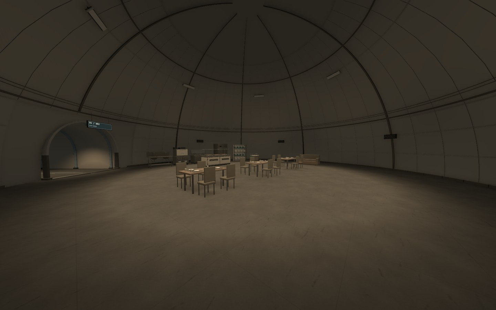

오늘 B1을 만들고 회의장까지 배치함\
그런데 전체 구역을 보면 아직 맞지 않는 느낌이 남았음

책상과 침대, 식탁이 있으니 각각의 용도는 알 수 있음\
그래도 사람들이 매일 일하고 생활하는 장소처럼 보이는지는 다른 문제였음

## 구역의 이름보다 그곳에서 하는 일

직원 구역인데 능력 시험 장비처럼 보이는 물건이 섞여 있었음\
연구 시설이라는 큰 분위기로 묶다가 층별 역할이 흐려진 상태였음

B1에서 필요한 것은 데이터를 받고 읽고 정리하는 자리와\
직원들이 먹고 쉬고 자는 공간임

출입을 관리하는 것과 직원 생활 자체를 통제하는 것도 구분해야 함\
구역 이름을 붙이기 전에 누가 와서 무엇을 하는 장소인지 먼저 정리할 필요가 있었음

## 큰 돔에 가구만 놓으면 남는 빈 공간

_현재 식당 구역. 가구는 있지만 넓은 바닥과 높은 천장 안에서 식사·조리·휴식의 경계가 약함._

기계층에서는 큰 설비와 배관이 높은 공간을 차지했음\
직원 생활층에 같은 방식으로 가구만 늘리면 바닥에 작은 물건을 흩어 놓은 느낌이 남음

식당이라면 음식을 받는 자리, 앉는 자리, 정리하는 자리와 지나가는 길이 있어야 함\
침실이라면 침대 옆을 다른 구역으로 가는 사람이 계속 통과해도 되는지 봐야 함

빈 바닥을 전부 채우는 것보다\
어디를 비워야 하고 그 빈자리가 무슨 역할인지 먼저 정해야 할 것 같음

## 이동 검사는 공간의 일부만 확인함

통로와 계단을 지나갈 수 있고 의자 가까이 접근할 수 있어도\
그 방이 편하게 일하거나 쉬는 장소가 되지는 않음

회의장도 8명이 앉을 자리는 만들 수 있음\
하지만 여러 출입구를 오가는 길이 회의 자리와 섞이면 회의실의 독립성이 약해짐

앞으로는 충돌 없이 지나가는지와 함께\
들어왔을 때 용도가 보이는지, 어디에 머물고 어디로 지나가는지 따로 확인하려고 함

검사를 통과했다는 기록을 전체 디자인의 완료로 읽으면 안 되겠음

## 가까이서 봐야 드러나는 메시 문제

냉각 펌프는 첫 수정 뒤에도 방열핀 모양이 이상했음\
전체 크기와 정렬을 확인하는 화면만으로는 손상된 부위를 충분히 잡지 못함

확대해서 보니 회전값을 맞추는 문제가 아니라\
핀과 플랜지 자체의 형태를 다시 만들어야 하는 부분이었음

전체 실루엣, 가까운 면의 모양, 멀어졌을 때의 LOD를 나눠 봐야 함\
생활 공간을 전체 평면과 실제 눈높이에서 따로 보는 것과도 비슷했음

## 다음에는 구획부터 잡기

원형 공동과 통로 연결은 유지하고\
칸막이, 전실, 부분 낮은 천장으로 사람이 사용하는 범위를 먼저 나누기로 함

업무와 회의, 휴식과 수면, 세면·세탁과 수납을 구분한 뒤\
기존 가구를 그 안에 다시 배치할 예정

깊이 충돌 보수로 파일도 많이 늘어남\
메시의 겹침을 고친 것과 저장 용량·실행 성능을 개선한 것도 같은 말이 아님

지금 결과는 보존하고, 공용화할 메시와 실제 빌드 비용은 따로 확인할 일로 남김\
오늘은 새 소품을 계속 더하기보다 B1 전체에서 다시 볼 기준을 정리하고 마감함

구현 내용과 검사 범위는 [오늘의 일일개발일지]({{ '/posts/after-seconds-scene-depth-repair-and-b1-staff-floor/' | relative_url }})에 따로 기록함

작성자 송예찬
