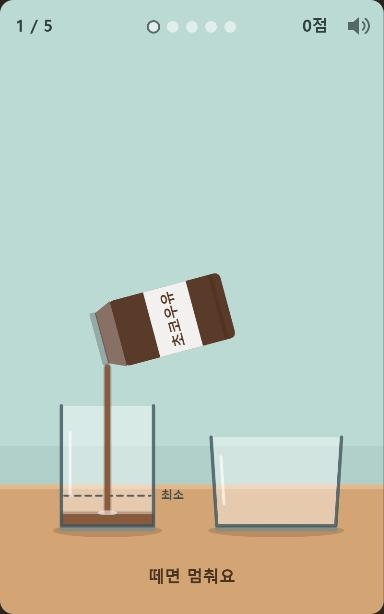
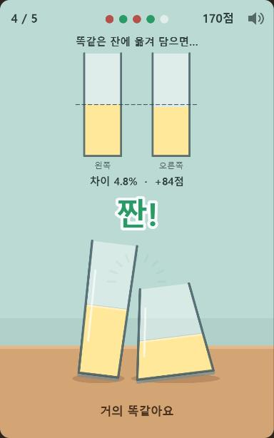
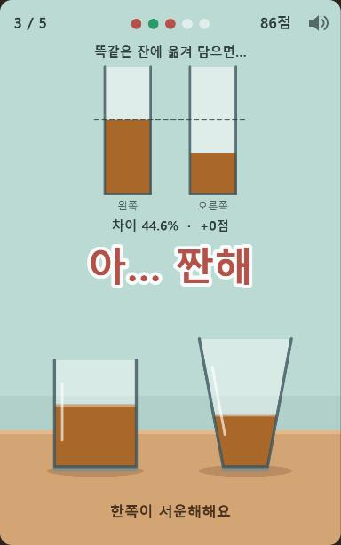
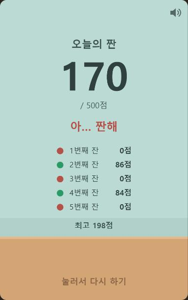

게임개발로 먹고 살기 어려운 이유\
게임은 필요에 의해 구매되지 않는다

피드백은 나에대한 평가가 아니다\
결과물을 발전시키는 정보이다\
피드백이 향하는 곳은 내가 아니라 결과물

좋았던점\
내 강점이 잘 보였던 장면은?

궁금한 점 \
내 의도와 재미가 덜 보이는 곳은?

다음 액션\
다음 버전에서 한 가지만 바꾼다면?

재미는 배우는 순간에 생긴다\
발견 " 보스가 팔을 들면 곧 공격하네? "\
연습 " 죽어도 괜찮아, 한 번 더! "\
성장 " 이제 피하는 타이밍이 보여 !"\
새 패턴 " 어? 2단계에선 패턴이 바뀌었네? "

게임이 지루해지는 두 가지 이유

너무 쉬우면 배울게 없어 반복 숙제가 되고 너무 헷갈리거나 어려우면 어렵다고 하지 않게 된다 딱 좋은 정도를 찾을 것

그림보다 규칙 먼저

규칙은 재미의 뼈대이다

## 미니 웹게임 「아 짠 해」

규칙부터 잡고 간단한 웹게임을 하나 만들어 봄\
소재는 "컵 두 개에 똑같이 따르기"

[게임 하러 가기](https://songyechan1024.github.io/Kasil_DevLog/assets/games/ah-jjan-hae/)

### 규칙

화면을 꾹 누르고 있으면 따라지고 떼면 멈춤\
왼쪽 잔은 점선(최소)만 넘기면 원하는 만큼 따르면 됨\
그 다음 모양이 다른 오른쪽 잔에 같은 양을 따름\
오른쪽 잔은 손을 떼는 순간 끝이라 다시 따를 수 없음\
넘치면 그 잔은 0점\
5잔을 따르고 500점 만점

원래 소재는 따르는 도중에 한 번 탭해서 컵을 바꾸는 방식이었음\
근데 정해진 양을 반으로 나누는 느낌은 아닌 것 같았음\
집에서는 보통 큰 팩에서 따르니까\
그냥 두 잔 양을 똑같이 맞추고 기분 좋아지는 쪽으로 바꿈\
그래서 우유가 아니어도 됨\
딸기우유, 보리차, 오렌지 같은 걸로 잔마다 바뀜

### 어떤 게 재밌는지

잔 모양이 달라서 높이만 보고 맞추면 틀림\
넓은 잔은 낮게 차고 좁은 잔은 높게 참\
눈으로 양을 가늠해야 하는 게 핵심

다 따르면 똑같은 잔 두 개에 옮겨 담아서 차이를 보여줌\
거의 같으면 두 잔이 "짠!" 하고 건배함

많이 다르면 "아… 짠해"가 뜸\
제목 「아 짠 해」는 건배할 때의 "짠 해!"와 안쓰러운 "짠해" 둘 다로 읽히게 지음

위에 적은 "재미는 배우는 순간에 생긴다"에 맞춰 보면\
발견 " 넓은 잔은 생각보다 덜 올라오네? "\
연습 " 한 잔이 금방 끝나니까 한 번 더! "\
성장 " 이 잔은 이쯤에서 떼면 되겠다 "\
새 패턴 " 어? 이번엔 잔 조합이 바뀌었네? "\
이 흐름이 나오게 하려고 함

### 난이도

처음 만든 버전은 직접 해보니 거의 "아… 짠해"만 나옴\
너무 어려우면 안 하게 된다는 얘기 그대로라 쉽게 조정함

| 바꾼 것 | 내용 |
| --- | --- |
| 점수 기준 | 차이 4% 이내 "짠!!" · 10% 이내 "짠!" · 18% 이내 "짠…?" · 그 이상은 "아… 짠해" |
| 따르는 속도 | 전체적으로 늦춤 |
| 첫 잔 | 오른쪽 잔에 "여기쯤" 연습선을 보여줌 |

1~3번째 잔은 같은 속도이고 4~5번째 잔은 조금 더 빨리 따라짐\
조작은 누르기와 떼기 하나뿐이라 쉬움\
어려운 건 양을 눈으로 맞추는 부분

5잔이 끝나면 "오늘의 짠" 점수와 잔별 점수가 나옴\
HTML 파일 하나로 되어 있어서 링크만 열면 바로 할 수 있음
