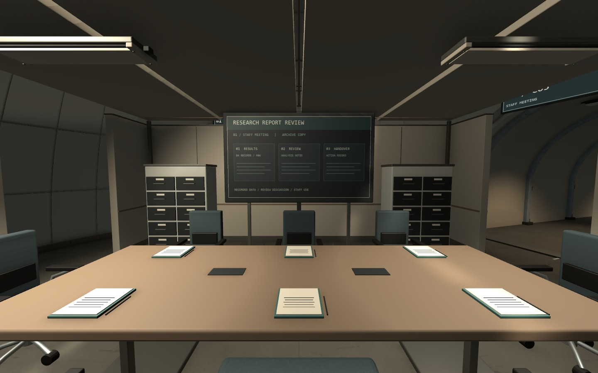
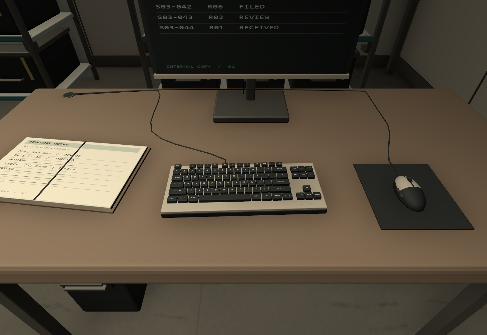
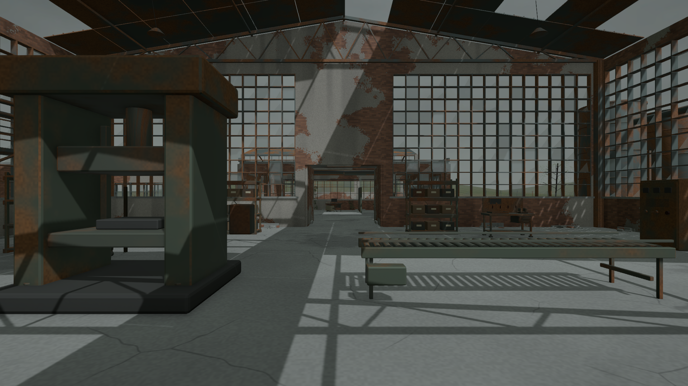
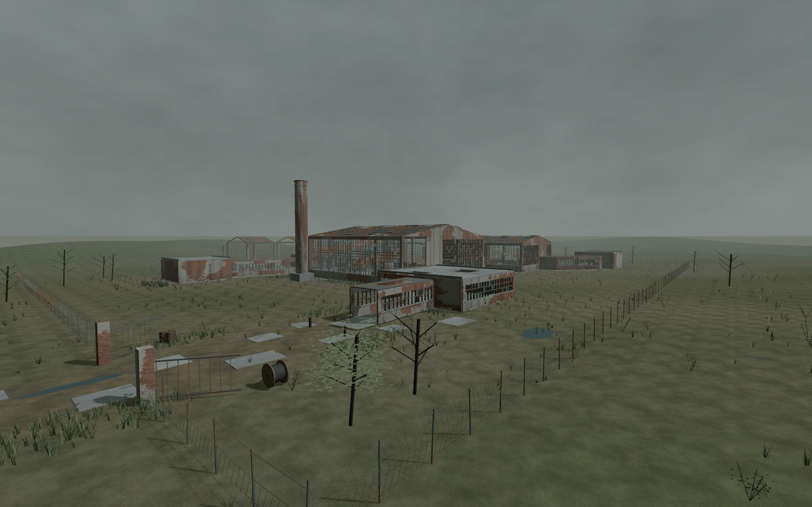
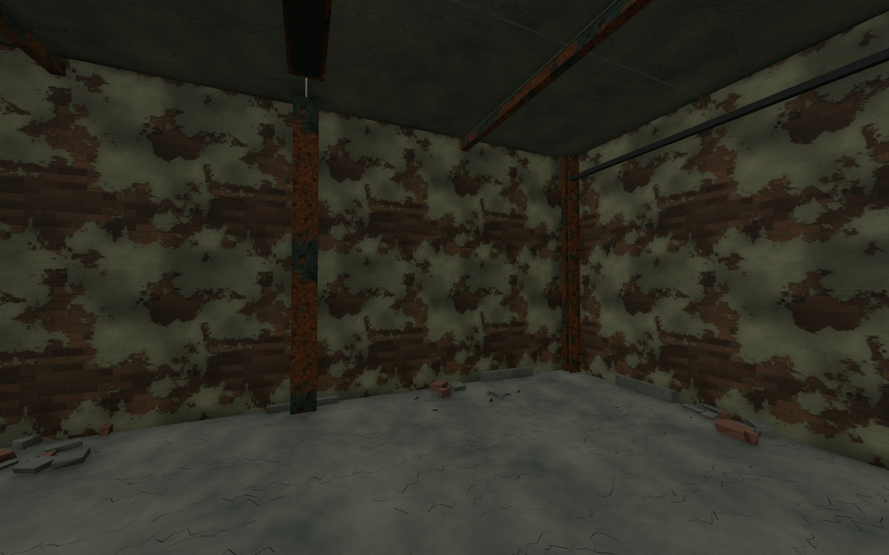
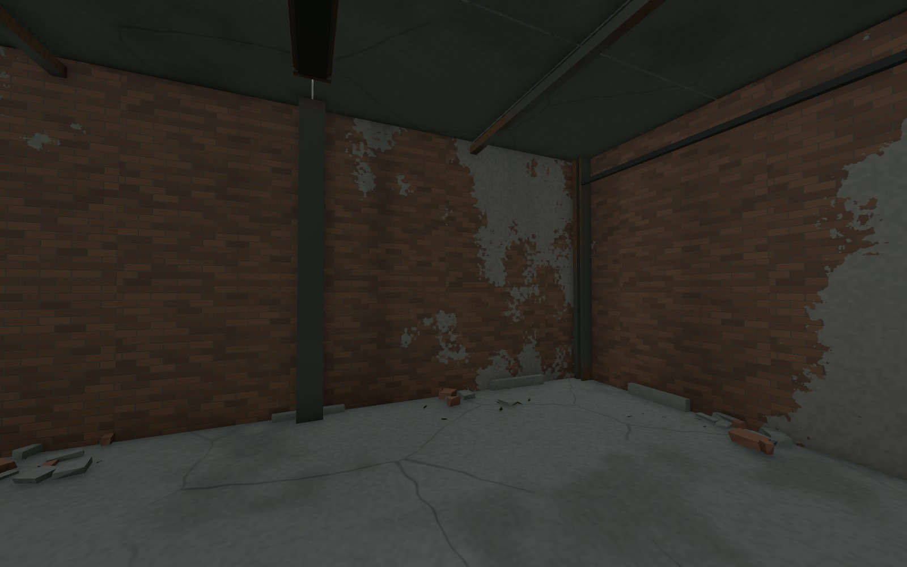

어제 남겨 둔 B1 전체 실내 재설계부터 진행함\
이후 책상 위 소품을 보수하고 마지막 지상 1층을 제작함

지상층은 지금도 사용하는 공장이 아니라 지하 시설을 감추는 폐공장임\
이 기준에 맞춰 건물과 외부 지형을 다시 구성하고, 마지막으로 벽의 반복 무늬를 수정함

## B1에서 머무는 자리와 지나가는 길 나누기

기존 공동 13개와 이동 코어 3개, 통로 22개는 유지함\
그 안에 업무·회의·식사·휴식·수면·위생 공간을 나누는 구획을 추가함

주요 체류 구획 17개, 칸막이 103개 구간과 부분 천장 21개를 구성함\
큰 돔 안에 가구만 놓여 있던 상태에서 사람이 사용하는 실내 범위를 잡는 작업임

_실내 재설계 단계의 회의실. 좌석과 발표 공간을 구분하고 회의실 바깥으로 우회하는 길을 남김. 테이블 소품은 이후 추가 보수함._

침실은 통과 길에서 침대가 바로 보이지 않도록 입구를 꺾음\
식당은 조리·배식·식사·회수와 공용 통행을 구분하고, 연구 데이터 업무도 열람·대조·인계·보관으로 나눔

기존 가구를 재사용해 주요 배치는 203개로 정리함\
새 실내 구조 FBX 13종은 약 9.58MiB이며 이 단계에서 새 재질과 텍스처는 추가하지 않음

## 똑같던 책상과 입력 장치 보수

실내를 나눈 뒤에도 책상 위 물건이 너무 비슷하게 반복되고 있었음\
마우스가 앉는 사람 기준 왼쪽에 있는 배치와 단순한 키보드·마우스 형상도 함께 확인함

관련 53배치를 살펴보고 51배치를 보수함\
연구 데스크 24개는 12가지 구성으로 나누고, 업무석 28개의 마우스를 작업자 오른쪽에 맞춤

_앉는 방향을 기준으로 입력 장치와 문서 자리를 구분한 데스크._

키보드는 엇갈린 키 배열, 넓은 주요 키와 각인을 보강함\
마우스는 곡면 몸체, 버튼 분할, 스크롤 휠, 측면 버튼과 케이블을 구분함

서류·트레이·전화·컵도 업무에 따라 다르게 놓음\
회의 테이블과 식탁, 무전 인계대, 직원 의무실 카트와 녹음기까지 비슷한 문제를 함께 살펴봄

새 모델 30종에는 3단계 LOD를 적용함\
FBX 원본은 약 41.74MiB, 새 텍스처는 2048 아틀라스 1장과 재질 2개임

근접 디테일을 늘린 만큼 최고 LOD의 삼각형도 늘어남\
이번 작업은 외형 보수이며 성능 최적화를 완료한 것으로 기록하지 않음

## 지상 1층은 사용하지 않는 위장용 폐공장

첫 배치에는 정상적인 사무·출하와 켜진 장비처럼 보이는 흔적이 남아 있었음\
지상층의 용도에 맞지 않아 운영 중인 분위기를 만드는 30개 배치를 제거함

남긴 기존 기물 55개는 녹과 먼지, 꺼진 화면 등 방치 상태로 정리함\
깨진 격자창, 일부가 무너진 지붕, 노출 철골과 점검 데크, 배관·굴뚝·사일로를 구성함

_실제 Play에서 확인한 생산동. 작업등과 화면 발광을 끄고 창과 지붕 틈으로 들어오는 빛을 사용함._

외부도 건물만 놓인 평지로 두지 않음\
384×320m Terrain에 완만한 기복과 배수 저지대, 흙·자갈·이끼 레이어를 구성함

진입로에는 깨진 포장과 웅덩이, 경계에는 낡은 울타리와 열린 대문을 배치함\
건물 주변에는 잔해와 낙엽, 풀 군락·관목·나무를 추가함

_지상층 외부 검수 화면. 건물과 방치된 부지를 함께 확인한 상태임._

폐공장 재작업의 새 FBX 191개는 합계 약 26.70MiB임\
식생은 구역별 메시와 LOD로 묶고, 이전 초안에서 사용하지 않는 씬 오브젝트도 정리함

## AE_VA_Walls의 반복 무늬 수정

벽을 넓게 보니 같은 벗겨짐 모양이 일정 간격으로 반복되고 있었음\
낡은 벽을 표현하려던 얼룩이 오히려 도장처럼 찍힌 무늬로 보임

_수정 전. 작은 벗겨짐 패턴이 벽 전체에서 반복됨._

벽돌 줄눈과 미세한 표면 결은 기존 크기를 유지함\
큰 벗겨짐·습기·녹·바닥 균열은 월드 좌표에 따라 달라지도록 분리함

_수정 후 같은 시점. 작은 벽돌 패턴과 큰 표면 손상의 크기를 따로 다룸._

계단 코어와 생산·하역·사무동, 외벽·굴뚝의 관련 재질 10개에 적용함\
LOD를 포함한 렌더러 252개가 대상이며 다른 층의 공유 재질은 바꾸지 않음

1층 전용 셰이더의 컴파일 오류는 없었고 실제 Play 화면도 다시 확인함\
게임 카메라가 단색 배경을 사용해 하늘이 검게 나오던 부분은 1층 씬의 Skybox 설정으로 수정함

## 검수와 남은 작업

| 범위 | 확인한 결과 |
| --- | --- |
| B1 이동 | 297/297 경로 통과, 공용 우회 길 104/104 확인 |
| B1 공간 | 침실 시선 64개에서 직접 노출 0, 회의석 8개의 발표 화면 가림 0 |
| B1 소품 보수 후 | 실제 Play 5구역 이동·시점 입력 확인, 새 경고·오류 0 |
| 1F 이동 | 주요 75개와 점검 계단·외부 도로 왕복 4개, 합계 79/79 통과 |
| 1F 실제 Play | 실내·코어·데크·도로·마당 11곳의 이동과 프레임 진행 확인 |
| 표면·메시 | 검사 범위에서 정밀 깊이 충돌 잔여 0, 새 메시·셰이더 오류 0 |

깊이 충돌 검사는 일정 크기 이상의 불투명 평면과 LOD 관계를 구분한 결과임\
모든 작은 면과 모든 시점의 외형을 보증하는 검사는 아님

반사와 가림 데이터도 갱신함\
게임 로직과 Player 프리팹, Animator는 이번 작업에서 수정하지 않음

다음에는 지상층 전체 분위기, 벽 표면과 외부 지형을 다시 보고 필요한 구역을 보수할 예정\
층간 전환·문·승강기·AI 같은 게임 기능과 빌드 성능 측정은 별도 작업으로 남음

원본 파일 크기는 실행 중 RAM·VRAM 사용량과 다름\
PC 권장 사양은 실제 배포 빌드의 메모리와 프레임 시간을 측정한 뒤 정해야 함

[오늘의 데일리로그]({{ '/posts/daily-log-use-traces-and-texture-scale/' | relative_url }})에는 공간과 소품을 보며 정리한 기준을 따로 기록함

작성자 송예찬
