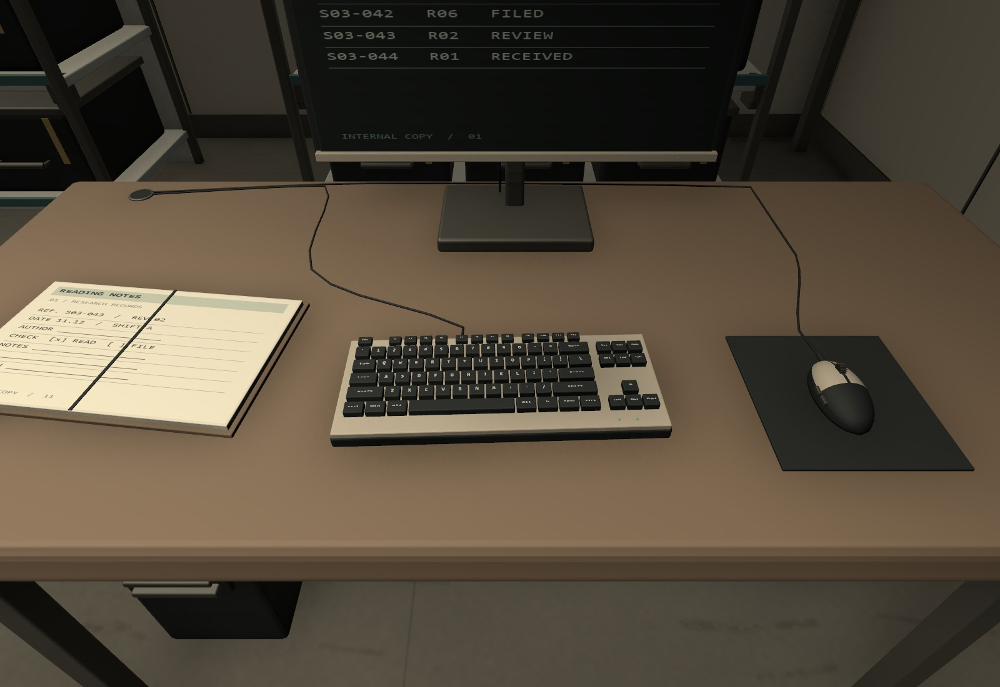
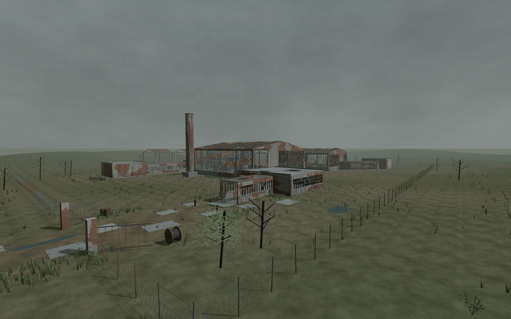

어제는 B1에서 사람이 머무는 자리와 지나가는 길이 섞여 있는 문제를 봄\
오늘은 실내를 나눈 뒤 책상 위 물건과 지상층의 분위기를 다시 확인함

공간을 나누고 필요한 소품을 넣어도 어색한 부분은 남아 있었음\
이번에는 물건 하나의 방향과 표면에 남은 흔적까지 봐야 했음

## 책상을 만든 방향과 사람이 앉는 방향

책상에 키보드와 마우스가 있다고 배치가 끝나는 건 아니었음\
앉는 쪽에서 보니 마우스가 키보드 왼쪽에 있는 자리가 있었음

모델을 만들 때의 축과 사용자가 보는 좌우를 혼동한 부분임\
이런 소품은 위에서 보기보다 의자 쪽에서 손을 뻗는 방향으로 확인해야 함

마우스를 오른쪽에 놓는 것만으로도 사용 방식이 더 잘 읽힘\
키보드의 큰 키, 마우스 버튼과 휠처럼 자주 보는 부분은 단순한 덩어리로 두면 가까이서 바로 어색해짐

같은 책상이어도 읽는 자료, 인계할 서류, 비워 둔 자리에는 차이가 필요함\
물건을 무작위로 흩뜨리기보다 그 자리에서 무슨 일을 하는지 먼저 생각해야 할 듯

## 폐공장은 건물의 상태와 주변 땅까지 이어짐

지상층은 현재 쓰는 공장이 아니라 위장을 위해 남겨 둔 폐공장임\
그런데 정상적인 업무 자리와 켜진 화면이 있으면 아직 사람이 관리하는 장소처럼 읽힘

벽에 녹을 추가하는 것만으로는 이 차이를 해결하기 어려웠음\
지붕과 창의 파손, 멈춘 설비, 꺼진 작업등과 남겨진 물건을 함께 맞춰야 함

공장 밖도 마찬가지였음\
울타리와 대문만 낡았는데 땅이 깨끗한 평지라면 서로 다른 장소처럼 보일 수 있음

진입로의 깨진 포장, 낮은 곳의 물, 건물 가장자리의 풀과 잔해까지 같이 봐야 함\
건물의 분위기가 벽에서 끝나는 게 아니라 주변 땅으로 이어져야 한다는 쪽으로 정리함

## 반복 무늬를 줄일 때 무엇을 크게 할지

벽에 벗겨짐을 넣었는데 같은 모양이 계속 반복됨\
하나의 작은 무늬로 벽 전체를 채우니 방치된 벽보다 인쇄된 패턴처럼 보였음

텍스처 전체를 크게 늘리면 얼룩 간격은 벌어져도 벽돌까지 커질 수 있음\
벽돌 한 장의 크기와 오래된 얼룩이 퍼진 범위는 따로 다뤄야 했음

오늘은 작은 표면 결과 큰 벗겨짐을 분리해 적용함\
근접에서는 벽돌과 줄눈이 읽히고, 멀리서는 큰 얼룩의 분포가 반복을 덜 드러내는 방향임

책상마다 같은 물건이 같은 자리에 있는 문제와도 닮아 있었음\
하나만 보면 괜찮아도 여러 개를 이어서 보면 복제한 흔적이 먼저 보일 수 있음

## 멀리서 본 화면과 실제 플레이 화면

전체 실루엣, 방 안의 눈높이, 소품 확대를 나눠 봐야 함\
한 화면으로 전부 확인했다고 생각하기 어려웠음

실제 Play에서는 카메라 배경 설정 때문에 하늘이 검게 나오는 문제도 발견함\
검수용 화면이 괜찮아 보여도 게임 카메라에서 같은 결과가 나오는지 다시 확인할 필요가 있음

이동 검사와 메시 검사는 잘못된 부분을 좁히는 데 도움이 됨\
다만 통과 숫자만으로 폐공장 분위기나 생활 공간의 자연스러움까지 판단할 수는 없음

오늘은 여기까지 저장함\
다음 검수에서도 전체 공간에서 읽히는 용도와 가까이서 보이는 배치·표면을 함께 볼 예정

구현 수치와 검수 범위는 [오늘의 일일개발일지]({{ '/posts/after-seconds-b1-redesign-and-abandoned-factory/' | relative_url }})에 정리함

작성자 송예찬
