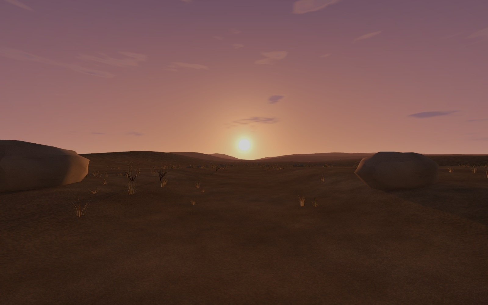

오늘은 Unity 생명주기를 정리하고, 따로 만든 엘프 바드 파츠를 한 캐릭터로 조립함\
Blender에서 목과 손, 옷자락을 움직여 보고 집에서도 이어서 열 수 있도록 작업 파일을 준비함

개인 프로젝트에서는 폐공장의 구조와 프랍을 보수하고 석양 아래 황야를 구성함\
수업·실습 내용은 이 글에, 개발 내역과 작업하면서 배운 점은 아래의 일일개발일지·데일리 로그에 나누어 정리함

## Unity 생명주기

Unity가 정해진 시점에 호출하는 함수를 정리함\
순서뿐 아니라 한 번만 호출되는지, 반복되는지, 어떤 조건에서 호출되는지도 같이 봐야 함

위 그림은 큰 흐름을 보는 참고용으로 남겨 둠\
모든 함수가 화살표 순서대로 매번 실행된다는 뜻으로 읽으면 안 됨

### 초기화와 활성화

`Reset`은 컴포넌트를 처음 붙이거나 Inspector에서 Reset을 선택할 때 기본값을 잡는 용도임\
편집 모드에서 호출되며, 게임 시작 때 항상 가장 먼저 실행되는 함수는 아님 — [Unity Reset 문서](https://docs.unity.com/en-us/engine/6000.0/script-reference/unityengine/monobehaviour/reset)

| 함수 | 정리한 역할 |
| --- | --- |
| `Awake` | 스크립트 인스턴스가 초기화될 때 내부 상태와 참조를 준비함 |
| `OnEnable` | 오브젝트와 컴포넌트가 활성 상태가 될 때 호출됨. 다시 활성화하면 또 호출될 수 있음 |
| `Start` | 활성화된 스크립트의 첫 `Update` 전에 한 번 호출됨 |

같은 컴포넌트의 `Awake`는 `Start`보다 먼저 실행됨\
여러 오브젝트의 같은 콜백이 어떤 순서로 실행될지는 임의로 기대하면 안 됨 — [Unity 실행 순서 문서](https://docs.unity.com/en-us/engine/6000.0/manual/scripting/managing-update-order/execution-order), [Start 문서](https://docs.unity.com/en-us/engine/6000.0/script-reference/unityengine/monobehaviour/start)

### 반복 업데이트와 물리 이벤트

`Update`는 화면 프레임마다, `LateUpdate`는 그 프레임의 `Update`가 끝난 뒤 호출됨\
`FixedUpdate`는 고정된 시간 간격을 기준으로 처리되므로 화면 한 프레임에 없을 수도, 여러 번 호출될 수도 있음 — [Unity 실행 순서 문서](https://docs.unity.com/en-us/engine/6000.0/manual/scripting/managing-update-order/execution-order), [FixedUpdate 문서](https://docs.unity.com/en-us/engine/6000.0/script-reference/unityengine/monobehaviour/fixedupdate)

그래서 `FixedUpdate`와 화면 프레임을 같은 횟수로 생각하면 안 됨\
`OnTrigger...`와 `OnCollision...`도 물리 조건에 맞는 이벤트가 생길 때 받는 콜백임

### 비활성화와 종료

`OnDisable`은 비활성화, `OnDestroy`는 파괴, `OnApplicationQuit`은 애플리케이션 종료에 관련된 콜백임\
그림의 아래쪽처럼 세 함수가 언제나 같은 순서로 이어지는 하나의 종료 단계는 아님

특히 `OnApplicationQuit`은 앱이 종료되기 전에 호출되며 플랫폼에 따라 받지 못하는 경우도 있음 — [Unity OnApplicationQuit 문서](https://docs.unity.com/en-us/engine/6000.0/script-reference/unityengine/monobehaviour/onapplicationquit)

오늘은 함수 이름을 외우는 것보다 초기화·반복 처리·활성 상태 변경을 나누어 정리해 둠

## 엘프 바드 파츠를 한 캐릭터로 조립하기

VARCO에서 만든 머리, 몸통, 팔, 손, 하체를 Blender로 가져옴\
치마와 망토를 입히고 만돌린까지 들려서 엘프 바드 한 명으로 조립해 봄

처음에는 악기를 든 자세에 맞춰 파츠를 배치함\
정면에서는 팔이 이어져 보여도 옆으로 돌려 보면 어깨와 손목의 경계가 드러남\
악기를 든 전체 모습을 확인한 뒤, 애니메이션을 붙일 버전은 팔을 벌린 T포즈로 다시 맞춤

### 움직일 몸 만들기

T포즈용 파츠를 놓고 양팔 길이와 양손 크기부터 맞춤\
허리와 어깨는 파츠를 겹쳐 놓기만 하면 자세를 바꿀 때 경계가 드러남

몸은 복셀로 표면을 합친 뒤 메시를 줄이고 UV를 다시 펼침\
색과 표면 정보도 새 몸에 사용할 텍스처로 구워 줌

몸, 치마, 망토, 만돌린은 각각 메시로 남겨 둠\
같은 뼈대를 쓰면서도 망토나 악기만 골라 고칠 수 있는 구성임

### 목을 돌렸을 때 보이던 자국

머리 파츠에 목이 이미 붙어 있어서 몸통 위에 얹으니 목이 길고 아래쪽에 둥근 선이 남았음\
머리 위치를 내려 길이를 맞추고 목 밑단을 어깨 경사에 맞춰 넓힘\
끝부분은 몸통 표면 안으로 살짝 넣음

모양을 맞춰도 흐린 띠가 보여서 몸통의 피부색을 목 쪽으로 서서히 섞음\
이후 고개를 돌려 보며 턱은 머리를 따라가고 목 밑은 어깨에 남도록 웨이트를 조절함\
턱에서 목 밑으로 내려갈수록 머리뼈의 영향을 줄이는 방식임

### 손가락과 옷자락 리깅

손은 손가락이 펼쳐진 오른손으로 교체함\
피부색을 몸에 맞춘 뒤 반전해서 왼손도 만듦

손가락 마디마다 뼈를 넣고 왼손은 주먹을, 오른손은 검지와 중지만 굽혀 봄\
한 손가락을 굽힐 때 옆 손가락까지 따라오는지 확인하기 위한 자세임

치마는 허리 둘레를 따라 8줄, 망토는 등 쪽으로 5줄의 뼈를 넣음\
머리카락은 앞뒤·좌우로 4갈래를 잡았고 최종 뼈대는 99개임\
팔을 내리고 한쪽 다리를 든 자세까지 확인한 뒤 기본 자세로 되돌려 저장함

### 집에서 이어서 열기

- [Blender 원본 V0.02 다운로드](https://github.com/SongYeChan1024/Kasil_DevLog/releases/download/elfbard-261113-v0.02/261113_Blender_NCAI_ElfBard_Rigged_V0.02.blend) · 약 494MB. 조립 전 T포즈 파츠와 리깅한 캐릭터가 함께 들어 있음. 목이나 손을 파츠 단계부터 다시 손볼 때 쓰는 파일임
- [Blender 경량본 V0.02 다운로드]({{ '/assets/data/elfbard-261113/ElfBard_Rigged_V0.02_Light.blend' | relative_url }}) · 약 74MB. 최종 메시 4개와 뼈대 99개를 남기고 텍스처 13장을 2K로 넣음. 별도 텍스처 폴더 없이 포즈와 웨이트를 이어서 편집할 수 있음

Blender 5.2.2에서 경량본을 다시 열어 확인함\
오른쪽 아래팔 뼈를 돌렸을 때 몸 메시의 정점도 따라 움직이는 것까지 봄

## After Seconds 폐공장 보수

지상 1층의 분위기는 유지하면서 가까이서 어색한 부분을 다시 봄\
네모난 천장 구멍을 바꾸는 것에서 시작해 금속판의 접힘과 콘크리트의 파단면·철근을 구분함

벽돌처럼 보이던 외벽은 금속 외장으로 수정하고 창의 비율을 낮춤\
녹을 넓게 덮기보다 판 이음과 볼트, 빗물이 흐른 자리와 벽 하단의 흔적을 살림\
아이비와 낙엽, 설비 주변의 바닥 흔적도 함께 보수함

승강기는 고정 통로 안의 객실과 균형추, 레일·로프·도르래가 읽히도록 구성함\
도착 방화문과 계단을 연결하고, 이후 스크립트를 붙일 수 있도록 가동 부품을 분리함

마지막에는 케이블 릴·의자·공구 카트·지게차·유압 프레스의 곡면과 연결 부위를 다시 다듬음\
작은 장식을 더하는 것만큼 큰 윤곽과 부품이 이어지는 모양이 중요했음

### 석양 아래로 이어지는 황야

공장 밖은 마른 길과 풀, 바위와 낮은 언덕이 이어지는 황야로 만듦\
태양을 더 크게 하고 주변 빛번짐을 보강해, 처음 빛을 마주하는 순간을 강조함

_공장을 나와 자유를 찾았다는 느낌을 주고 싶은 배경. 현재는 외형과 조명, 보행 지형을 준비한 상태임._

승강기 운행과 문 제어, 엔딩 연출은 나중에 직접 스크립트를 작성할 예정\
오늘은 배경·구조·프랍 보수와 통행·Play 확인까지 마무리함

## 오늘의 데일리 로그와 일일개발일지

- [데일리 로그 — 부서진 재질과 처음 마주한 빛]({{ '/posts/daily-log-material-damage-and-first-light/' | relative_url }})\
  지붕의 파손, 벽의 재료, 기계의 연결과 석양을 보며 달라진 판단 기준을 정리함
- [After Seconds 일일개발일지 — 폐공장 구조 보수와 석양 아래 황야]({{ '/posts/after-seconds-factory-detail-and-sunset-wilderness/' | relative_url }})\
  오늘 수정한 구조와 외형, 프랍 5종·11배치의 마지막 보수, 통행과 Play 검수 결과를 모음

작성자 송예찬
