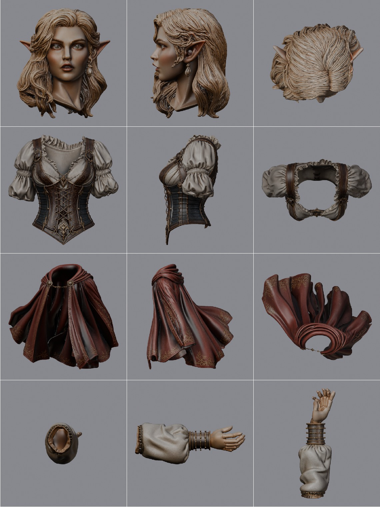
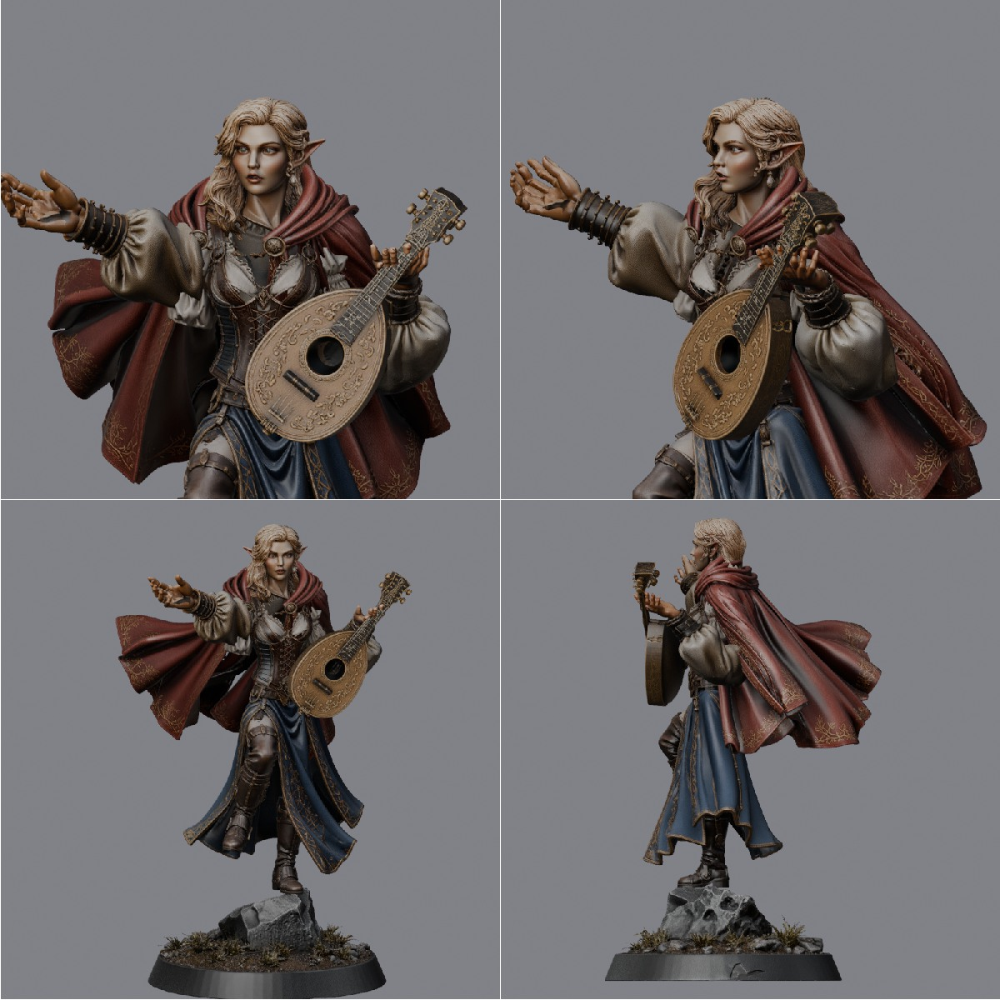
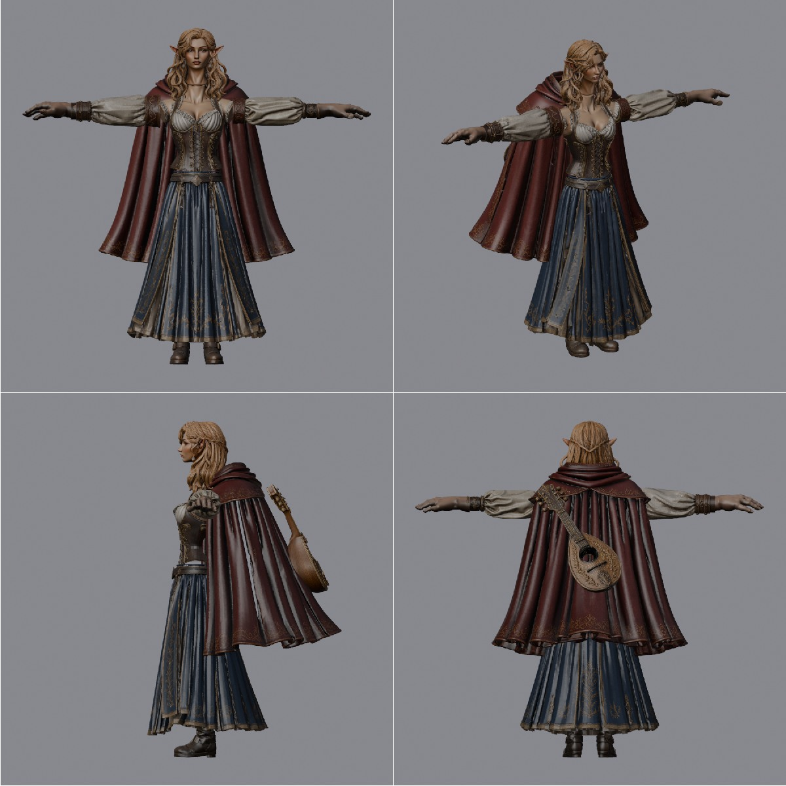
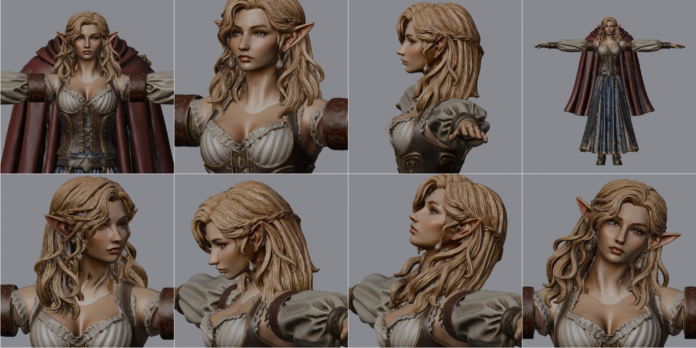
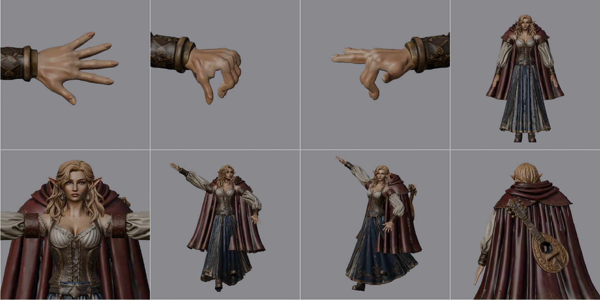

유니티의 생명주기

## 엘프 바드 파츠를 한 캐릭터로 조립하기

VARCO에서 만든 머리, 몸통, 팔, 손, 하체를 블렌더로 가져옴.\
여기에 치마와 망토를 입히고 만돌린까지 들려서 엘프 바드 한 명으로 조립해 봄.

처음엔 악기를 든 자세에 맞춰 파츠를 배치함.\
정면에선 팔이 이어져 보여도 옆으로 돌려 보면 어깨와 손목이 어디서 만나는지 보임.\
악기까지 든 모습을 먼저 확인하고, 애니메이션을 붙일 버전은 팔을 벌린 T포즈로 다시 맞춤.

### 움직일 몸 만들기

T포즈용으로 다시 만든 파츠를 놓고 양팔 길이와 양손 크기부터 맞춤.\
상체와 하체가 만나는 허리, 몸통과 팔이 만나는 어깨는 겹쳐 놓기만 하면 포즈를 바꿀 때 경계가 드러남.\
몸통 쪽은 복셀로 표면을 합친 뒤 메시를 줄이고 UV를 다시 펼침. 색과 표면 정보도 새 몸에 쓸 텍스처로 구워 줌.

몸, 치마, 망토, 만돌린은 각각 메시로 남겨 둠.\
같은 뼈대를 쓰면서도 망토나 악기만 골라 고칠 수 있음.

### 목을 돌렸을 때 보이던 자국

머리 파츠에 목이 이미 붙어 있었음. 몸통 위에 얹으니 목이 길고, 아래쪽에 둥근 선이 남았음.\
머리 위치를 내려 목 길이를 맞추고 목 밑단을 어깨 경사에 맞춰 넓힘. 끝부분은 몸통 표면 안으로 살짝 넣음.\
그래도 흐린 띠가 보여서 바로 아래 몸통의 피부색을 가져와 목 쪽으로 갈수록 서서히 섞이게 함.

모양을 맞춘 다음엔 고개를 돌려 봄. 턱은 머리를 따라가야 하고 목 밑은 어깨에 남아야 자연스러움.\
그래서 턱에서 목 밑으로 내려갈수록 머리뼈가 잡아당기는 비율을 줄임.

### 손가락과 옷자락 리깅

손은 손가락이 펼쳐진 오른손으로 교체함. 피부색을 몸에 맞춘 뒤 반전해서 왼손도 만들었음.\
손가락 마디마다 뼈를 넣고 왼손은 주먹을, 오른손은 검지와 중지만 굽혀 봄. 한 손가락을 굽힐 때 옆 손가락까지 따라오는지 볼 수 있는 자세임.

치마는 허리 둘레를 따라 8줄, 망토는 등 쪽으로 5줄의 뼈를 넣음. 머리카락은 앞뒤·좌우로 4갈래를 잡음.\
최종 뼈대는 99개. 팔을 내리고 한쪽 다리를 든 자세까지 확인한 뒤 기본 자세로 되돌려 저장함.

### 집에서 이어서 열기

- [Blender 원본 V0.02 다운로드](https://github.com/SongYeChan1024/Kasil_DevLog/releases/download/elfbard-261113-v0.02/261113_Blender_NCAI_ElfBard_Rigged_V0.02.blend) · 약 494MB. 조립 전 T포즈 파츠와 리깅한 캐릭터가 함께 들어 있음. 목이나 손을 파츠 단계부터 다시 손볼 때 쓰는 파일.
- [Blender 경량본 V0.02 다운로드]({{ '/assets/data/elfbard-261113/ElfBard_Rigged_V0.02_Light.blend' | relative_url }}) · 약 74MB. 최종 메시 4개와 뼈대 99개를 남기고 텍스처 13장을 2K로 넣음. 별도 텍스처 폴더 없이 포즈와 웨이트를 이어서 편집할 수 있음.

Blender 5.2.2에서 경량본을 다시 열어 오른쪽 아래팔 뼈를 돌렸을 때 몸 메시의 정점도 따라 움직이는 것까지 확인함.
