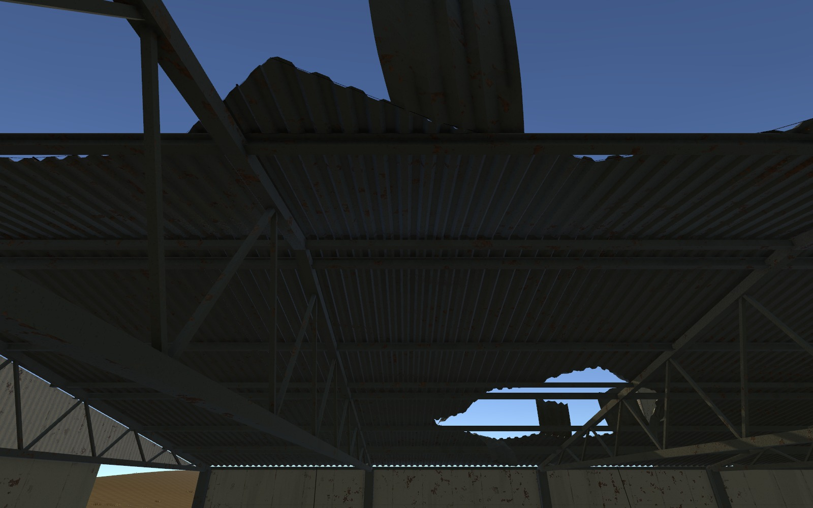
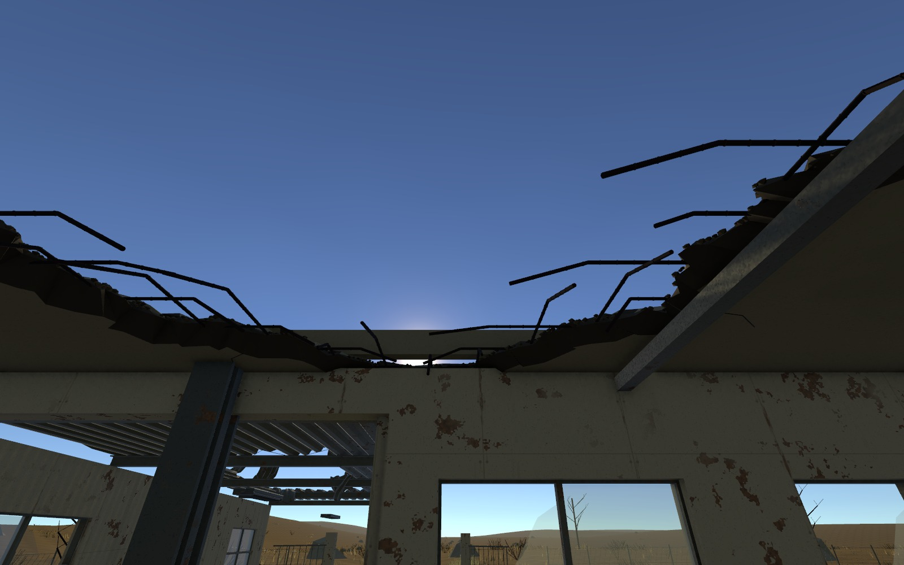
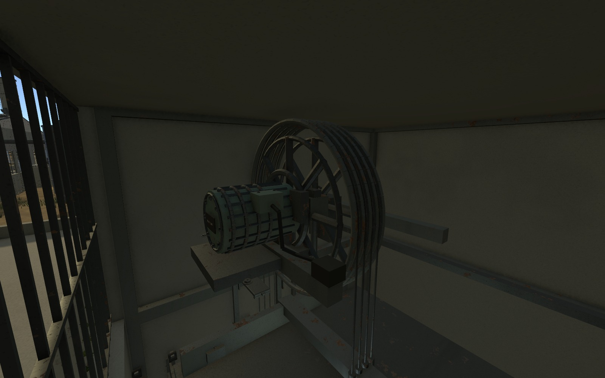
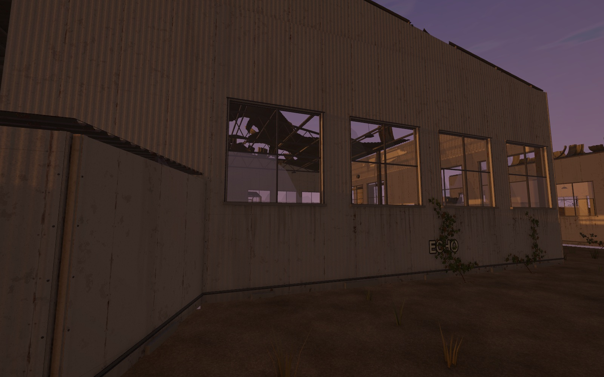
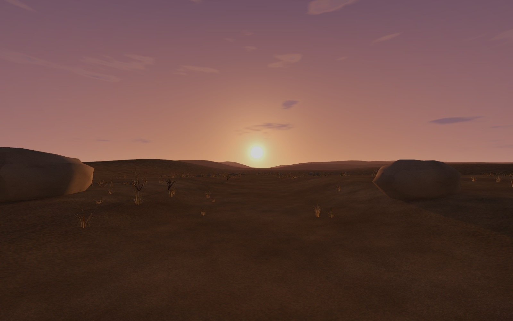
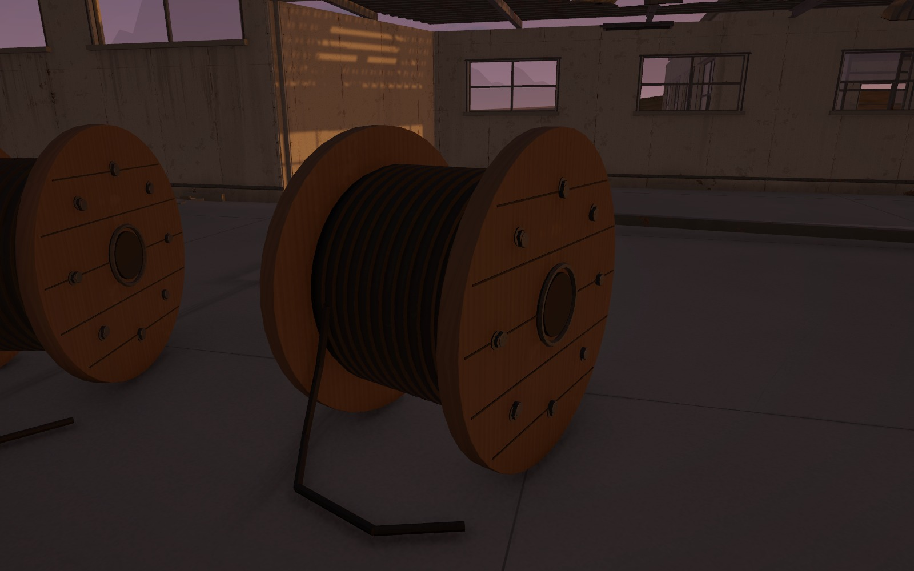
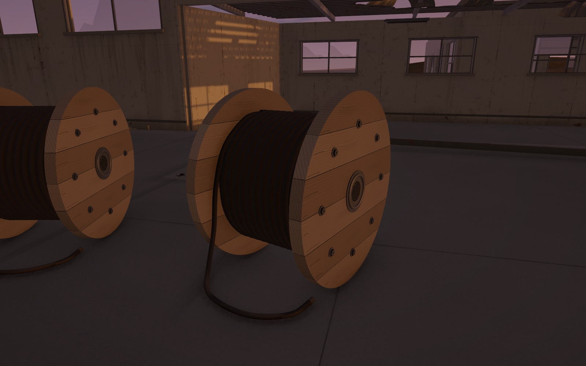
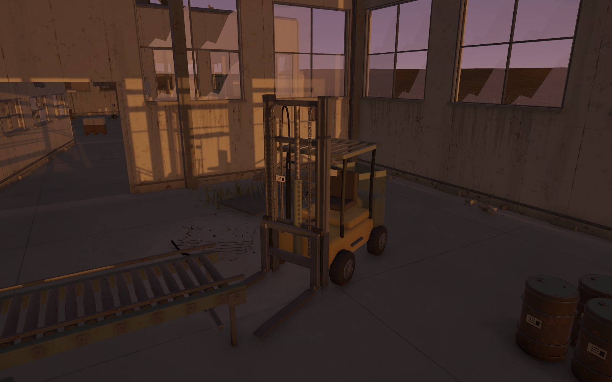

오늘은 지상 1층 폐공장을 다시 검수하며 구조와 표면을 보수함\
천장 구멍, 승강기와 계단 연결부터 시작해 벽·창·아이비·실내 프랍 순서로 범위를 넓힘

공장 밖은 석양이 지는 황야로 구성함\
건물 밖으로 걸어 나왔을 때 처음 빛을 마주하고 자유를 찾는 느낌을 주려는 방향임

## 지붕 파손과 창의 비율

천장 11곳의 네모난 빈 부분을 불규칙하게 바꿈\
그것만으로는 잘라 낸 느낌이 남아서 금속 지붕 9곳과 콘크리트 천장 2곳을 재료에 맞게 다시 보수함

금속 지붕은 골과 판 이음, 고정 부위를 구분함\
뜯긴 판이 위로 들리거나 접혀도 일부는 지지대에 붙어 있도록 구성함

_금속 지붕 보수 단계. 아래에서 판의 골과 겹침, 접힌 단면을 확인한 화면이며 석양 적용 전임._

콘크리트는 깨진 단면에 두께와 골재, 균열을 주고 철근이 드러나게 함\
바닥 잔해도 금속판과 콘크리트 조각을 구분해 파손된 지붕 아래로 연결함

_콘크리트 천장 보수 단계. 금속판처럼 접히는 표현과 구분함. 석양 적용 전 화면임._

창이 너무 많아 벽보다 유리면이 먼저 보이던 부분도 줄임\
수정한 벽 모델 14개의 설계 면적을 기준으로 창 개구부 비율을 44.8%에서 19.8%로 낮춤

이 수치는 해당 벽 구간의 개구부 비율임\
공장 전체 화면에서 유리가 차지하는 픽셀 비율이나 깨지고 남은 유리의 양을 뜻하지 않음

## 승강기 구조와 도착 계단 연결

승강기는 고정된 사각 통로 안에서 객실이 움직이는 구조로 다시 구성함\
객실·균형추·도르래·로프·문을 분리하고, 레일과 권상 모터·브레이크·하부 완충 장치를 추가함

_권상부 외형을 보수하던 단계. 로프가 걸리는 부분과 고정 장치를 구분함. 석양 적용 전 화면임._

VB 도착 방화문은 계단과 이어지지 않던 상태였음\
문 앞 개구부와 도착참, 18m 계단·난간을 연결하고 통행 여유를 확인함

오늘은 구조·외형과 가동 부품 분리까지 진행함\
승강기 운행, 도착 층 판정과 문 개폐 스크립트는 이후 직접 작성할 부분으로 남김

## 벽과 바닥에 남은 흔적

어제 조절했던 벽돌 반복 무늬는 오늘 재검수에서 재료 자체가 맞지 않는 것으로 정리함\
공장 외벽의 벽돌 패턴을 제거하고 도장된 금속 외장으로 바꿈

판 이음과 볼트 주변에 작은 녹을 두고, 넓게 퍼진 녹 표현은 줄임\
창 아래 빗물 자국, 벽 하단의 습기와 먼지, 모서리의 도장 벗겨짐을 구분함

_벽 비율과 금속 패널, 작은 표면 손상을 석양 아래에서 확인한 모습._

바닥에는 설비와 전원함 사이로 이어지는 홈과 배선, 고정 흔적을 보강함\
설비 주변의 기름때와 가장자리 먼지, 하역 구간의 휜 바퀴 자국도 위치에 따라 다르게 넣음

아이비는 벽을 타는 줄기와 잎 군집을 보강하고 바닥 낙엽으로 이어지게 함\
실내 프랍도 먼저 24종·49배치의 세부를 손본 뒤, 마지막 검수에서 어색함이 남은 5종을 다시 제작함

## 석양과 황야

별도 HDRI 없이 석양 스카이박스를 구성함\
서쪽의 낮은 태양, 주황빛 지평선과 보랏빛 하늘, 얇은 구름을 맞춤

첫 화면에서는 태양의 존재감이 약해서 크기를 키움\
밝은 중심부와 주변 광륜, 넓게 퍼지는 따뜻한 빛을 나누고 Bloom을 함께 조절함

_수용한 석양을 유지한 채 바위·식생·지면을 보수한 황야. 엔딩에서 걸어갈 풍경으로 준비함._

황야는 마른 흙·자갈·밝은 먼지·다져진 흙을 섞고, 바위와 마른 풀·관목의 형태를 나눔\
큰 삼각 면이 보이던 바위는 풍화된 둥근 면으로 다듬고 식생은 지면 경사를 따라 놓음

공장 주변과 보행 구간의 지형 높이는 유지함\
먼 곳에는 낮은 언덕을 겹쳐 평평하게 끊겨 보이던 원경을 보완함

실제 Play에서는 Cinemachine 카메라의 Far Clip이 Main Camera 값을 덮어쓰는 문제가 있었음\
1층 씬에서 카메라를 제어하는 렌즈의 거리를 1,000m에서 4,500m로 맞추고 다시 확인함

현재 완성한 범위는 배경과 조명, 이동 가능한 지형임\
엔딩 진입이나 화면 전환, 빛에 적응하는 시간 연출은 아직 구현하지 않음

## 주요 프랍 5종의 마지막 보수

마지막에는 곡면과 케이블, 기계 연결, 재질별 마모 순서로 다시 봄\
케이블 릴 3개, 의자 5개, 공구 카트·지게차·유압 프레스 각 1개로 총 11배치를 보수함

_보수 전. 원판 윤곽과 감긴 줄, 바닥으로 내려오는 케이블의 연결을 다시 볼 필요가 있었음._

_같은 석양 아래의 보수 후 모습. 판재와 나무 결, 연속된 권선과 케이블의 처짐을 함께 수정함._

| 프랍 | 보수한 부분 |
| --- | --- |
| 케이블 릴 | 둥근 원판을 이루는 판재, 길이 방향 나무 결과 갈라짐, 연속된 나선 권선과 늘어진 줄 |
| 사무용 의자 | 둥근 쿠션과 봉제선, 등받이 외피, 높이 조절부와 레버, 5발 받침·캐스터 |
| 공구 카트 | 접힌 판금, 서랍 틈과 둥근 손잡이, 잠금쇠, 바퀴 허브와 회전 브래킷 |
| 지게차 | 곡면 차체와 균형추, 개방된 상부 가드, 마스트 레일·롤러와 도르래를 감는 체인, 끝이 얇아지는 포크 |
| 유압 프레스 | 가이드와 램 실린더의 연결부, 펌프·분배 블록, 기둥을 돌아 연결되는 유압 호스 |

_체인이 상부 도르래를 감고 내려오는 모양과 포크·차체의 연결을 확인함._

금속·목재·고무·직물은 같은 얼룩으로 처리하지 않음\
도장 금속의 작은 벗겨짐과 손잡이의 마모, 목재 섬유, 고무의 미세 균열, 직물 짜임을 나눔

새 모델 5종에 3단계 LOD를 적용하고 1층 전용 재질 17개를 사용함\
원래 배치와 충돌체는 유지하면서 시각 모델을 교체했고, 반사 프로브 8개를 갱신함

## 검수와 남은 작업

| 확인 범위 | 결과 |
| --- | --- |
| 최종 프랍 보수 후 주요 통행 | 75/75 경로 통과 |
| 황야 보수 단계의 외부 통행 | 출구부터 약 585m 구간 왕복 2/2 통과, 폭 879표본에서 막힘 0 |
| 최종 실제 Play | 3시점·728프레임 진행, 새 경고·오류 0 |
| 최종 에셋 검사 | 메시·재질·스크립트 누락 0, 셰이더 오류 0, 대상 LOD 11/11 연결 확인 |
| 마지막 프랍 교체의 보존 범위 | 기존 충돌체 165개 유지, 수용한 하늘과 황야·건물 배치 유지 |

황야 경로는 플레이어와 같은 치수의 임시 CharacterController로 검사함\
실제 플레이어가 엔딩을 끝까지 수행했다는 의미는 아니며, 외부 경로 검사와 마지막 Play 확인은 서로 다른 단계의 결과임

오늘은 외형과 배경 보수까지 저장함\
게임 C#과 Animator는 수정하지 않았고 승강기·문·엔딩의 동작은 이후 작업으로 남음

짧은 에디터 검수로 제품 빌드의 성능까지 확인한 것은 아님\
다음에는 기능을 붙이면서 이동과 시야를 다시 보고, 배포 빌드에서 프레임 시간과 메모리를 측정할 예정

- [오늘의 데일리로그]({{ '/posts/daily-log-material-damage-and-first-light/' | relative_url }}) — 재질과 구조를 보며 달라진 기준
- [261113_NCAI]({{ '/posts/261113_ncai/' | relative_url }}) — 오늘 수업·실습과 작업 기록 모음

작성자 송예찬
