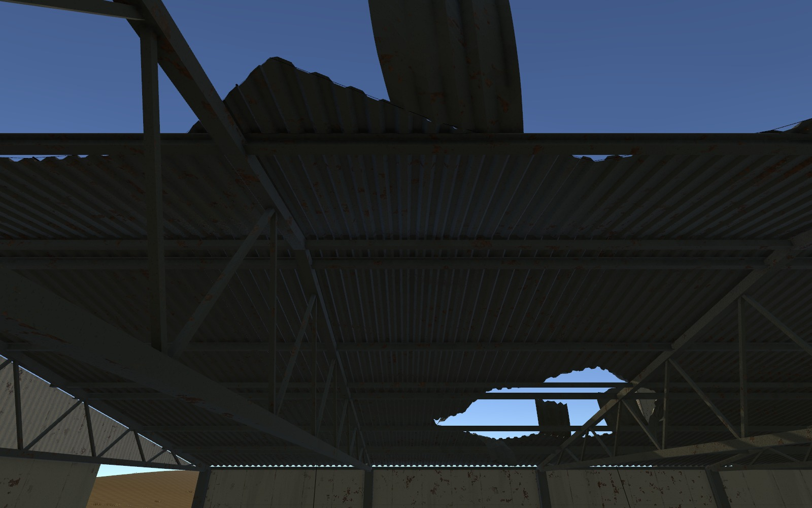
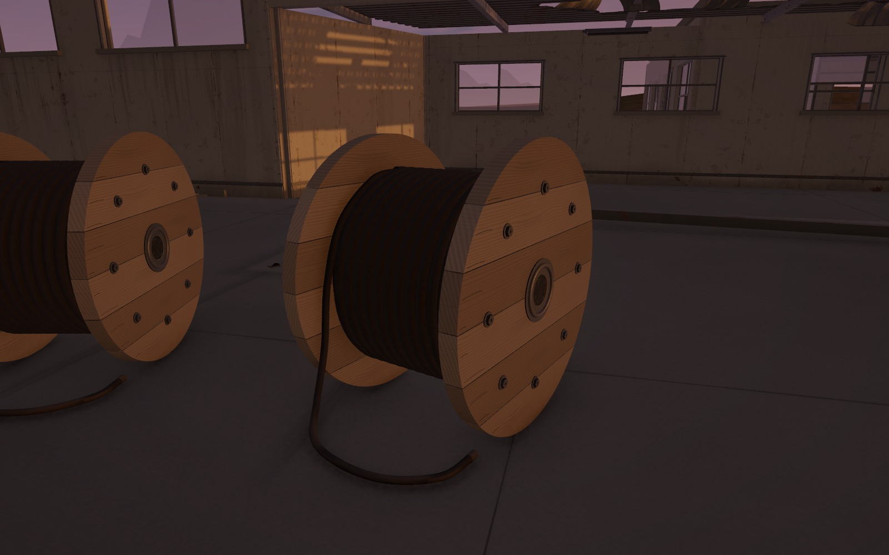
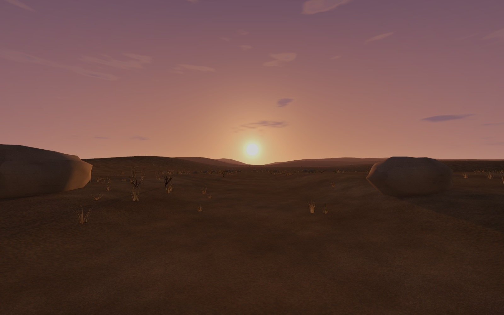

어제 만든 폐공장을 오늘 다시 보니 멀리서는 괜찮아도 가까이서 설명이 안 되는 부분이 있었음\
천장에는 구멍이 있고 벽에는 녹이 있었지만, 왜 그렇게 남았는지는 잘 보이지 않았음

오늘은 구멍과 얼룩의 양보다 재질이 망가지는 방식과 부품이 이어지는 구조를 먼저 봄\
마지막에는 공장을 나와 황야를 걷는 장면까지 연결함

## 구멍의 윤곽만 바꿔서는 부족했음

처음에는 천장 구멍이 네모라서 비어 있는 느낌이 강하다고 생각함\
불규칙하게 바꾸고 나서도 아직 천장을 잘라 낸 것처럼 보였음

금속 지붕이라면 판이 어디에 고정되어 있었는지, 어느 쪽이 들리고 접혔는지가 보여야 함\
콘크리트라면 깨진 단면의 두께와 안쪽 철근이 남아야 재료가 읽힘

_금속 지붕의 파손 구조를 보수한 단계. 석양을 적용하기 전 화면임._

구멍을 더 복잡하게 만드는 것과 파손을 설명하는 것은 다른 작업이었음\
남아 있는 판과 지지대, 아래 떨어진 잔해까지 이어져야 자연스러워 보임

## 어제는 무늬의 크기, 오늘은 재료 자체를 다시 봄

어제는 벽돌 크기를 유지하면서 큰 얼룩의 반복을 줄였음\
오늘 가까이서 다시 보니 금속 외장으로 보여야 할 공장 벽에 벽돌 무늬가 있는 것부터 맞지 않았음

반복 간격을 조절하기 전에 이 벽이 무슨 재료인지 먼저 정해야 했음\
벽돌 패턴을 걷어 내고 판의 이음새, 고정 볼트, 도장 벗겨짐과 작은 녹을 기준으로 바꿈

녹도 넓게 칠하는 것만으로는 낡은 모습이 되지 않았음\
창 아래로 흐른 물, 벽 하단의 습기, 손잡이와 바퀴가 닳은 자리를 따로 보는 편이 설득력 있었음

## 부품의 수보다 연결되는 모양

승강기는 큰 상자가 오르내리는 모습만으로는 구조가 잘 읽히지 않았음\
고정된 통로 안에 객실이 있고, 레일과 균형추, 로프와 도르래가 어떻게 이어지는지 보여야 했음

작은 프랍에서도 비슷한 문제가 보임\
케이블 릴은 원판의 둥근 윤곽과 감긴 줄에서 바닥으로 이어지는 곡선이 먼저 눈에 들어옴\
지게차는 체인이 도르래를 감고 내려오는 모양, 프레스는 호스가 연결 부위까지 이어지는지가 중요했음

_작은 볼트뿐 아니라 원판의 윤곽, 나무 결 방향과 늘어진 줄을 함께 확인함._

디테일을 올린다고 하면 작은 장식을 더 넣는 쪽부터 생각하기 쉬움\
이번에는 큰 곡면과 부품 사이의 연결을 먼저 고친 뒤 표면 마모를 넣는 순서가 필요했음

외형으로 구조가 읽히는 것과 실제로 작동하는 것은 별개임\
승강기의 움직임과 문 제어는 나중에 직접 스크립트를 작성할 부분으로 남겨 둠

## 밖으로 나온 순간의 빛

공장 밖은 황야로 이어지게 만듦\
아무것도 없는 배경보다는 마른 풀과 돌, 낮게 겹친 언덕 사이로 계속 걸어갈 수 있는 풍경을 원했음

석양도 단순히 하늘색을 바꾸는 것으로 끝내고 싶지는 않았음\
낮게 걸린 태양을 더 크게 하고 주변 빛번짐을 보강해, 플레이어가 처음 빛을 마주하는 순간을 강조함

_공장 밖으로 나와 자유를 찾았다는 느낌을 주고 싶은 장면. 현재는 배경과 조명을 구성한 상태임._

실내에서 보던 좁은 구조와 바깥의 열린 시야가 대비되니 엔딩에서 쓰고 싶은 방향이 더 분명해짐\
다만 이 화면이 실제 플레이에서도 같은 감정을 주는지는 이동 속도와 연출을 붙인 뒤 다시 봐야 함

## 오늘 남겨 둘 기준

멀리서 보는 분위기, 가까이서 보는 재질, 실제 카메라에서 이어지는 길을 나눠 확인함\
검수용 화면에서 보이던 원경이 Play에서 사라질 때는 실제 카메라를 제어하는 설정까지 찾아봐야 했음

통행 검사와 Play 확인을 마쳤어도 모든 프랍이 완벽해졌다는 뜻은 아님\
오늘은 눈에 띄던 구조와 연결, 표면의 문제를 한 차례 더 줄인 것으로 기록함

다음에는 기능을 붙일 때도 부품이 어디를 기준으로 움직이는지, 플레이어가 어느 거리에서 보는지 같이 확인할 예정

- [오늘의 일일개발일지]({{ '/posts/after-seconds-factory-detail-and-sunset-wilderness/' | relative_url }}) — 수정 내역과 검수 결과
- [261113_NCAI]({{ '/posts/261113_ncai/' | relative_url }}) — Unity 생명주기와 엘프 바드 조립·리깅, 오늘 기록 모음

작성자 송예찬
