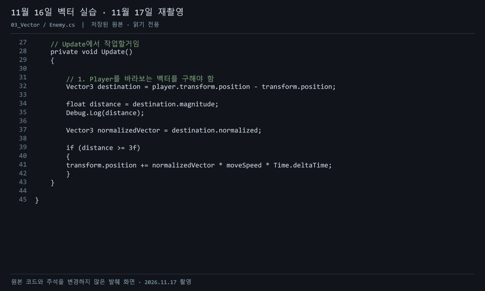
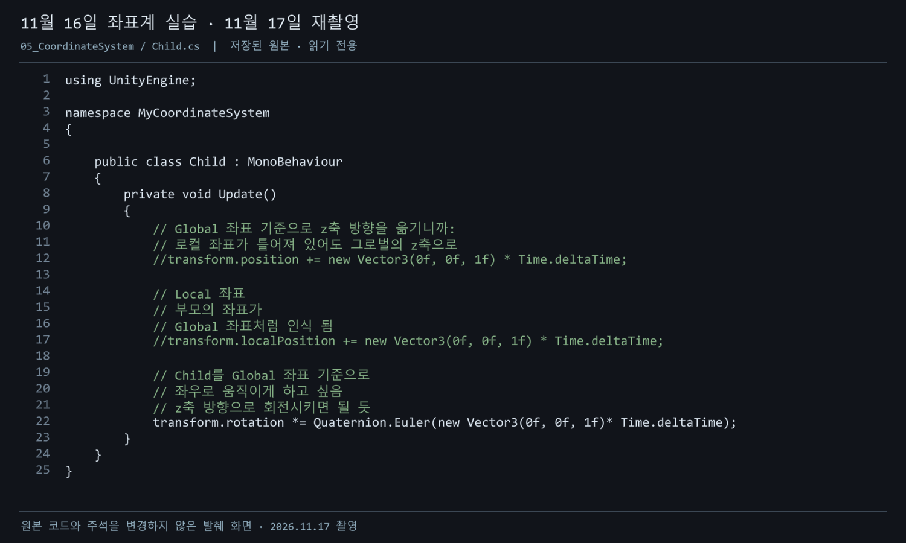

오늘은 Unity에서 벡터, 쿼터니언, 좌표계를 배움\
`20261112_UnityEngine_Study` 프로젝트의 `SampleScene`에서 이어서 진행함

스크립트는 주제마다 `03_Vector`, `04_Quaternion`, `05_CoordinateSystem` 폴더로 나눔\
namespace도 `MyVector`, `MyQuaternion`, `MyCoordinateSystem`으로 따로 잡음

## 벡터 (Vector)

크기와 방향을 가진 값\
수의 집합\
(1,2) -> 2차원 벡터\
(3,4,5) -> 3차원 벡터

처음에는 "힘과 방향"이라고 적었는데, 크기와 방향으로 고침\
힘은 벡터로 표현할 수 있는 물리량이고 벡터의 크기 자체와 같은 말은 아님

### Player의 위치를 벡터로 넣기

(0, 0, 0)에 있는 Player를 (10, 5, -1)로 옮겨 봄\
게임이 시작됐을 때 한 번만 하면 되니까 `Start`에서 작업함\
Position에는 수 3개가 들어가야 하므로 3차원 벡터인 `Vector3`로 넣음

```csharp
private void Start()
{
    transform.position = new Vector3(10f, 5f, -1f);
}
```

처음에는 `GetComponent<Transform>()`으로 가져오는 줄을 적었다가 주석으로 바꿈\
`MonoBehaviour`를 상속받으면 `transform`을 바로 쓸 수 있기 때문임\
Transform은 워낙 자주 써서 Unity가 미리 가져올 수 있게 만들어 둔 것

`Vector3`는 클래스가 아니라 구조체(struct)임\
메모에는 키워드만 적어 둬서, 클래스와 무엇이 다른지는 따로 정리해야 함

### 벡터의 더하기

x축만 있는 좌표공간에서\
어느 한 점을 찍었을 때, 그 위치는\
x축 하나로 표현할 수 있음\
즉, 수가 하나이므로 1차원 벡터임

2라는 벡터와 3이라는 벡터를 서로 더하면\
5라는 벡터가 됨\
즉, 벡터의 더하기는 같은 성분끼리 더하는 것이라고 생각하면 됨

여기서 알 수 있는 건 크기와 방향만 같으면\
같은 벡터로 취급한다는 것임

```csharp
// x:2, y:2, z:0
Vector3 vector1 = new Vector3(2f, 2f, 0f);
// x:2, y:0, z:0
Vector3 vector2 = new Vector3(2f, 0f, 0f);
Vector3 vector3 = vector1 + vector2;
Debug.Log(vector3);
```

같은 성분끼리 더하면 (4, 2, 0)이 됨

### 벡터의 뺄셈

같은 성분끼리 빼기를 하면 됨\
A라는 벡터와 B라는 벡터가 있을 때 A - B를 하면\
같은 성분끼리 뺀 값이 나옴\
그 벡터의 방향은 B가 A를 바라보는 방향임

```csharp
Vector3 vector4 = new Vector3(5f, 3f, 0f);
Vector3 vector5 = new Vector3(1f, 2f, 1f);
Vector3 vector6 = vector4 - vector5;
Debug.Log(vector6);
```

계산하면 (4, 1, -1)이 됨\
`vector5`의 위치에서 `vector4`의 위치를 향하는 벡터임

### 벡터의 크기와 프로퍼티

벡터의 크기는 방향 없이 수 하나로 나오는 값이라 스칼라라고 부름\
구하는 방식은 각 성분을 제곱해서 더하고, 제곱근을 씌워 주면 됨

```csharp
Vector3 vector = new Vector3(3f, 4f, 0f);
float scalar1 = vector.magnitude;
Debug.Log(scalar1);
```

(3, 4, 0)이면 9 + 16 + 0 = 25이고, 제곱근을 씌우면 5가 됨

`magnitude`는 프로퍼티(Property)임\
쓸 때는 괄호 없이 변수처럼 쓰지만, 안에서는 함수처럼 계산한 값을 돌려줌

### 벡터의 정규화

어떤 벡터를 방향은 그대로 놔두고\
크기는 1로 만드는 과정을 정규화라고 함

```csharp
Vector3 vector7 = new Vector3(1f, 0f, 0f);
Vector3 vector8 = new Vector3(0f, 1f, 0f);
Vector3 vector9 = vector7 + vector8;
float sclar2 = vector9.magnitude;
Debug.Log(sclar2); // 1.414

Vector3 normalizedVector = vector9.normalized;
Debug.Log(normalizedVector);
Debug.Log(normalizedVector.magnitude);
```

크기가 1인 벡터 두 개를 더했는데 크기는 2가 아니라 1.414(√2)가 됨\
이걸 정규화하면 약 (0.707, 0.707, 0)이 되고 크기는 1임

처음에는 `vector7`과 `vector8`에 각각 `.normalized`를 붙인 다음 더하는 식으로 적었음\
근데 둘 다 원래 크기가 1이라 정규화해도 그대로이고, 더하면 다시 1.414가 됨\
정규화는 각각이 아니라 **더한 결과**에 해야 함

대각선 이동에 정규화를 쓰는 이유도 같음\
x로 5, y로 5를 동시에 가면 실제로는 √50, 약 7.07만큼 가게 됨\
한 방향만 누를 때보다 대각선이 빨라지는 것\
그래서 방향 벡터를 먼저 정규화해서 크기를 1로 맞추고, 그 뒤에 속도를 곱함

정규화가 속도를 정해 주는 건 아님\
정규화는 방향만 남기고, 속도는 뒤에 곱하는 값이 정함 — [Unity Vector3.normalized 문서](https://docs.unity3d.com/6000.4/Documentation/ScriptReference/Vector3-normalized.html)

### Enemy가 Player를 따라가게 하기

위에서 본 뺄셈, 크기, 정규화를 한 번에 써 보는 실습\
Enemy라는 녀석이 Player를 졸졸 따라다니게 만듦


_11월 16일 실습 코드를 11월 17일 Unity의 읽기 전용 검토 창에서 다시 촬영함. 코드와 주석은 원본 그대로임._

```text
Vector                 ← MyVector 스크립트
├─ Player              ← Player 스크립트
└─ Enemy               ← Enemy 스크립트
```

필요한 정보는 세 가지임

1. Enemy 본인의 위치
2. Player의 위치
3. 얼마나 빠르게 이동할 건지 (이동속도, `moveSpeed = 5f`)

```csharp
private void Update()
{
    // 1. Player를 바라보는 벡터를 구해야 함
    Vector3 destination = player.transform.position - transform.position;

    float distance = destination.magnitude;
    Debug.Log(distance);

    Vector3 normalizedVector = destination.normalized;

    if (distance >= 3f)
    {
        transform.position += normalizedVector * moveSpeed * Time.deltaTime;
    }
}
```

Player 위치에서 Enemy 위치를 빼면 Enemy가 Player를 바라보는 벡터가 나옴\
이 벡터의 `magnitude`가 둘 사이의 거리이고, `normalized`가 방향임

방향에 `moveSpeed`와 `Time.deltaTime`을 곱해서 매 프레임 조금씩 이동함\
거리가 3 이상일 때만 움직이므로, 3보다 가까워지면 멈춤

Player는 `Start`에서 (10, 5, -1)로 옮겨지고 Enemy는 (0, 0, 0)에 있음\
그래서 시작할 때의 거리는 √126, 약 11.2로 계산됨

### Enemy에게 Player를 알려 주는 방법

Enemy의 `player` 필드는 `[SerializeField]`인데 씬에서는 비워 둔 상태임\
대신 부모에 붙은 `MyVector`가 둘을 찾아서 연결해 줌

```csharp
// Awake 안에서 자식의 컴포넌트 찾기
player = GetComponentInChildren<Player>();
enemy = GetComponentInChildren<Enemy>();

// Start 안에서 Enemy에게 Player 넘겨 주기
enemy.SetPlayer(player);
```

Enemy가 Player를 직접 찾지 않고, 밖에서 넣어 주는 방식임\
코드 주석에는 게으른 초기화(Lazy Initialize)와 의존성 주입(Dependency Injection, DI)이라는 이름을 적어 둠

Player와 이동속도를 한 번에 받는 `Init(Player, float)` 함수도 만들어 뒀음\
현재 코드에서 호출하는 건 `SetPlayer`뿐임

`Player`라는 이름의 클래스는 지난 시간의 컴포넌트 탐색 실습에도 있음\
namespace가 `MyComponentScan`과 `MyVector`로 달라서 서로 다른 클래스로 구분됨\
`Enemy.cs`는 namespace 밖에 있어서 맨 위에 `using MyVector;`를 적어 줌

## 쿼터니언 (Quaternion)

### Rotation에 Vector3가 안 들어감

```csharp
// transform.rotation = new Vector3(90f, 90f, 0f);
```

Unity에서 Transform 컴포넌트 안에 있는 Rotation이라는 속성을 보면\
Position과 같이 값이 3개가 들어가는 것을 볼 수 있음\
그래서 Position과 같이 Rotation에 `Vector3`를 넣어 보려고 하니까 안 들어감

`transform.rotation`의 타입이 `Vector3`가 아니라 `Quaternion`이기 때문임

### 짐벌락

3차원 세계에는 축이 3개가 있고, 그 축마다 회전을 시켜야 함\
근데 Vector 형태로 회전을 시키다 보니까 축이 하나로 겹쳐지는 상황이 나옴\
3축에서 2축이 되는 것\
이러한 현상을 짐벌락이라고 함

직접 보려고 Y - X - Z 순서로 축을 겹쳐서 만듦

```text
Gimbal
└─ Y
   ├─ Y_Bar
   └─ X
      ├─ X_Bar
      └─ Z
         ├─ Z_Bar
         └─ Plane        ← Body, Wing, Tail로 만든 비행기
```

회전을 시켜 보니까, X를 90도만큼 회전하니 Z축과 Y축이 겹쳐 버리는 문제가 발생했음\
이렇게 되면 Z축과 Y축이 합쳐져서 Y를 돌리나 Z를 돌리나 같은 회전이 됨\
원래 Z축으로 하던 회전은 할 수 없게 되어 버림

현재 씬에는 Gimbal의 회전값이 전부 0으로 저장되어 있고 오브젝트는 꺼 둔 상태임

### 그래서 쿼터니언

처음에는 가상의 w축을 추가한 4축 회전으로 적었는데, 이 표현은 수정해야 함\
공간에 회전축이 하나 더 생기는 것이 아니라 x, y, z, w 성분 네 개로 3차원 회전을 표현하는 것임\
Unity는 회전을 내부적으로 쿼터니언으로 관리함

`Quaternion`은 x, y, z, w 값 4개로 회전 하나를 나타냄\
이 값들은 각도가 아니라서 직접 고치지 않고, 함수로 만들어서 씀 — [Unity Quaternion 문서](https://docs.unity3d.com/6000.4/Documentation/ScriptReference/Quaternion.html)

### Quaternion.Euler로 회전 넣기

Inspector에서 보던 x, y, z 각도는 `Quaternion.Euler`로 쿼터니언으로 바꿔서 넣음

```csharp
Quaternion rotation1 = Quaternion.Euler(new Vector3(0f, 90f, 0f));
transform.rotation = rotation1;
```

y축으로 90도 회전한 상태가 됨 — [Unity Quaternion.Euler 문서](https://docs.unity3d.com/6000.4/Documentation/ScriptReference/Quaternion.Euler.html)

### 회전을 합칠 때는 곱하기

쿼터니언의 `*`는 회전 두 개를 합성하는 연산임\
더하기와 빼기를 전부 곱하기로 바꿔 놓았다는 뜻은 아님\
회전 두 개를 이어 적용하고 싶으면 곱함

```csharp
Quaternion rotation2 = Quaternion.Euler(new Vector3(90f, 0f, 0f));
Quaternion rotation3 = Quaternion.Euler(new Vector3(0f, 0f, 90f));
Quaternion rotation4 = rotation2 * rotation3;
Debug.Log(rotation4);
transform.rotation = rotation4;
```

x축 90도 회전과 z축 90도 회전을 합친 회전임\
숫자의 곱셈과 달리 곱하는 순서를 바꾸면 결과가 달라질 수 있음 — [Unity Quaternion 곱셈 문서](https://docs.unity3d.com/6000.4/Documentation/ScriptReference/Quaternion-operator_multiply.html)

위의 `Euler` 코드와 이 코드는 확인한 뒤 현재 `MyQuaternion.cs`에서 주석 처리해 둔 상태임

### 계속 도는 Item

얼마만큼 빠르게 회전할 것인가?\
무슨 축 기준으로 회전할 것인가?\
이 두 가지를 정해서 계속 도는 오브젝트를 만듦

```csharp
[SerializeField]
private float rotationSpeed = 0f;

private void Update()
{
    transform.rotation *= Quaternion.Euler(new Vector3(0f, rotationSpeed, 0f) * Time.deltaTime);
}
```

현재 회전에 작은 회전을 매 프레임 곱해서 누적하는 방식임\
`Time.deltaTime`을 곱했으므로 `rotationSpeed`는 1초에 도는 각도가 됨

코드의 기본값은 0이고, 씬의 Item에는 Inspector에서 5를 넣어 둠\
y축 기준으로 1초에 5도씩 도는 설정임

## 좌표계 (CoordinateSystem)

### Global 좌표와 Local 좌표

Global 좌표\
특정 객체가 어떤 행동을 해도\
동서남북처럼 딱 정해져 있는 좌표를 말함\
`transform.position` -> Global 좌표

Local 좌표\
부모의 좌표계를 Global 좌표처럼 따라가는 좌표를 말함\
`transform.localPosition` -> Local 좌표

| 코드 | 기준 |
| --- | --- |
| `transform.position` | 씬 전체에서 정해져 있는 Global 좌표 |
| `transform.localPosition` | 부모를 기준으로 한 Local 좌표 |

부모가 없는 오브젝트는 두 값이 같음 — [Unity Transform.localPosition 문서](https://docs.unity3d.com/6000.4/Documentation/ScriptReference/Transform-localPosition.html)

### Parent와 Child로 확인하기


_11월 17일 재촬영. 이동 두 줄은 주석이고 실제로 실행하는 줄은 회전임. 주석의 의도와 현재 동작을 구분해서 읽음._

```text
CoordinateSystem       ← CoordinateSystem 스크립트 (개념 주석만 있음)
└─ Parent              ← Parent 스크립트, Rotation (0, 0, 90)
   └─ Child            ← Child 스크립트, Rotation (0, 90, 90)
```

`Child.cs`의 `Update`에서 한 줄씩 바꿔 가며 확인함

```csharp
// 1. Global 좌표 기준으로 z축 방향으로 이동
transform.position += new Vector3(0f, 0f, 1f) * Time.deltaTime;

// 2. Local 좌표 기준으로 z축 방향으로 이동
transform.localPosition += new Vector3(0f, 0f, 1f) * Time.deltaTime;
```

1번은 로컬 좌표가 틀어져 있어도 Global의 z축으로 이동함\
2번은 부모의 좌표가 Global 좌표처럼 인식됨\
그래서 부모가 회전해 있으면 부모가 향한 z축 쪽으로 이동하게 됨

다만 저장된 씬에서는 Parent가 z축으로만 90도 돌아가 있음\
z축을 중심으로 돌리면 z축의 방향 자체는 그대로라서, 이 설정에서는 두 코드의 이동 방향이 같게 나옴\
x나 y 방향으로 옮기거나 Parent를 다른 축으로 돌려야 차이가 보일 것\
이 부분은 씬에 저장된 값을 보고 정리한 것이고, 직접 바꿔서 비교해 본 것은 아님

두 줄은 현재 주석 상태이고, 지금 켜져 있는 건 아래 코드임

```csharp
// Child를 Global 좌표 기준으로
// 좌우로 움직이게 하고 싶음
// z축 방향으로 회전시키면 될 듯
transform.rotation *= Quaternion.Euler(new Vector3(0f, 0f, 1f) * Time.deltaTime);
```

Child를 자기 z축 기준으로 1초에 1도씩 돌리는 코드임\
위에서 배운 쿼터니언 곱하기를 그대로 사용함

### 오늘 실습한 범위와 다음에 확인할 것

11월 16일 글을 정리할 당시에는 `Vector`와 `Quaternion` 오브젝트를 꺼 두고 `CoordinateSystem`을 켜 둔 상태였음\
`Parent.cs`의 `Update`는 아직 비어 있음

Child를 Global 좌표 기준으로 좌우로 움직이는 건 회전까지만 작성했고, 이동 코드는 아직 없음\
회전한 상태에서 `position`과 `localPosition` 중 무엇을 바꿔야 원하는 방향으로 가는지 다음에 이어서 확인할 것

오늘은 **뺄셈으로 방향을 구하고, 정규화로 크기를 1로 맞춘 뒤, 속도를 곱해서 이동하는 흐름**을 정리함\
회전은 `Vector3`가 아니라 `Quaternion`으로 다루고, 합칠 때는 곱한다는 것도 같이 기억해 둘 것

## 프로젝트를 다시 확인하며 보완한 내용

11월 17일에 수업 프로젝트를 다시 열어 보고 어제 코드의 의미를 보완함\
입력·충돌 실습은 오늘 새로 진행한 내용이어서 [261117_NCAI]()에 따로 정리함

### 3만큼 떨어져 멈춘다는 조건

`Enemy.cs`는 거리가 3 이상이면 한 프레임만큼 이동함\
이동 후의 위치를 정확히 거리 3에 맞추는 코드는 없음

```csharp
if (distance >= 3f)
{
    transform.position += normalizedVector * moveSpeed * Time.deltaTime;
}
```

그래서 경계 바깥에서 한 번 이동한 뒤 3보다 조금 가까워질 수 있음\
지금은 일정 거리 안에 들어오면 추적을 멈추는 연습임

목표 위치의 y도 방향 계산에 들어감\
Player가 (10, 5, -1)에 있으니 Enemy도 위쪽으로 이동하는 코드임\
바닥만 따라가는 추적이나 길 찾기까지 구현한 것은 아님

### Local 위치와 자기 앞 방향은 다름

`localPosition`은 부모를 기준으로 한 위치임\
자식이 자기 몸만 돌렸다고 `localPosition.z`가 그 자식의 앞 방향이 되는 것은 아님

| 표현 | 뜻 |
| --- | --- |
| `transform.position` | 월드에서의 위치 |
| `transform.localPosition` | 부모 좌표계에서의 위치 |
| `transform.forward` | 이 오브젝트가 향하는 앞 방향을 월드 좌표로 표현한 벡터 |

좌표값을 바꾸는 것과 방향 벡터를 구하는 것을 구분해야 함\
이 구분이 다음 시간에 캐릭터가 바라보는 쪽으로 이동하는 코드로 이어짐

### 코드와 씬 연결을 같이 보기

`MyVector`는 자식의 Player와 Enemy를 찾아서 참조를 넘겨 줌\
Enemy는 받은 Player의 위치를 보고 이동함

참조를 전달하는 함수와 이동하는 함수를 나눠 놓으니까\
누가 대상을 찾아 주고, 누가 실제로 움직이는지 구분하기 쉬움

`Parent.Update`는 비어 있고, `Child.Update`는 회전 코드만 실행 중임\
주석에 적어 둔 “좌우로 이동”과 실제로 작성된 동작은 따로 확인해야 함

## 개인 프로젝트에 연결한 부분

수업 뒤 After Seconds에서는 점프와 투척을 이어서 작업함\
수업 프로젝트와 코드 구조는 다르지만 방향·속도·시간을 나누는 생각은 그대로 사용함

| 수업에서 본 것 | 개인 프로젝트에서 연결한 부분 |
| --- | --- |
| 방향에 속도와 시간을 곱하기 | 이동 가감속과 공중 수평 속도 유지 |
| 회전으로 방향을 바꾸기 | 시선보다 위쪽으로 각도를 준 투척 방향 |
| 기준 좌표 구분 | 눈 위치와 오른손 방출 위치를 나눌 필요 |
| 참조를 밖에서 전달하기 | Presenter가 입력을 받고 이동·시야·투척 기능에 요청 |

점프는 바닥에서만 시작하고, 공중에서는 발이 떨어질 때의 수평 속도를 유지하도록 함\
투척은 시험용 공을 즉시 출발시키고 명중을 로그로 받는 단계까지 진행함

궤적 표시·위/아래 전환·확대의 기반도 넣었지만 손 표시와 실제 비행의 정밀 비교는 다음 작업으로 남음\
구현과 검증 범위는 [11월 16일 개발일지]()에 따로 정리함
