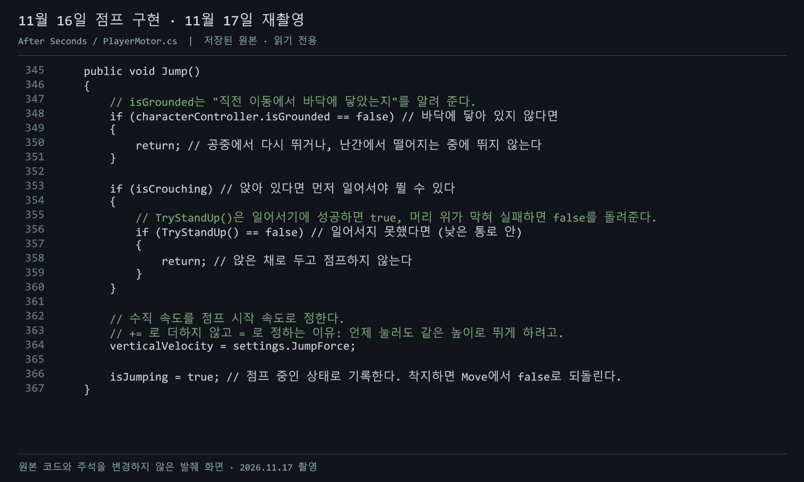

오늘은 환경 디테일에서 플레이어 조작 쪽으로 작업을 옮김\
점프와 가감속을 먼저 넣고, 물건을 던지는 첫 기능을 연결함

## 점프와 가감속

CharacterController로 이동하는 기존 구조에 점프를 추가함\
바닥에 있을 때만 뛰고 공중 재점프는 하지 않음

- 앉은 상태에서는 일어설 공간이 있으면 일어서면서 점프함
- 머리가 천장에 닿으면 상승을 멈추고 떨어짐
- 공중에서는 방향을 새로 조종하지 않고 발이 떨어진 순간의 수평 속도를 유지함
- 바닥에서는 가속·감속을 거쳐 출발하고 멈춤

| 시험값 | 값 |
| --- | --- |
| 점프 시작 속도 | 6m/s |
| 플레이어 중력 | 20m/s² |
| 바닥 가속 | 30m/s² |
| 바닥 감속 | 40m/s² |

계산상 점프 높이는 약 0.9m임\
수치는 ScriptableObject 설정에 두고 조작감을 보면서 조절할 값으로 남김

점프 입력은 Presenter에서 받고 Motor에 요청하도록 연결함\
점프 이동은 들어갔지만 전신의 점프 애니메이션 연결은 아직 남아 있음

_11월 16일 구현한 Jump 함수를 11월 17일 읽기 전용 창에서 재촬영함. 공중이거나 일어설 수 없는 상태에서는 점프 요청을 끝냄._

## 지붕이 보인다고 점프를 막는 것은 아님

1층 공장의 지붕 14개에 충돌체가 없어 점프로 통과할 수 있던 부분을 보강함\
각 지붕의 실제 메시를 사용하는 MeshCollider를 추가함

파손된 지붕의 열린 부분은 그대로 열려 있도록 함\
구멍을 막는 단순한 사각 충돌체로 바꾸지는 않음

걷기·계단·앉기 중심으로 확인했던 공간도 점프가 생기면 검수 범위가 달라짐\
난간이나 낮은 설비를 넘어 생기는 지름길은 이후 층별로 확인할 부분임

## 입력과 상태부터 정리

| 상황 | 입력과 동작 |
| --- | --- |
| 던지기 자세 전환 | E |
| 자세에서 조준 | 왼쪽 클릭 유지 |
| 방출 | 왼쪽 클릭 떼기 |
| 위/아래 던지기 전환 | 자세에서 R |
| 확대 | 왼쪽 클릭으로 조준하기 전에 오른쪽 클릭 |
| 조준 취소 | 조준 중 오른쪽 클릭, 또는 E로 자세까지 해제 |

던진 뒤에는 자세와 확대를 풀도록 함\
취소한 뒤 왼쪽 클릭을 놓는 경우에는 물체가 나가지 않아야 함

F 상호작용과 Q 버리기도 입력 에셋과 기획에 반영함\
다만 키가 등록된 것과 줍기·버리기 기능이 완성된 것은 다름

재장전과 탄약 보충은 넣지 않는 방향으로 정리함\
빈 총은 던질 수 있는 물건으로 남고, R은 던지기 방식 전환에 사용함

## 시험용 공과 명중 알림

`PlayerThrow`가 공을 생성하고 Rigidbody에 초기 속도를 넣음\
`ThrownObject`는 충돌을 받으면 명중 사실을 바깥으로 알림

첫 시험값은 위로 던지기 12m/s·8도, 아래로 던지기 7m/s·5도임\
공의 지름은 12cm이고 시험용 공은 일정 시간이 지나면 정리함

아이템 이름과 월드 프리팹은 `ItemDefinition`에 나눠 보관함\
아직 인벤토리가 없어 시험용 공을 반복해서 던지는 단계임

한 번의 투척에서 여러 번 부딪히면 명중 알림도 각각 받을 수 있게 함\
이 알림에 나중에 교환 예약을 연결할 예정임

**투척은 즉시 실행하고, 유효 명중 이후 3초 뒤에 교환한다는 규칙은 유지함**\
오늘 교환 예약이나 경비 AI를 구현한 것은 아님

## 궤적과 확대의 기반

조준 중에는 LineRenderer로 궤적을 그리고 취소하면 숨기도록 함\
위/아래 던지기에 따라 속도와 각도가 바뀜

확대는 Cinemachine 가상 카메라의 FOV를 조절하도록 연결함\
확대 상태에서는 마우스 감도도 낮춤

앞으로는 전체 착지 경로보다 날아갈 방향을 짧게 보여 주고\
확대할 때 더 길게 보여 주는 쪽으로 보완할 예정임

## 확인한 범위와 다음 작업

당일 Play에서 기능을 직접 호출해 공의 비행·명중 알림, 자세 해제와 궤적 계산을 확인함\
키보드·마우스로 이어지는 전체 조작과 화면의 자연스러움은 그때 충분히 확인하지 못함

공의 중력은 Rigidbody의 기본 중력이고 플레이어 점프의 중력 20과는 별개임\
미리보기는 실제 투척물의 물리 설정에 맞춰야 함

다음은 손의 방출 위치, 궤적과 실제 비행의 일치, 벽 가까이에서의 처리를 확인할 것\
손에 보이는 물건과 실제 물체가 동시에 남지 않도록 연결하는 작업도 필요함

[같은 날의 학습 기록]() · [다음 날 투척 보완]()
