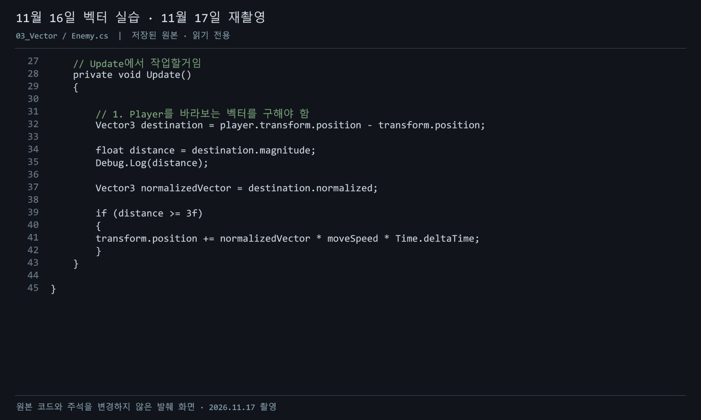

오늘은 벡터와 회전, 좌표계를 공부하고 After Seconds의 점프와 투척을 이어서 작업함\
수업에서 보던 작은 코드가 실제 조작을 만들 때 어디에 들어가는지 같이 볼 수 있었음

## 방향과 빠르기를 따로 보기

Enemy가 Player를 따라가려면 두 위치를 빼면 됨\
그런데 뺀 값을 그대로 이동에 더하면 목표가 멀리 있을수록 한 번에 많이 움직이게 됨

방향은 정규화해서 크기를 1로 맞추고, 이동속도는 따로 곱함\
프레임마다 흐른 시간도 같이 곱해서 이동하는 방식임

대각선 입력도 같은 문제였음\
앞과 옆을 동시에 더하면 길이가 길어지므로 방향을 합친 뒤 크기를 조절해야 함

오늘은 “어디로 갈 것인가”와 “얼마나 빠르게 갈 것인가”를 분리해서 봄

_11월 16일 작성한 수업 원본을 11월 17일 읽기 전용 창에서 재촬영함. 방향·거리·속도가 각각 어디에 쓰이는지 같이 봄._

## 어떤 좌표를 기준으로 움직이는가

`position`과 `localPosition`은 이름이 비슷해도 기준이 다름\
월드 기준인지, 부모 기준인지부터 정해야 원하는 방향을 설명할 수 있음

회전도 Inspector에 값이 세 개 보인다고 `Vector3`를 그대로 넣을 수는 없었음\
회전값은 `Quaternion`으로 만들고, 회전 두 개를 합칠 때는 곱함

주석에 “Global 기준으로 좌우 이동”이라고 적어 놓아도\
실제 코드가 회전만 바꾸고 있으면 아직 이동을 만든 것은 아님

내가 하려던 행동과 코드가 지금 하는 행동을 따로 읽어 봐야 함

## 점프를 넣으니 다시 확인해야 할 공간이 생김

After Seconds에 점프와 가감속을 넣음\
걷기만 할 때와 달리 천장에 닿는 상황을 확인해야 했음

1층 공장 지붕에는 외형은 있지만 충돌체가 없는 부분이 있었음\
지붕 메시 14개에 충돌체를 추가함

이동 기능 하나가 늘어나면 기존 레벨도 다시 봐야 함\
전에 걸어서 통과했던 검수가 점프까지 확인해 주는 것은 아니었음

## 같은 클릭도 상태에 따라 의미가 달라짐

투척은 E로 자세를 바꾸고 왼쪽 클릭을 누르는 동안 조준, 떼면 던지는 방식으로 정함\
그런데 오른쪽 클릭에 확대와 취소를 같이 넣으니 어느 상태인지 먼저 정해야 했음

왼쪽 클릭을 누르기 전에는 확대\
누르고 조준하는 중에는 취소

키를 추가하는 것보다 입력이 들어왔을 때의 상태를 정리하는 일이 먼저였음\
취소한 뒤 손을 뗐다고 물건이 나가면 안 된다는 것도 같이 확인해야 함

## 오늘 남긴 것

시험용 공 투척과 명중 알림, 궤적·확대·위/아래 전환의 기반을 만듦\
소지품 전체와 3초 교환은 아직 별도 작업임

기능을 호출해서 값이 바뀌는 것과 실제 화면에서 자연스럽게 보이는 것도 구분할 것\
다음에는 손에서 물체가 나오는 위치와 궤적, 실제 비행을 같이 확인해야 함

[수업 코드와 복습]() · [오늘의 개발일지]()
