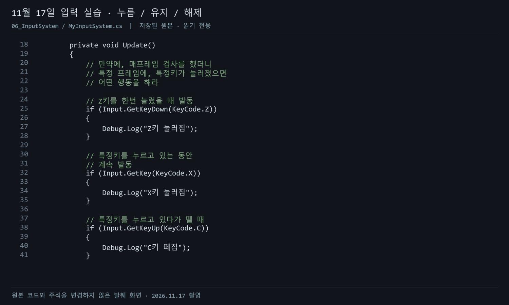
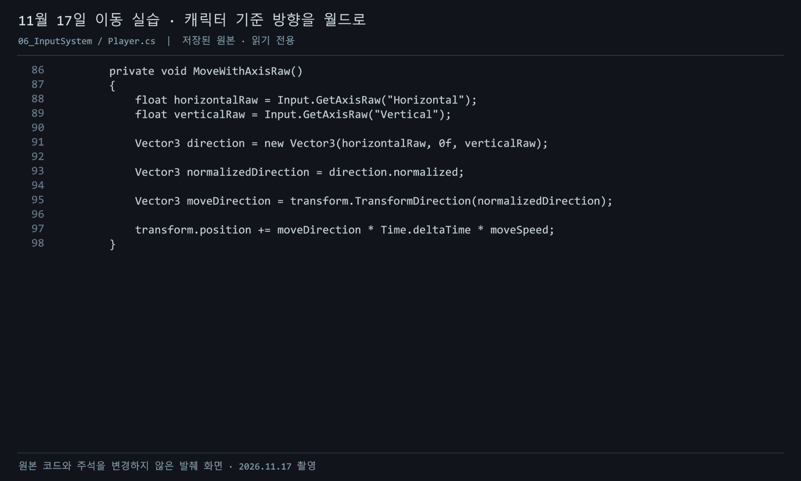
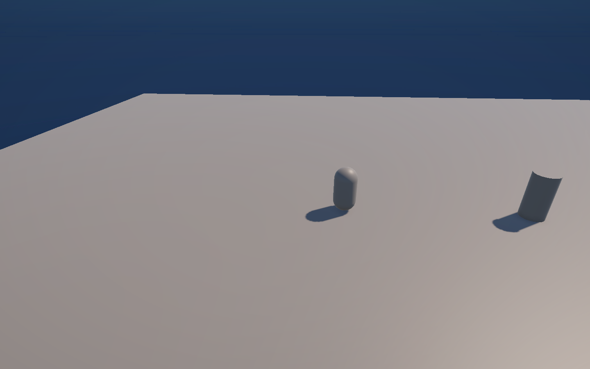

오늘은 어제 배운 벡터와 좌표계를 입력에 연결함\
`20261112_UnityEngine_Study`의 `06_InputSystem`에서 이동과 시야 회전을 작성하고, `07_Collision`을 시작함

아직 수업이 진행 중이어서 오전부터 점심 무렵까지 확인한 내용을 먼저 정리함\
코드가 있는 것과 씬에 붙어서 실행되는 것은 나눠서 기록할 것

## 기존 Input과 새 Input System

수업 프로젝트에는 Input System 패키지가 설치되어 있음\
하지만 현재 활성 입력 설정은 **Input Manager (Old)**이고 실습 코드도 `UnityEngine.Input`을 사용함

패키지가 설치됐다고 기존 `Input.GetKey` 코드가 새 Input System 방식으로 바뀌는 것은 아님

| 구분 | 지금 정리한 내용 |
| --- | --- |
| 기존 Input Manager | `Update`에서 `Input.GetKey`, `GetAxis` 등으로 상태를 읽음 |
| 새 Input System | Input Action으로 동작을 묶고, 콜백을 받거나 값을 직접 읽을 수 있음 |

주석에는 기존 방식은 느리고 새 방식은 한 번만 검사한다는 식으로 적었는데, 그렇게 단정하면 안 됨\
새 방식도 값을 매 프레임 읽을 수 있고 액션 종류에 따라 알림 시점도 달라짐 — [Unity Input System Actions 문서](https://docs.unity3d.com/Packages/com.unity.inputsystem@1.19/manual/Actions.html)

수업에서는 먼저 기존 API로 입력 상태를 구분하는 중임\
After Seconds의 Input Action 구성과 섞어서 기억하지 않도록 할 것

## 누른 순간·누르는 동안·뗀 순간

`MyInputSystem.cs`에서 키 입력을 세 가지로 나눠 봄

```csharp
if (Input.GetKeyDown(KeyCode.Z))
    Debug.Log("Z키 눌러짐");

if (Input.GetKey(KeyCode.X))
    Debug.Log("X키 눌러짐");

if (Input.GetKeyUp(KeyCode.C))
    Debug.Log("C키 떼짐");
```

| 함수 | 확인하는 시점 |
| --- | --- |
| `GetKeyDown` | 누르기 시작한 프레임 |
| `GetKey` | 누르고 있는 동안 |
| `GetKeyUp` | 뗀 프레임 |

한 번만 해야 하는 동작과 계속해야 하는 동작을 구분해야 함\
점프 시작, 이동 유지, 물건 방출처럼 필요한 시점이 다름


_저장된 수업 코드를 읽기 전용 창에서 촬영함. Z·X·C로 입력 시점 세 가지를 나눠 놓은 부분임._

마우스도 Down·유지·Up을 나눌 수 있음\
버튼 번호는 0이 왼쪽, 1이 오른쪽, 2가 가운데임

실습에는 왼쪽 버튼 Down, 오른쪽 버튼 유지, 가운데 버튼 Up의 로그를 작성함

## GetAxis와 GetAxisRaw

`Horizontal`과 `Vertical`은 입력 설정에 등록된 축 이름임\
가로와 세로 값을 따로 읽어서 이동 벡터를 만듦

```csharp
float horizontal = Input.GetAxisRaw("Horizontal");
float vertical = Input.GetAxisRaw("Vertical");
Vector3 direction = new Vector3(horizontal, 0f, vertical);
```

| 키보드 축 입력 | 값이 바뀌는 방식 |
| --- | --- |
| `GetAxis` | Input Manager의 감도·복귀 설정에 따라 부드럽게 바뀜 |
| `GetAxisRaw` | 평활화 없이 값을 읽음. 키보드에서는 -1, 0, 1을 사용함 |

키보드의 Raw 입력을 쓰면 누름과 해제에 바로 반응하는 방향값을 얻을 수 있음 — [Unity Input.GetAxisRaw 문서](https://docs.unity3d.com/6000.4/Documentation/ScriptReference/Input.GetAxisRaw.html)

현재 키보드 Raw 값을 출력하는 코드가 켜져 있음\
마우스 이동·휠 값과 일반 축 값을 비교하는 부분은 주석으로 남겨 둠

## 캐릭터가 바라보는 방향으로 이동

`Player.cs`에는 세 가지 이동 함수를 만들어 둠

| 함수 | 입력 방식 | 현재 Update에서 호출 |
| --- | --- | --- |
| `MoveWithKey` | 키별로 앞·뒤·좌·우 방향을 더함 | 주석 처리 |
| `MoveWithAxis` | `GetAxis`로 축을 읽음 | 주석 처리 |
| `MoveWithAxisRaw` | `GetAxisRaw`로 축을 읽음 | 호출 중 |

세 함수를 동시에 실행하면 같은 입력으로 이동이 중복될 수 있음\
현재는 Raw 방식 하나만 사용함

아래는 실행 중인 이동 함수의 핵심 부분을 정리한 것임

```csharp
float horizontal = Input.GetAxisRaw("Horizontal");
float vertical = Input.GetAxisRaw("Vertical");

Vector3 direction = new Vector3(horizontal, 0f, vertical).normalized;
direction = transform.TransformDirection(direction);
transform.position += direction * moveSpeed * Time.deltaTime;
```

먼저 정규화해서 대각선으로 갈 때 빨라지는 것을 막음\
그다음 캐릭터 기준의 방향을 월드 방향으로 바꿈


_실제 MoveWithAxisRaw 함수. 축 입력 → 정규화 → 월드 방향 변환 → 위치 변경 순서임._

어제 `localPosition`은 부모 기준 위치라고 정리함\
오늘의 `TransformDirection`은 **이 오브젝트의 로컬 방향을 월드 방향으로 바꾸는 함수**임\
위치를 옮기는 함수가 아니고 위치·스케일의 영향을 받지 않음 — [Unity Transform.TransformDirection 문서](https://docs.unity3d.com/6000.4/Documentation/ScriptReference/Transform.TransformDirection.html)

캐릭터를 옆으로 돌린 뒤 앞으로 입력하면 그 캐릭터의 앞 방향으로 이동하게 됨\
이동속도 기본값은 5이고 프레임 시간도 곱해 줌

지금은 `transform.position`을 직접 변경하는 실습임\
Rigidbody나 CharacterController로 장애물에 막히는 이동까지 만든 단계는 아님

## 몸은 좌우, 카메라는 위아래

카메라는 `Awake`에서 자식의 Camera 컴포넌트를 찾아 보관함\
좌우 시선은 Player를 돌리고 위아래 시선은 카메라만 돌리는 방식임

```csharp
float mouseX = Input.GetAxis("Mouse X");
float mouseY = Input.GetAxis("Mouse Y");
float sensitivity = 2f;

currentPitch -= mouseY * sensitivity;
currentPitch = Mathf.Clamp(currentPitch, -90f, 90f);
mainCamera.transform.localEulerAngles = new Vector3(currentPitch, 0f, 0f);

transform.Rotate(0f, mouseX * sensitivity, 0f);
```

`currentPitch`를 누적하고 -90~90도로 제한함\
몸까지 위아래로 기울이지 않아서 이동 방향과 올려다보는 각도를 나눌 수 있음

왼쪽 클릭으로 커서를 잠그고 숨기며, Esc로 잠금을 풀고 다시 보이게 함\
현재 코드에는 커서가 풀렸을 때 회전 계산을 멈추는 조건까지 들어간 것은 아님

**시야 회전 코드를 작성한 것과 카메라를 눈 위치에 둔 것은 별개임**\
확인한 씬의 Main Camera는 Player 기준 `(0, 1.5, -5)`에 있어서 플레이어 뒤쪽에 있음\
아직 눈 위치에서 보는 1인칭 화면으로 정리된 상태는 아님

## Collision 실습 시작

`07_Collision`에서는 충돌과 Trigger의 개념을 정리하기 시작함\
오전 메모 작성 시점에 `MyCollision.cs`에서 확인한 함수는 아래 한 개임

```csharp
private void OnCollisionEnter(Collision collision)
{
    Debug.Log("충돌 처리 됨");
}
```

| 구분 | 확인할 내용 |
| --- | --- |
| 일반 충돌 | 서로 닿는 충돌체와 물리 반응, `OnCollision...` |
| Trigger | 영역 진입·유지·이탈 감지, `OnTrigger...` |

일반 충돌 이벤트는 충돌하는 두 물체 중 적어도 하나에 비키네마틱 Rigidbody가 있어야 함\
`Collision` 인자로 접촉 정보도 받을 수 있음 — [Unity Collider.OnCollisionEnter 문서](https://docs.unity3d.com/6000.4/Documentation/ScriptReference/Collider.OnCollisionEnter.html)

### 오전 메모 작성 시점의 코드와 씬

확인한 열린 씬에서는 `Collision` 그룹이 켜져 있고 `InputSystem` 그룹은 꺼져 있음\
Plane, Player, Enemy에 Collider가 있고 Player에는 중력을 사용하는 Rigidbody가 있음

`MyCollision` 로그 스크립트가 이 오브젝트에 붙은 상태는 확인되지 않음\
함수를 작성한 단계로 기록하고, Play에서 충돌 로그까지 확인했다고 적지는 않음

`OnCollisionStay`, `OnCollisionExit`, Trigger 함수들은 아직 주석에 이름만 정리되어 있음\
충돌 실습용 `Player.cs`와 `Enemy.cs`도 만들기 시작했지만 동작은 아직 작성 중임

다음에는 스크립트를 연결하고 충돌 시작·유지·종료 로그를 비교하면 됨\
일반 충돌과 Trigger의 차이도 실제 오브젝트로 확인할 것

### 오후 스크린샷을 추가하며 확인한 변화


_11월 17일 오후의 실제 Scene View를 촬영함. Play 결과가 아니라 편집 상태의 배치 화면임._

촬영할 때는 Player와 Enemy에 각각 `MyCollision.Player`, `MyCollision.Enemy`가 붙어 있었음\
Player는 중력을 사용하는 Rigidbody이고 Enemy의 Collider는 Is Trigger가 켜진 상태임

오전의 빈 스크립트 준비 단계에서 씬 연결 단계로 진행된 것을 확인함\
이 사진만으로 충돌·Trigger 콜백의 실행 결과까지 확인한 것은 아님

## 개인 프로젝트와 연결해서 보기

After Seconds에서는 왼쪽 클릭 유지가 조준이고 떼는 순간이 방출임\
취소한 상태에서 버튼을 놓으면 던지지 않아야 해서 입력 상태와 행동 상태를 함께 확인함

수업의 Down·유지·Up 구분이 실제 조작에서는 상태 전환 규칙으로 이어짐\
손에 보이는 물체와 실제 물리 물체의 시작 위치를 맞추는 작업에도 좌표 기준 구분이 필요했음

[어제의 벡터·좌표계 메모]() · [오늘의 데일리로그]() · [투척 개발일지]()
