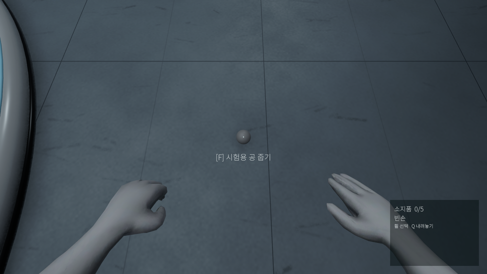
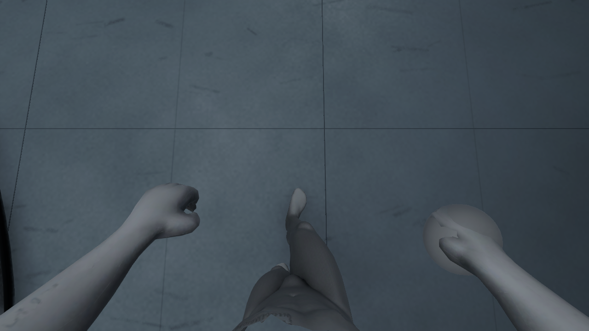
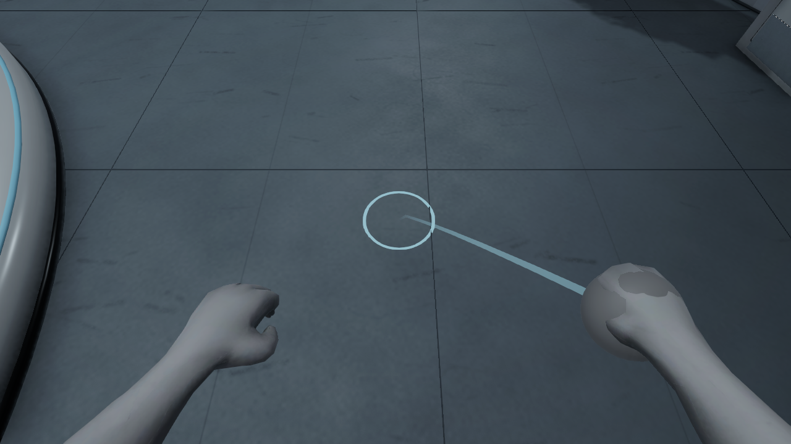
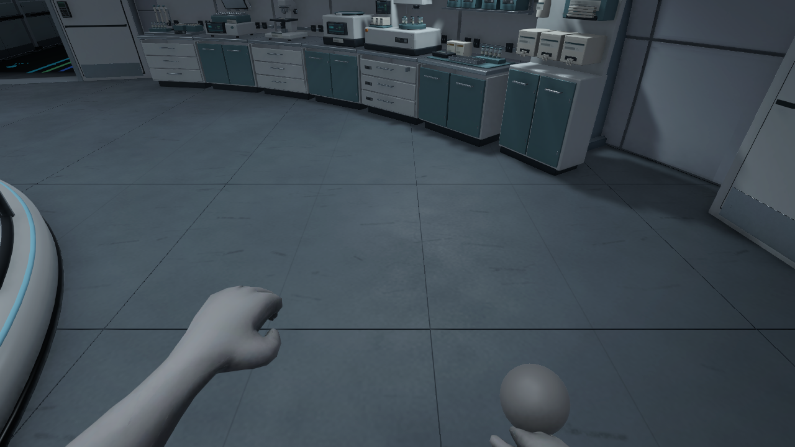
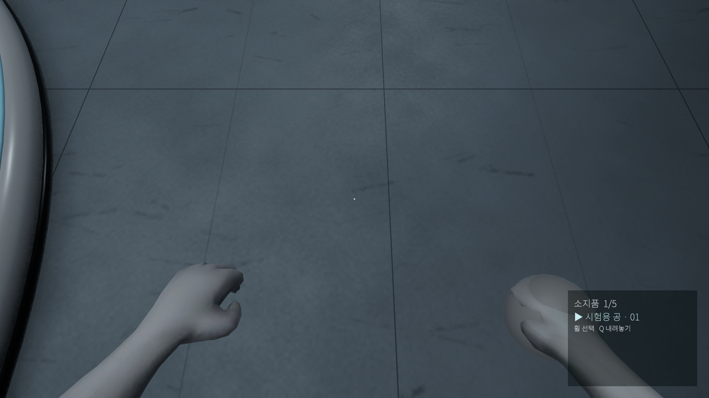
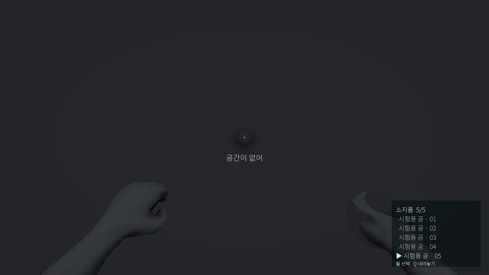

오전에는 손에 보이는 공과 실제로 날아가는 공의 위치를 맞춤\
오후에는 움직임과 조작감을 보완하고 **줍기 → 던지기 → 다시 줍기**까지 연결함

현재 지하 5층에서는 빈손으로 시작함\
앞바닥의 시험용 공을 바라보면 F 안내가 나오고, 주우면 오른손과 소지품 목록에 반영됨


_오늘 마지막 연결 상태. 자동으로 공을 공급하는 대신 실제 바닥의 공을 주워야 함._

## 양손과 아래를 볼 때 보이는 발

처음에는 기존 더미의 팔을 가져와 손과 소지품을 표시함\
이후에는 걷기·달리기 속도에 따라 양손이 반대 박자로 움직이도록 보완함


_오전 연결 전 화면. 손과 소지품의 시작 위치를 볼 수 없었음._

달릴 때는 흔들림이 커지고 조준·확대 중에는 줄어듦\
점프와 착지에는 손이 조금 들리거나 눌리는 반응을 넣음

아래를 보면 다리와 발이 보이도록 기존 본을 공유하는 표시 메시를 추가함\
원본 전신은 그림자를 담당하고 하체는 기존 걷기·달리기·앉기 애니메이션을 따름


_소지품 UI를 연결하기 전의 이동 검수 화면. 발이 실제 걸음 포즈를 따라가는지 확인함._

몸이 카메라 밖에 있을 때 Animator가 본 갱신을 멈추는 문제도 확인함\
`AlwaysAnimate`로 바꿔 화면 아래의 발이 멈춘 자세로 남지 않게 함

## VARCO 동작 연결

위로 던지기는 VARCO의 `throw_baseball`을 현재 리그에 맞춰 반입함\
기존 걷기·달리기 클립의 손목 경로도 화면용 손 동작에 연결함

움직임의 위상은 기존 하체 Animator와 맞추고 화면에 맞게 진폭을 줄임\
물체는 클립이 끝날 때까지 기다리지 않고 버튼을 놓는 프레임에 출발함

아래로 던지기는 별도 VARCO 전용 클립을 가져온 상태는 아님\
낮은 손에서 앞·아래로 밀고 돌아오는 동작을 절차적으로 보완함

현재 손과 의상은 회색 더미를 사용하는 시험 모델임\
물건마다 자연스럽게 쥐는 손가락 자세와 최종 손 외형은 더 다듬어야 함

## 표시선이 닿을 때만 접촉 원 표시

오른손에 든 물체 중심에서 궤적을 시작하게 함\
미리보기와 실제 방출에 같은 시작점·속도·중력·감쇠·고정 물리 간격을 사용함

선이 길고 진하면 화면을 너무 많이 설명하게 됨\
일반 상태에서는 2.5m, 확대에서는 4m까지만 보이고 끝으로 갈수록 흐리게 바꿈


_표시선이 실제 표면까지 닿을 때만 원이 나옴. 피해나 교환 범위를 뜻하는 원은 아님._

선이 중간에서 끊겼는데 먼 바닥에 원만 남으면 연결이 어색했음\
표시 길이 안에서 표면까지 이어질 때만 원을 보여 주고, 닿지 않으면 원도 숨김

눈앞이 비어 있어도 손이나 공이 들어갈 공간은 막혀 있을 수 있음\
눈에서 손까지와 방출 지점을 공의 크기로 검사해 벽 안에서 던지는 것도 막음

## 좌클릭 바로 투척과 아래로 굴리기

E로 자세를 켠 뒤 클릭해야 하는 과정이 번거로웠음\
이제 좌클릭을 누르면 조준하고, 떼면 바로 던지도록 바꿈

R로 위·아래 방식을 바꿀 수 있음\
E는 취소로 남기고, 조준 중 우클릭도 취소로 처리함

아래로 던지기는 처음에 위로 띄우는 느낌이 강했음\
손만 낮추는 것으로는 부족해서 발사 방향·회전·감쇠·마찰과 팔의 후속 동작을 함께 바꿈


_굴림 보수 단계의 방출 화면. 바닥으로 순간이동시키지 않고 손에서 나온 공이 중력과 충돌로 바닥에 닿게 함._

구체 반지름과 수평 속도에 맞춰 전진 회전을 줌\
바닥에 닿은 뒤에는 실제 마찰과 감쇠로 굴러가게 하며, 접촉 후 위치나 속도를 강제로 덮어쓰지 않음

아래 4.5m/s로 진행한 당시 평지 시험에서는 접촉 뒤 약 2.568m 이동하고 약 7회 회전함\
접촉 예측 오차는 약 4.38cm였음

**마감 시점의 설정 에셋은 위 15m/s·아래 10m/s임**\
위의 굴림 거리 측정은 이전 4.5m/s 시험 결과이며 현재 10m/s의 이동 거리로 해석하지 않음

## 같은 물건을 소지하고 다시 꺼내기

오전에는 방출 때 시험용 공 프리팹을 새로 만드는 기반을 검사함\
마지막에는 월드 물건 자체를 보관하고 같은 객체를 다시 꺼내는 방식으로 연결함

```text
F로 획득 가능 여부 확인
→ 같은 월드 객체의 물리를 멈추고 비활성 보관
→ 소지 목록에 추가하고 손에 표시
→ 투척 또는 내려놓기 성공 시 같은 객체 활성화
→ 소지 목록에서 제거
→ 다시 F로 획득
```


_종류 데이터만 복제해 무한 공급하지 않고, 획득한 객체를 다시 방출함._

| 조작 | 현재 동작 |
| --- | --- |
| F | 바라보는 가까운 물건 줍기 |
| 좌클릭 누름 / 해제 | 조준 / 선택 물건 투척 |
| R | 위·아래 투척 전환 |
| Q | 안전한 손 앞에서 내려놓기 |
| 마우스 휠 | 개별 소지품 순환 선택 |

같은 종류도 합치지 않고 최대 5개까지 소지함\
가득 차면 “공간이 없어”를 표시하고 새 물건은 바닥에 남겨 둠


_격리된 검수 공간에서 공을 추가해 확인한 화면. 실제 B5 시작 위치에는 시험용 공 1개를 배치함._

Q로 내려놓기는 투척 명중 이벤트를 발생시키지 않음\
손 앞이 막히면 방출을 거절하고 소지품을 유지함

아래로 던진 공을 다시 주워 위로 던질 때는 원래 물리 설정을 먼저 복원함\
이전 방식의 마찰이나 회전이 다음 투척에 섞이지 않도록 함

마지막 검사에서는 비활성 소지품을 플레이어 Collider로 분류하는 문제를 발견함\
물건끼리 충돌이 무시되지 않도록 수정하고 각각 내려놓은 뒤 다시 확인함

## 확인한 결과와 현재 설정

| 단계별 검사 | 결과 |
| --- | --- |
| 오전 투척 기반 | 동작 36/36, 별도 물리 14/14 |
| 양손·하체 표시 | 40/40 |
| VARCO 동작·당시 R 전환 | 47개 + 20개 통과 |
| 표시선과 접촉 원 | 34/34 |
| 좌클릭 직접 투척 | 34/34 |
| 아래 굴림 보수 | 29/29 |
| 최종 줍기·소지품·재획득 | **36/36** |

각 수치는 해당 단계에서 확인한 범위임\
모든 단계를 현재 설정으로 한 번에 다시 검사했다는 의미로 합산하지 않음

최종 검사는 실제 키보드·마우스 입력과 Rigidbody로 진행함\
동일 객체 재획득, 중복 방지, 5개 한도, 벽·거리 차단, 선택·취소, 실패 시 보존을 포함함

처음 던진 뒤 21초가 지나도 물건이 남아 있는지 확인함\
관련 컴포넌트 428개에서 누락 스크립트와 깨진 참조는 없었고, 마지막 컴파일도 통과함

| 마감 시점 설정 | 값 |
| --- | --- |
| 위 / 아래 초기 속도 | 15m/s / 10m/s |
| 아래 방향 | 시선 대비 -12도, 최종 고도각 -75~-5도 |
| 일반 / 확대 표시선 | 2.5m / 4m |
| 선 불투명도 | 30%, 끝에서 0% |
| 줍기 거리 / 방출 후 재획득 대기 | 2.2m / 0.25초 |
| 소지 한도 | 개별 물건 5개 |

오전 자유 비행 검사는 고정 간격과 감쇠를 나눠 정적 조건에서 진행함\
접촉 후 위치에는 충돌 해결 결과도 섞이므로 자유 비행 오차와 구분해서 기록함

게임 코드 예외는 확인되지 않았음\
에디터 보조 패키지의 로그 파일 잠금 오류와 그림자 아틀라스 안내는 게임 검사 결과와 따로 남김

## 남은 작업

현재 물리 지원 대상은 중심 SphereCollider 하나인 시험용 공임\
실제 소품의 다른 형상과 물건별 쥐기, 전용 손 외형은 다음 작업임

유효 명중 뒤 3초 교환, 경비 AI, 씬을 넘어가는 소지품 유지도 아직 연결하지 않음\
이제 공을 주워 던지고 다시 줍는 흐름을 기준으로 다음 기능을 붙일 수 있는 상태임

[어제의 점프·투척 기반]() · [오늘의 학습 기록]()
