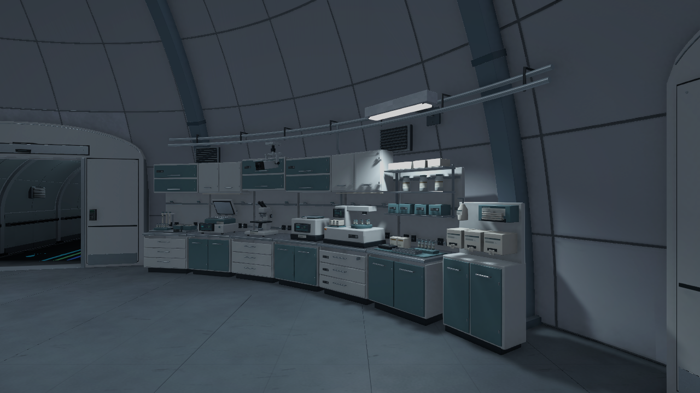
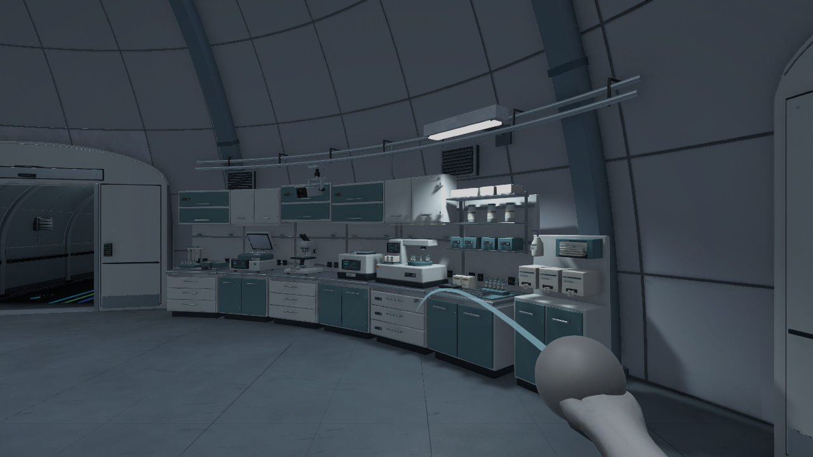
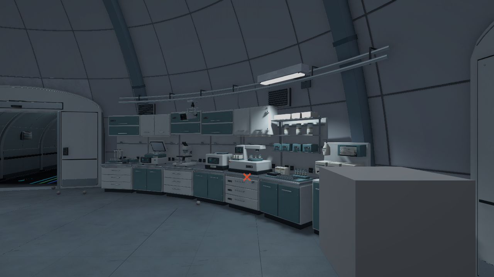

어제 만든 투척 기능에 1인칭 손을 연결하고 궤적과 실제 비행을 비교함\
오늘 오전 작업 기준으로 기록하며 손 외형과 애니메이션은 아직 임시 단계임

## 손이 없는 화면에서 소지품이 보이는 화면으로

기존 더미 캐릭터에서 팔 부분을 가져와 카메라 아래에 별도로 배치함\
원본 전신 모델은 유지하고 팔에 해당하는 2,348개 삼각형을 사용함


_연결 전. 같은 지하 5층 카메라에서 손과 소지품이 보이지 않는 상태임._


_연결 후. 기존 더미 팔로 공을 든 위치와 화면 점유를 확인하는 단계임._

팔은 전신 Animator와 별도로 움직이게 함\
걷기·앉기 같은 하체 동작 위에 새 상체 애니메이션을 덮는 방식은 사용하지 않음

준비·조준·방출 후 복귀를 연결하고 이동 흔들림과 시야 회전에 따른 작은 움직임을 넣음\
확대할 때는 흔들림을 줄임

플레이 중 전신은 그림자를 남기고 화면에서 숨겨 얼굴 안쪽이 보이는 것을 막음\
팔 표시를 끄면 전신의 원래 표시 상태로 돌아가도록 함

## 손의 표시와 실제 물체를 같은 순간에 바꾸기

손에 든 공은 보여 주기 위한 복제 메시이고 Collider를 붙이지 않음\
실제로 날아갈 공은 방출할 때 Rigidbody가 있는 프리팹으로 생성함

왼쪽 클릭을 놓은 프레임에 다음 처리를 같이 함

1. 현재 손에 든 물체의 중심을 구함
2. 시작 위치가 막혔는지 확인함
3. 손의 표시를 숨기고 같은 중심에 물리 물체 하나를 만듦
4. 초기 속도를 넣고 자세·확대를 해제함

애니메이션이 끝날 때까지 물체 생성을 기다리지는 않음\
팔은 방출 이후 짧게 복귀하지만 투척은 입력 순간에 바로 실행함

**유효 명중 이후 3초 뒤에 교환한다는 규칙은 그대로임**\
팔의 복귀 시간과 교환 대기 시간은 관계없고, 교환 예약 기능은 아직 연결하지 않음

## 궤적을 실제 물리와 맞추기

`ThrowFlight`에 투척물의 중력·감쇠·고정 물리 간격을 사용하는 계산을 모음\
미리보기와 실제 생성에 같은 시작 위치와 초기 속도를 사용함

손 위치를 갱신한 뒤 궤적을 계산하도록 순서도 조정함\
손이 움직였는데 선은 이전 위치에 남는 상황을 줄이기 위한 변경임

이번 시험용 공에 사용하는 한 틱의 계산은 아래와 같음

```text
속도 = (이전 속도 + 중력 × 고정 간격)
       × max(0, 1 - 감쇠 × 고정 간격)
위치 = 이전 위치 + 속도 × 고정 간격
```

연속된 곡선 식만 그리는 대신 실제 Rigidbody의 고정 간격 진행과 비교함\
충돌은 공의 반지름을 넣은 SphereCast로 검사함


_아래로 던지기 시험. 선은 끝으로 갈수록 흐려지게 하고 일반 상태에서는 짧게 보여 줌._

| 조절값 | 현재 시험값 |
| --- | --- |
| 위로 던지기 | 12m/s · 8도 |
| 아래로 던지기 | 7m/s · 5도 |
| 일반 / 확대 궤적 길이 | 2.5m / 7m |
| 선 굵기 / 불투명도 | 0.012m / 0.35 |
| 팔 복귀 시간 | 0.24초 |
| 확대 중 움직임 크기 | 일반의 25% |

현재 물리 예측 대상은 **원점 중심의 SphereCollider 하나를 가진 시험용 투척물**임\
다른 형상이나 제약이 있는 물건은 아직 같은 정확도로 지원하지 않으며, 지원하지 않는 프로필은 방출을 거절함

## 가까운 벽과 시작 겹침 처리

궤적의 끝만 검사하면 손이 벽 안에 들어간 채로 물체를 생성할 수 있음\
눈에서 손까지의 공간과 공이 생성될 위치도 함께 확인함

자기 몸의 Collider와 Trigger는 투척 경로에서 제외함\
실제 장애물과 시작부터 겹치면 손의 표시를 숨기고 방출도 막음


_가까운 장애물을 둔 검수 화면. 막힘 표시와 생성 거절을 같이 확인함._

화면 가운데가 비어 있다는 이유만으로 공이 지나갈 수 있다고 처리하지 않음\
좁은 틈은 선이 아니라 공의 크기를 기준으로 확인함

## 실행해서 확인한 결과

지하 5층에서 실제 Play를 진행하며 입력과 동작을 확인함\
PlayerInput에 키보드·마우스 상태를 전달하는 검사와 기능을 직접 호출하는 검사를 함께 사용함

| 검사 | 결과와 범위 |
| --- | --- |
| 동작 검사 | 36/36 통과 |
| 방출 중복 | 방출 7회에 알림 7회, 생성 프레임에 손의 복제본 표시 0회 |
| 손과 생성 중심 | 7회 방출의 최대 차이 0.0000000m |
| 자유 비행 | 고정 간격 3종 × 감쇠 2종, 6/6 통과 |
| 정적 장애물 | 8/8 통과, 첫 충돌 시점 차이 최대 1틱(0.02초) |
| 프로젝트 상태 | 검수 시 컴파일 오류·경고 0, 프리팹 누락 스크립트·필수 팔 참조 누락 0 |

입력은 E 자세 전환, 왼쪽 클릭 조준·방출, R 위·아래 전환, 오른쪽 클릭 확대·취소를 확인함\
취소 후 버튼을 놓기, 이동 중 투척, 앉아서 투척, 점프, 급격한 시야 회전과 컴포넌트 비활성화도 포함함

자유 비행은 고정 간격 0.01·0.02·0.033333초와 감쇠 0·0.5 조합으로 검사함\
각 1초 동안 실제 위치와 예측 위치의 차이가 출력 정밀도에서 0.0000000m였음

장애물은 평지·높은 곳·경사·낮은 천장·가까운 벽·문틀·좁은 창문·통과 가능한 창문으로 나눔\
물리 검사는 고정된 발사 조건과 정적 표적을 둔 별도 물리 씬에서 진행함

충돌 후 위치 차이는 0~0.21544m였음\
충돌 해결과 틱의 남은 이동까지 포함한 위치이므로 **접촉 순간 위치 오차도 0이라는 뜻은 아님**

목표 프레임레이트 30·60·144 설정에서도 단일 방출을 확인함\
다만 144 설정의 측정 구간은 6프레임에 약 0.087초여서 실제 144fps를 유지한 검증은 아님

## 남은 작업

현재 손은 쥐기 중심을 맞춘 임시 본 회전임\
손가락 변형과 물건별 쥐기, 위·아래 투척 전용 준비·유지·방출·복귀 애니메이션을 다듬어야 함

시험용 공 반복 공급과 실제 아이템 소비의 연결 지점은 나눠 둠\
반복 설정을 끄면 성공한 투척에서 선택 참조를 비우지만 인벤토리 전체가 구현된 것은 아님

전신 점프 애니메이션, 교환 예약, 경비 AI는 다음 작업으로 남김\
움직이는 표적의 미래 충돌과 튕긴 뒤 경로, 다른 형상의 투척물도 이번 검증 범위에는 들어가지 않음

원본 모델과 기존 프리팹 참조를 보존하고 검수용 임시 오브젝트는 Play 종료로 정리함\
손 외형을 완성했다고 보기보다, 다음 에셋을 연결하고 비교할 수 있는 동작 기반을 만든 상태임

[어제의 점프·투척 기반]() · [오늘의 학습 기록]()
