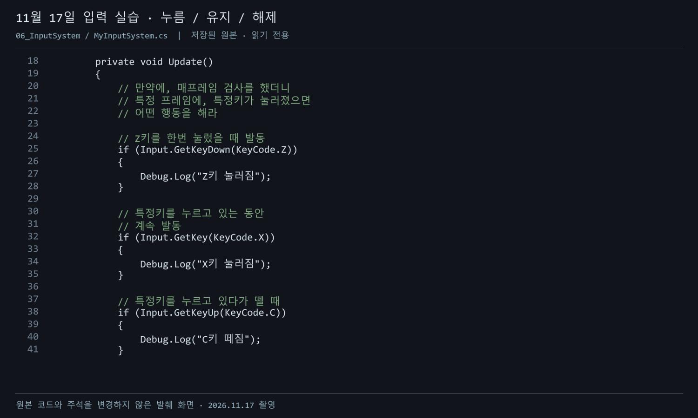
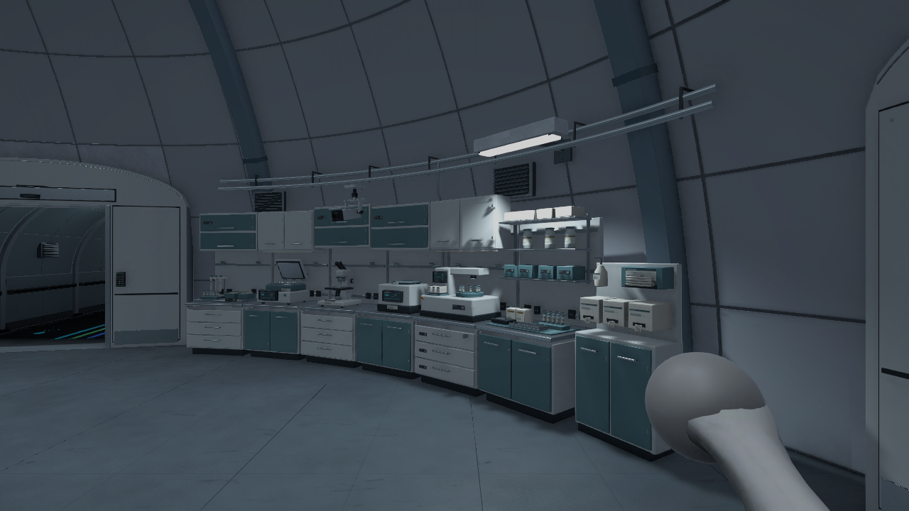

오늘 오전부터 점심 무렵까지 진행한 내용을 먼저 남김\
수업에서는 입력과 이동·시야 회전을 정리했고, 개인 프로젝트에서는 1인칭 손과 투척을 보완함

## 버튼 하나에도 여러 시점이 있음

키를 눌렀다는 말 안에 누른 순간, 누르는 동안, 뗀 순간이 나뉨\
수업에서는 Down·유지·Up 로그로 나눠 보게 됨

After Seconds에서는 왼쪽 클릭을 누르는 동안 조준하고, 떼는 순간 물건이 나감\
조준을 취소했다면 같은 버튼을 떼도 물건이 나가면 안 됨

입력값만 보는 것으로는 부족하고 지금 어떤 행동을 하고 있는지도 같이 봐야 함\
취소한 다음에 놓기까지 확인하는 이유가 여기 있었음

_수업 원본을 읽기 전용 창에서 촬영함. 같은 키 입력이라는 말도 세 시점으로 나눠서 보게 됨._

## 카메라가 보는 곳과 손이 있는 곳

화면 가운데에서 물건을 출발시키면 계산은 단순해 보임\
하지만 손은 화면 오른쪽에 있어서 실제로 보이는 시작점과 맞지 않음

손을 그리는 것만으로 끝나는 문제가 아니었음\
손의 물체 중심, 궤적 시작점, 실제 생성 위치가 같은 기준을 써야 함

_오늘 Play 검수에서 촬영한 임시 손과 시험용 공. 손의 표시와 물리 물체의 출발점을 비교하기 위한 단계임._

벽 가까이에서는 더 잘 드러남\
눈앞은 비어 있어도 손이나 공이 들어갈 공간은 막혀 있을 수 있음

공의 크기까지 포함해서 확인하고 시작부터 겹치면 던지지 않도록 함\
보이는 선 하나도 실제로 날아갈 물체를 기준으로 그려야 한다는 쪽으로 생각을 정리함

## 수업 코드도 화면과 함께 보기

수업의 카메라 회전 코드는 몸의 좌우 회전과 카메라의 위아래 회전을 나눠 놓음\
그렇다고 카메라 위치까지 자동으로 눈높이에 맞는 것은 아니었음

열린 씬에서는 카메라가 플레이어 뒤에 있음\
코드의 의도와 실제 배치를 같이 봐야 지금 만든 화면을 설명할 수 있음

충돌 함수도 마찬가지임\
함수를 작성했는지, 오브젝트에 붙였는지, 실제로 닿아서 로그가 나왔는지는 각각 다른 확인임

## 예쁜 궤적보다 같은 계산부터

선이 자연스럽게 휘어 보여도 실제 Rigidbody가 같은 길로 가는지는 별개임\
중력과 감쇠, 고정 물리 간격을 맞추고 실제 비행과 비교함

충돌 전에는 같은 위치를 따라가는지 볼 수 있었음\
하지만 충돌 뒤의 공 위치는 접촉 후 밀려나거나 움직인 결과까지 포함함

그래서 자유 비행 오차와 첫 충돌 시점, 충돌 뒤 위치 차이를 나눠서 기록함\
하나의 숫자로 전부 정확하다고 적으면 확인하지 않은 부분까지 포함하게 됨

프레임레이트도 목표값을 144로 넣는 것과 실제로 144fps가 나오는 것은 달랐음\
설정값과 측정값을 따로 남기는 습관이 필요함

## 임시로 쓸 수 있는 것과 마무리된 것

기존 더미 모델의 팔을 가져와 손에 공을 들고 던지는 흐름을 연결함\
화면에 팔이 생겨 시작 위치와 방출 시점을 비교하기 쉬워짐

다만 지금 손은 쥐기 포즈와 투척 전용 애니메이션이 부족한 임시 모델임\
동작이 연결된 상태와 외형까지 다듬어진 상태를 구분해서 남겨 둠

다음에는 물건별 쥐기와 위·아래 던지기 동작을 다듬어야 함\
수업의 충돌 실습도 연결 상태와 실제 로그를 함께 확인하며 이어 갈 것

[오늘 수업메모]() · [구현과 검증 수치]()
