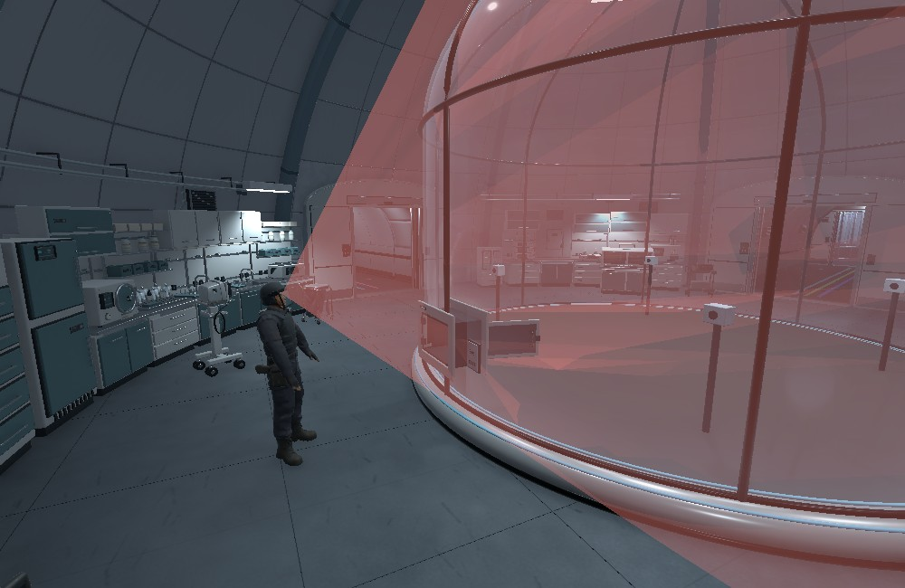
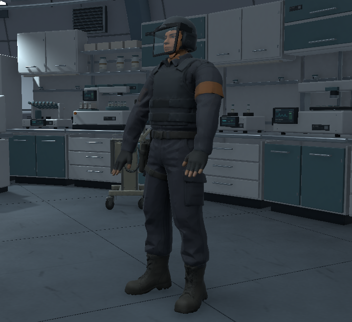
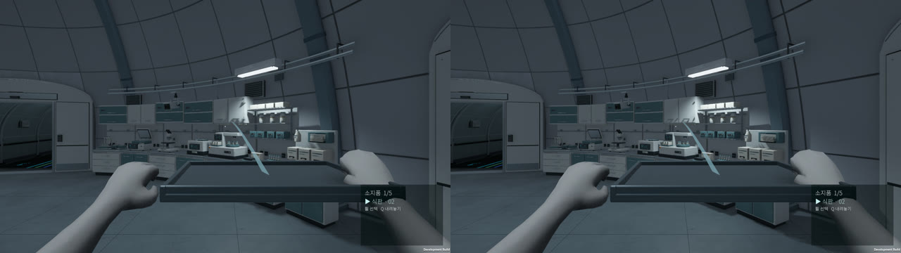

B5에서 식판을 집어 배식구 너머 경비에게 던지고, 자리가 바뀐 뒤 A계단으로 B4에 올라가는 경로를 연결함.\
오늘 검수 기준은 경비 한 명과 B5 → B4 구간임.

## 식판은 통과하고 모서리는 걸리는 배식구

강철 식판에서 바닥과 테두리를 분리해 손으로 들 수 있게 함. 폭 45cm, 깊이 30cm짜리 납작한 물건이라 손 앞 여유와 예상 궤적, 실제 투척 충돌에 같은 상자 형상을 씀. 열린 배식구 중앙으로는 지나가고, 모서리가 프레임에 걸리면 부딪힘.

F로 주운 식판은 던졌다가 다시 집을 수 있음. 휠을 돌리면 식판을 가진 채 맨손도 선택할 수 있음. 맨손을 고르면 조준이 풀리고, 최대 5개인 소지 공간은 그대로 쓸 수 있음.

이동은 `CharacterController`가 담당함. 넓은 복도에서 방향을 바꿀 때 발이 바로 뒤로 튀는 느낌을 줄이려고 출발·재가속 15, 키를 뗄 때 감속 18, 반대 입력 제동 20m/s²를 시험값으로 잡음. 걷기 5m/s에서 정반대로 누르면 약 0.25초에 기존 속도가 0이 된 뒤 반대쪽으로 가속함.

## 명중 시각과 교환 좌표를 나눔

식판이 경비에게 실제로 맞으면 그 시각부터 게임 시간 3초를 셈. 예약에는 대상을 기억해 두고, 시간이 찼을 때 플레이어와 경비의 현재 발 위치를 다시 읽음. 양쪽 바닥과 몸이 들어갈 공간이 모두 확보되면 두 사람을 함께 옮김.

식판이 맞은 뒤 경비가 약 2.42m 더 걸어간 경우에도 실행 순간의 위치로 교환됐음. 경비의 이전 순찰 경로는 비우고 새 위치에서 다시 판단하게 함.

<video controls playsinline preload="none" width="960" style="max-width:100%;height:auto" poster="{{ '/assets/img/uploads/2026-11-18-b5-swap-pulse.jpg' | relative_url }}" aria-label="식판 명중 뒤 세 번의 박자와 위치 교환">
  <source src="{{ '/assets/video/2026-11-18-b5-swap-pulse.mp4' | relative_url }}" type="video/mp4">
</video>

[소리와 함께 보는 B5 교환 영상 · 4.2초]({{ '/assets/video/2026-11-18-b5-swap-pulse.mp4' | relative_url }})

명중 후 1초와 2초에 예고가 울리고, 3초에 교환이 성립하면 마지막 박자가 울림. VARCO Sound 데스크톱 앱에서 만든 심장·북 소리의 첫 타격을 0.62초로 잘라 씀. 예약을 취소하면 남은 박자도 멈춤.

화면 가장자리의 옅은 물결은 한 박자에 0.58초 동안 안쪽으로 번짐. 카메라 상하 흔들림은 세 박자에서 각각 최대 0.16°, 0.22°, 0.29°로 측정됨. 매번 0.20초 안에 원래 각도로 돌아왔고, 이 재생에서 투척 조준 방향과 카메라 화각 변화는 모두 0°였음.

## 경비의 눈에서 시작하는 시야와 두 게이지

경비가 고개를 돌리면 눈에서 시작하는 입체 콘도 같이 돌아감. 시야각 90°, 최대 15m 안에서 머리와 몸통이 보이는지 검사함. 배식 포드의 유리를 통해서는 플레이어를 볼 수 있고, 옆의 금속 프레임이 두 부위를 가리면 노출이 끊김.

_경비를 옆에서 본 검수 화면. 콘의 꼭짓점이 얼굴에 붙어 있어 경비가 어디를 보는지 읽을 수 있음._

| 플레이어가 한 행동 | 경비의 반응 |
| --- | --- |
| 머리와 몸통을 모두 드러냄 | 노란 게이지가 서서 2.2초, 웅크려서 3.5초에 참. 한 부위만 보이면 두 배 걸림 |
| 노란 게이지가 차기 전에 완전히 숨음 | 쌓인 경계가 줄어듦 |
| 노란 게이지가 가득 참 | 빨간 게이지와 추격음으로 바뀌고 경비가 따라옴 |
| 추격 중 모퉁이 뒤로 숨음 | 마지막 목격 지점으로 향해 수색함. 6게임초 안에 다시 보이면 즉시 추격하고, 끝까지 놓치면 배식구 순찰로 복귀함 |

대기·걷기·달리기 클립의 발 기준도 맞춤. 이전에는 애니메이션이 시작되면 경비 신발이 바닥 아래로 약 1.41m 들어갔음. 붙잡기 예고 중에는 거리를 벌리거나 유리를 사이에 두면 벗어날 수 있고, 붙잡힌 뒤 Enter로 다시 시작하면 경비와 식판이 초기 위치에 돌아옴.

## 계단을 건널 때 무엇을 가져갈지

`GameRoot`는 플레이어·카메라·HUD·로딩 화면을 유지함. 경비와 순찰 경로, 바닥에 있는 물건은 층 씬에 둠. 식판을 주우면 공통 씬으로 옮기고, 던지거나 내려놓으면 현재 층의 물건이 됨.

A계단으로 B4에 도착한 뒤 같은 식판을 다시 던질 수 있었음. B5의 경비와 바닥에 남긴 공은 B5와 함께 정리됨. B4 도착 자리를 막아 놓은 시험에서는 플레이어와 식판이 B5에 남았고, 장애물을 치운 뒤 다시 올라갈 수 있었음.

## 가장 긴 멈춤이 나온 구간

RTX 3070 · Direct3D 12 · 1920×1080 Windows 개발 빌드에서 같은 동선을 수정 전후 각 두 번 측정함. 계단 아래에서 B4를 미리 읽고, 도착을 확정할 때 층의 루트 오브젝트를 켜도록 바꿈.

| 측정 구간 | 수정 전 | 수정 후 |
| --- | ---: | ---: |
| 경비 교환 전후 6프레임 중 최장, 1회 / 2회 | 16.34 / 103.32ms | 9.36 / 10.09ms |
| 계단참에 닿은 뒤 조작 복귀, 1회 / 2회 | 824 / 840ms | 30 / 38ms |
| 계단 아래 접근 후 2초 중 최장 프레임 | 12.13~14.28ms | 20.24~20.49ms |

선로딩으로 계단참에서 기다리는 시간은 줄었고, 일부 비용이 계단 아래로 옮겨감. 접근 구간을 건너뛰어 곧장 계단참에 도착한 별도 시험에서는 조작 복귀에 777ms가 걸림. 다음에 다시 볼 곳은 계단에 접근할 때의 긴 한 프레임임.

_왼쪽이 수정 전, 오른쪽이 수정 후. 광원 328개를 유지하고 실시간 그림자를 그리는 광원을 115개에서 16개로 줄임._

고정된 B5 시작 시점에서 드로우 콜이 8,555회에서 2,263회로 줄었음. T11·T19 복도는 구간별로 3단계 LOD를 적용함. T19 한 구간을 따로 측정해 6m·36m·80m에서 차례대로 근거리·중거리·원거리 메시가 그려지는 것도 확인함.

[같은 플레이를 조작하는 입장에서 적은 데일리 로그]()
