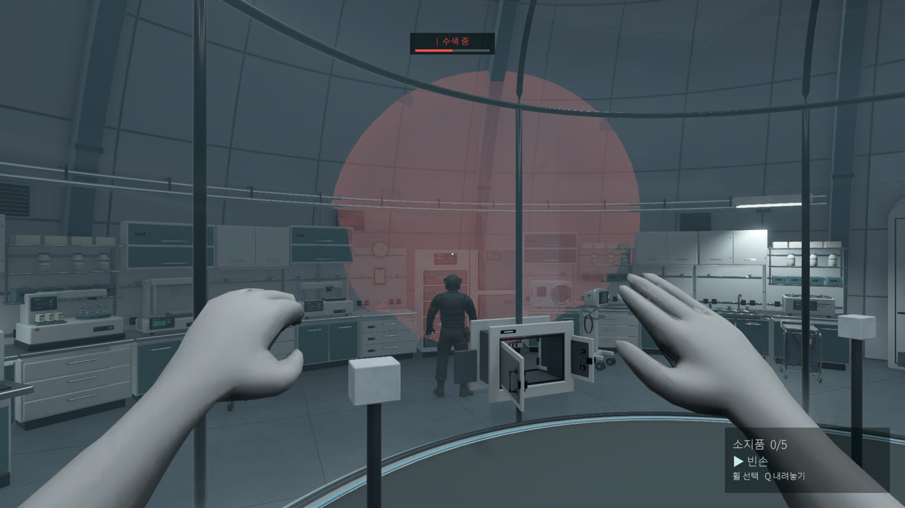
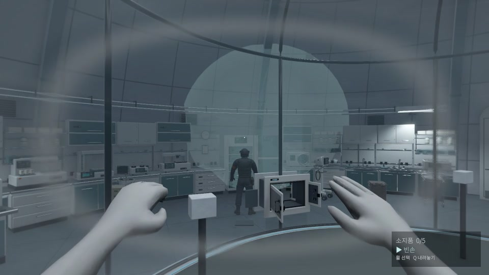

배식구 너머로 식판을 던져 경비에게 맞힘. 그 뒤에도 나는 걸을 수 있고 경비도 계속 움직임.\
오늘 가장 신경 쓴 건 자리가 바뀌기까지 기다리는 그 3초였음.

## 식판이 맞은 뒤에도 두 사람은 움직임

처음 내가 확인하고 싶었던 건 “던지고 나서 옆으로 비키면 경비는 어디에 나타나지?”였음.\
경비가 식판을 맞고 약 2.42m 더 걸어간 시험 기록을 봄. 3초가 끝난 순간 내가 서 있던 곳에 경비가 오고, 나는 그때 경비가 서 있던 곳으로 감.

이 규칙이면 식판이 손을 떠난 뒤에도 할 일이 생김. 한 걸음 더 나가거나 엄폐물 옆으로 붙는 것도 교환 결과를 바꾸는 선택임.

## 경비가 나를 놓친 순간

모퉁이 뒤로 숨었을 때 경비 얼굴은 안 보이는데, 경비가 아직 나를 찾고 있는지는 알고 싶었음.\
노란색이 차는 동안에는 몸을 숨길 여지가 있음. 빨간색까지 간 뒤에는 벽을 돌아도 경비가 마지막으로 나를 본 자리까지 따라옴.

_시야가 끊긴 뒤의 빨간 게이지. 이때 다시 눈에 띄면 곧바로 추격이 이어짐._

게이지가 남은 시간을 보여 주니까, 여기서 기다릴지 한 번 더 이동할지 판단할 근거가 생김. 노란 경계음과 빨간 추격음도 구분해 두니 식판을 조준하느라 화면 위를 못 볼 때 쓸 단서가 하나 더 있음.

## 소리는 묵직하게, 시선은 조금만

심장과 북을 겹친 소리에 맞춰 화면 가장자리에 뿌연 물결을 넣음. 첫 박자는 약하게, 실제로 자리가 바뀌는 마지막 박자는 가장 크게 잡음.\
카메라는 마지막에도 0.29도 정도만 위아래로 떨림. 박자가 지나면 원래 각도로 돌아와서, 다음에 던질 곳을 계속 보고 있을 수 있음.

_두 번째 박자를 지난 장면. 소리까지 들으면 앞선 두 번과 자리가 바뀌는 마지막 한 번을 구별하기 쉬움._

오늘 같은 동선을 따라가 보니 “화면이 한번 멎었다”는 느낌에도 시점이 둘 있었음. 식판 때문에 위치가 바뀌는 순간과, 계단참에서 다음 층 조작이 돌아오는 순간임. 둘을 나눠 재고 나서야 어느 쪽을 먼저 고칠지 정할 수 있었음.

[오늘의 구현 기록과 4.2초 플레이 영상]()
