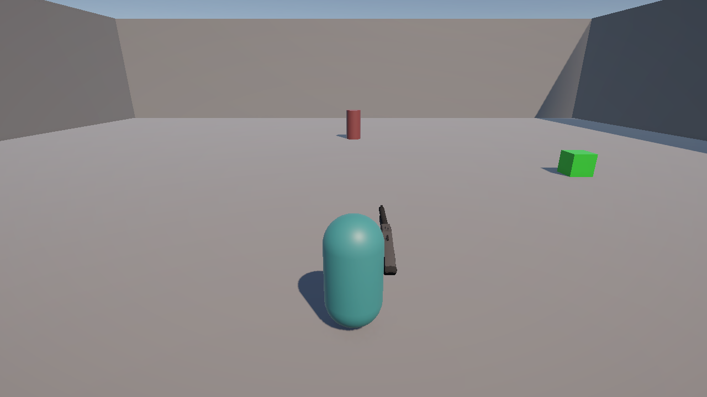
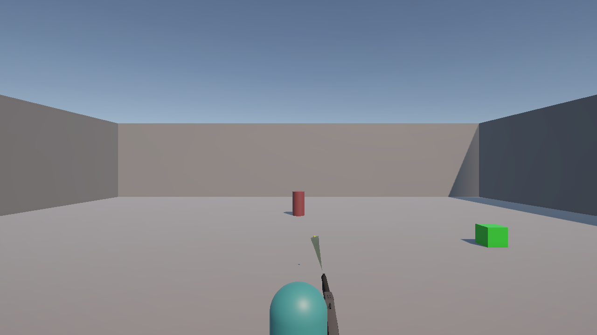
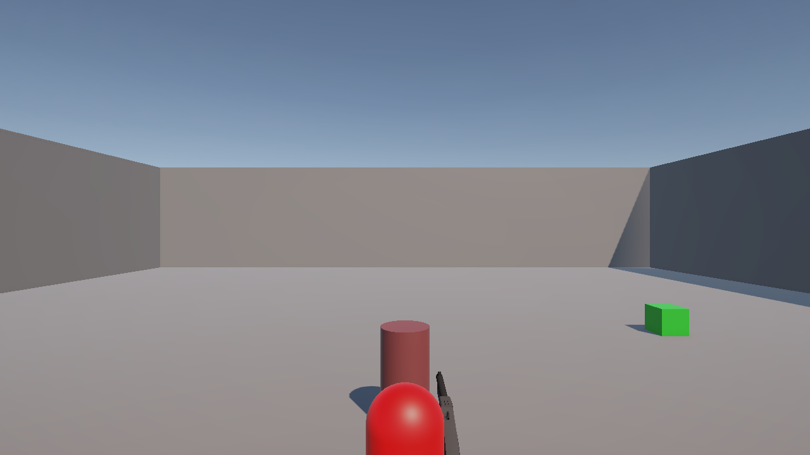
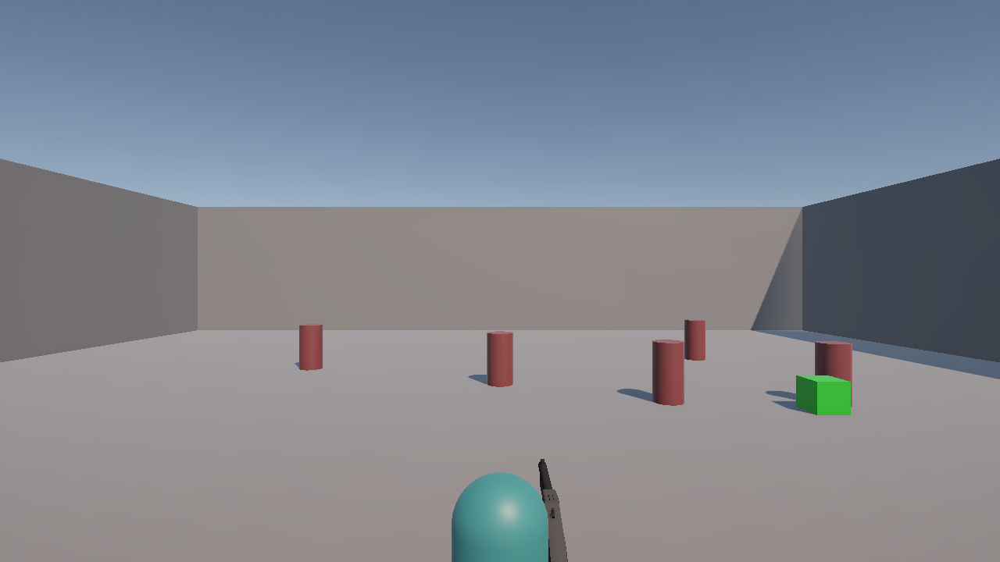

오늘은 `261119_NCAI_UnityGame`에서 캡슐 캐릭터가 움직이고, 총알을 발사하고, 적이 가까워지면 피해를 받는 것까지 연결해 봄.


_스폰 기능을 붙이기 전의 시작 배치. 청록색 캡슐이 플레이어, 맞은편 붉은 원기둥이 적임._

## 옆으로만 걸었는데 시선이 왜 돌아가지?

WASD 입력은 캐릭터가 바라보는 방향을 기준으로 받음. `transform.forward`와 `transform.right`로 방향을 구하고, 대각선에서도 같은 속도로 움직이도록 정규화함. Rigidbody 속도를 쓸 때 Y는 기존 값을 가져와야 점프 중에도 상승·하강 속도가 이어짐.

마우스 좌우 입력은 플레이어 몸을 Y축으로 돌리고, 상하 입력은 자식 카메라의 X축에만 적용함. 그런데 마우스를 가만히 둔 채 옆으로 걸어도 시선이 돌아갔음. 점프하고 착지할 때는 몸이 기울기도 함.

| 겪은 현상 | 확인한 설정 |
| --- | --- |
| X·Z 회전을 잠갔는데도 착지할 때 기울어짐 | 오른쪽 앞에 붙은 총의 Box Collider까지 한 Rigidbody로 계산됨. `Automatic Tensor`를 끄고 `Inertia Tensor Rotation`을 0°로 맞춰서, 열어 둔 Y 회전축을 몸의 수직축과 맞춤. |
| A/D만 눌러도 몸과 카메라가 같이 돌아감 | 총 쪽으로 무게중심이 치우쳐 있어서 발밑의 마찰이 몸을 돌릴 수 있음. `Automatic Center Of Mass`를 끄고 로컬 중심을 `(0, 0, 0)`으로 맞춤. |

처음에는 총과 플레이어의 충돌 레이어부터 봤는데, 레이어에서 둘의 충돌을 꺼도 자식 콜라이더는 부모 Rigidbody의 무게중심 계산에 들어감. 같은 콜라이더 배치로 비교했을 때, 오른쪽으로 1초 이동하는 동안 약 21° 돌아가던 몸이 중심을 맞춘 뒤에는 0°였음. 총 콜라이더를 켜고 Y 회전을 열어 둔 상태에서 확인한 값임.

## 적이 원점 근처에서 멈춘 이유

처음에는 `GameManager.Start()`에서 플레이어를 초기화하고, `EnemyManager`를 통해 씬에 배치한 적에게 플레이어 참조를 넘김. 이때는 적이 `Init(player)`를 받으면 추적 코루틴을 시작하는 구조였음. 플레이어 쪽 방향을 구하는 데까지는 맞았는데, 처음에는 적이 다가오지 않았음.

```csharp
Vector3 direction = (player.transform.position - transform.position).normalized;
transform.position += direction * moveSpeed * Time.deltaTime;
```

여기서 한참 차이를 만든 게 `+=`의 더하기 기호 하나였음. 적은 Z가 10인 위치에서 출발함. 이번 프레임에 Z 방향으로 `-0.05`만큼 움직인다고 하면, `=`를 썼을 때는 Z가 곧바로 `-0.05`가 됨. `+=`를 쓰면 Z가 `9.95`가 되고 다음 프레임에는 거기서 한 걸음 더 감.

## 총알이 지나간 자리에 선 남기기

왼쪽 클릭을 받으면 `Gun.Attack()`이 총구의 `ShootPosition` 위치와 회전으로 총알 프리팹을 생성함. 총알은 `OnEnable()`에서 앞쪽으로 한 번 힘을 받음.

처음 붙인 `Line Renderer`에는 두 점이 `(0, 0, 0)`, `(0, 0, 1)`로 들어 있었고 `Use World Space`가 켜져 있었음. 총알이 움직여도 두 점은 월드 원점 근처에 그대로 있었던 이유임. 이번에 표현하려던 건 총알이 지나간 경로라서 최종 프리팹에는 `Trail Renderer`를 사용함.


_발사 직후 한 프레임. 총구 앞 작은 노란 점이 총알이고, 그 뒤로 이동 경로가 이어짐._

## 피격 처리는 같은 함수로 받기

플레이어와 적 모두 `IDamageable`의 `TakeDamage(float damage)`를 구현함. 총알은 트리거에 닿은 오브젝트에서 이 인터페이스를 찾고, 있으면 피해 10을 전달한 뒤 사라짐. 체력이 줄었을 때 무엇을 보여줄지는 맞은 쪽에서 처리함.

적은 플레이어와 거리가 3유닛 미만이면 추적을 멈추고 피해 10을 줌. 공격한 뒤에는 코루틴에서 2초를 기다림. 플레이어는 맞는 순간 빨갛게 변하고 0.2초 뒤 원래 색으로 돌아감.


_두 오브젝트 중심 사이 거리가 약 2.99유닛인 순간. 화면 아래 플레이어 색이 바뀐 걸로 근접 공격이 들어온 시점을 확인함._

체력 쪽에는 다음에 볼 부분이 하나 남음. 적은 `hp <= 0f`일 때 제거되는데 플레이어의 사망 로그는 `hp < 0f`일 때 찍힘. 지금처럼 체력 100에서 10씩 받으면 정확히 0이 되는 열 번째 공격에서 두 조건의 차이가 드러남.

## 스폰 지점은 다섯 개인데 적이 한 마리도 안 나옴

후반 실습에서는 씬에 적을 미리 놓는 대신, `EnemyManager` 아래에 빈 오브젝트 다섯 개를 두고 각각 `SpawnPoint`를 붙임. `SpawnPoint`는 위치와 회전을 표시하고, 프리팹을 생성하는 일은 매니저가 맡음.

처음에는 `GetComponentInChildren<SpawnPoint[]>()`라고 씀. 이러면 Unity가 배열 자체를 컴포넌트로 찾으려다가 예외가 남. 원하는 건 자식 여러 개에 붙어 있는 `SpawnPoint`라서, 복수형 함수에 컴포넌트 하나의 타입을 넘겨야 함.

```csharp
spawnPointArray = GetComponentsInChildren<SpawnPoint>();
```

이걸 고치고 나니 지점은 5개가 잡혔는데도 적은 0마리였음. 두 번째 원인은 `Init()`에서 `CoSpawnEnemies(player);`만 호출한 것. 이 호출은 `IEnumerator`를 돌려주고, Unity에 실행을 맡기는 줄이 따로 필요함.

```csharp
StartCoroutine(CoSpawnEnemies(player));
```

코루틴은 첫 적을 바로 생성하고, 생성할 때마다 `WaitForSeconds(1f)`로 기다림. 지점은 매번 `Random.Range(0, spawnPointArray.Length)`로 다시 뽑아서 같은 장소가 두 번 선택될 수도 있음.

여기서 초기화 시점도 다시 봄. `private GameObject enemyPrefab;`과 끝에 `= null`을 붙인 선언은 참조 필드의 기본값이 같음. 이번 프리팹 참조는 인스펙터에 연결했고, 스폰 지점은 `Awake()`에서 미리 찾아 저장함. 첫 스폰 요청이 들어왔을 때 비어 있는 값을 채워서 재사용하는 식으로 짜면 그게 게으른 초기화임.

## 다섯 마리를 유지하려면 누가 살아 있는지 알아야 함

`spawnPointArray.Length`는 **생성할 수 있는 장소 수**, `enemyList.Count`는 **생성해서 관리 중인 적 수**임. 이번에는 둘 다 5라서 헷갈리기 쉬웠음.

`enemyList.Count < 5`만 써 두고 목록에 추가하는 줄을 빠뜨리면, 오브젝트가 몇 마리 생겨도 목록의 개수는 계속 0임. 생성 직후에 `enemyList.Add(enemyComponent)`를 하고, 죽었다는 알림을 받으면 그 적을 `Remove`해야 한 자리가 빔.


_실행 약 4.3초 뒤. 화면에 보이는 적도 5마리, 매니저 목록에 들어 있는 적도 5마리였음._

## 적이 죽었다는 소식을 점수까지 전달하기

`GameManager`가 `enemyManager.Init(player, AddScore)`를 호출할 때 `AddScore` 뒤에는 괄호가 없음. 지금 점수를 더하는 호출은 `AddScore(10)`이고, 여기서는 나중에 호출할 메서드를 건네는 것임. 이때 사용한 델리게이트 타입이 `Action<int>`임.

| 알림을 보내는 쪽 | 받는 쪽에 필요한 값 | 호출 |
| --- | --- | --- |
| `Enemy.Die()` | 매니저가 목록에서 지울 적과 이번 처치 점수 | `onEnemyDie?.Invoke(this, score)` |
| `EnemyManager.OnEnemyDie()` | 게임 매니저가 더할 점수 | `onEnemyDie?.Invoke(score)` |

두 필드 이름이 모두 `onEnemyDie`라서 매니저 쪽에서도 `Invoke(enemy, score)`로 썼다가 오류가 났음. 적이 보관하는 쪽은 `Action<Enemy, int>`, 매니저가 보관하는 쪽은 `Action<int>`임. 매니저에서 적을 목록에서 지우고 나면, 총점을 관리하는 쪽에는 정수 하나만 전달하면 됨.

플레이 모드에서 생성된 적 한 마리에 `TakeDamage(100f)`를 호출해 확인함. 사망 처리 직후 목록은 5마리에서 4마리로 줄고 누적 점수는 0에서 10이 됨. 다음 적이 생성되자 목록은 다시 5마리, 점수는 그대로 10이었음.

**100점 클리어 판정은 다음에 볼 부분.** `AddScore(int score)`의 `this.score`는 누적 점수이고 `score`는 이번에 받은 점수임. 지금은 `this.score += score`로 합산한 뒤 `if (score >= 100)`을 검사해서, 10점짜리 적을 열 마리 잡아도 조건에 들어가지 않음. 누적 점수로 판정하려면 `if (this.score >= 100)`을 써야 함. 수업 종료 시점의 `Cleargame()` 본문은 비어 있음.
