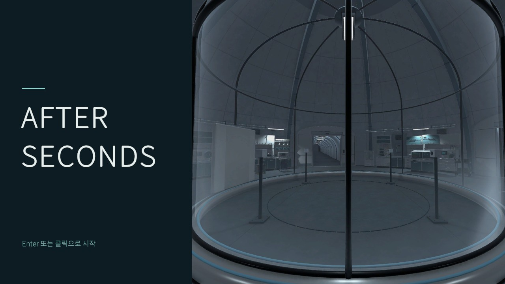
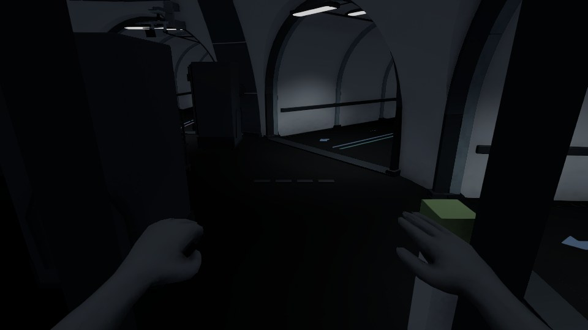
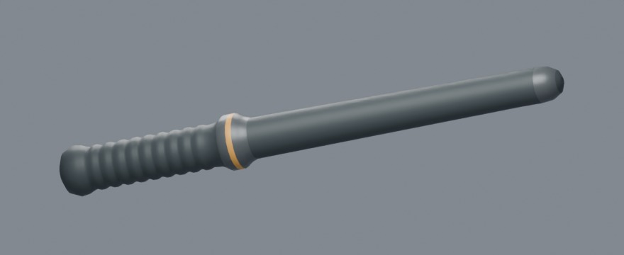
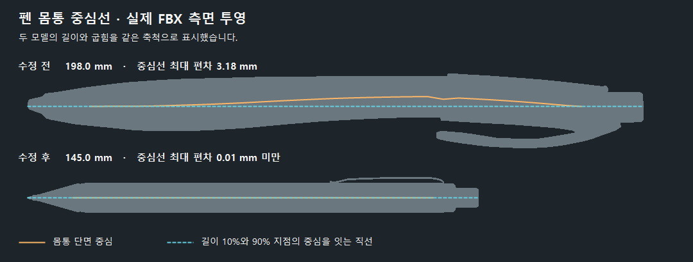
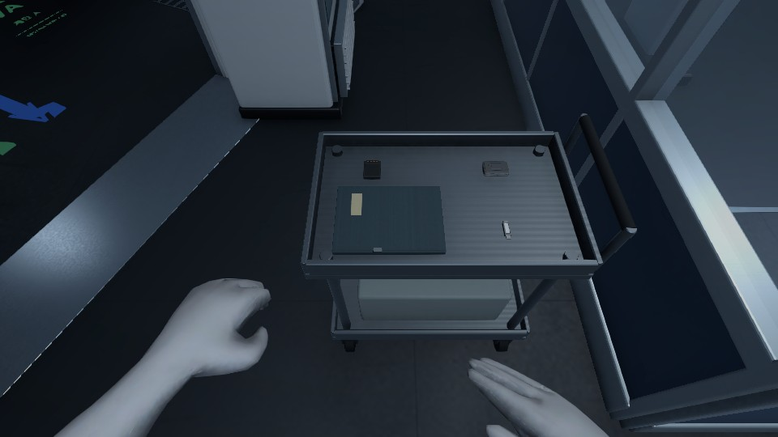
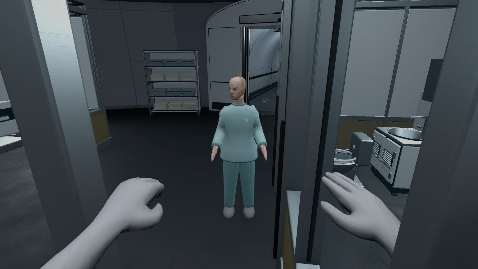

B5에서 계단을 올라가면 다음 층 계단이 바로 보였음. 이대로라면 연구소에서 탈출하는 게임인데 정작 연구소 안에 들어갈 이유가 적었음. 오늘은 **층 안에서 한 가지 일을 마치면 두 계단과 화물 승강기가 함께 열리는 구조**로 연결함.

## 지하 5층에서 지상까지

시작 화면에서 Enter나 클릭을 누르면 로딩을 거쳐 B5 관찰 포드로 들어감. 인트로 영상을 넣을 자리도 만들었고, 현재는 포드 정지 화면에서 시작함. 층을 옮기거나 재시도할 때도 같은 로딩 화면을 씀.

| 층 | 올라가기 전에 하는 일 |
| --- | --- |
| B5 격리층 | 보안관제실로 들어가 격리 해제 레버를 당김 |
| B4 진단층 | 몸을 낮춰 청색 광학선 아래를 통과함. 서서 건드리면 소리가 남 |
| B3 저온 보관층 | 제염 분사 구역에서 2.8초를 채움. 도중에 나오면 다시 시작함 |
| B2 설비층 | 펌프가 돌아가고 녹색 등이 켜질 때 점검로를 건넘 |
| B1 기록층 | 인계표를 읽고 맞은편 단말에서 승인함 |

화물 승강기는 F로 호출하고, 탄 뒤 안쪽 상행 버튼을 누름. 칸이 오를 때 균형추는 내려가고 로프와 도르래도 따라 움직임. 위층에 도착하면 상행이 다시 잠기므로 칸 안에서 버튼만 연달아 눌러 층을 건너뛸 수 없음.

계단과 승강기를 번갈아 이용해 지상 폐공장까지 진행함. 현재 HP와 손에 든 물건이 다음 층까지 이어졌음. 도착할 자리를 시험용 장애물로 막아 보니 아래층 승강기 문이 다시 열렸고, 장애물을 치운 뒤 같은 버튼으로 올라갈 수 있었음.

## 경비가 교대할 때 무엇을 건네는지

지하 각 층에서 두 경비가 거점 감시와 복도 순찰을 나눠 맡음. 둘이 인계점까지 걸어와 만나면 경로와 함께 **호출기와 손전등**을 바꿔 듦. 개인 권총은 각자 계속 갖고 있으므로 제압해서 주우면 그 경비가 쓰고 남긴 발수가 그대로임.

쓰러진 동료를 벽 뒤에 놓았을 때는 신고가 없었음. 동료가 보이자 신고가 들어가 예비 경비 한 명이 나왔고, 이어 플레이어를 직접 식별하자 두 번째 경비가 합류함. 물건이 부딪히는 소리를 들으면 그쪽을 살피러 감.

B5 격리 지원 경비의 보조 장비로 진압봉도 추가함. 제압하면 권총과 따로 떨어져서 원하는 쪽을 F로 주울 수 있음. 진압봉을 주워 던지고 바닥에 떨어진 진압봉을 조준해 맞히자 3초 뒤 그 자리로 이동했음. 현재 진압봉으로 가능한 동작은 줍기·투척·위치 교환까지임.

## 명중한 순간과 자리가 바뀌는 순간

경비는 맞은 순간 쓰러지고 총을 놓침. 그 뒤에도 플레이어는 움직일 수 있음. 1초와 2초에 심장과 북을 겹친 소리가 나고, 화면 가장자리에 흰 안개가 차올랐다 걷힘. 세 번째 박자가 오면 그때의 플레이어와 경비 위치를 맞바꿈. 떨어뜨린 총은 원래 바닥에 남음.

<video controls playsinline preload="none" width="960" style="max-width:100%;height:auto" poster="{{ '/assets/img/uploads/2026-11-19-swap-heartbeat.jpg' | relative_url }}" aria-label="B5 경비가 쓰러지고 세 번째 박자에 위치가 바뀌는 플레이 영상">
  <source src="{{ '/assets/video/2026-11-19-swap-heartbeat.mp4' | relative_url }}" type="video/mp4">
</video>

[B5 교환 장면 · 소리 포함 4.27초]({{ '/assets/video/2026-11-19-swap-heartbeat.mp4' | relative_url }})

시야각이 박자마다 약 2.5°, 3.1°, 3.6° 줄었다가 원래대로 돌아옴. 영상은 실제 플레이 프레임에 게임에서 측정한 타이밍과 음량대로 박동음을 맞춘 기록임.

플레이어와 경비는 같은 피해 인터페이스를 쓰고 각자 HP를 가짐. 현재 시험값은 플레이어 3, 일반 경비 1임. 발각된 뒤 경비가 조준하는 동안 엄폐하면 사격이 취소되고 그 총의 잔탄도 보존됐음. 빈 권총은 그대로 던지거나 다시 주울 수 있음.

## 집을 수 있는 물건과 방에 머무는 사람

기존 식판에 더해 아이템 모델 34종을 Unity로 가져왔고, 진압봉까지 더해 현재 목록은 36종임. 펜은 옆에서 확대하니 몸통이 휘어 있었음. Blender에서 고친 뒤 몸통 단면 중심의 최대 편차가 3.18mm에서 0.01mm 미만으로 줄었음.

B5 관제동 카트에는 서류철·USB·데이터 샤드·호출기를 놓음. 카트는 방에 남는 장식이고, 위의 물건은 각각 주워 손에 들고 던질 수 있음. 문서 열람이나 단말 사용은 다음 작업임.

B5 생활·격리 구역과 B4 진단·회복 구역에는 비전투 실험체를 한 명씩 배치함. 키와 환자복, 서 있는 자세가 다르고 가까이서 물건이 부딪히면 고개를 돌림. B5 격리실 문턱에서 플레이어 눈높이로 본 모습임.

Unity 6000.4.0f1 Play 모드에서 B5 아이템·제압 67개, 교대·증원·장비 25개, B5부터 지상까지 층 진행과 실험체 반응 58개 항목을 각각 통과함. 구역 사이 이동을 단축한 검수이며, 다음에 한 번에 걸어 보면서 확인할 건 경비가 길을 비우는 시간과 층별 대기 시간임. 진압봉 근접 동작과 실험체 개별 대사·능력도 남아 있음.

[오늘의 데일리로그에서 장비와 배치 기준 돌아보기]()
