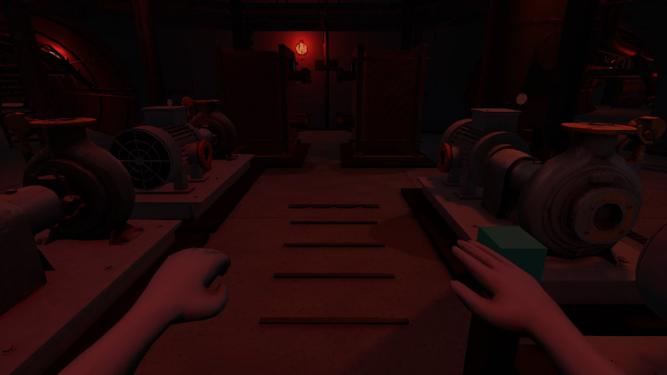
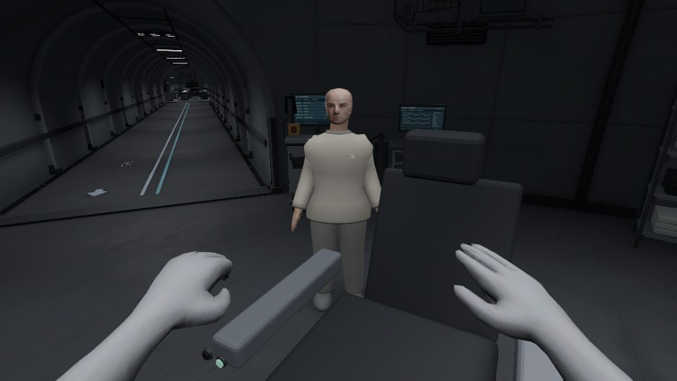

처음 든 생각은 “경비마다 권총이 100% 떨어지면 너무 뻔하지 않나?”였음. 드롭 테이블에 다른 물건도 섞을까 고민함. 그런데 경비가 내 앞에서 한 발을 쓰고 쓰러졌다면, 바닥에서 주운 그 총에는 몇 발이 남아 있어야 할까?

## 손전등을 따라가 봄

복도를 돌던 경비가 거점 경비와 만나 손전등을 건넴. 교대가 끝난 뒤에는 방금 손전등을 받은 사람이 복도로 나감. 각자 차고 온 권총은 그대로임. 이제 어느 쪽이 손전등을 떨어뜨릴지 내가 보고 기억할 수 있음.

이렇게 생각하니 권총을 늘 얻을 수 있어도 매번 같은 보상은 아님. 나한테 이미 한 발을 쓴 경비라면 그만큼 적게 남은 총을 줍게 됨. 멀리서 누가 뭘 들고 다니는지 봐 둔 것도 쓸모가 있음. B5 지원 경비의 진압봉 역시 허리에 보이던 바로 그 물건을 회수하는 식으로 정함.

## 계단이 보이는데도 펌프 소리를 듣는 이유

층에 도착하자마자 다음 계단이 보이면 나부터 그쪽으로 바로 갈 것 같았음. 그래서 오늘은 층마다 잠깐 멈춰서 살펴볼 이유를 하나씩 둠. 그중 기억에 남는 곳이 B2 점검로였음.

_펌프 가까이에서는 작동음에 발소리가 묻힘. 녹색 표시등이 켜지는 때가 건널 타이밍임._

B3에서는 분사가 끝날 때까지 제자리에 머물러야 하고, B2에서는 펌프가 돌기 시작할 때 내가 움직여야 함. 둘 다 잠깐 기다리는 구간인데 소리를 들은 다음에 할 일은 다름. 층마다 다른 긴장감을 주고 싶다는 말이 여기서는 꽤 구체적으로 보였음.

## 회복실에서 고개를 돌리는 사람

B4 회복 의자 옆에 다른 실험체를 세워 두고 플레이어 눈높이에서 봄. 근처에 물건이 떨어지자 그쪽으로 잠깐 고개를 돌림. 경비는 같은 소리를 들으면 자리에서 벗어나 조사하고, 이 사람은 그 자리에 서서 바라봄.

플레이어 말고도 여기서 검사를 받고 기다리는 사람이 있다는 걸 보여 주고 싶었음. 다음에 직접 걸어 볼 때는 처음 온 사람도 이 인물을 경비와 구분할 수 있는지, 어느 거리에서 고개를 돌리는 동작이 읽히는지 보고 싶음.

[층별 잠입 동선, 경비 교대와 3초 교환 플레이 영상]()
