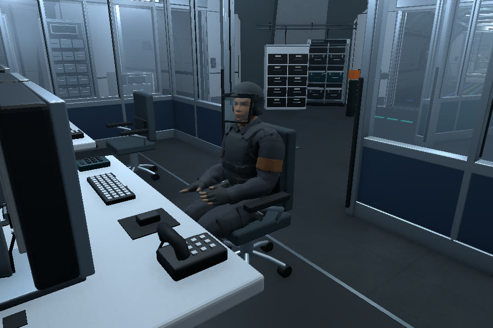
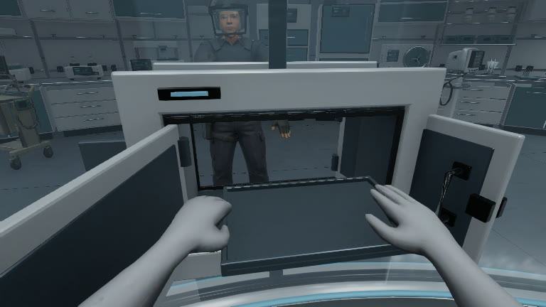
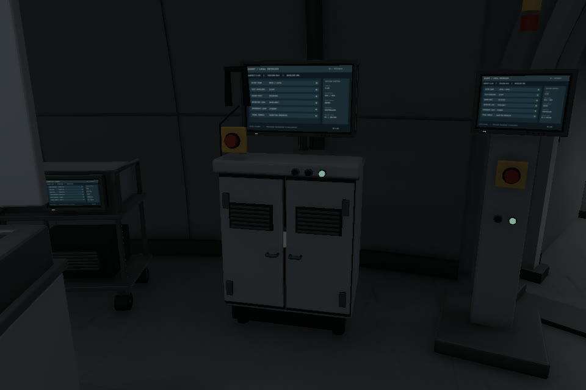

B5에서 시작하니 경비들이 전부 유리 돔 쪽으로 오는 것처럼 보였음. 배식을 마친 동료를 확인하러 오는 경비는 한 명이면 되는데, 평시 순찰까지 그쪽을 지나면 첫 장면의 의미가 달라짐. 오늘은 **각 근무조가 어느 복도를 끝까지 확인하고 어디로 돌아오는지**부터 다시 잡음.

## 한 돔에 두 명, 복도를 다 돌면 역할 교대

지하 다섯 층의 63개 돔에 2인 1조 근무를 적용함. A가 복도 한쪽을 따라 반대편 문턱까지 가고, U자로 돌아 반대쪽을 살피며 자기 돔으로 복귀함. 연결된 복도가 여러 개면 전부 마쳐야 한 바퀴임.

그동안 B는 돔을 지킴. A가 돌아오면 B가 같은 복도를 돌고 A가 돔을 맡음. **A → B가 한 사이클이고, 두 사이클이면 두 사람 모두 복도를 두 바퀴씩** 돈 셈임. 다음 조는 가까운 계단에서 출발함. 네 번째 복귀 예상 시각에서 계단부터 인계점까지 걸리는 시간을 빼서 출발을 맞춤. B1 근무조는 B2에서 올라옴. 새 조가 일찍 도착해도 실제로 만나야 인계됨.

돔 안에서도 행동을 달리함. B5 관제석처럼 앉아서 출입구를 볼 수 있는 곳은 기존 의자를 씀. 설비 때문에 한눈에 보기 어려운 곳은 안쪽을 걸으며 확인함. 복도에서 소리를 듣고 조사하러 간 경우에는 아직 확인하지 못한 통로부터 이어서 돎.

## 유리 포드 안에서 시작하는 첫 교환

B5는 포드 안에서 배식구를 바라보며 시작함. 경비가 식판을 내밀면 두 손으로 밀어내고, 식판이 몸에 닿는 순간 경비가 쓰러짐. 3초 뒤 자리가 바뀌면 플레이어는 바깥에서 유리 안에 남은 경비를 보게 됨. 복도에 나갔던 같은 조 경비가 배식구로 돌아오면서 잠입이 이어짐.

교환할 때는 두 몸이 상대 위치에 들어갈 공간을 먼저 검사함. 공중에서도 공간이 충분하면 그 자리로 가고, 계단 모서리에 몸이 겹치면 가까운 착지 위치를 찾음. 경비는 맞은 부위에 따라 머리·몸통·팔다리가 먼저 반응하고 무릎이 꺾인 뒤 바닥에 닿도록 보수함.

## 누가 보고 누구에게 알리는지

B5 T01의 CCTV는 C02 관제석에 연결함. 관제 담당자가 무전을 보내기 전에 자리를 비우면 대기 중인 보고도 끊김. W03 연구원은 플레이어를 식별하고 도주를 시작하는 순간 신고를 예약함. 30초 뒤 시설 경보가 올라가고, 중간에 층을 옮겨도 남은 시간이 이어짐. B4 진단실 진입로의 카메라는 N01 근무자가 확인함. C02 경비 단말에서는 설비 점검을 요청할 수 있게 함.

층을 옮길 때는 상행 조건을 충족한 시점부터 다음 층을 미리 읽도록 조정함. 화면은 로딩 끝에 암전을 거쳐 플레이 장면으로 밝아짐.

## 화면 밖에서 들킬 때

일반 플레이에서는 눈앞에 보이던 시야 콘을 끔. 순찰 중에는 고개가 다음 코너를 먼저 향하게 하고, 실제로 플레이어를 보기 시작하면 경비 머리 위에 노란 게이지를 띄움. 화면 밖 경비는 방향에 맞춰 노란 호로 표시함. 식별을 마치면 빨간 느낌표가 뜨고, 엄폐하면 화면 위에 수색 게이지만 남음.

B5 플레이 모드에서 HUD·경고음 연결 21개와 시야 차폐·복수 경비·고개 회전 9개 항목을 확인함. 한 경비가 벽 너머를 수색할 때 다른 경비가 나를 보기 시작하면 새로 들키는 방향이 먼저 표시됐음. 임시 클립으로 카메라를 돌렸을 때 경고음이 반복되지 않는 것까지 확인함.

다음 작업은 바르코 사운드에서 의심음과 발각음을 만드는 것임. `GameRoot > CommonUI > GuardAlert`의 `Notice Sound`와 `Spotted Sound` 슬롯은 비워 둠.

[오른쪽 뒤 의심 표시와 엄폐 후 수색 화면 비교]()
