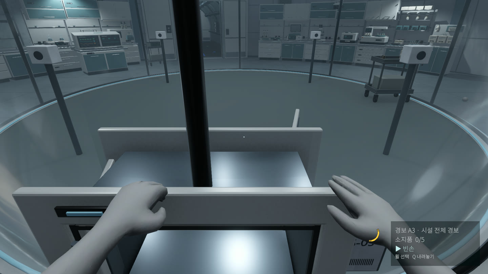
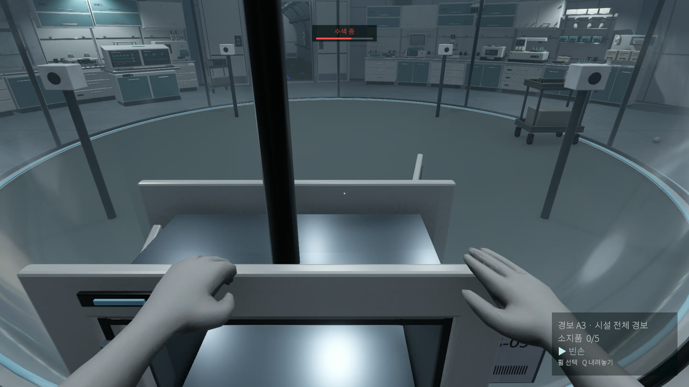

복도에서 경비를 보고 있으면 고개만 봐도 언제 지나가야 할지 감이 옴. 그런데 문을 열려고 등을 돌리는 순간에는? 나를 보기 시작한 경비를 확인하겠다고 매번 뒤를 돌아야 한다면, 앞에 있는 문도 제대로 살피기 어려울 것 같았음.

## 고개를 숙여도 등 뒤는 등 뒤

처음에는 경비 머리 위에 붙인 게이지를 화면 끝까지 밀어내면 될 줄 알았음. 앞에 있을 때는 그게 맞는데, 경비가 카메라 뒤에 있으면 고개를 숙이는 것만으로도 표시가 엉뚱한 쪽으로 갈 수 있었음.

그래서 정후방은 화면 아래, 오른쪽 뒤는 오른쪽 아래로 잡음. 발밑을 보는 중에도 그대로임. 노란 호가 조금 찼을 때는 엄폐할 여유가 있고, 빨간 느낌표가 뜨면 이미 추격이 시작된 상태임.

_오른쪽 뒤에서 의심받는 상태를 고정해 찍은 B5 검수 화면. 처음에는 호 끝이 오른쪽 아래 소지품 안내에 걸려서 대각선 표시를 조금 안쪽으로 옮김._

## 숨은 다음엔 뭐가 궁금하지?

벽을 돌아 시야를 끊었는데도 같은 호가 경비를 따라다니면, 벽 너머에서 어느 쪽으로 걷는지까지 알 수 있음. 이때 내가 궁금한 건 지금 나가도 되는지였음. 방향 표시를 지우고 화면 위에 남은 수색 게이지만 두기로 함.

_같은 시점에서 수색 상태만 바꿔 본 화면. 경비가 어느 쪽에 있는지는 표시가 알려 주지 않음._

다음에 들어 볼 건 첫 의심음과 발각음임. 뒤를 보지 않고 소리만 들었을 때도 ‘아직 숨을 수 있음’과 ‘이제 뛰어야 함’이 구별되는지 확인해 보고 싶음.

[오늘의 돔 순찰·교대와 경비 HUD 구현 기록]()
